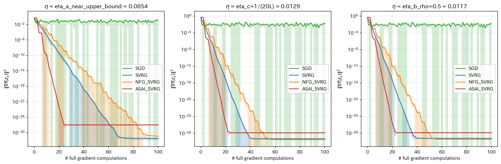
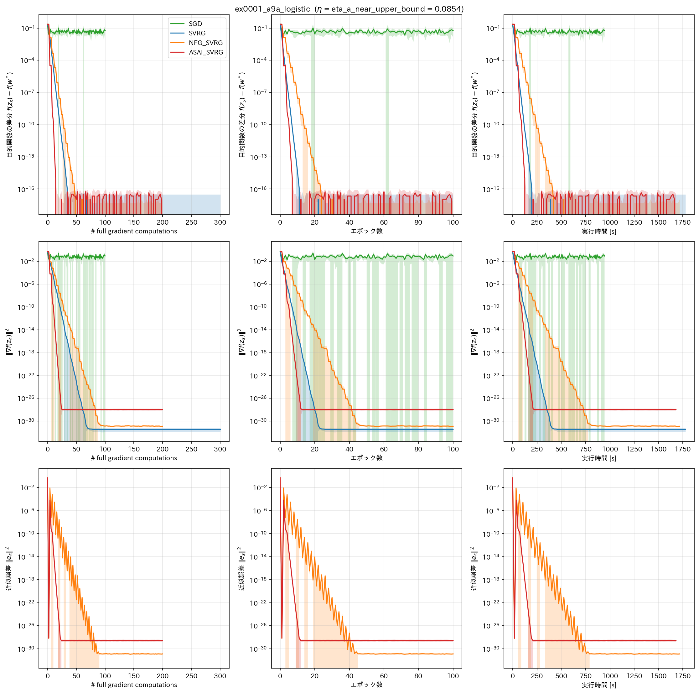
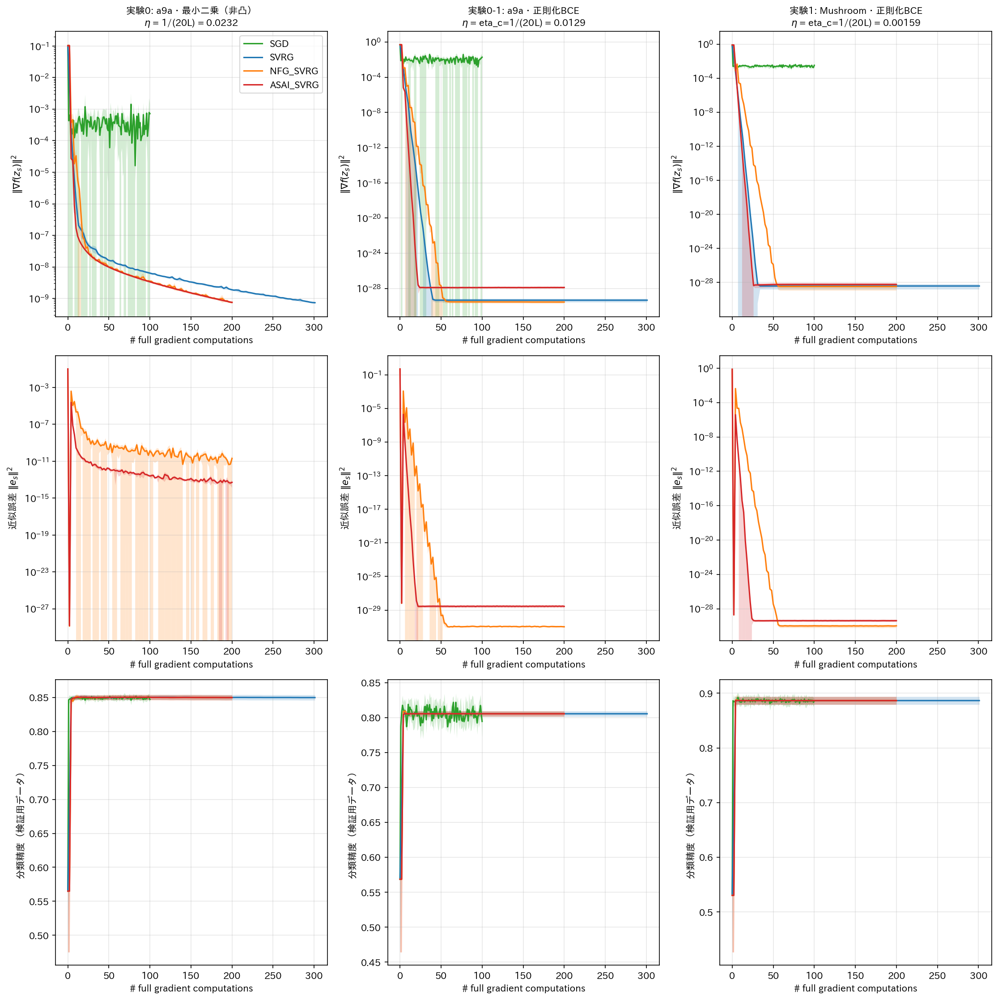

# report_041

`.orders/order_041.md` に対応する実験0-1（`ex0001_a9a_logistic`）の実施記録である．

## 1. 目的

実験0（`ex000_a9a_least_squares`，`.reports/report_020.md`）は，NFG SVRG原論文（`references/No_Full_Grad_SVRG.pdf`）付録A.1と同一の条件，すなわち切片なしの線形結合にシグモイド関数を適用した出力を二乗誤差で評価する非凸の目的関数（正則化なし）で実施した．一方，実験1（`ex001_mushroom_logistic`，`.reports/report_021.md`）は，切片付きの線形結合とL2正則化付き二値交差エントロピー（Binary Cross Entropy，BCE）損失による強凸の目的関数で実施した．実験0-1は，データ条件を実験0と同一に保ったまま，誤差関数・モデル・学習率の決定規則を実験1と揃えた実験である．これにより，実験0と実験0-1の差異は目的関数のみに，実験0-1と実験1の差異はデータセットとその前処理のみに帰着する．

## 2. データセットとモデル

### 2.1 データセット

実験0と同一のa9a（LIBSVM Data，UCI Adultの二値分類向け前処理版）を用いる．全データ数 $ N=32561 $，特徴量次元数 $ d=123 $（One-Hotエンコード済みの0/1特徴量），ラベルは $ \{-1,+1\} $ を $ \{0,1\} $ に写像した．Seedを `random_state` とする9:1の層化分割により，学習用 $ N_{\text{train}}=29304 $，検証用 $ N_{\text{test}}=3257 $ とした．特徴量は実験0と同様に標準化せず0/1のまま用いる（実験1の標準化はMushroomの順序符号化に対する前処理であるため適用しない）．検証用データの多数派クラスの割合は0.759である．

### 2.2 モデルと目的関数

実験1と同一の，切片付きの線形結合にシグモイド関数を適用したモデルとL2正則化付きBCE損失を用いる（`programs/ex0001_a9a_logistic/model.py`）．

$$
f(w, b) = \frac{1}{N}\sum_{n=1}^{N} \ell_{BCE}\bigl(y_n, \sigma(w^\top x_n + b)\bigr) + \frac{\lambda}{2}\bigl(\|w\|^2 + b^2\bigr)
$$

ここで $ w \in \mathbb{R}^{123} $ が重み，$ b \in \mathbb{R} $ が切片，$ \sigma $ がシグモイド関数，$ \lambda $ がL2正則化係数である．正則化を切片にも課すため，全パラメータについて $ \mu=\lambda $ の強凸性が成立する．パラメータは倍精度で保持する．

## 3. 平滑性定数・正則化係数・学習率

実験1と同一の規則で決定した（`programs/ex0001_a9a_logistic/train.py`）．a9aは各レコードで14個の成分が1となるため $ \max_i\|[x_i;1]\|^2 = 15 $ である．

| 量 | 規則 | 値 |
| :--- | :--- | ---: |
| $ L_0 $ | $ \frac14\max_i\|[x_i;1]\|^2 $ | 3.75 |
| $ \lambda = \mu $ | $ 0.03 L_0 $ | 0.1125 |
| $ L $ | $ L_0 + \lambda $ | 3.8625 |
| 条件数 $ \mu/L $ | | 0.0291（実験1と同一） |
| $ K $ | $ N_{\text{train}} $ | 29304 |
| $ \eta_a $ | $ 0.99/(3L) $ | $ 8.544\times10^{-2} $（$ \rho=297.4 $） |
| $ \eta_b $ | $ \rho(\eta)=0.5 $ の大きい方の解 | $ 1.169\times10^{-2} $（$ \rho=0.500 $） |
| $ \eta_c $ | $ 1/(20L) $ | $ 1.294\times10^{-2} $（$ \rho=0.557 $） |

$ K $ が実験1（$ K=7311 $）より大きいため，収縮係数 $ \rho(\eta) $ の最小値は約0.21まで下がり，$ \rho=0.5 $ を満たす $ \eta_b $ が存在する．実験1と比較すると，学習率の値は $ L $ が約1/8倍（実験1は $ L\approx31.4 $）であるため約8倍大きい．

## 4. 実験条件

| 項目 | 値 |
| :--- | :--- |
| 比較手法 | SGD，SVRG（`SVRGFinalPoint`），NFG SVRG（`NFGSVRGFinalPoint`），ASAI SVRG（`ASAISVRG`） |
| バッチサイズ | 1（ランダムリシャッフル，1エポックで学習用データを1巡） |
| エポック数（外部ループ数） | 100 |
| Seed | 0〜4 |
| 条件数 | 4手法 × 3学習率 × 5Seed = 60条件 |
| 評価指標 | $ f(z_s)-f(w^*) $，$ \|\nabla f(z_s)\|^2 $，近似誤差 $ \|e_s\|^2 $，検証用データの分類精度 |
| 実行環境 | CPU，`.venv_pytorch`，32プロセス並列（物理コア数相当，1プロセスあたりRAM約0.5GB） |

$ f(w^*) $ はL-BFGS-Bで求めた（Seed 0で $ f(w^*)=0.4740 $）．並列数は，並列数1で1エポックを実行したパイロット（RAM最大約0.5GB，約14秒/エポック）に基づき，train.pyの既定値（物理コア数相当）のままとした．60条件は全て正常に完了した（所要時間約1時間）．

## 5. 結果

### 5.1 収束の様子



図1はフル勾配の計算回数（オラクル呼び出し回数を $ N_{\text{train}} $ で割った値）に対する $ \|\nabla f(z_s)\|^2 $（5Seedの平均と標準偏差）である．3つの学習率の全てで，SVRG系3手法は $ \|\nabla f\|^2 $ が対数軸上でほぼ直線的に減少し，$ 10^{-28} $〜$ 10^{-31} $ の機械精度の水準に到達した．SGDは $ 10^{-2} $ 前後で停滞した．

表1は $ \|\nabla f(z_s)\|^2 $ が初めてしきい値を下回るまでのフル勾配の計算回数（5Seedの平均±標準偏差）である．実験1の値も併記する．

| 学習率 | 手法 | 実験0-1: $ <10^{-10} $ | 実験0-1: $ <10^{-20} $ | 実験1: $ <10^{-10} $ | 実験1: $ <10^{-20} $ |
| :--- | :--- | ---: | ---: | ---: | ---: |
| $ \eta_a $ | SVRG | 23.2±1.5 | 44.8±1.5 | 16.6±1.2 | 31.6±2.2 |
| $ \eta_a $ | NFG SVRG | 28.0±0.0 | 56.8±3.0 | 20.8±1.6 | 40.0±2.5 |
| $ \eta_a $ | ASAI SVRG | **11.2±1.0** | **18.0±0.0** | **10.0±0.0** | **18.0±0.0** |
| $ \eta_b $ | SVRG | 13.6±1.2 | 27.4±1.2 | 11.8±1.5 | 20.8±1.5 |
| $ \eta_b $ | NFG SVRG | 17.6±2.0 | 35.2±1.6 | 22.0±0.0 | 44.4±0.8 |
| $ \eta_b $ | ASAI SVRG | **10.0±0.0** | **17.2±1.0** | **11.2±1.0** | **19.6±0.8** |
| $ \eta_c $ | SVRG | 13.6±1.2 | 27.4±1.2 | 13.0±0.0 | 22.6±1.2 |
| $ \eta_c $ | NFG SVRG | 19.2±1.6 | 35.2±1.6 | 20.0±0.0 | 40.0±0.0 |
| $ \eta_c $ | ASAI SVRG | **10.0±0.0** | **17.2±1.0** | **10.4±0.8** | **18.8±1.0** |

全ての学習率で，フル勾配の計算回数あたりの収束はASAI SVRG，SVRG，NFG SVRGの順に速い．ASAI SVRGは $ 10^{-20} $ への到達に約17〜18回を要し，SVRG（27〜45回）の約0.4〜0.6倍，NFG SVRG（35〜57回）の約0.3〜0.5倍であった．この順序は実験1と一致する．

### 5.2 3つの横軸 × 3つの評価指標



図2は $ \eta_a $ における比較である（$ \eta_b $，$ \eta_c $ は `comparison_all_axes_eta1.168868e-02.png`，`comparison_all_axes_eta1.294498e-02.png`）．横軸をエポック数・実行時間とした場合でも順序は変わらず，ASAI SVRGは約10エポック・約200秒，SVRGは約20エポック・約400秒，NFG SVRGは約45エポック・約800秒で機械精度の水準に到達した．近似誤差 $ \|e_s\|^2 $（3行目）はASAI SVRGがNFG SVRGより速く減少した．NFG SVRGの近似誤差はエポックごとに鋸歯状に振動した．ASAI SVRGの $ \|\nabla f\|^2 $ と $ \|e_s\|^2 $ はSVRG・NFG SVRGより1〜2桁高い水準（$ \|\nabla f\|^2\approx10^{-28} $）で頭打ちとなったが，$ f(z_s)-f(w^*) $ は3手法とも $ 10^{-17} $ 以下（倍精度の丸め誤差の水準）であり，実用上の差ではない．実験1でも同様の頭打ちの差が観察されている．

### 5.3 最終エポックの評価指標

`outputs/ex0001_a9a_logistic/final_epoch_summary.md` より抜粋する（5Seedの平均±標準偏差）．

| 学習率 | 手法 | $ f(z_s)-f(w^*) $ | 精度 | $ \|\nabla f(z_s)\|^2 $ | 実行時間[s] |
| :--- | :--- | ---: | ---: | ---: | ---: |
| $ \eta_a $ | SGD | 6.01e-02 ± 4.59e-02 | 0.7910 ± 0.0284 | 8.99e-02 | 944.9 |
| $ \eta_a $ | SVRG | $ \approx 0 $ | 0.8053 ± 0.0038 | 3.52e-32 | 1778.9 |
| $ \eta_a $ | NFG SVRG | $ \approx 0 $ | 0.8053 ± 0.0038 | 1.26e-31 | 1717.9 |
| $ \eta_a $ | ASAI SVRG | $ \approx 0 $ | 0.8053 ± 0.0038 | 1.07e-28 | 1679.7 |
| $ \eta_b $ | SGD | 8.35e-03 ± 5.38e-03 | 0.7951 ± 0.0221 | 1.65e-02 | 937.8 |
| $ \eta_c $ | SGD | 9.45e-03 ± 6.28e-03 | 0.7944 ± 0.0231 | 1.87e-02 | 951.8 |

$ \eta_b $，$ \eta_c $ のSVRG系3手法も $ \eta_a $ と同じく最適解に到達し，精度は0.8053で一致した．

### 5.4 実験0・実験0-1・実験1の比較



図3は，3実験に共通する学習率の規則 $ \eta=1/(20L) $ で比較したものである（1行目 $ \|\nabla f\|^2 $，2行目近似誤差，3行目分類精度）．

## 6. 考察

### 6.1 目的関数を強凸に変えると，a9aでも線形収束が得られる

実験0（非凸の最小二乗損失）では，SVRG系手法の $ \|\nabla f\|^2 $ は300回のフル勾配計算後も $ 10^{-9} $ 程度までしか減少せず，減少は緩やかであった（図3左上）．同じa9aのデータで目的関数をL2正則化付きBCEに変えた実験0-1では，約20〜60回のフル勾配計算で機械精度の水準に到達した（図3中央上）．したがって，実験0で観察された遅い収束はデータセットではなく目的関数（非凸性，強凸性の欠如）に起因する．実験0の $ \eta_a=1/(3L) $ で観察されたNFG SVRG・ASAI SVRGの不安定化（`report_020.md`）も，実験0-1では $ \rho $ の理論値が297と大きい $ \eta_a $ においてすら生じなかった．

### 6.2 手法間の順序は実験1と一致し，データセットに依存しない

実験0-1と実験1は，データセットとその前処理以外の条件（目的関数，正則化の比率，条件数，学習率の規則）が同一である．両実験で，フル勾配の計算回数あたりの収束の速さはASAI SVRG > SVRG > NFG SVRGの順であり，ASAI SVRGの到達回数（$ 10^{-20} $ まで約17〜20回）はデータセットにほとんど依存しなかった（表1）．近似誤差 $ \|e_s\|^2 $ がASAI SVRGでNFG SVRGより速く減少する現象（ASAI SVRG論文の定理2に対応）も，a9aで再現された．一方，SVRGとNFG SVRGの到達回数は $ \eta_a $ においてa9aの方が実験1より約1.4倍多く，上界近傍の学習率ではこれらの手法がデータセットの影響を受けやすい．

### 6.3 正則化係数 $ \lambda = 0.03L_0 $ はa9aに対して強い

実験0-1の最適解の検証精度は0.8053であり，実験0のSVRG（約0.85，図3左下）より約4.5ポイント低く，多数派クラスの割合（0.759）に近い．最適値 $ f(w^*)=0.474 $ も大きい．$ \lambda $ は $ L_0 $ に対する比率で決めており，無加工の0/1特徴量で $ L_0=3.75 $ となるa9aでは $ \lambda=0.1125 $ となる．これは実験1（標準化により $ L_0 $ が大きく，$ \lambda $ もそれに比例する）とは特徴量のスケールが異なるため，モデルに対する正則化の相対的な強さが異なると考えられる．本実験の目的は最適化手法の収束の比較であり，同一の目的関数に対する比較の妥当性は損なわれないが，分類精度を実験0と比較する場合にはこの点に注意が必要である．SGDの精度（約0.79）は最適解より低く，Seed間の分散も大きい．これは定数の学習率のSGDが最適解の周辺で振動し続けるためである．

### 6.4 実行時間

1エポックあたりの実行時間は，SGD約9.5秒，SVRG系約17秒であった（32プロセス並列時）．実験1（Mushroom，$ N_{\text{train}}=7311 $，SGD約2.7秒，SVRG系約4.8〜5.1秒）の約3.5倍であり，$ N_{\text{train}} $ の比（約4.0倍）よりやや小さい．バッチサイズ1では1回の勾配計算の固定費（自動微分の呼び出し等）が支配的であり，次元数の差（123と22）の影響は小さいと考えられる．

## 7. 未解決の論点・今後の検討候補

- 正則化の比率 $ \lambda = 0.03L_0 $ はa9aでは分類精度を約4.5ポイント下げている（6.3節）．精度も実験0と比較したい場合，$ \lambda $ を小さくした条件（例えば比率 $ 10^{-3} $）を追加する必要がある．ただし，条件数 $ \mu/L $ が小さくなると $ \rho=0.5 $ を満たす $ \eta_b $ が存在しなくなる可能性があるため，事前に $ \rho $ の最小値を確認する必要がある（未検証）．
- 実験1で行った特徴量の標準化をa9aにも適用した条件は実施していない．前処理の影響を分離するには，標準化したa9aでの追加実験が候補となる．
- 正則化なし（$ \lambda=0 $，凸だが強凸でないBCE）の条件は実施していない．実験0の非凸性と，強凸性の有無のどちらが遅い収束の主因かを切り分けるには，この条件が必要である．
- ASAI SVRGの $ \|\nabla f\|^2 $ が他手法より1〜2桁高い水準で頭打ちとなる現象（5.2節）は，平均パラメータの計算における丸め誤差の蓄積と推測されるが，検証していない．

## 8. 実行コマンド

```bash
# 学習（60条件，完了済みの条件はスキップ）
.venv_pytorch/bin/python programs/ex0001_a9a_logistic/train.py
# 単体テスト
.venv_pytorch/bin/python -m pytest tests/test_ex0001_a9a_logistic.py -v
# 可視化（「実験0-1専用の可視化」セクションが outputs/ex0001_a9a_logistic/ に図を保存）
.venv_pytorch/bin/jupyter nbconvert --to notebook --execute --inplace visualize_result.ipynb
```
