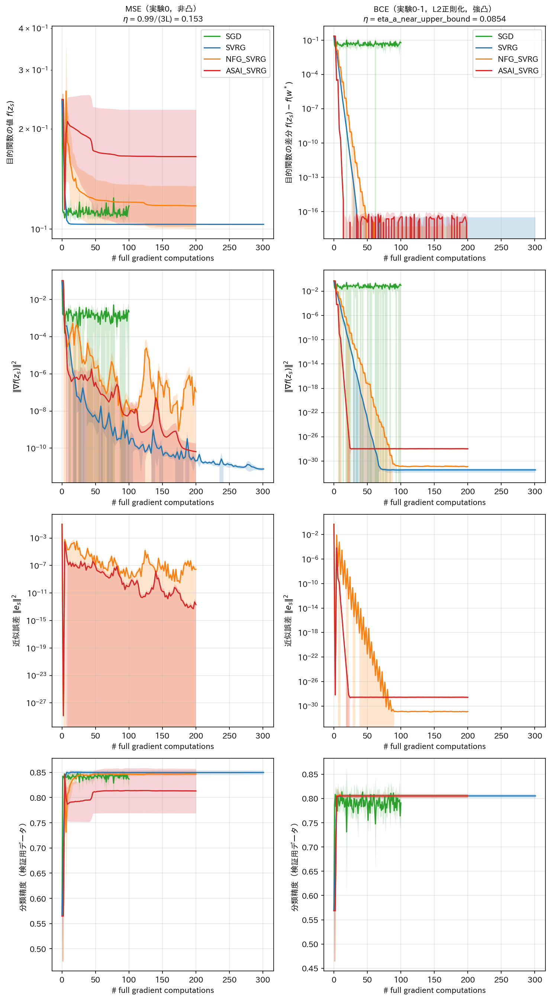
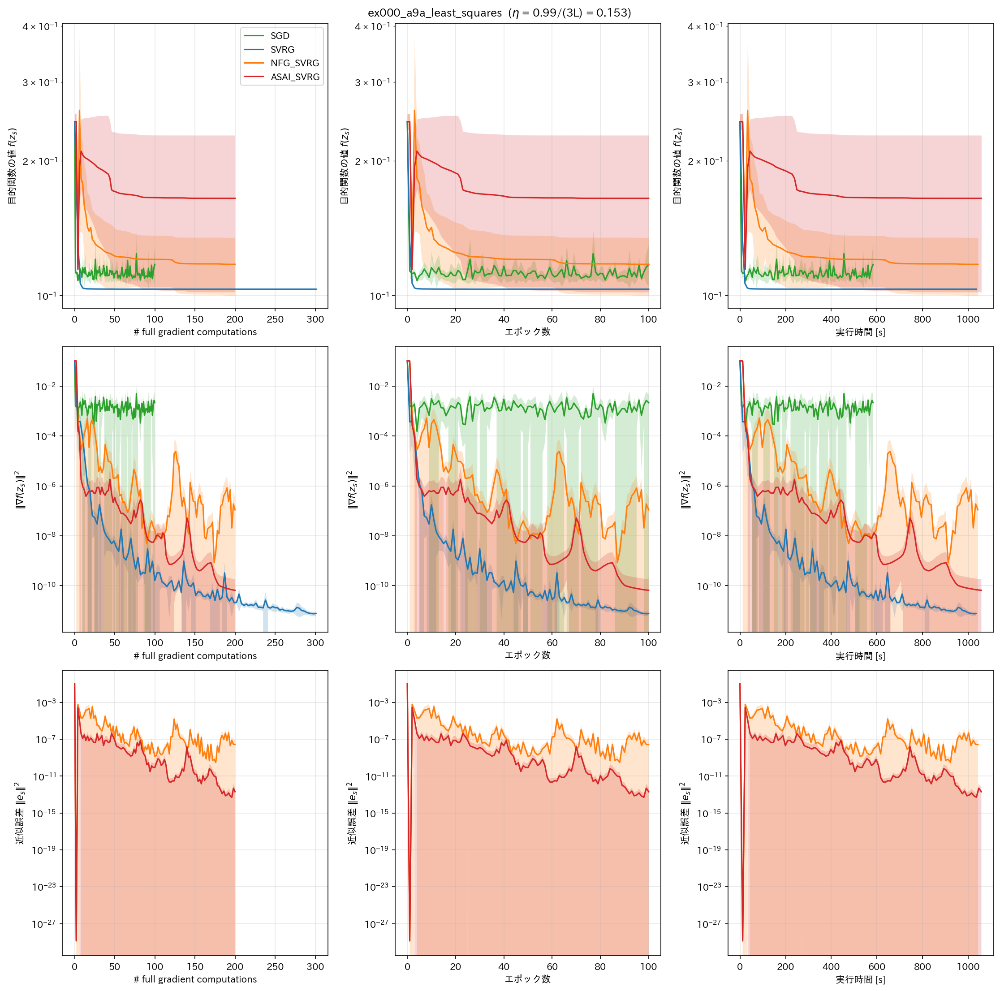

# report_042

`.orders/order_042.md` に対応する，a9aの2つの実験（MSE：実験0，BCE：実験0-1）を学習率 $ \eta = 0.99/(3L) $ で実施した記録である．

## 1. 目的

ASAI SVRG論文（`references/ASAI_SVRG_paper.pdf`）4.1節のMushroom実験（本リポジトリの実験1，`.reports/report_021.md`）は，学習率の1つを補題3の条件 $ 0 < \eta < 1/(3L) $ の上界近傍 $ \eta = 0.99/(3L) $ としている．a9aを用いた2つの実験でも同じ規則で学習率を定め，目的関数（非線形最小二乗誤差（Mean Squared Error，MSE）か，L2正則化付き二値交差エントロピー（Binary Cross Entropy，BCE）か）による挙動の違いを比較する．

## 2. 実験条件

| 項目 | MSE（実験0，`ex000_a9a_least_squares`） | BCE（実験0-1，`ex0001_a9a_logistic`） |
| :--- | :--- | :--- |
| データ | a9a，$ N_{\text{train}}=29304 $，$ N_{\text{test}}=3257 $，$ d=123 $，0/1特徴量を無加工で使用 | 同左 |
| モデル | $ \sigma(w^\top x) $（切片なし） | $ \sigma(w^\top x + b) $（切片あり） |
| 目的関数 | $ \frac1N\sum_n (y_n-\sigma(w^\top x_n))^2 $（非凸，正則化なし） | $ \frac1N\sum_n \ell_{BCE} + \frac{\lambda}{2}(\|w\|^2+b^2) $，$ \lambda=0.1125 $（強凸） |
| 平滑性定数 $ L $ | $ L_{\text{individual}} = \kappa_{\max}\max_i\|x_i\|^2 = 2.1568 $ | $ \frac14\max_i\|[x_i;1]\|^2+\lambda = 3.8625 $ |
| 学習率 $ \eta = 0.99/(3L) $ | $ 1.530\times10^{-1} $ | $ 8.544\times10^{-2} $ |
| 共通 | SGD，SVRG（最終点採用），NFG SVRG（最終点採用），ASAI SVRG．バッチサイズ1，ランダムリシャッフル，100エポック，Seed 0〜4 | 同左 |

MSEの $ \kappa_{\max} $ は1サンプル分の損失の2階微分の絶対値の上界であり，定義は `report_020.md` と同一である．

MSEは，`programs/ex000_a9a_least_squares/train.py` の `build_hyperparameter_list` に4つ目の規則 $ 0.99/(3L) $ を追加し，新規の20条件（4手法 × 5Seed）を学習した．既存の3つの学習率（$ 1/(3L) $，$ 1/(20L) $，$ 1/(20Ln) $）の60条件は再利用し，変更していない．新規の20条件は20プロセスで並列実行した（既存の60条件は60プロセスで並列実行しており，実行時間は並列度が異なるため既存条件と直接比較できない）．

BCEは，`.orders/order_041.md` で既に $ \eta_a = 0.99/(3L) $ として同一条件の20条件を実施済みである．学習はSeedにより決定的であるため，既存の結果を用いた．再利用の妥当性を確認するため，4手法それぞれでSeed 0を3エポック再実行した．目的関数の差分，$ \|\nabla f\|^2 $，近似誤差，精度の全ての値が保存済みのログとビット単位で一致した．

## 3. 結果



図1は，横軸をフル勾配の計算回数（オラクル呼び出し回数を $ N_{\text{train}} $ で割った値）とし，縦軸を上から目的関数（MSEは値 $ f(z_s) $，BCEは差分 $ f(z_s)-f(w^*) $），$ \|\nabla f(z_s)\|^2 $，近似誤差 $ \|e_s\|^2 $，検証用データの分類精度としたものである（5Seedの平均と標準偏差）．左列がMSE，右列がBCEである．

### 3.1 最終エポックの評価指標（5Seedの平均±標準偏差）

| 目的関数 | 手法 | 目的関数 | 精度 | $ \|\nabla f(z_s)\|^2 $ | $ \|e_s\|^2 $ |
| :--- | :--- | ---: | ---: | ---: | ---: |
| MSE | SGD | 1.175e-01 ± 1.26e-02 | 0.8367 ± 0.0112 | 2.17e-03 | なし |
| MSE | SVRG | 1.034e-01 ± 1.94e-04 | 0.8497 ± 0.0042 | 7.63e-12 | 0 |
| MSE | NFG SVRG | 1.175e-01 ± 1.73e-02 | 0.8466 ± 0.0030 | 1.10e-07 | 2.78e-08 |
| MSE | ASAI SVRG | 1.650e-01 ± 6.31e-02 | 0.8131 ± 0.0441 | 6.54e-11 | 2.04e-13 |
| BCE | SGD | 6.01e-02 ± 4.59e-02 | 0.7910 ± 0.0284 | 8.99e-02 | なし |
| BCE | SVRG | $ \approx 0 $ | 0.8053 ± 0.0038 | 3.52e-32 | 0 |
| BCE | NFG SVRG | $ \approx 0 $ | 0.8053 ± 0.0038 | 1.26e-31 | 1.27e-31 |
| BCE | ASAI SVRG | $ \approx 0 $ | 0.8053 ± 0.0038 | 1.07e-28 | 2.68e-29 |

MSEの目的関数は値 $ f(z_s) $（L-BFGS-Bによる参考値は $ f(x^*) \approx 0.1033 $〜$ 0.1037 $），BCEは差分 $ f(z_s)-f(w^*) $ である．

### 3.2 MSEのSeedごとの最終値

| 手法 | $ f(z_s) $（Seed 0〜4） | 精度（Seed 0〜4） |
| :--- | :--- | :--- |
| SGD | 0.1379, 0.1076, 0.1084, 0.1067, 0.1266 | 0.819, 0.843, 0.847, 0.846, 0.828 |
| SVRG | 0.1033, 0.1033, 0.1036, 0.1033, 0.1037 | 0.851, 0.846, 0.848, 0.846, 0.858 |
| NFG SVRG | 0.1033, 0.1033, 0.1036, 0.1410, 0.1362 | 0.850, 0.846, 0.847, 0.841, 0.848 |
| ASAI SVRG | **0.2408**, 0.1033, 0.1368, 0.1033, **0.2408** | **0.759**, 0.846, 0.855, 0.846, **0.759** |



図2はMSEの $ \eta = 0.99/(3L) $ における3つの横軸（フル勾配の計算回数，エポック数，実行時間）× 3つの評価指標の比較である．

## 4. 考察

### 4.1 BCEでは上界近傍の学習率でも3手法とも線形収束する

BCEでは，SVRG系3手法は全Seedで同一の最適解に到達し，$ \|\nabla f\|^2 $ は機械精度の水準まで線形に減少した（図1右列）．$ \|\nabla f\|^2 < 10^{-20} $ に到達するまでのフル勾配の計算回数は，ASAI SVRG 18.0，SVRG 44.8，NFG SVRG 56.8であった（`report_041.md` 表1）．理論上の収束係数 $ \rho(\eta) $ が297と1を大きく超える学習率でも不安定化は生じなかった．

### 4.2 MSEではSVRGのみが全Seedで安定し，NFG SVRG・ASAI SVRGは一部のSeedで劣る解に停滞する

MSEでは，SVRGは5Seed全てで参考値 $ f(x^*) $ と同じ水準（0.1033〜0.1037）に到達し，$ \|\nabla f\|^2 $ も $ 10^{-11} $ まで減少した．一方，NFG SVRGは2Seed（0.141，0.136），ASAI SVRGは3Seed（0.2408が2つ，0.137）で参考値より高い目的関数の値に停滞した．$ \|\nabla f\|^2 $ はNFG SVRG・ASAI SVRGともに増減を繰り返しながら緩やかに減少した（図2中段）．

ASAI SVRGのSeed 0とSeed 4は $ f = 0.2408 $，精度0.759で停止した．0.759は検証用データの多数派クラス（負例）の割合と一致し，0.2408は学習用データの正例の割合と一致する．したがって，この2Seedでは $ \sigma(w^\top x_n) \approx 0 $ が全サンプルで成り立ち，全てを負例と予測する状態に収束したと解釈できる．MSE損失の勾配は $ \sigma'(z) = \sigma(z)(1-\sigma(z)) $ を含むため，シグモイドが飽和すると勾配がほぼ0になり，この平坦な領域から抜け出せない．目的関数が非凸であるため，このような停留点が存在しうる．BCE損失ではシグモイドの飽和による勾配の消失が生じない（勾配が $ \sigma(z)-y $ に比例する）ため，同様の停滞は起きなかった．

### 4.3 $ 0.99/(3L) $ と $ 1/(3L) $ の差は小さい

MSEの既存条件 $ \eta = 1/(3L) = 1.545\times10^{-1} $ でも，ASAI SVRGのSeed 0とSeed 4は同じく $ f = 0.2408 $，精度0.759に停滞しており，NFG SVRGもSeed 1が同じ状態に停滞していた（`outputs/ex000_a9a_least_squares/final_epoch_summary.md`）．学習率を1%下げた $ 0.99/(3L) $ では，NFG SVRGのSeed 1はこの状態を避けたが，ASAI SVRGの2Seedは変わらなかった．SGD，SVRGの最終値は両条件でほぼ同一であった．したがって，上界近傍でのNFG SVRG・ASAI SVRGの不安定化（`report_020.md`）は，$ \eta $ を $ 1/(3L) $ から $ 0.99/(3L) $ に下げる程度では解消しない．

### 4.4 実験1（Mushroom）との関係

実験1（BCE，$ \eta = 0.99/(3L) $）では3手法とも全Seedで最適解に収束した（`report_021.md`）．同じBCEのa9a（実験0-1）でも同じ結果であり，4.1節の実験の結論はa9aでも再現した．一方，同じa9aでも目的関数をMSEにすると，NFG SVRG・ASAI SVRGは上界近傍の学習率で一部のSeedが劣る解に停滞した．この差は，強凸性（BCE）の有無とシグモイドの飽和（MSE）に起因する．

## 5. 未解決の論点・今後の検討候補

- MSEでASAI SVRGの2Seedが全て負例と予測する状態に停滞する原因（初期のパラメータ平均によるスナップショットが飽和領域に入るのか，内部ループの途中で飽和するのか）は特定していない．スナップショット点と内部ループ中の $ \max_n |w^\top x_n| $ の推移を記録すれば切り分けられる．
- MSEで $ L = L_{\text{individual}} $ は $ \kappa_{\max} $ に基づく保守的な上界である．上界近傍の学習率でASAI SVRGが不安定化する学習率の境界（例えば $ 0.5/(3L) $，$ 0.25/(3L) $）は未検証である．
- BCEは再利用した既存結果（`order_041`）に基づく．新たな学習は行っていない．

## 6. 実行コマンド

```bash
# MSE（実験0）：追加した 0.99/(3L) の20条件を学習（既存の60条件はスキップ）
.venv_pytorch/bin/python programs/ex000_a9a_least_squares/train.py
# BCE（実験0-1）：0.99/(3L) の条件は実施済み（完了済みの条件はスキップ）
.venv_pytorch/bin/python programs/ex0001_a9a_logistic/train.py
# 単体テスト
.venv_pytorch/bin/python -m pytest tests/test_ex000_a9a_least_squares.py tests/test_ex0001_a9a_logistic.py -v
# 可視化（「a9aにおけるMSEとBCEの比較」セクション）
.venv_pytorch/bin/jupyter nbconvert --to notebook --execute --inplace visualize_result.ipynb
```
