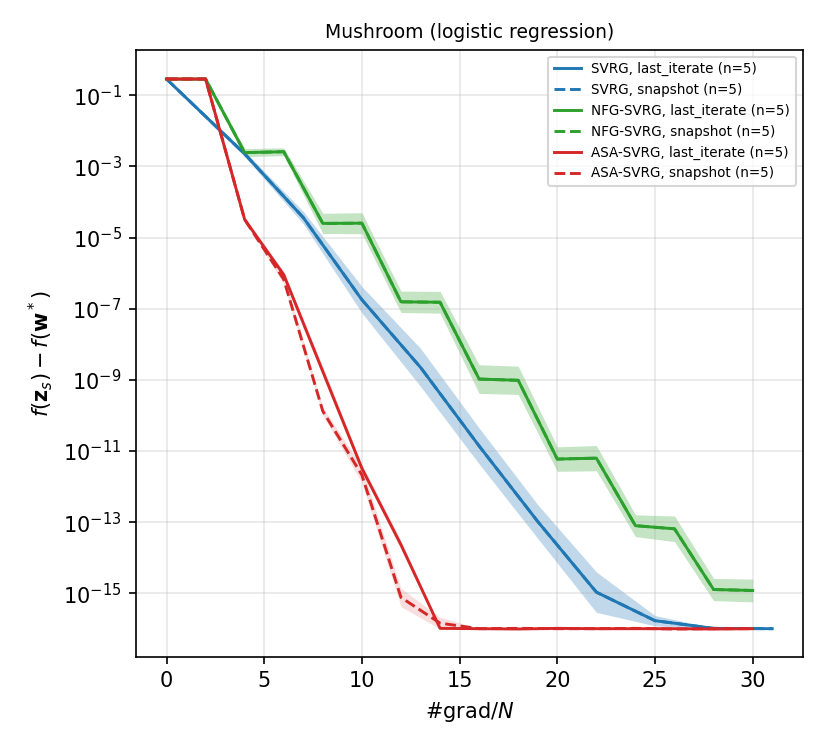
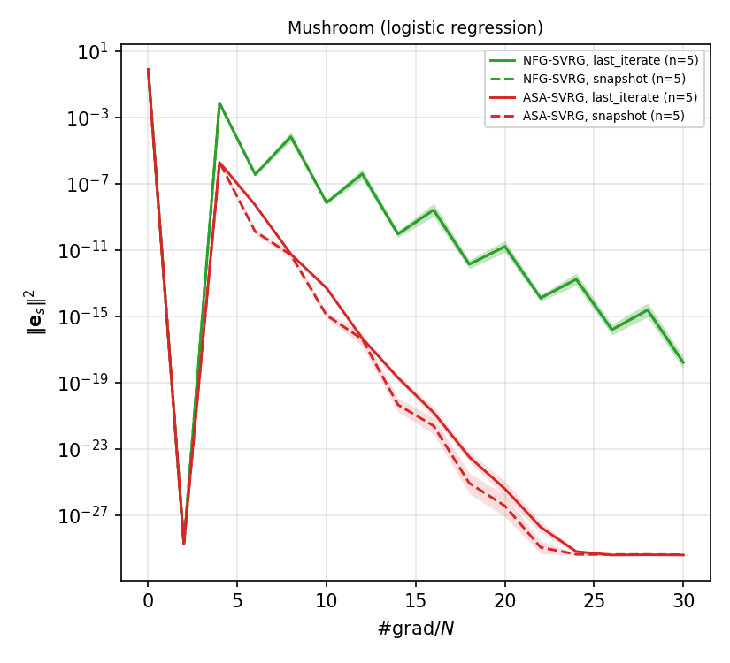
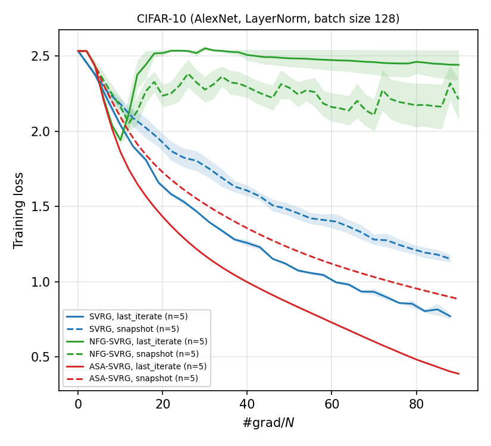
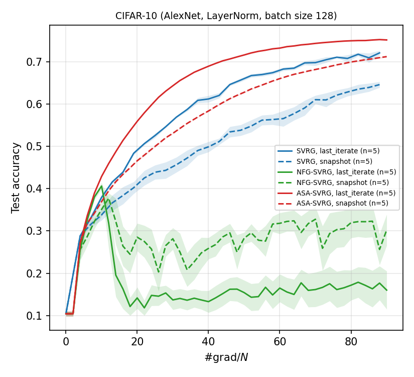
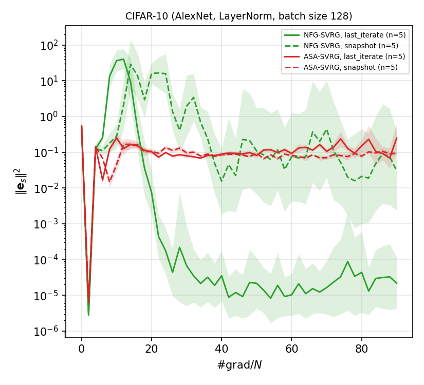
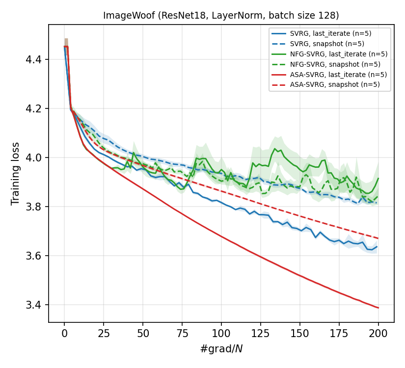
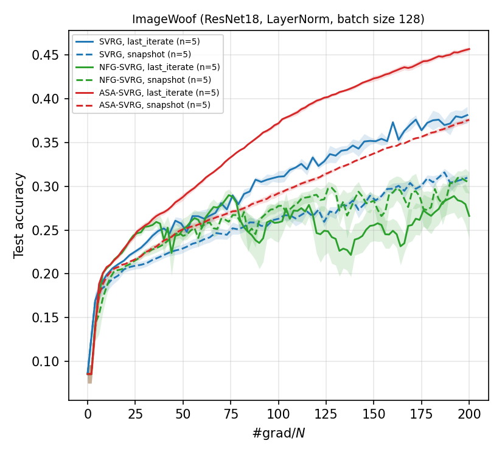
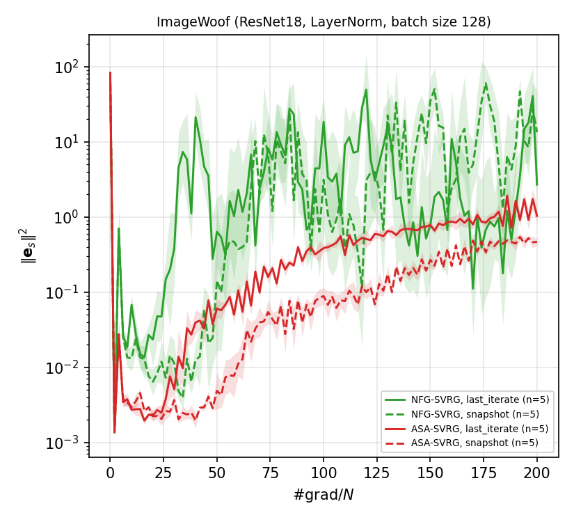

# report_043：E0（内側ループの開始点の影響確認）

対応するorder：`.orders/order_043.md`．実験計画：`実験計画.md` 2章（E0）．

> **状態**：E0の全90試行（3問題 × 3手法 × 2条件 × 5シード）が完了した．

## 1. 実施内容

### 1.1 背景

論文のAlgorithm 1〜4は各外側ループの開始時に $ {\mathbf w}_{s}^{0} \leftarrow {\mathbf z}_{s} $ とするが，既存の実装は
`model` を $ {\mathbf z}_{s} $ に戻さず，次の内側ループを前の内側ループの最終点 $ {\mathbf w}_{s-1}^{K} $ から開始していた．
最終点をスナップショットとする手法（Mushroomの SVRG・NFG-SVRG）では両者は一致するが，平均点を用いるASA-SVRG
（全実験）と，ランダム点を用いるSVRG・NFG-SVRG（CIFAR-10，ImageWoof）では異なる．

### 1.2 実装（`programs_review/`）

- `programs_review/` の外のファイルは参照しない．最適化手法のクラス（`programs/optimizers/`）と `set_seed`，`ResultLogger` は
  変更せずに `programs_review/programs/common/` にコピーした．データも `programs_review/datasets/` に取得し直した．
- 引数 `inner_start` ∈ {`last_iterate`, `snapshot`} を追加した．`snapshot` では `optimizer.end_epoch()` と
  `snapshot_model` の更新の直後に `model` のパラメータを $ {\mathbf z}_{s} $ で上書きする（実験計画1.1節の通り）．
- ログに `test_correct`，`full_grad_norm_sq`，`approx_cos`，`terminated` を追加した．既存の項目は名前も計算方法も変えていない．
- CIFAR-10・ImageWoofは前処理（決定論的）を1回だけ適用した結果をキャッシュし，`CachedTensorLoader` で読み出す．
  添字を長さ $ N $ の `DataLoader(shuffle=True, generator=...)` で生成するため，ミニバッチの順序と乱数生成器の消費は
  既存の実装と同一である（`tests/test_e0_programs.py` で確認）．
- 詳細は `programs_review/document.md` を参照．テストは10件全て成功した（`python -m pytest -q tests`）．

### 1.3 条件

| 問題 | 手法 | 学習率 | ミニバッチサイズ | エポック数 | 予算（図の横軸） | シード |
|---|---|---|---|---|---|---|
| (i) Mushroom | SVRG（最終点），NFG-SVRG（最終点），ASA-SVRG | $ \eta = 0.99/(3L) = 1.049767\times10^{-2} $（$ \rho = 298.4 $） | 1（$ K = 7311 $） | 100 | $ \#\mathrm{grad}/N \le 31 $ | 0〜4 |
| (ii) CIFAR-10・AlexNet（LayerNorm） | SVRG，NFG-SVRG，ASA-SVRG | $ 10^{-3} $ | 128（$ K = 391 $） | 48 | $ \le 90 $ | 0〜4 |
| (iii) ImageWoof・ResNet18（LayerNorm） | SVRG，NFG-SVRG，ASA-SVRG | $ 10^{-3} $ | 128（$ K = 71 $） | 128 | $ \le 200 $ | 0〜4 |

Mushroomでは実験計画はASA-SVRGのみとしているが，計算が軽いため，最終点を用いるSVRG・NFG-SVRGでも2条件が
一致することの確認として3手法とも実行した．実行環境：Python 3.12.15，torch 2.11.0+cu128，cuDNN 9.19，Pillow 13.0.0，
NVIDIA RTX PRO 6000 Blackwell Max-Q．

## 2. 既存の実装との一致の確認

`inner_start="last_iterate"` の新しい実装を既存のログ（`outputs/ex001_mushroom_logistic`，`outputs/ex0024_...`，`outputs/ex0051_...`）と
比較した（`programs_review/programs/compare_with_existing_logs.py`）．

| 問題 | 比較範囲 | 結果 |
|---|---|---|
| (i) Mushroom | 3手法 × 5シード × 全101評価点（100エポック） | 75系列全てが**ビット単位で完全一致** |
| (ii) CIFAR-10 | 3手法 × 5シード × 全49評価点（48エポック） | `train_loss`，`test_accuracy`，`oracle_calls` の45系列全てが**ビット単位で完全一致**．`approx_error` は15系列中12系列が完全一致，NFG-SVRGの3系列のみ相対差 $ \le 2.1\times10^{-16} $（倍精度の丸め誤差） |
| (iii) ImageWoof | 3手法 × シード0 × 先頭3評価点（2エポック） | 完全一致せず．学習損失の相対差 $ \le 6.4\times10^{-6} $，テスト正解数の差は最大2枚（3929枚中） |

ImageWoofの差は，学習を行う前の0エポック目（初期値は同一）の学習損失（新 4.455171792，既存 4.455172097）から既に
生じている．したがって差の原因は学習ループではなく入力画像の前処理である．既存の環境のチャネル統計量のキャッシュ
（`datasets/ex005_.../channel_stats.json`）が残っておらず再計算したこと，またはPillow・libjpegのバージョンの違いによると
考えられる（どちらが原因かは未確認）．学習ループのコードはCIFAR-10と共通（`common/vr_image_training.py`）であり，
CIFAR-10で完全一致したことから，学習ループは既存の実装と同一であると判断した．ImageWoofの新しい結果は，既存の結果と
入力がわずかに異なる別の試行として扱い，E0の2条件の比較は新しい実行どうしで行う．

## 3. 結果：(i) Mushroom

図：`programs_review/outputs/ex001_e0_mushroom_logistic/figures/`（実線が `last_iterate`，破線が `snapshot`，5シードの幾何平均 ± 標準誤差）．

| 手法 | 開始点 | 最終テスト精度 | 目的関数誤差 $ \le 10^{-10} $ に初めて到達する $ \#\mathrm{grad}/N $ | 学習後半の近似誤差の平均 |
|---|---|---:|---:|---:|
| SVRG | last_iterate | 0.8866 ± 0.0036 | 16.60 ± 0.60 | （全勾配） |
| SVRG | snapshot | 0.8866 ± 0.0036 | 16.60 ± 0.60 | （全勾配） |
| NFG-SVRG | last_iterate | 0.8866 ± 0.0036 | 19.20 ± 0.80 | 1.30e-09 ± 1.0e-09 |
| NFG-SVRG | snapshot | 0.8866 ± 0.0036 | 19.20 ± 0.80 | 1.30e-09 ± 1.0e-09 |
| ASA-SVRG | last_iterate | 0.8866 ± 0.0036 | 10.00 ± 0.00 | 4.09e-22 ± 1.8e-22 |
| ASA-SVRG | snapshot | 0.8866 ± 0.0036 | 9.20 ± 0.49 | 2.42e-22 ± 2.1e-22 |

値は5シードの平均 ± 標準誤差．目的関数誤差は予算内で倍精度の丸め誤差（約 $ 10^{-16} $）まで減少するため，最終値ではなく
到達の速さで比較した（図の縦軸も $ 10^{-16} $ で切り上げている）．

- SVRG・NFG-SVRG（最終点）：2条件の全ての記録（`elapsed_time` を除く）が5シードで完全に一致した．実装上も理論上も期待通りである．
- ASA-SVRG：`snapshot` の方が目的関数誤差の減少がわずかに速く（$ 10^{-10} $ への到達がシード0と2で2だけ早く，他は同じ），
  学習後半の近似誤差も小さい傾向がある（対応のある差の $ \log_{10} $ の平均 $ -0.81 \pm 0.34 $）．テスト精度は全シードで同一である．
- 手法間の順序（目的関数誤差の減少の速さ：ASA-SVRG ＞ SVRG ＞ NFG-SVRG，近似誤差：ASA-SVRG ＜ NFG-SVRG）は開始点によらず変わらない．
  論文4.1節（図1）の結論は，論文のAlgorithm通りの実装（`snapshot`）でも維持される．

## 4. 結果：(ii) CIFAR-10，(iii) ImageWoof

図：`programs_review/outputs/ex002_e0_cifar10_alexnet_layernorm/figures/`，`programs_review/outputs/ex003_e0_imagewoof_resnet18_layernorm/figures/`
（実線が `last_iterate`，破線が `snapshot`，シード間の平均 ± 標準誤差）．全ての表は `programs_review/outputs/e0_summary.md`．
両問題とも，学習損失が非有限となって打ち切った試行はない．

### 4.1 (ii) CIFAR-10（5シード，予算 $ \#\mathrm{grad}/N \le 90 $）

| 手法 | 開始点 | 最終テスト精度 | 最終の学習損失 | 学習後半の近似誤差の平均 |
|---|---|---:|---:|---:|
| SVRG | last_iterate | 0.7213 ± 0.0055 | 0.771 ± 0.017 | （全勾配） |
| SVRG | snapshot | 0.6463 ± 0.0069 | 1.152 ± 0.024 | （全勾配） |
| NFG-SVRG | last_iterate | 0.1600 ± 0.0451 | 2.440 ± 0.099 | 2.7e-01 ± 2.7e-01 |
| NFG-SVRG | snapshot | 0.3023 ± 0.0371 | 2.211 ± 0.133 | 2.1e+01 ± 1.1e+01 |
| ASA-SVRG | last_iterate | **0.7520 ± 0.0017** | **0.389 ± 0.002** | 2.4e-01 ± 2.6e-02 |
| ASA-SVRG | snapshot | **0.7126 ± 0.0019** | **0.885 ± 0.003** | 8.5e-02 ± 2.9e-03 |

対応のある差（snapshot − last_iterate，5シードの平均 ± 標準誤差）：

| 手法 | 最終テスト精度 | 最終の学習損失 | 学習後半の $ \log_{10} $ 近似誤差 |
|---|---:|---:|---:|
| SVRG | $ -0.075 \pm 0.012 $（5シード全てで低下） | $ +0.381 \pm 0.038 $ | － |
| NFG-SVRG | $ +0.142 \pm 0.062 $（4シードで向上） | $ -0.229 \pm 0.151 $ | $ +4.28 \pm 1.55 $ |
| ASA-SVRG | $ -0.039 \pm 0.002 $（5シード全てで低下） | $ +0.496 \pm 0.002 $ | $ -0.43 \pm 0.05 $ |

### 4.2 (iii) ImageWoof（5シード，予算 $ \#\mathrm{grad}/N \le 200 $）

| 手法 | 開始点 | 最終テスト精度 | 最終の学習損失 | 学習後半の近似誤差の平均 |
|---|---|---:|---:|---:|
| SVRG | last_iterate | 0.3815 ± 0.0097 | 3.636 ± 0.026 | （全勾配） |
| SVRG | snapshot | 0.3098 ± 0.0034 | 3.815 ± 0.005 | （全勾配） |
| NFG-SVRG | last_iterate | 0.2662 ± 0.0262 | 3.914 ± 0.069 | 3.1e+01 ± 1.7e+00 |
| NFG-SVRG | snapshot | 0.3041 ± 0.0120 | 3.843 ± 0.035 | 4.2e+01 ± 2.7e+00 |
| ASA-SVRG | last_iterate | **0.4570 ± 0.0020** | **3.387 ± 0.004** | 8.7e-01 ± 1.1e-01 |
| ASA-SVRG | snapshot | **0.3761 ± 0.0025** | **3.670 ± 0.004** | 2.9e-01 ± 3.1e-02 |

対応のある差（snapshot − last_iterate，5シードの平均 ± 標準誤差）：

| 手法 | 最終テスト精度 | 最終の学習損失 | 学習後半の $ \log_{10} $ 近似誤差 |
|---|---:|---:|---:|
| SVRG | $ -0.072 \pm 0.007 $（5シード全てで低下） | $ +0.180 \pm 0.023 $ | － |
| NFG-SVRG | $ +0.038 \pm 0.020 $（4シードで向上） | $ -0.071 \pm 0.051 $ | $ +0.14 \pm 0.05 $ |
| ASA-SVRG | $ -0.081 \pm 0.003 $（5シード全てで低下） | $ +0.283 \pm 0.003 $ | $ -0.48 \pm 0.03 $ |

### 4.3 考察

- **開始点は非凸の画像分類の結果を大きく変える．** 論文のAlgorithm通り（`snapshot`）にすると，平均点を用いるASA-SVRGと
  ランダム点を用いるSVRGは，同じ予算での学習損失・テスト精度が明確に悪化する（CIFAR-10で精度 $ -3.9 $・$ -7.5 $ ポイント，
  ImageWoofで $ -8.1 $・$ -7.2 $ ポイント）．差はシード間の標準誤差より1桁以上大きい．
- **手法間の順序は変わらない．** どちらの開始点でも，最終精度と学習損失は ASA-SVRG ＞ SVRG ＞ NFG-SVRG の順である
  （ImageWoofの `snapshot` ではSVRG 0.310とNFG-SVRG 0.304がほぼ同じ）．ASA-SVRGが最良であるという論文4.2・4.3節の主張は `snapshot` でも維持される．
  一方，論文の図2・図3の数値（精度の水準）は `last_iterate` の実装による値であり，Algorithmの記述とは対応しない．
- **ASA-SVRGの近似誤差は `snapshot` の方が小さい．** これは，近似誤差の評価点 $ {\mathbf z}_{s} $ と，次の内側ループの
  勾配の参照点が一致するためと考えられる．学習の進みが遅いこと（損失が大きく勾配が小さくない状態に留まること）の寄与も区別できていない．
- **悪化の原因（仮説）．** `snapshot` では各外側ループの後に内側ループの「過去の点の平均（またはランダムな点）」まで
  パラメータを戻すため，1つの外側ループで進んだ距離の一部を捨てる．例えばASA-SVRGでは，内側ループの軌跡がほぼ直線的に
  進む場合，$ {\mathbf z}_{s} $ は軌跡の中点付近となり，実効的な進みが約半分となる．非凸の問題で学習率が小さく
  （$ \eta = 10^{-3} $），予算内で収束しない設定ではこの差がそのまま現れる．Mushroom（強凸，予算内で丸め誤差まで収束）では
  影響が見えにくかったことと整合する．この仮説は未検証である．
- NFG-SVRGは `last_iterate` で $ \#\mathrm{grad}/N \approx 10 $ 以降に損失が増加して発散的になるが，`snapshot` では
  増加が緩やかである．スナップショットへ戻すことで，近似誤差の大きいNFG-SVRGの軌跡の暴走が抑えられていると考えられる．

## 5. 現時点の結論と方針の判断材料

- Mushroom（強凸，論文の理論の設定）では，開始点を論文のAlgorithmに合わせても結果は実質的に変わらず，ASA-SVRGはわずかに良くなる．
  実験計画2.1節の方針(a)（結果が実質的に変わらない）に該当する．
- 非凸の画像分類（CIFAR-10，ImageWoof）では，開始点によって精度の水準が大きく変わる．
  したがって**実験計画2.1節の方針(b)（結果が変わる場合）に該当する**．ただし手法間の順序と「ASA-SVRGが最良」という
  主張は変わらない．
- 方針(b)のどちらを採るか（論文のAlgorithmに合わせて画像の実験を `snapshot` で再実施するか，Algorithm・理論解析の前提を
  実装（$ {\mathbf w}_{s}^{0} \leftarrow {\mathbf w}_{s-1}^{K} $）に合わせて修正するか）は著者の判断事項である．判断材料：
  - `snapshot` で再実施する場合：論文の記述と理論（Algorithm 1〜4）に整合するが，画像の実験の精度の水準は下がる．
    E2（精度の向上の再評価）等も `snapshot` で行う必要がある．
  - Algorithmを実装に合わせる場合：精度は現状のままだが，理論解析（$ {\mathbf w}_{s}^{0} = {\mathbf z}_{s} $ を前提とする
    収束解析）との対応を本文で説明する必要がある．Mushroom（理論の設定）では2条件がほぼ同じ結果となったことは，
    その説明の根拠として使える．

### 5.1 著者の判断（2026-11-18）と，`snapshot` での論文の主張の成否

理論の主要な主張が $ {\mathbf w}_{s}^{0} = {\mathbf z}_{s} $ に依存するため，**全実験を `inner_start="snapshot"` で行う**．
画像分類について「SGDと同程度の精度」とは書かない．
以下は，バッチサイズ128の主要な主張を `snapshot` の結果（E0）で確認したものである．SGDは開始点の影響を受けないため，既存のログを用いた．

| 論文の記述 | CIFAR-10 | ImageWoof |
|---|---|---|
| SGD並みの精度（アブストラクト，4.3節） | **不成立**：SGD 0.762，ASA-SVRG 0.713 | **不成立**：SGD 0.466，ASA-SVRG 0.376 |
| ASA-SVRG ＞ SVRG（全勾配を計算しないのに精度が高い） | 成立：0.713 ＞ 0.646 | 成立：0.376 ＞ 0.310 |
| NFG-SVRGは他の手法よりはるかに低い | 成立：0.302 | ASA-SVRGに対しては成立（0.304）．**SVRG（0.310）とはほぼ同じ** |
| ASA-SVRGの近似誤差はNFG-SVRGよりはるかに小さい | 成立（8.5e-02 対 2.1e+01） | 成立（2.9e-01 対 4.2e+01） |
| ASA-SVRGの曲線はSGDより揺らぎが小さい | 成立：学習後半のテスト精度の評価点間の変化の標準偏差 0.0020 対 SGD 0.0053 | 成立：0.0012 対 SGD 0.0397 |

揺らぎの指標は，$ B/2 < \#\mathrm{grad}/N \le B $ の評価点間のテスト精度の差の標準偏差（5シードの平均）である．
評価の間隔はSGDが $ \#\mathrm{grad}/N = 1 $ ごと，ASA-SVRGが2ごとである．間隔が広いほど傾向による変化を多く含むので，
この比較はSGDに有利な向きであり，結論は保守的である．
学習率 $ 10^{-3} $ は `last_iterate` で選んだ値である．`snapshot` で精度の水準が回復するかは，学習率の再調整で確認する余地がある（未実施）．
付録B（バッチサイズ32・512）は `snapshot` で再実施が必要である．

## 6. 未解決の論点・次の作業の候補

1. 方針(b)の2つの選択肢のどちらを採るかを著者が判断する．その判断によって，E1〜E3を `inner_start` のどちらで実施するかが決まる．
2. ImageWoofの入力の差の原因（チャネル統計量かPillowか）は未確認．既存のチャネル統計量が分かれば一致を確認できる．
3. E1（Mushroomの $ \rho $ を変えた実験とサンプリング方式）は，E0のMushroomの結果から `inner_start` の影響が小さいことが分かったため，
   方針が決まり次第すぐに実装できる（計算は軽い）．
4. E3（実時間の比較）は他の実験と同時に実行できないため，E0・E2の完了後に実施する必要がある．
