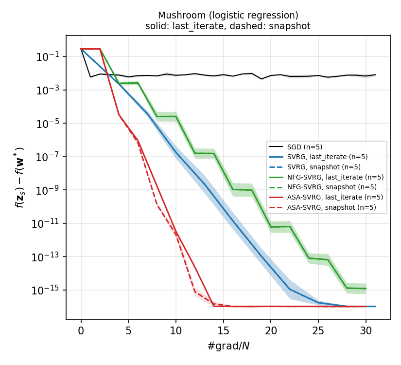
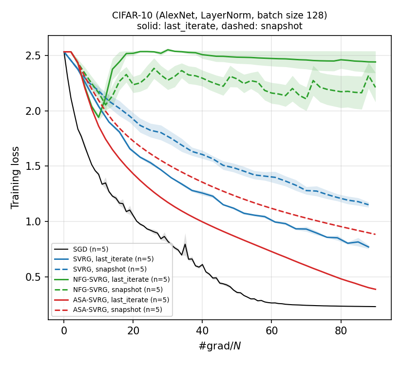
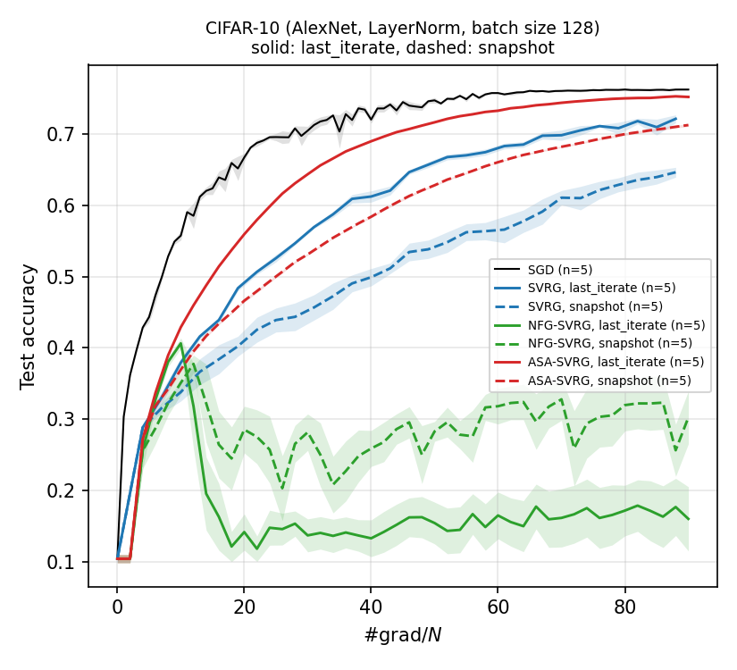
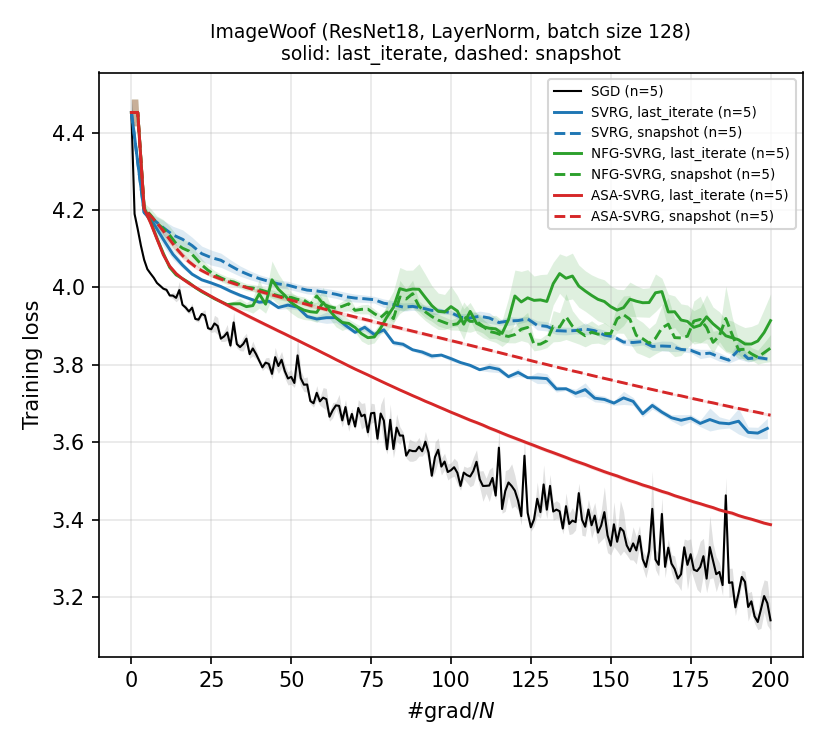
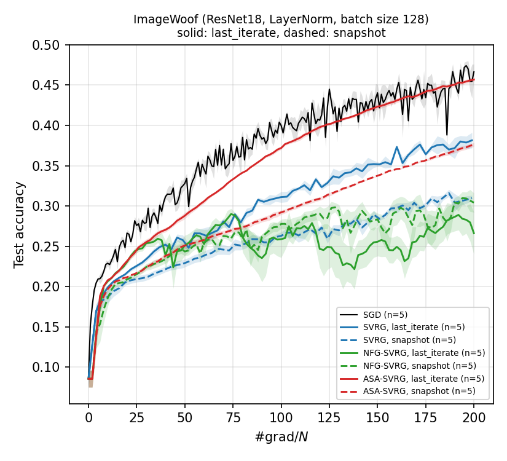

# report_044：内側ループの開始点の影響（SGDとの比較）

対応するorder：`.orders/order_044.md`．元にした実験：E0（`.reports/report_043.md`）．新しい学習は行っていない．

## 0. 要点

- **比較した2条件．** 各外側ループの内側ループの開始点 $ {\mathbf w}_{s}^{0} $ を比べた．
  - `last_iterate`：前の内側ループの最終点 $ {\mathbf w}_{s-1}^{K} $．既存の実装．
  - `snapshot`：スナップショット $ {\mathbf z}_{s} $．論文のAlgorithm 1〜4．
- **SGDとの関係が変わる．** SGDは内側ループを持たないので，開始点の影響を受けない．そのため，SGDとの比較は開始点によって大きく変わる．
  - 非凸の画像分類で `snapshot` にすると，ASA-SVRGとSGDの最終テスト精度の差は次のように広がる．
    - CIFAR-10：$ -1.0 $ ポイントから $ -5.0 $ ポイント
    - ImageWoof：$ -1.0 $ ポイントから $ -9.0 $ ポイント
  - 論文の「SGDと同程度の精度」という主張は，`snapshot` では成り立たない．
- **開始点で変わらない結果．**
  - 分散縮小法の中での順位（ASA-SVRG ＞ SVRG ＞ NFG-SVRG）．ただしImageWoofの `snapshot` ではSVRGとNFG-SVRGがほぼ同じになる．
  - ASA-SVRGの学習曲線の揺らぎがSGDよりはるかに小さいこと．
  - Mushroom（強凸）の結果は，どの手法も実質的に変わらない．
- **今後の方針．** 著者の判断により，以降の実験は全て `snapshot` で行う．画像分類の主張は「SGDと同程度の精度」から，
  「SVRG系の中で最も高い精度・小さい近似誤差を，SGDより揺らぎの小さい学習曲線で達成する」に改める．

## 1. 比較の方法

| 項目 | 内容 |
|---|---|
| 分散縮小法の結果 | E0の全90試行：3問題 × 3手法（SVRG，NFG-SVRG，ASA-SVRG）× 2条件 × シード0〜4（`programs_review/outputs/ex00{1,2,3}_e0_*`） |
| SGDの結果 | 既存のログ（シード0〜4）．同じ学習率・ミニバッチサイズ・正則化係数の条件 |
| SGDのログのパス（Mushroom） | `outputs/ex001_mushroom_logistic/SGD/eta1.049767e-02_lambda9.155984e-01_K7311_epochs100` |
| SGDのログのパス（CIFAR-10） | `outputs/ex0024_cifar10_alexnet_layernorm_longrun/SGD/lr0.001_bs128_normlayernorm_lambda0.0005_epochs96` |
| SGDのログのパス（ImageWoof） | `outputs/ex0051_imagewoof_resnet18_bs128_longrun/SGD/lr0.001_bs128_lambda0.0005_epochs384` |
| 予算（論文の図と同じ横軸の上限） | Mushroom：$ \#\mathrm{grad}/N \le 31 $，CIFAR-10：$ \le 90 $，ImageWoof：$ \le 200 $ |
| 最終値 | 予算以下の最後の評価点の値（5シードの平均 ± 標準誤差） |
| SGDとの差 | 平均の差 ± 両者の標準誤差の二乗和の平方根 |
| 揺らぎ | 予算の後半（$ B/2 < \#\mathrm{grad}/N \le B $）で，隣り合う評価点の間のテスト精度の変化の標準偏差 |
| 集計 | `programs_review/programs/analysis_e0_with_sgd.py`．全ての表は `programs_review/outputs/e0_with_sgd_summary.md` |

SGDのログについての補足：
- ImageWoofのSGDは既存の環境で計算したものである．前処理がE0の実行とわずかに異なる（report_043 2節）．
  その差による初期の学習損失の差は相対 $ 10^{-7} $ 程度であり，以下の比較には影響しない．
- 揺らぎの評価の間隔は手法によって異なる．SGDは $ \#\mathrm{grad}/N = 1 $ ごと，NFG-SVRG・ASA-SVRGは2ごと，SVRGは3ごとである．
  そのため，SGDは評価点を間引いて間隔を2と3にそろえた値も求めた．

## 2. 結果

### 2.1 Mushroom（強凸，ロジスティック回帰）



| 手法 | 開始点 | 最終テスト精度 | SGDとの差 | 最終の目的関数誤差（幾何平均） |
|---|---|---:|---:|---:|
| SGD | － | 0.8888 ± 0.0053 | － | $ 8.0\times10^{-3} $ |
| SVRG | 両条件で同一 | 0.8866 ± 0.0036 | $ -0.0022 \pm 0.0064 $ | $ 1.0\times10^{-16} $ |
| NFG-SVRG | 両条件で同一 | 0.8866 ± 0.0036 | $ -0.0022 \pm 0.0064 $ | $ 1.2\times10^{-15} $ |
| ASA-SVRG | last_iterate | 0.8866 ± 0.0036 | $ -0.0022 \pm 0.0064 $ | $ 1.0\times10^{-16} $ |
| ASA-SVRG | snapshot | 0.8866 ± 0.0036 | $ -0.0022 \pm 0.0064 $ | $ 1.0\times10^{-16} $ |

- SGDは誤差床（$ \approx 10^{-2} $）で止まる．分散縮小法はどちらの開始点でも倍精度の丸め誤差まで収束する．
- 開始点で変わるのはASA-SVRGの収束の速さだけである．`snapshot` の方がわずかに速く，目的関数誤差が $ 10^{-10} $ に到達する
  $ \#\mathrm{grad}/N $ は 10.0 から 9.2 になった．
- テスト精度は全ての手法でSGDと統計的に区別できない．
- 論文4.1節（図1）の結論は，開始点によらず成り立つ．

### 2.2 CIFAR-10（AlexNet，LayerNorm，バッチサイズ128）




| 手法 | 開始点 | 最終テスト精度 | SGDとの差 | 最終の学習損失 | テスト精度の揺らぎ（後半） |
|---|---|---:|---:|---:|---:|
| SGD | － | 0.7624 ± 0.0011 | － | 0.233 ± 0.000 | 0.0053（間隔2：0.0056，間隔3：0.0046） |
| SVRG | last_iterate | 0.7213 ± 0.0055 | $ -0.041 \pm 0.006 $ | 0.771 ± 0.017 | 0.0141 |
| SVRG | snapshot | 0.6463 ± 0.0069 | $ -0.116 \pm 0.007 $ | 1.152 ± 0.024 | 0.0136 |
| NFG-SVRG | last_iterate | 0.1600 ± 0.0451 | $ -0.602 \pm 0.045 $ | 2.440 ± 0.099 | 0.0223 |
| NFG-SVRG | snapshot | 0.3023 ± 0.0371 | $ -0.460 \pm 0.037 $ | 2.211 ± 0.132 | 0.0569 |
| ASA-SVRG | last_iterate | 0.7520 ± 0.0017 | $ -0.010 \pm 0.002 $ | 0.389 ± 0.002 | **0.0017** |
| ASA-SVRG | snapshot | 0.7126 ± 0.0019 | $ -0.050 \pm 0.002 $ | 0.885 ± 0.003 | **0.0020** |

### 2.3 ImageWoof（ResNet18，LayerNorm，バッチサイズ128）




| 手法 | 開始点 | 最終テスト精度 | SGDとの差 | 最終の学習損失 | テスト精度の揺らぎ（後半） |
|---|---|---:|---:|---:|---:|
| SGD | － | 0.4665 ± 0.0097 | － | 3.140 ± 0.025 | 0.0397（間隔2：0.0356，間隔3：0.0415） |
| SVRG | last_iterate | 0.3815 ± 0.0097 | $ -0.085 \pm 0.014 $ | 3.636 ± 0.026 | 0.0178 |
| SVRG | snapshot | 0.3098 ± 0.0034 | $ -0.157 \pm 0.010 $ | 3.815 ± 0.005 | 0.0124 |
| NFG-SVRG | last_iterate | 0.2662 ± 0.0262 | $ -0.200 \pm 0.028 $ | 3.914 ± 0.069 | 0.0185 |
| NFG-SVRG | snapshot | 0.3041 ± 0.0120 | $ -0.162 \pm 0.016 $ | 3.843 ± 0.035 | 0.0207 |
| ASA-SVRG | last_iterate | 0.4570 ± 0.0020 | $ -0.010 \pm 0.010 $ | 3.387 ± 0.004 | **0.0018** |
| ASA-SVRG | snapshot | 0.3761 ± 0.0025 | $ -0.090 \pm 0.010 $ | 3.670 ± 0.004 | **0.0012** |

## 3. 考察

### 3.1 開始点の影響の大きさ

非凸の2問題について，`snapshot` から `last_iterate` を引いた差を手法ごとにまとめる．

- **SVRG と ASA-SVRG**
  - 最終テスト精度は CIFAR-10 で $ -7.5 $・$ -3.9 $ ポイント，ImageWoof で $ -7.2 $・$ -8.1 $ ポイント変わった．
  - 低下は5シード全てで起きた．
  - 学習損失も全て悪化した．
- **NFG-SVRG**
  - 最終テスト精度は CIFAR-10 で $ +14.2 $ ポイント，ImageWoof で $ +3.8 $ ポイント変わり，逆に向上した．
  - `last_iterate` では，近似誤差の大きいNFG-SVRGの軌跡が序盤（$ \#\mathrm{grad}/N \approx 10 $）以降に悪化していく．
    外側ループごとにスナップショットへ戻すことで，この悪化が緩和されると考えられる．
- **悪化の原因（仮説，未検証）**
  - `snapshot` では外側ループごとに，内側ループの途中の点まで戻る．戻る先は，ASA-SVRGでは過去の点の平均，SVRGではランダムな点である．
  - その結果，1つの外側ループで進んだ距離の一部を捨てることになる．
  - 内側ループの軌跡がほぼ直線なら，平均点は中点付近になる．このときASA-SVRGの実効的な進みは約半分になる．
  - 学習率 $ 10^{-3} $ が小さく，予算内で収束しない非凸の設定では，この差がそのまま最終値に現れる．
  - 強凸のMushroomは予算内に丸め誤差まで収束するため，差が現れなかったと考えられる．

### 3.2 SGDとの比較

| 主張 | `last_iterate`（現在の論文の数値） | `snapshot`（今後の方針） |
|---|---|---|
| SGDと同程度の最終精度（アブストラクト，4.3節） | ほぼ成立：CIFAR-10 で $ -1.0 $ ポイント，ImageWoof で $ -1.0 \pm 1.0 $ ポイント | **不成立**：CIFAR-10 で $ -5.0 $ ポイント，ImageWoof で $ -9.0 $ ポイント |
| 学習損失の減少はSGDが最も速く，次がASA-SVRG（4.2節） | 成立 | 成立．ただしSGDとの差は大きい（CIFAR-10：0.233 対 0.885） |
| ASA-SVRGの学習曲線はSGDより揺らぎが小さい | 成立 | **成立**．間隔2でそろえると CIFAR-10 で 0.0020 対 0.0056（約1/3），ImageWoof で 0.0012 対 0.0356（約1/30） |
| 全勾配を計算しないASA-SVRGが，同じ $ \#\mathrm{grad}/N $ でSVRGより高精度 | 成立 | 成立（CIFAR-10：0.713 対 0.646，ImageWoof：0.376 対 0.310） |
| NFG-SVRGは他の3手法よりはるかに低い | 成立 | CIFAR-10では成立．ImageWoofではSVRG（0.310）とNFG-SVRG（0.304）がほぼ同じ |

揺らぎについての補足：
- SGDの評価点は各反復の点 $ {\mathbf w}_{k} $ である．分散縮小法の評価点はスナップショット $ {\mathbf z}_{s} $ である．
  ASA-SVRGでは $ {\mathbf z}_{s} $ が内側ループの平均点なので，揺らぎの小ささは平均化の効果も含む．
- `snapshot` でも揺らぎの小ささは保たれる．ImageWoofでは `last_iterate` よりさらに小さい．
  ただし，学習の進みが遅いことの寄与とは区別できていない．

### 3.3 論文の書き方への示唆（著者の判断の材料）

1. 画像分類では，SGDを最終精度で上回る・並ぶとは書かない．ASA-SVRGの位置づけを次のように改める．
   - SVRG系の中で最良である．
   - 全勾配を計算するSVRGより高精度である．
   - 学習曲線の揺らぎがSGDより小さい．
2. 開始点の影響（E0）は付録に載せる．
   - 載せる内容：`last_iterate` の方が非凸の問題で精度が高いこと．理論は `snapshot` を前提とすること．
   - これにより，査読者に実装と理論の対応を明示できる．
   - SVRG++（Allen-Zhu & Yuan, 2016）は前の最終点から内側ループを始める変種であり，実用上の変種として言及できる．
3. 学習率 $ 10^{-3} $ は `last_iterate` で選んだ値である．
   - `snapshot` でのSGDとの差の一部は，学習率を調整すれば縮まる可能性がある．
   - 査読者に「SGDとの比較が公平か」と問われることに備え，`snapshot` で学習率を数点振る実験を追加することを提案する．

## 4. 未解決の論点・次の作業の候補

1. `snapshot` での学習率の再調整（ASA-SVRG，SVRG，SGDの各数点．画像の2問題）．実験計画への追加が必要である．
2. 付録B（バッチサイズ32・512）の `snapshot` での再実施．
3. 悪化の原因の仮説（実効的な進みが約半分になる）の検証．例えば，各外側ループで $ \|{\mathbf w}_{s-1}^{K} - {\mathbf z}_{s}\| $ と
   $ \|{\mathbf w}_{s-1}^{K} - {\mathbf w}_{s-1}^{0}\| $ の比を記録すれば確かめられる．
4. E1〜E3は `inner_start="snapshot"` を既定として実施する．

## 5. 再現方法

```bash
cd programs_review/programs
python analysis_e0_with_sgd.py \
  --sgd ex001_e0_mushroom_logistic=../../outputs/ex001_mushroom_logistic/SGD/eta1.049767e-02_lambda9.155984e-01_K7311_epochs100 \
        ex002_e0_cifar10_alexnet_layernorm=../../outputs/ex0024_cifar10_alexnet_layernorm_longrun/SGD/lr0.001_bs128_normlayernorm_lambda0.0005_epochs96 \
        ex003_e0_imagewoof_resnet18_layernorm=../../outputs/ex0051_imagewoof_resnet18_bs128_longrun/SGD/lr0.001_bs128_lambda0.0005_epochs384
```
