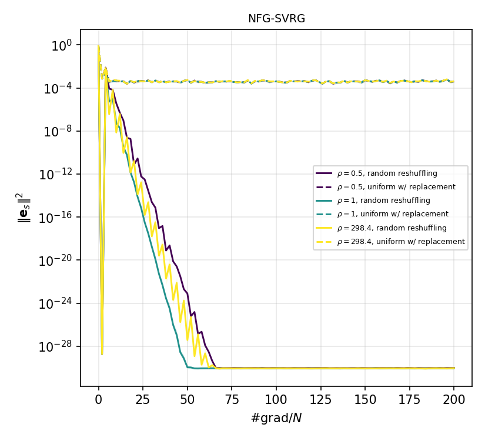

# report_046：E1の成果物（`E1_results.zip`）の統合

## 0. 要点

- 別のPCで実施したE1の成果物 `E1_results.zip`（690ファイル，約13.9MB）を本リポジトリに取り込んだ．既存のファイルとの衝突はなく，既存のファイルは1つも変更されていない（`programs_review/document.md` への追記を除く）．
- `programs_review/tests/` の全テスト（E0・付録Bの11件，E1の16件，計27件）が本PCで通過した．
- 本PCで1試行を再実行し，zip内のログと倍精度の丸め誤差の範囲で一致することを確認した．
- E1の結果の内容（実験計画3.7節の3つの論点への回答）は `.reports/report_050.md` に記載されている．要点は5節に再掲する．

## 1. 取り込んだファイル

| 種類 | パス |
|---|---|
| 指示・報告 | `.orders/order_050.md`，`.reports/report_050.md` |
| プログラム | `programs_review/programs/ex006_e1_mushroom_rho_sampling/`（`data.py`，`model.py`，`train.py`，`README.md`），`programs_review/programs/analysis_e1.py` |
| テスト | `programs_review/tests/test_e1_programs.py` |
| 可視化 | `programs_review/visualize_result_E1.ipynb`（実行済み） |
| 結果 | `programs_review/outputs/ex006_e1_mushroom_rho_sampling/`（200試行の `config.json`・`log.json`，図30枚，`consistency_with_e0.md`，`consistency_with_existing_sgd.md`），`programs_review/outputs/e1_summary.md`，`programs_review/outputs/_run_logs/ex006_e1_train.log` |

展開は作業用ディレクトリで行い，絶対パスや `..` を含むパスがないこと，リポジトリに同名のファイルが存在しないことを確認してから，上書きしない設定（`cp -n`）で複写した．

## 2. 外部参照の確認

E1のプログラムが import するのは `programs_review/programs/common/` の `machine_learning_utils` と `optimizers`，および同じディレクトリの `data.py`・`model.py` のみである．`programs_review/` の外のファイルは，既存のSGDのログとの一致確認でコマンドライン引数として渡すパスのみであり，プログラム中には現れない．`common/` は変更されていない．

## 3. テスト

```text
cd programs_review && ../.venv_pytorch/bin/python -m pytest -q tests
27 passed in 3.30s
```

## 4. 本PCでの再実行による一致の確認

NFG-SVRG，`uniform_with_replacement`，$ \rho = 1.0 $，シード0の1試行を本PCで再実行し（出力先は作業用ディレクトリ），zip内の `log.json` と比較した．NFG-SVRG・`uniform_with_replacement` は，E1で非ゼロの誤差床が観測された条件である．

| 項目 | 記録数（本PC／zip） | 最大絶対誤差 |
|---|---|---:|
| `epoch`，`oracle_calls`，`full_grad_computations`，`accuracy`，`test_correct`，`terminated` | 101／101 | 0 |
| `objective_gap` | 101／101 | $ 2.2\times10^{-16} $ |
| `approx_error` | 101／101 | $ 5.9\times10^{-18} $ |
| `grad_norm_sq`，`full_grad_norm_sq` | 101／101 | $ 6.9\times10^{-18} $ |
| `elapsed_time` | 101／101 | 114秒（並列実行の負荷の差であり比較の対象外） |

`approx_cos` は比較スクリプトが非数（初回の記録）を含む列を扱えず `nan` と表示された．誤差床の大きさ（目的関数誤差 $ \sim 1.7\times10^{-4} $，近似誤差 $ \sim 4\times10^{-4} $）に比べて差は12桁以上小さく，誤差床は別のPCの環境に依存するものではない．

## 5. E1の結果の要点（`.reports/report_050.md` より）

- `random_reshuffle` では，$ \rho \in \{0.5, 0.64, 0.8, 1, 2, 10, 298.4\} $ の全条件で，SVRG・NFG-SVRG・ASA-SVRGの目的関数誤差が100エポック以内に倍精度の丸め誤差（$ 10^{-16} $ 程度）まで減少した．$ \rho \geq 1 $（定理1の保証の対象外）でも収束が観測された．
- `uniform_with_replacement`（$ \rho \in \{0.5, 1, 298.4\} $）では，NFG-SVRGとASA-SVRGの目的関数誤差・近似誤差が $ 10^{-4} $ 程度で止まり，$ \rho $ によらずほぼ同じ大きさの誤差床が生じた（図 `outputs/ex006_e1_mushroom_rho_sampling/figures/e1_sampling_overlay_NFG_SVRG_approx_error.png`）．SVRGには誤差床は生じなかった．
- SGDは全条件で $ 10^{-3} $ 程度の誤差床で止まり，学習率が大きいほど誤差床が大きい．



## 6. 未解決の論点・次の作業の候補

1. `uniform_with_replacement` の誤差床の原因の検証（report_050 7節）．1エポックで一度も選ばれないデータ点の勾配が更新されないことによる，という説明は検証されていない．
2. 統合した成果物はまだGitにコミットされていない．付録B（report_045）の実行中のファイルと合わせて，コミットの範囲を決める必要がある．
3. 付録B（`ex004`，`ex005`）の実行は継続中であり，終了後に report_045 を作成する．
