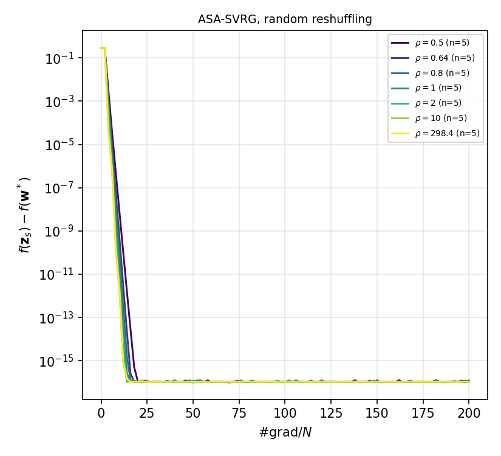
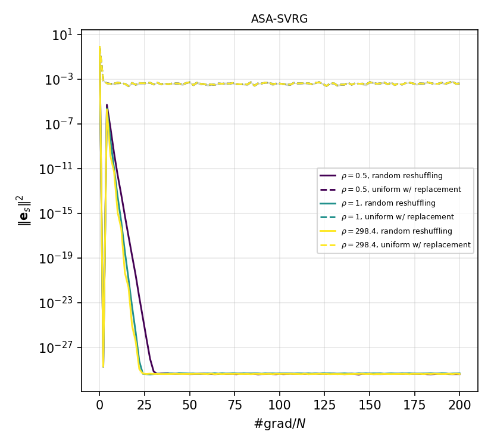
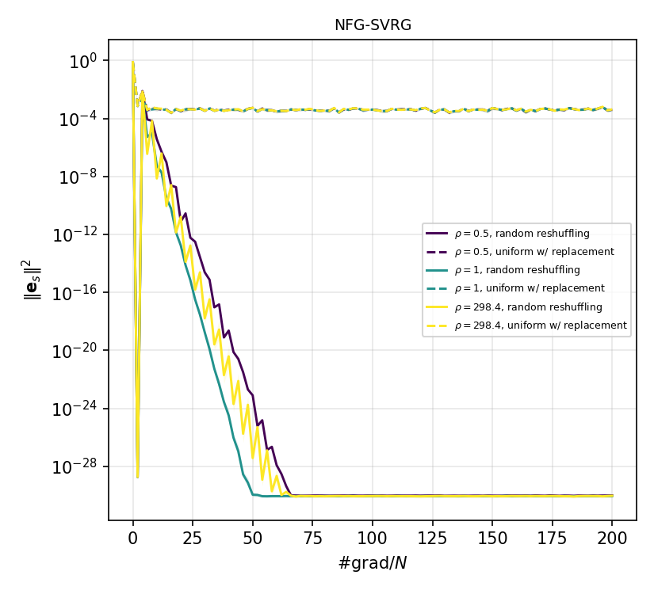
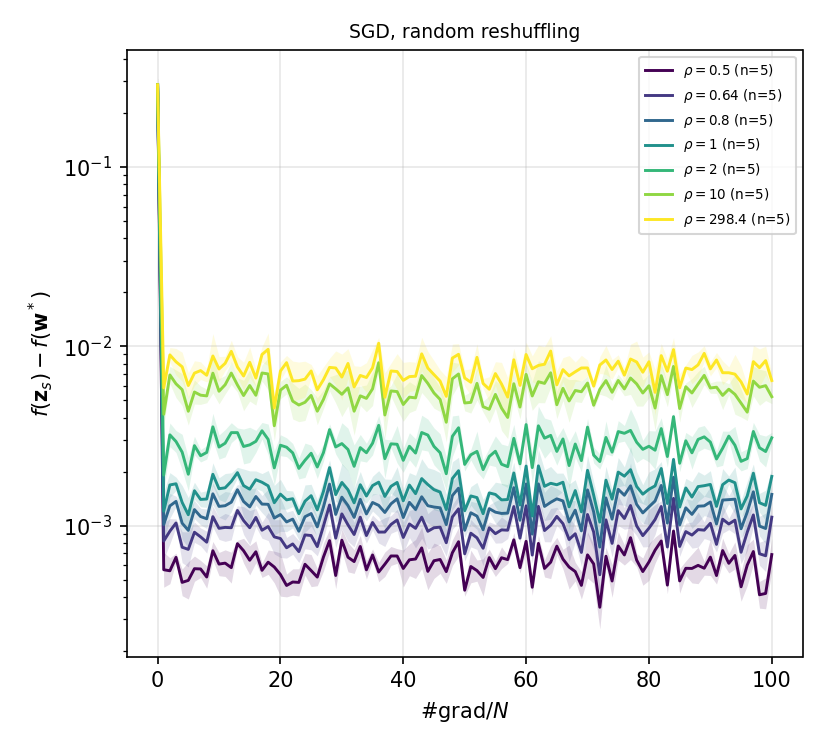

# report_050：E1（Mushroomにおける ρ の異なる学習率での収束挙動とサンプリング方式の影響）

対応するorder：`.orders/order_050.md`．対応する指示：`実験指示E1.md`．対応する実験計画：`実験計画.md` 3章．

## 0. 要点

- **実施内容．** Mushroom（強凸）で，$ \rho \in \{0.5, 0.64, 0.8, 1.0, 2.0, 10, 298.4\} $ の7条件（学習率 $ \eta $ に換算），
  2種類のサンプリング方式（`random_reshuffle` 全7条件，`uniform_with_replacement` は $ \rho \in \{0.5, 1.0, 298.4\} $ のみ），
  4手法（SGD，SVRG，NFG-SVRG，ASA-SVRG），5シード，合計200試行を実行した．内側ループの開始点は
  `inner_start="snapshot"`（report_044の著者判断）に固定した．
- **一致確認．** 本実行の前に，`last_iterate`／`snapshot`，$ \rho=298.4 $，シード0の新実装を，E0とSGDの既存ログと比較した．
  差は全て倍精度の丸め誤差の範囲内（1節参照）であり，実装の正しさを確認した．
- **論点1（実験計画3.7節）：ρ<1でSVRGの実測の縮小率 $ \hat r $ は理論の上界 $ \rho $ 以下か．**
  **事実：** `random_reshuffle` では，$ \rho=0.5, 0.64, 0.8 $ の全ての手法で $ \hat r \ll \rho $（例：SVRG で $ \hat r \approx 0.0009$–$0.0024$）．
  3手法とも5シード全てで100エポック以内に目的関数誤差が倍精度の丸め誤差（$ \sim 10^{-16}$–$10^{-17} $）まで到達しており，
  理論の上界を大きく下回る速さで収束した．
- **論点2：ρ≥1でも目的関数誤差は減少し続けるか．**
  **事実：** `random_reshuffle` では，$ \rho=2, 10, 298.4 $（理論の保証対象外）でも，SVRG・NFG-SVRG・ASA-SVRGの3手法全てが
  100エポック以内に倍精度の丸め誤差まで減少した．定理1の仮定（$ \rho<1 $）が破れても，この強凸問題では実務上の収束が
  観測された．
- **論点3：uniform_with_replacementはNFG-SVRG・ASA-SVRGに非ゼロの誤差床を生じさせるか．**
  **事実：観測された．** `uniform_with_replacement` では，NFG-SVRGとASA-SVRGの両方で，目的関数誤差・近似誤差が
  $ 10^{-4} $ 付近の非ゼロの床で止まり，倍精度の丸め誤差には到達しなかった（例：NFG-SVRG，$ \rho=0.5 $：
  目的関数誤差の床 $ 1.726\times10^{-4} $，近似誤差の床 $ 4.154\times10^{-4} $）．同じ $ \rho $ の `random_reshuffle` では
  両指標とも $ 10^{-17}$–$10^{-31} $ まで減少しており，対照的である．一方SVRGは `uniform_with_replacement` でも
  丸め誤差まで到達し，床は観測されなかった．これは，SVRGがスナップショットでの全勾配を毎外側ループで再計算し
  近似誤差を持たないのに対し，NFG-SVRG・ASA-SVRGは勾配を近似するため，独立一様サンプリングによる分散（置換を
  許さない`random_reshuffle`では1エポックで全データを等回数使うのに対し，`uniform_with_replacement`では使用回数が
  不均一になる）の影響を受けると考えられる．**ただしこの因果関係の説明は推測であり，本実験では検証していない．**
- **SGDとの比較．** 全条件でSGDは $ 10^{-3} $ 程度の誤差床（学習率に比例して増大）で止まり，分散縮小法（3手法）は
  `random_reshuffle` ではいずれも丸め誤差まで到達した．この順序関係は論文の主張と整合する．

## 1. 実行環境・一致確認

### 1.1 実行環境

| 項目 | 内容 |
|---|---|
| OS | Linux 6.18.58.1-microsoft-standard-WSL2（WSL2） |
| Python | 3.12.14（`.venv_pytorch`） |
| 主要パッケージ | torch 2.11.0+cu128，numpy 2.4.6，scipy 1.18.1 |
| 計算資源 | CPUのみ（`torch.set_num_threads(1)`），24論理コア，`multiprocessing.Pool(processes=20)` で1試行1プロセス |
| 実行時間 | 約26分（200試行，20並列） |

### 1.2 既存実装との一致確認（`実験指示E1.md` 3節）

$ \rho=298.4 $，`random_reshuffle`，シード0について，新実装（`ex006_e1_mushroom_rho_sampling`）の出力を
既存のログと比較した．結果は `programs_review/outputs/ex006_e1_mushroom_rho_sampling/consistency_with_e0.md`，
`consistency_with_existing_sgd.md` に保存した．

- **SVRG系（`inner_start="last_iterate"` と `"snapshot"` の両方，対E0）．** `oracle_calls`，`accuracy` は完全一致．
  `objective_gap`，`approx_error`，`grad_norm_sq` は絶対誤差が $ 10^{-17}$–$10^{-20} $ で，倍精度の丸め誤差の範囲内．
  相対誤差は一部で非常に大きい値（例：$ 4.99\times10^{291} $）になっているが，これは両者の値自体が倍精度の丸め誤差の
  床（$ \sim 10^{-16} $ 付近）まで収束しているために，分母がゼロに近づき相対誤差が意味を持たなくなるためである．
  絶対誤差で見れば許容範囲内であり，`実験指示E1.md` 3.3節が許容する「CPUやBLASの違いによる倍精度の丸め誤差の範囲の差」
  と判断した．
- **SGD（対，リポジトリルートの既存ログ）．** `oracle_calls`，`accuracy`，`approx_error`（NaN同士の比較）は完全一致．
  `objective_gap` の最大絶対誤差 $ 3.331\times10^{-16} $（相対 $ 1.181\times10^{-13} $），`grad_norm_sq` の最大絶対誤差
  $ 2.082\times10^{-17} $（相対 $ 1.033\times10^{-15} $）であり，いずれも許容範囲（相対 $ 10^{-12} $ 程度以下）に収まる．

以上より，新実装は既存実装と（丸め誤差を除いて）同一の計算を行っていることを確認し，本実行に進んだ．

## 2. 実験条件

| 項目 | 内容 |
|---|---|
| 問題 | Mushroom，ロジスティック回帰（E0と同一，$ N_{\mathrm{train}}=7311 $，$ N_{\mathrm{test}}=813 $，$ d=22 $） |
| $ L $，$ \mu=\lambda $ | $ L=31.43554637377223 $，$ \mu=\lambda=0.9155984380710358 $ |
| $ \rho $（目標）と $ \eta $ | 0.5→0.001105364，0.64→0.001590556（$ =1/(20L) $，既存実験と同一値），0.8→0.002026671，1.0→0.002492011，2.0→0.004165425，10→0.008141732，298.4→0.01049767（$ =0.99/(3L) $，既存実験と同一値）．$ \rho=0.5,0.8,1.0,2.0,10 $ は二分法（`solve_eta_for_target_rho`）で求めた |
| サンプリング方式 | `random_reshuffle`（全7 $ \rho $）：`rng.permutation`．`uniform_with_replacement`（$ \rho\in\{0.5,1.0,298.4\} $ のみ）：`rng.integers(0, N_train, size=N_train)`（重複を許す） |
| 手法 | SGD（新規追加），SVRG（最終点），NFG-SVRG（最終点），ASA-SVRG |
| 内側ループの開始点 | `snapshot`（固定） |
| シード・エポック | 5シード，各100エポック |
| 試行数 | $ (7+3) \times 4 \times 5 = 200 $ |
| 実装 | `programs_review/programs/ex006_e1_mushroom_rho_sampling/`（`ex001_e0_mushroom_logistic/` を拡張．詳細はそのREADME.md参照） |
| 集計 | `programs_review/programs/analysis_e1.py` → `outputs/e1_summary.md` と `outputs/ex006_e1_mushroom_rho_sampling/figures/` |

打ち切り（発散による early-stop）は200試行中0件であった．

## 3. 結果

### 3.1 集計表（抜粋）

全条件の表は [`outputs/e1_summary.md`](../programs_review/outputs/e1_summary.md) を参照．主要な行を以下に示す
（値は5シードの平均 ± 標準誤差，誤差床は最後の20外側ループの中央値）．

| sampling | $ \rho $（目標） | 手法 | 最終の目的関数誤差 | 実測の縮小率 $ \hat r $ | 誤差床（目的関数誤差） | 誤差床（近似誤差） |
|---|---:|---|---:|---:|---:|---:|
| random reshuffling | 0.5 | SVRG | $ 4.441\times10^{-17} $ | 0.0009 | $ 4.441\times10^{-17} $ | $ 0 $ |
| random reshuffling | 0.5 | NFG-SVRG | $ 6.661\times10^{-17} $ | 0.1154 | $ 6.661\times10^{-17} $ | $ 9.955\times10^{-31} $ |
| random reshuffling | 0.5 | ASA-SVRG | $ 6.661\times10^{-17} $ | 0.0135 | $ 7.772\times10^{-17} $ | $ 4.326\times10^{-30} $ |
| random reshuffling | 298.4 | SVRG | $ 8.882\times10^{-17} $ | 0.0091 | $ 8.882\times10^{-17} $ | $ 0 $ |
| random reshuffling | 298.4 | ASA-SVRG | $ 6.661\times10^{-17} $ | 0.0016 | $ 6.661\times10^{-17} $ | $ 4.383\times10^{-30} $ |
| uniform w/ replacement | 0.5 | NFG-SVRG | $ 1.595\times10^{-4} $ | 0.9262 | $ 1.726\times10^{-4} $ | $ 4.154\times10^{-4} $ |
| uniform w/ replacement | 0.5 | ASA-SVRG | $ 1.290\times10^{-4} $ | 0.9240 | $ 1.377\times10^{-4} $ | $ 4.040\times10^{-4} $ |
| uniform w/ replacement | 298.4 | NFG-SVRG | $ 1.818\times10^{-4} $ | 0.9274 | $ 1.746\times10^{-4} $ | $ 4.163\times10^{-4} $ |
| uniform w/ replacement | 298.4 | ASA-SVRG | $ 1.625\times10^{-4} $ | 0.9262 | $ 1.637\times10^{-4} $ | $ 4.044\times10^{-4} $ |
| random reshuffling | 0.5 | SGD | $ 7.530\times10^{-4} $ | （適用外） | $ 5.971\times10^{-4} $ | （適用外） |
| random reshuffling | 298.4 | SGD | $ 6.533\times10^{-3} $ | （適用外） | $ 7.607\times10^{-3} $ | （適用外） |

`uniform_with_replacement` でのNFG-SVRG・ASA-SVRGの $ \hat r $（$ \approx 0.92$–$0.93 $）は，目的関数誤差が指数的に
減少せず早期に誤差床で平坦化することを反映している（$ \hat r $ は後半のほぼ変化しない区間の比として計算されるため，
1に近い値になる）．

### 3.2 図

代表的な図を以下に示す．全図は `programs_review/outputs/ex006_e1_mushroom_rho_sampling/figures/` を参照．









`visualize_result_E1.ipynb` を実行済みにし，`analysis_e1.py` の出力（表・全図）を埋め込んだ．

## 4. 実験計画3.7節の3つの論点への回答

### 論点1：$ \rho<1 $ でSVRG系の実測の縮小率 $ \hat r $ は理論の上界 $ \rho $ 以下か

**事実．** `random_reshuffle` の $ \rho=0.5, 0.64, 0.8 $ について，SVRG・NFG-SVRG・ASA-SVRGの3手法全てで
$ \hat r \le \rho $ が成立した．特にSVRGは $ \hat r \approx 0.0009$–$0.0024 $ と非常に小さく，理論の上界を大きく下回った．
ASA-SVRGも $ \hat r \approx 0.004$–$0.014 $ と小さい．NFG-SVRGは他の2手法より $ \hat r $ が大きい（$ 0.06$–$0.12 $）が，
それでも $ \rho $ 以下である．

**推測．** 理論の上界（定理1）はワーストケースの保証であり，実際のMushroomデータでの収束はそれよりはるかに速い．
これは強凸問題で，かつ初期値から最適解までの距離が小さいことによると考えられるが，検証していない．

### 論点2：$ \rho\ge1 $ でも目的関数誤差は減少し続けるか

**事実．** `random_reshuffle` の $ \rho=2, 10, 298.4 $（定理1の仮定 $ \rho<1 $ の範囲外）でも，SVRG・NFG-SVRG・ASA-SVRGの
3手法は全て100エポック以内に目的関数誤差を倍精度の丸め誤差（$ \sim10^{-16}$–$10^{-17} $）まで減少させた．減少が
止まったり増加に転じたりする様子は観測されなかった．

**推測．** 定理1の $ \rho<1 $ はこの上界の式が意味を持つための十分条件であり，必要条件ではない可能性がある．
あるいは，この強凸問題・この学習率の範囲では，理論の保証対象外でも実際には収束するだけの余裕があると考えられる．
より大きな $ \rho $（本実験の最大は298.4）や，非凸問題でも同様に成り立つかは未検証である．

### 論点3：`uniform_with_replacement` はNFG-SVRG・ASA-SVRGに非ゼロの誤差床を生じさせるか

**事実．観測された．** $ \rho\in\{0.5, 1.0, 298.4\} $ の全てで，NFG-SVRGとASA-SVRGは目的関数誤差・近似誤差とも
$ 10^{-4} $ 付近の非ゼロの床で止まった．同じ $ \rho $ の `random_reshuffle` では両指標とも $ 10^{-17} $（目的関数誤差）
・$ 10^{-30} $（近似誤差）以下まで減少しており，`uniform_with_replacement` に限って明確な床が生じた．一方SVRGは
`uniform_with_replacement` でも床を生じず，丸め誤差まで到達した．

**推測（未検証）．** SVRGは外側ループごとに全勾配を計算し直すため，サンプリング方式の影響を受けない．NFG-SVRGと
ASA-SVRGはスナップショットの全勾配を1エポックの間に少数のサンプルで近似するため，サンプルの選び方の分散が
近似誤差に直接影響すると考えられる．`random_reshuffle` は1エポックで全データ点をちょうど1回使うのに対し，
`uniform_with_replacement` は使用回数が不均一（一部は0回，一部は複数回）になるため，全勾配の近似に系統的な
偏り・分散が残り，誤差床として現れると推測される．この因果関係自体，および床の大きさ（$ \sim10^{-4} $）が
何で決まるか（$ 1/N_{\mathrm{train}} $ などとの関係）は，本実験の範囲では検証していない．

## 5. 統合時の注意

- **README.md の転記．** `programs_review/programs/ex006_e1_mushroom_rho_sampling/README.md` 5節に，
  `programs_review/document.md` への追記内容（実装している実験の一覧，ディレクトリ構成，依存関係の図，
  `config.json` の新キーの説明）を記載した．統合時にそちらを `document.md` に転記する．
- **共通化の提案（`programs_review/programs/common/` は変更していない）．**
  1. `common/optimizers/` のSVRG系オプティマイザのインターフェースはE1でも無変更で利用でき，変更は不要であった．
  2. `compare_with_existing_logs.py` もE1の一致確認にそのまま再利用でき，変更は不要であった．
  3. 今回`ex001_e0_mushroom_logistic/train.py` の `solve_eta_for_target_rho`，`compute_optimal_solution` などの
     Mushroom専用ロジックを `ex006` にコピーして使った．今後E2・E3等でも同種の学習率探索が必要になる場合，
     これらの関数を `common/` に切り出すことを検討してよい（本実験では対象外のため実施していない）．
- **ディレクトリ構成の衝突回避．** 本実験は並行作業との衝突を避けるため，`order_050`／`report_050`／`ex006` の
  番号を使用した．他のPCでの並行実験（E1以外の番号帯）との統合時は，`.orders/`，`.reports/` の番号の重複が
  ないことを確認すること．
- **zipに含めなかったもの．** 一致確認のための補助出力
  `programs_review/outputs/_verify/ex006/`（`last_iterate` と `snapshot` 双方を含む小規模な検証用ログ）は
  `実験指示E1.md` 5節のzip対象に含まれていないため，`E1_results.zip` には含めていない．削除はしていない
  （再現性のため残置）．

## 6. 再現方法

```bash
cd programs_review/programs
python ex006_e1_mushroom_rho_sampling/train.py --workers 20
python analysis_e1.py
cd .. && python -m pytest -q tests/test_e1_programs.py
```

## 7. 未解決の論点・次の作業の候補

1. 論点3の原因（`uniform_with_replacement` の誤差床がサンプルの使用回数の不均一性に起因するという推測）の検証．
   例えば，1エポック内の各データ点の使用回数の分散と誤差床の大きさの関係を調べる．
2. 論点1・2で観測された「理論の上界より速い収束」が，非凸問題（画像分類）でも成り立つかの確認（E1はMushroomのみ）．
3. `uniform_with_replacement` の誤差床（$ \sim10^{-4} $）の大きさが $ \eta $ や $ N_{\mathrm{train}} $ とどう関係するかの定量化．
   本実験は3つの $ \rho $（学習率）のみで，床の大きさに明確な単調性は見られなかった（0.5：$ 1.73\times10^{-4} $，
   1.0：$ 1.72\times10^{-4} $，298.4：$ 1.75\times10^{-4} $，いずれもNFG-SVRG）．

## 8. 成果物（`E1_results.zip`）

`実験指示E1.md` 5節のコマンドで作成した．`.orders/order_050.md`，`.reports/report_050.md`，
`programs_review/programs/ex006_e1_mushroom_rho_sampling/`（プログラム・ログ・図・一致確認結果），
`programs_review/programs/analysis_e1.py`，`programs_review/tests/test_e1_programs.py`，
`programs_review/visualize_result_E1.ipynb`（実行済み），`programs_review/outputs/e1_summary.md`，
および実行ログ `programs_review/outputs/_run_logs/ex006_e1_train.log` を含む（690ファイル，計 13,819,626 バイト）．
`__pycache__`，`.pyc`，`.pth` は含まれていない．以下は `unzip -l E1_results.zip` の全出力である．

```text
Archive:  E1_results.zip
  Length      Date    Time    Name
---------  ---------- -----   ----
     3843  2026-11-18 22:40   .orders/order_050.md
    16869  2026-11-19 01:11   .reports/report_050.md
        0  2026-11-18 22:50   programs_review/programs/ex006_e1_mushroom_rho_sampling/
     6078  2026-11-18 22:41   programs_review/programs/ex006_e1_mushroom_rho_sampling/data.py
     8681  2026-11-18 22:41   programs_review/programs/ex006_e1_mushroom_rho_sampling/model.py
     6406  2026-11-18 22:50   programs_review/programs/ex006_e1_mushroom_rho_sampling/README.md
    28046  2026-11-18 22:49   programs_review/programs/ex006_e1_mushroom_rho_sampling/train.py
    19196  2026-11-18 22:46   programs_review/programs/analysis_e1.py
    10058  2026-11-18 22:49   programs_review/tests/test_e1_programs.py
  3543899  2026-11-19 01:12   programs_review/visualize_result_E1.ipynb
        0  2026-11-19 01:09   programs_review/outputs/ex006_e1_mushroom_rho_sampling/
        0  2026-11-19 00:19   programs_review/outputs/ex006_e1_mushroom_rho_sampling/NFG_SVRG/
        0  2026-11-19 00:18   programs_review/outputs/ex006_e1_mushroom_rho_sampling/NFG_SVRG/inner_snapshot_uniform_with_replacement_rho1.0_eta2.492011e-03_lambda9.155984e-01_K7311_epochs100/
        0  2026-11-19 00:33   programs_review/outputs/ex006_e1_mushroom_rho_sampling/NFG_SVRG/inner_snapshot_uniform_with_replacement_rho1.0_eta2.492011e-03_lambda9.155984e-01_K7311_epochs100/3/
    28473  2026-11-19 00:33   programs_review/outputs/ex006_e1_mushroom_rho_sampling/NFG_SVRG/inner_snapshot_uniform_with_replacement_rho1.0_eta2.492011e-03_lambda9.155984e-01_K7311_epochs100/3/log.json
      615  2026-11-19 00:33   programs_review/outputs/ex006_e1_mushroom_rho_sampling/NFG_SVRG/inner_snapshot_uniform_with_replacement_rho1.0_eta2.492011e-03_lambda9.155984e-01_K7311_epochs100/3/config.json
        0  2026-11-19 00:33   programs_review/outputs/ex006_e1_mushroom_rho_sampling/NFG_SVRG/inner_snapshot_uniform_with_replacement_rho1.0_eta2.492011e-03_lambda9.155984e-01_K7311_epochs100/2/
    28475  2026-11-19 00:33   programs_review/outputs/ex006_e1_mushroom_rho_sampling/NFG_SVRG/inner_snapshot_uniform_with_replacement_rho1.0_eta2.492011e-03_lambda9.155984e-01_K7311_epochs100/2/log.json
      615  2026-11-19 00:33   programs_review/outputs/ex006_e1_mushroom_rho_sampling/NFG_SVRG/inner_snapshot_uniform_with_replacement_rho1.0_eta2.492011e-03_lambda9.155984e-01_K7311_epochs100/2/config.json
        0  2026-11-19 00:32   programs_review/outputs/ex006_e1_mushroom_rho_sampling/NFG_SVRG/inner_snapshot_uniform_with_replacement_rho1.0_eta2.492011e-03_lambda9.155984e-01_K7311_epochs100/0/
    28442  2026-11-19 00:32   programs_review/outputs/ex006_e1_mushroom_rho_sampling/NFG_SVRG/inner_snapshot_uniform_with_replacement_rho1.0_eta2.492011e-03_lambda9.155984e-01_K7311_epochs100/0/log.json
      615  2026-11-19 00:32   programs_review/outputs/ex006_e1_mushroom_rho_sampling/NFG_SVRG/inner_snapshot_uniform_with_replacement_rho1.0_eta2.492011e-03_lambda9.155984e-01_K7311_epochs100/0/config.json
        0  2026-11-19 00:33   programs_review/outputs/ex006_e1_mushroom_rho_sampling/NFG_SVRG/inner_snapshot_uniform_with_replacement_rho1.0_eta2.492011e-03_lambda9.155984e-01_K7311_epochs100/4/
    28444  2026-11-19 00:33   programs_review/outputs/ex006_e1_mushroom_rho_sampling/NFG_SVRG/inner_snapshot_uniform_with_replacement_rho1.0_eta2.492011e-03_lambda9.155984e-01_K7311_epochs100/4/log.json
      615  2026-11-19 00:33   programs_review/outputs/ex006_e1_mushroom_rho_sampling/NFG_SVRG/inner_snapshot_uniform_with_replacement_rho1.0_eta2.492011e-03_lambda9.155984e-01_K7311_epochs100/4/config.json
        0  2026-11-19 00:33   programs_review/outputs/ex006_e1_mushroom_rho_sampling/NFG_SVRG/inner_snapshot_uniform_with_replacement_rho1.0_eta2.492011e-03_lambda9.155984e-01_K7311_epochs100/1/
    28477  2026-11-19 00:33   programs_review/outputs/ex006_e1_mushroom_rho_sampling/NFG_SVRG/inner_snapshot_uniform_with_replacement_rho1.0_eta2.492011e-03_lambda9.155984e-01_K7311_epochs100/1/log.json
      615  2026-11-19 00:33   programs_review/outputs/ex006_e1_mushroom_rho_sampling/NFG_SVRG/inner_snapshot_uniform_with_replacement_rho1.0_eta2.492011e-03_lambda9.155984e-01_K7311_epochs100/1/config.json
        0  2026-11-19 00:19   programs_review/outputs/ex006_e1_mushroom_rho_sampling/NFG_SVRG/inner_snapshot_uniform_with_replacement_rho298.4_eta1.049767e-02_lambda9.155984e-01_K7311_epochs100/
        0  2026-11-19 00:34   programs_review/outputs/ex006_e1_mushroom_rho_sampling/NFG_SVRG/inner_snapshot_uniform_with_replacement_rho298.4_eta1.049767e-02_lambda9.155984e-01_K7311_epochs100/3/
    28463  2026-11-19 00:34   programs_review/outputs/ex006_e1_mushroom_rho_sampling/NFG_SVRG/inner_snapshot_uniform_with_replacement_rho298.4_eta1.049767e-02_lambda9.155984e-01_K7311_epochs100/3/log.json
      617  2026-11-19 00:34   programs_review/outputs/ex006_e1_mushroom_rho_sampling/NFG_SVRG/inner_snapshot_uniform_with_replacement_rho298.4_eta1.049767e-02_lambda9.155984e-01_K7311_epochs100/3/config.json
        0  2026-11-19 00:34   programs_review/outputs/ex006_e1_mushroom_rho_sampling/NFG_SVRG/inner_snapshot_uniform_with_replacement_rho298.4_eta1.049767e-02_lambda9.155984e-01_K7311_epochs100/2/
    28484  2026-11-19 00:34   programs_review/outputs/ex006_e1_mushroom_rho_sampling/NFG_SVRG/inner_snapshot_uniform_with_replacement_rho298.4_eta1.049767e-02_lambda9.155984e-01_K7311_epochs100/2/log.json
      617  2026-11-19 00:34   programs_review/outputs/ex006_e1_mushroom_rho_sampling/NFG_SVRG/inner_snapshot_uniform_with_replacement_rho298.4_eta1.049767e-02_lambda9.155984e-01_K7311_epochs100/2/config.json
        0  2026-11-19 00:33   programs_review/outputs/ex006_e1_mushroom_rho_sampling/NFG_SVRG/inner_snapshot_uniform_with_replacement_rho298.4_eta1.049767e-02_lambda9.155984e-01_K7311_epochs100/0/
    28450  2026-11-19 00:33   programs_review/outputs/ex006_e1_mushroom_rho_sampling/NFG_SVRG/inner_snapshot_uniform_with_replacement_rho298.4_eta1.049767e-02_lambda9.155984e-01_K7311_epochs100/0/log.json
      617  2026-11-19 00:33   programs_review/outputs/ex006_e1_mushroom_rho_sampling/NFG_SVRG/inner_snapshot_uniform_with_replacement_rho298.4_eta1.049767e-02_lambda9.155984e-01_K7311_epochs100/0/config.json
        0  2026-11-19 00:34   programs_review/outputs/ex006_e1_mushroom_rho_sampling/NFG_SVRG/inner_snapshot_uniform_with_replacement_rho298.4_eta1.049767e-02_lambda9.155984e-01_K7311_epochs100/4/
    28499  2026-11-19 00:34   programs_review/outputs/ex006_e1_mushroom_rho_sampling/NFG_SVRG/inner_snapshot_uniform_with_replacement_rho298.4_eta1.049767e-02_lambda9.155984e-01_K7311_epochs100/4/log.json
      617  2026-11-19 00:34   programs_review/outputs/ex006_e1_mushroom_rho_sampling/NFG_SVRG/inner_snapshot_uniform_with_replacement_rho298.4_eta1.049767e-02_lambda9.155984e-01_K7311_epochs100/4/config.json
        0  2026-11-19 00:34   programs_review/outputs/ex006_e1_mushroom_rho_sampling/NFG_SVRG/inner_snapshot_uniform_with_replacement_rho298.4_eta1.049767e-02_lambda9.155984e-01_K7311_epochs100/1/
    28478  2026-11-19 00:34   programs_review/outputs/ex006_e1_mushroom_rho_sampling/NFG_SVRG/inner_snapshot_uniform_with_replacement_rho298.4_eta1.049767e-02_lambda9.155984e-01_K7311_epochs100/1/log.json
      617  2026-11-19 00:34   programs_review/outputs/ex006_e1_mushroom_rho_sampling/NFG_SVRG/inner_snapshot_uniform_with_replacement_rho298.4_eta1.049767e-02_lambda9.155984e-01_K7311_epochs100/1/config.json
        0  2026-11-18 23:48   programs_review/outputs/ex006_e1_mushroom_rho_sampling/NFG_SVRG/inner_snapshot_random_reshuffle_rho0.64_eta1.590556e-03_lambda9.155984e-01_K7311_epochs100/
        0  2026-11-19 00:04   programs_review/outputs/ex006_e1_mushroom_rho_sampling/NFG_SVRG/inner_snapshot_random_reshuffle_rho0.64_eta1.590556e-03_lambda9.155984e-01_K7311_epochs100/3/
    28467  2026-11-19 00:04   programs_review/outputs/ex006_e1_mushroom_rho_sampling/NFG_SVRG/inner_snapshot_random_reshuffle_rho0.64_eta1.590556e-03_lambda9.155984e-01_K7311_epochs100/3/log.json
      609  2026-11-19 00:04   programs_review/outputs/ex006_e1_mushroom_rho_sampling/NFG_SVRG/inner_snapshot_random_reshuffle_rho0.64_eta1.590556e-03_lambda9.155984e-01_K7311_epochs100/3/config.json
        0  2026-11-19 00:04   programs_review/outputs/ex006_e1_mushroom_rho_sampling/NFG_SVRG/inner_snapshot_random_reshuffle_rho0.64_eta1.590556e-03_lambda9.155984e-01_K7311_epochs100/2/
    28450  2026-11-19 00:04   programs_review/outputs/ex006_e1_mushroom_rho_sampling/NFG_SVRG/inner_snapshot_random_reshuffle_rho0.64_eta1.590556e-03_lambda9.155984e-01_K7311_epochs100/2/log.json
      609  2026-11-19 00:04   programs_review/outputs/ex006_e1_mushroom_rho_sampling/NFG_SVRG/inner_snapshot_random_reshuffle_rho0.64_eta1.590556e-03_lambda9.155984e-01_K7311_epochs100/2/config.json
        0  2026-11-19 00:03   programs_review/outputs/ex006_e1_mushroom_rho_sampling/NFG_SVRG/inner_snapshot_random_reshuffle_rho0.64_eta1.590556e-03_lambda9.155984e-01_K7311_epochs100/0/
    28576  2026-11-19 00:03   programs_review/outputs/ex006_e1_mushroom_rho_sampling/NFG_SVRG/inner_snapshot_random_reshuffle_rho0.64_eta1.590556e-03_lambda9.155984e-01_K7311_epochs100/0/log.json
      609  2026-11-19 00:03   programs_review/outputs/ex006_e1_mushroom_rho_sampling/NFG_SVRG/inner_snapshot_random_reshuffle_rho0.64_eta1.590556e-03_lambda9.155984e-01_K7311_epochs100/0/config.json
        0  2026-11-19 00:04   programs_review/outputs/ex006_e1_mushroom_rho_sampling/NFG_SVRG/inner_snapshot_random_reshuffle_rho0.64_eta1.590556e-03_lambda9.155984e-01_K7311_epochs100/4/
    26871  2026-11-19 00:04   programs_review/outputs/ex006_e1_mushroom_rho_sampling/NFG_SVRG/inner_snapshot_random_reshuffle_rho0.64_eta1.590556e-03_lambda9.155984e-01_K7311_epochs100/4/log.json
      609  2026-11-19 00:04   programs_review/outputs/ex006_e1_mushroom_rho_sampling/NFG_SVRG/inner_snapshot_random_reshuffle_rho0.64_eta1.590556e-03_lambda9.155984e-01_K7311_epochs100/4/config.json
        0  2026-11-19 00:04   programs_review/outputs/ex006_e1_mushroom_rho_sampling/NFG_SVRG/inner_snapshot_random_reshuffle_rho0.64_eta1.590556e-03_lambda9.155984e-01_K7311_epochs100/1/
    28371  2026-11-19 00:04   programs_review/outputs/ex006_e1_mushroom_rho_sampling/NFG_SVRG/inner_snapshot_random_reshuffle_rho0.64_eta1.590556e-03_lambda9.155984e-01_K7311_epochs100/1/log.json
      609  2026-11-19 00:04   programs_review/outputs/ex006_e1_mushroom_rho_sampling/NFG_SVRG/inner_snapshot_random_reshuffle_rho0.64_eta1.590556e-03_lambda9.155984e-01_K7311_epochs100/1/config.json
        0  2026-11-18 23:55   programs_review/outputs/ex006_e1_mushroom_rho_sampling/NFG_SVRG/inner_snapshot_random_reshuffle_rho0.8_eta2.026671e-03_lambda9.155984e-01_K7311_epochs100/
        0  2026-11-19 00:10   programs_review/outputs/ex006_e1_mushroom_rho_sampling/NFG_SVRG/inner_snapshot_random_reshuffle_rho0.8_eta2.026671e-03_lambda9.155984e-01_K7311_epochs100/3/
    26960  2026-11-19 00:10   programs_review/outputs/ex006_e1_mushroom_rho_sampling/NFG_SVRG/inner_snapshot_random_reshuffle_rho0.8_eta2.026671e-03_lambda9.155984e-01_K7311_epochs100/3/log.json
      607  2026-11-19 00:10   programs_review/outputs/ex006_e1_mushroom_rho_sampling/NFG_SVRG/inner_snapshot_random_reshuffle_rho0.8_eta2.026671e-03_lambda9.155984e-01_K7311_epochs100/3/config.json
        0  2026-11-19 00:10   programs_review/outputs/ex006_e1_mushroom_rho_sampling/NFG_SVRG/inner_snapshot_random_reshuffle_rho0.8_eta2.026671e-03_lambda9.155984e-01_K7311_epochs100/2/
    27598  2026-11-19 00:10   programs_review/outputs/ex006_e1_mushroom_rho_sampling/NFG_SVRG/inner_snapshot_random_reshuffle_rho0.8_eta2.026671e-03_lambda9.155984e-01_K7311_epochs100/2/log.json
      607  2026-11-19 00:10   programs_review/outputs/ex006_e1_mushroom_rho_sampling/NFG_SVRG/inner_snapshot_random_reshuffle_rho0.8_eta2.026671e-03_lambda9.155984e-01_K7311_epochs100/2/config.json
        0  2026-11-19 00:10   programs_review/outputs/ex006_e1_mushroom_rho_sampling/NFG_SVRG/inner_snapshot_random_reshuffle_rho0.8_eta2.026671e-03_lambda9.155984e-01_K7311_epochs100/0/
    28418  2026-11-19 00:10   programs_review/outputs/ex006_e1_mushroom_rho_sampling/NFG_SVRG/inner_snapshot_random_reshuffle_rho0.8_eta2.026671e-03_lambda9.155984e-01_K7311_epochs100/0/log.json
      607  2026-11-19 00:10   programs_review/outputs/ex006_e1_mushroom_rho_sampling/NFG_SVRG/inner_snapshot_random_reshuffle_rho0.8_eta2.026671e-03_lambda9.155984e-01_K7311_epochs100/0/config.json
        0  2026-11-19 00:11   programs_review/outputs/ex006_e1_mushroom_rho_sampling/NFG_SVRG/inner_snapshot_random_reshuffle_rho0.8_eta2.026671e-03_lambda9.155984e-01_K7311_epochs100/4/
    27064  2026-11-19 00:11   programs_review/outputs/ex006_e1_mushroom_rho_sampling/NFG_SVRG/inner_snapshot_random_reshuffle_rho0.8_eta2.026671e-03_lambda9.155984e-01_K7311_epochs100/4/log.json
      607  2026-11-19 00:11   programs_review/outputs/ex006_e1_mushroom_rho_sampling/NFG_SVRG/inner_snapshot_random_reshuffle_rho0.8_eta2.026671e-03_lambda9.155984e-01_K7311_epochs100/4/config.json
        0  2026-11-19 00:10   programs_review/outputs/ex006_e1_mushroom_rho_sampling/NFG_SVRG/inner_snapshot_random_reshuffle_rho0.8_eta2.026671e-03_lambda9.155984e-01_K7311_epochs100/1/
    28528  2026-11-19 00:10   programs_review/outputs/ex006_e1_mushroom_rho_sampling/NFG_SVRG/inner_snapshot_random_reshuffle_rho0.8_eta2.026671e-03_lambda9.155984e-01_K7311_epochs100/1/log.json
      607  2026-11-19 00:10   programs_review/outputs/ex006_e1_mushroom_rho_sampling/NFG_SVRG/inner_snapshot_random_reshuffle_rho0.8_eta2.026671e-03_lambda9.155984e-01_K7311_epochs100/1/config.json
        0  2026-11-19 00:03   programs_review/outputs/ex006_e1_mushroom_rho_sampling/NFG_SVRG/inner_snapshot_random_reshuffle_rho2.0_eta4.165425e-03_lambda9.155984e-01_K7311_epochs100/
        0  2026-11-19 00:18   programs_review/outputs/ex006_e1_mushroom_rho_sampling/NFG_SVRG/inner_snapshot_random_reshuffle_rho2.0_eta4.165425e-03_lambda9.155984e-01_K7311_epochs100/3/
    28307  2026-11-19 00:18   programs_review/outputs/ex006_e1_mushroom_rho_sampling/NFG_SVRG/inner_snapshot_random_reshuffle_rho2.0_eta4.165425e-03_lambda9.155984e-01_K7311_epochs100/3/log.json
      607  2026-11-19 00:18   programs_review/outputs/ex006_e1_mushroom_rho_sampling/NFG_SVRG/inner_snapshot_random_reshuffle_rho2.0_eta4.165425e-03_lambda9.155984e-01_K7311_epochs100/3/config.json
        0  2026-11-19 00:18   programs_review/outputs/ex006_e1_mushroom_rho_sampling/NFG_SVRG/inner_snapshot_random_reshuffle_rho2.0_eta4.165425e-03_lambda9.155984e-01_K7311_epochs100/2/
    28547  2026-11-19 00:18   programs_review/outputs/ex006_e1_mushroom_rho_sampling/NFG_SVRG/inner_snapshot_random_reshuffle_rho2.0_eta4.165425e-03_lambda9.155984e-01_K7311_epochs100/2/log.json
      607  2026-11-19 00:18   programs_review/outputs/ex006_e1_mushroom_rho_sampling/NFG_SVRG/inner_snapshot_random_reshuffle_rho2.0_eta4.165425e-03_lambda9.155984e-01_K7311_epochs100/2/config.json
        0  2026-11-19 00:18   programs_review/outputs/ex006_e1_mushroom_rho_sampling/NFG_SVRG/inner_snapshot_random_reshuffle_rho2.0_eta4.165425e-03_lambda9.155984e-01_K7311_epochs100/0/
    28495  2026-11-19 00:18   programs_review/outputs/ex006_e1_mushroom_rho_sampling/NFG_SVRG/inner_snapshot_random_reshuffle_rho2.0_eta4.165425e-03_lambda9.155984e-01_K7311_epochs100/0/log.json
      607  2026-11-19 00:18   programs_review/outputs/ex006_e1_mushroom_rho_sampling/NFG_SVRG/inner_snapshot_random_reshuffle_rho2.0_eta4.165425e-03_lambda9.155984e-01_K7311_epochs100/0/config.json
        0  2026-11-19 00:18   programs_review/outputs/ex006_e1_mushroom_rho_sampling/NFG_SVRG/inner_snapshot_random_reshuffle_rho2.0_eta4.165425e-03_lambda9.155984e-01_K7311_epochs100/4/
    26979  2026-11-19 00:18   programs_review/outputs/ex006_e1_mushroom_rho_sampling/NFG_SVRG/inner_snapshot_random_reshuffle_rho2.0_eta4.165425e-03_lambda9.155984e-01_K7311_epochs100/4/log.json
      607  2026-11-19 00:18   programs_review/outputs/ex006_e1_mushroom_rho_sampling/NFG_SVRG/inner_snapshot_random_reshuffle_rho2.0_eta4.165425e-03_lambda9.155984e-01_K7311_epochs100/4/config.json
        0  2026-11-19 00:18   programs_review/outputs/ex006_e1_mushroom_rho_sampling/NFG_SVRG/inner_snapshot_random_reshuffle_rho2.0_eta4.165425e-03_lambda9.155984e-01_K7311_epochs100/1/
    28401  2026-11-19 00:18   programs_review/outputs/ex006_e1_mushroom_rho_sampling/NFG_SVRG/inner_snapshot_random_reshuffle_rho2.0_eta4.165425e-03_lambda9.155984e-01_K7311_epochs100/1/log.json
      607  2026-11-19 00:18   programs_review/outputs/ex006_e1_mushroom_rho_sampling/NFG_SVRG/inner_snapshot_random_reshuffle_rho2.0_eta4.165425e-03_lambda9.155984e-01_K7311_epochs100/1/config.json
        0  2026-11-18 23:56   programs_review/outputs/ex006_e1_mushroom_rho_sampling/NFG_SVRG/inner_snapshot_random_reshuffle_rho1.0_eta2.492011e-03_lambda9.155984e-01_K7311_epochs100/
        0  2026-11-19 00:11   programs_review/outputs/ex006_e1_mushroom_rho_sampling/NFG_SVRG/inner_snapshot_random_reshuffle_rho1.0_eta2.492011e-03_lambda9.155984e-01_K7311_epochs100/3/
    28390  2026-11-19 00:11   programs_review/outputs/ex006_e1_mushroom_rho_sampling/NFG_SVRG/inner_snapshot_random_reshuffle_rho1.0_eta2.492011e-03_lambda9.155984e-01_K7311_epochs100/3/log.json
      607  2026-11-19 00:11   programs_review/outputs/ex006_e1_mushroom_rho_sampling/NFG_SVRG/inner_snapshot_random_reshuffle_rho1.0_eta2.492011e-03_lambda9.155984e-01_K7311_epochs100/3/config.json
        0  2026-11-19 00:11   programs_review/outputs/ex006_e1_mushroom_rho_sampling/NFG_SVRG/inner_snapshot_random_reshuffle_rho1.0_eta2.492011e-03_lambda9.155984e-01_K7311_epochs100/2/
    28455  2026-11-19 00:11   programs_review/outputs/ex006_e1_mushroom_rho_sampling/NFG_SVRG/inner_snapshot_random_reshuffle_rho1.0_eta2.492011e-03_lambda9.155984e-01_K7311_epochs100/2/log.json
      607  2026-11-19 00:11   programs_review/outputs/ex006_e1_mushroom_rho_sampling/NFG_SVRG/inner_snapshot_random_reshuffle_rho1.0_eta2.492011e-03_lambda9.155984e-01_K7311_epochs100/2/config.json
        0  2026-11-19 00:11   programs_review/outputs/ex006_e1_mushroom_rho_sampling/NFG_SVRG/inner_snapshot_random_reshuffle_rho1.0_eta2.492011e-03_lambda9.155984e-01_K7311_epochs100/0/
    28456  2026-11-19 00:11   programs_review/outputs/ex006_e1_mushroom_rho_sampling/NFG_SVRG/inner_snapshot_random_reshuffle_rho1.0_eta2.492011e-03_lambda9.155984e-01_K7311_epochs100/0/log.json
      607  2026-11-19 00:11   programs_review/outputs/ex006_e1_mushroom_rho_sampling/NFG_SVRG/inner_snapshot_random_reshuffle_rho1.0_eta2.492011e-03_lambda9.155984e-01_K7311_epochs100/0/config.json
        0  2026-11-19 00:12   programs_review/outputs/ex006_e1_mushroom_rho_sampling/NFG_SVRG/inner_snapshot_random_reshuffle_rho1.0_eta2.492011e-03_lambda9.155984e-01_K7311_epochs100/4/
    27028  2026-11-19 00:12   programs_review/outputs/ex006_e1_mushroom_rho_sampling/NFG_SVRG/inner_snapshot_random_reshuffle_rho1.0_eta2.492011e-03_lambda9.155984e-01_K7311_epochs100/4/log.json
      607  2026-11-19 00:12   programs_review/outputs/ex006_e1_mushroom_rho_sampling/NFG_SVRG/inner_snapshot_random_reshuffle_rho1.0_eta2.492011e-03_lambda9.155984e-01_K7311_epochs100/4/config.json
        0  2026-11-19 00:11   programs_review/outputs/ex006_e1_mushroom_rho_sampling/NFG_SVRG/inner_snapshot_random_reshuffle_rho1.0_eta2.492011e-03_lambda9.155984e-01_K7311_epochs100/1/
    28515  2026-11-19 00:11   programs_review/outputs/ex006_e1_mushroom_rho_sampling/NFG_SVRG/inner_snapshot_random_reshuffle_rho1.0_eta2.492011e-03_lambda9.155984e-01_K7311_epochs100/1/log.json
      607  2026-11-19 00:11   programs_review/outputs/ex006_e1_mushroom_rho_sampling/NFG_SVRG/inner_snapshot_random_reshuffle_rho1.0_eta2.492011e-03_lambda9.155984e-01_K7311_epochs100/1/config.json
        0  2026-11-18 23:48   programs_review/outputs/ex006_e1_mushroom_rho_sampling/NFG_SVRG/inner_snapshot_random_reshuffle_rho0.5_eta1.105364e-03_lambda9.155984e-01_K7311_epochs100/
        0  2026-11-19 00:03   programs_review/outputs/ex006_e1_mushroom_rho_sampling/NFG_SVRG/inner_snapshot_random_reshuffle_rho0.5_eta1.105364e-03_lambda9.155984e-01_K7311_epochs100/3/
    28457  2026-11-19 00:03   programs_review/outputs/ex006_e1_mushroom_rho_sampling/NFG_SVRG/inner_snapshot_random_reshuffle_rho0.5_eta1.105364e-03_lambda9.155984e-01_K7311_epochs100/3/log.json
      607  2026-11-19 00:03   programs_review/outputs/ex006_e1_mushroom_rho_sampling/NFG_SVRG/inner_snapshot_random_reshuffle_rho0.5_eta1.105364e-03_lambda9.155984e-01_K7311_epochs100/3/config.json
        0  2026-11-19 00:02   programs_review/outputs/ex006_e1_mushroom_rho_sampling/NFG_SVRG/inner_snapshot_random_reshuffle_rho0.5_eta1.105364e-03_lambda9.155984e-01_K7311_epochs100/2/
    28561  2026-11-19 00:02   programs_review/outputs/ex006_e1_mushroom_rho_sampling/NFG_SVRG/inner_snapshot_random_reshuffle_rho0.5_eta1.105364e-03_lambda9.155984e-01_K7311_epochs100/2/log.json
      607  2026-11-19 00:02   programs_review/outputs/ex006_e1_mushroom_rho_sampling/NFG_SVRG/inner_snapshot_random_reshuffle_rho0.5_eta1.105364e-03_lambda9.155984e-01_K7311_epochs100/2/config.json
        0  2026-11-19 00:03   programs_review/outputs/ex006_e1_mushroom_rho_sampling/NFG_SVRG/inner_snapshot_random_reshuffle_rho0.5_eta1.105364e-03_lambda9.155984e-01_K7311_epochs100/0/
    28554  2026-11-19 00:03   programs_review/outputs/ex006_e1_mushroom_rho_sampling/NFG_SVRG/inner_snapshot_random_reshuffle_rho0.5_eta1.105364e-03_lambda9.155984e-01_K7311_epochs100/0/log.json
      607  2026-11-19 00:03   programs_review/outputs/ex006_e1_mushroom_rho_sampling/NFG_SVRG/inner_snapshot_random_reshuffle_rho0.5_eta1.105364e-03_lambda9.155984e-01_K7311_epochs100/0/config.json
        0  2026-11-19 00:03   programs_review/outputs/ex006_e1_mushroom_rho_sampling/NFG_SVRG/inner_snapshot_random_reshuffle_rho0.5_eta1.105364e-03_lambda9.155984e-01_K7311_epochs100/4/
    26957  2026-11-19 00:03   programs_review/outputs/ex006_e1_mushroom_rho_sampling/NFG_SVRG/inner_snapshot_random_reshuffle_rho0.5_eta1.105364e-03_lambda9.155984e-01_K7311_epochs100/4/log.json
      607  2026-11-19 00:03   programs_review/outputs/ex006_e1_mushroom_rho_sampling/NFG_SVRG/inner_snapshot_random_reshuffle_rho0.5_eta1.105364e-03_lambda9.155984e-01_K7311_epochs100/4/config.json
        0  2026-11-19 00:03   programs_review/outputs/ex006_e1_mushroom_rho_sampling/NFG_SVRG/inner_snapshot_random_reshuffle_rho0.5_eta1.105364e-03_lambda9.155984e-01_K7311_epochs100/1/
    27191  2026-11-19 00:03   programs_review/outputs/ex006_e1_mushroom_rho_sampling/NFG_SVRG/inner_snapshot_random_reshuffle_rho0.5_eta1.105364e-03_lambda9.155984e-01_K7311_epochs100/1/log.json
      607  2026-11-19 00:03   programs_review/outputs/ex006_e1_mushroom_rho_sampling/NFG_SVRG/inner_snapshot_random_reshuffle_rho0.5_eta1.105364e-03_lambda9.155984e-01_K7311_epochs100/1/config.json
        0  2026-11-19 00:11   programs_review/outputs/ex006_e1_mushroom_rho_sampling/NFG_SVRG/inner_snapshot_random_reshuffle_rho298.4_eta1.049767e-02_lambda9.155984e-01_K7311_epochs100/
        0  2026-11-19 00:25   programs_review/outputs/ex006_e1_mushroom_rho_sampling/NFG_SVRG/inner_snapshot_random_reshuffle_rho298.4_eta1.049767e-02_lambda9.155984e-01_K7311_epochs100/3/
    28461  2026-11-19 00:25   programs_review/outputs/ex006_e1_mushroom_rho_sampling/NFG_SVRG/inner_snapshot_random_reshuffle_rho298.4_eta1.049767e-02_lambda9.155984e-01_K7311_epochs100/3/log.json
      609  2026-11-19 00:25   programs_review/outputs/ex006_e1_mushroom_rho_sampling/NFG_SVRG/inner_snapshot_random_reshuffle_rho298.4_eta1.049767e-02_lambda9.155984e-01_K7311_epochs100/3/config.json
        0  2026-11-19 00:25   programs_review/outputs/ex006_e1_mushroom_rho_sampling/NFG_SVRG/inner_snapshot_random_reshuffle_rho298.4_eta1.049767e-02_lambda9.155984e-01_K7311_epochs100/2/
    28557  2026-11-19 00:25   programs_review/outputs/ex006_e1_mushroom_rho_sampling/NFG_SVRG/inner_snapshot_random_reshuffle_rho298.4_eta1.049767e-02_lambda9.155984e-01_K7311_epochs100/2/log.json
      609  2026-11-19 00:25   programs_review/outputs/ex006_e1_mushroom_rho_sampling/NFG_SVRG/inner_snapshot_random_reshuffle_rho298.4_eta1.049767e-02_lambda9.155984e-01_K7311_epochs100/2/config.json
        0  2026-11-19 00:25   programs_review/outputs/ex006_e1_mushroom_rho_sampling/NFG_SVRG/inner_snapshot_random_reshuffle_rho298.4_eta1.049767e-02_lambda9.155984e-01_K7311_epochs100/0/
    28343  2026-11-19 00:25   programs_review/outputs/ex006_e1_mushroom_rho_sampling/NFG_SVRG/inner_snapshot_random_reshuffle_rho298.4_eta1.049767e-02_lambda9.155984e-01_K7311_epochs100/0/log.json
      609  2026-11-19 00:25   programs_review/outputs/ex006_e1_mushroom_rho_sampling/NFG_SVRG/inner_snapshot_random_reshuffle_rho298.4_eta1.049767e-02_lambda9.155984e-01_K7311_epochs100/0/config.json
        0  2026-11-19 00:25   programs_review/outputs/ex006_e1_mushroom_rho_sampling/NFG_SVRG/inner_snapshot_random_reshuffle_rho298.4_eta1.049767e-02_lambda9.155984e-01_K7311_epochs100/4/
    28374  2026-11-19 00:25   programs_review/outputs/ex006_e1_mushroom_rho_sampling/NFG_SVRG/inner_snapshot_random_reshuffle_rho298.4_eta1.049767e-02_lambda9.155984e-01_K7311_epochs100/4/log.json
      609  2026-11-19 00:25   programs_review/outputs/ex006_e1_mushroom_rho_sampling/NFG_SVRG/inner_snapshot_random_reshuffle_rho298.4_eta1.049767e-02_lambda9.155984e-01_K7311_epochs100/4/config.json
        0  2026-11-19 00:25   programs_review/outputs/ex006_e1_mushroom_rho_sampling/NFG_SVRG/inner_snapshot_random_reshuffle_rho298.4_eta1.049767e-02_lambda9.155984e-01_K7311_epochs100/1/
    28555  2026-11-19 00:25   programs_review/outputs/ex006_e1_mushroom_rho_sampling/NFG_SVRG/inner_snapshot_random_reshuffle_rho298.4_eta1.049767e-02_lambda9.155984e-01_K7311_epochs100/1/log.json
      609  2026-11-19 00:25   programs_review/outputs/ex006_e1_mushroom_rho_sampling/NFG_SVRG/inner_snapshot_random_reshuffle_rho298.4_eta1.049767e-02_lambda9.155984e-01_K7311_epochs100/1/config.json
        0  2026-11-19 00:12   programs_review/outputs/ex006_e1_mushroom_rho_sampling/NFG_SVRG/inner_snapshot_uniform_with_replacement_rho0.5_eta1.105364e-03_lambda9.155984e-01_K7311_epochs100/
        0  2026-11-19 00:26   programs_review/outputs/ex006_e1_mushroom_rho_sampling/NFG_SVRG/inner_snapshot_uniform_with_replacement_rho0.5_eta1.105364e-03_lambda9.155984e-01_K7311_epochs100/3/
    28482  2026-11-19 00:26   programs_review/outputs/ex006_e1_mushroom_rho_sampling/NFG_SVRG/inner_snapshot_uniform_with_replacement_rho0.5_eta1.105364e-03_lambda9.155984e-01_K7311_epochs100/3/log.json
      615  2026-11-19 00:26   programs_review/outputs/ex006_e1_mushroom_rho_sampling/NFG_SVRG/inner_snapshot_uniform_with_replacement_rho0.5_eta1.105364e-03_lambda9.155984e-01_K7311_epochs100/3/config.json
        0  2026-11-19 00:26   programs_review/outputs/ex006_e1_mushroom_rho_sampling/NFG_SVRG/inner_snapshot_uniform_with_replacement_rho0.5_eta1.105364e-03_lambda9.155984e-01_K7311_epochs100/2/
    28457  2026-11-19 00:26   programs_review/outputs/ex006_e1_mushroom_rho_sampling/NFG_SVRG/inner_snapshot_uniform_with_replacement_rho0.5_eta1.105364e-03_lambda9.155984e-01_K7311_epochs100/2/log.json
      615  2026-11-19 00:26   programs_review/outputs/ex006_e1_mushroom_rho_sampling/NFG_SVRG/inner_snapshot_uniform_with_replacement_rho0.5_eta1.105364e-03_lambda9.155984e-01_K7311_epochs100/2/config.json
        0  2026-11-19 00:26   programs_review/outputs/ex006_e1_mushroom_rho_sampling/NFG_SVRG/inner_snapshot_uniform_with_replacement_rho0.5_eta1.105364e-03_lambda9.155984e-01_K7311_epochs100/0/
    28452  2026-11-19 00:26   programs_review/outputs/ex006_e1_mushroom_rho_sampling/NFG_SVRG/inner_snapshot_uniform_with_replacement_rho0.5_eta1.105364e-03_lambda9.155984e-01_K7311_epochs100/0/log.json
      615  2026-11-19 00:26   programs_review/outputs/ex006_e1_mushroom_rho_sampling/NFG_SVRG/inner_snapshot_uniform_with_replacement_rho0.5_eta1.105364e-03_lambda9.155984e-01_K7311_epochs100/0/config.json
        0  2026-11-19 00:27   programs_review/outputs/ex006_e1_mushroom_rho_sampling/NFG_SVRG/inner_snapshot_uniform_with_replacement_rho0.5_eta1.105364e-03_lambda9.155984e-01_K7311_epochs100/4/
    28474  2026-11-19 00:27   programs_review/outputs/ex006_e1_mushroom_rho_sampling/NFG_SVRG/inner_snapshot_uniform_with_replacement_rho0.5_eta1.105364e-03_lambda9.155984e-01_K7311_epochs100/4/log.json
      615  2026-11-19 00:27   programs_review/outputs/ex006_e1_mushroom_rho_sampling/NFG_SVRG/inner_snapshot_uniform_with_replacement_rho0.5_eta1.105364e-03_lambda9.155984e-01_K7311_epochs100/4/config.json
        0  2026-11-19 00:27   programs_review/outputs/ex006_e1_mushroom_rho_sampling/NFG_SVRG/inner_snapshot_uniform_with_replacement_rho0.5_eta1.105364e-03_lambda9.155984e-01_K7311_epochs100/1/
    28500  2026-11-19 00:27   programs_review/outputs/ex006_e1_mushroom_rho_sampling/NFG_SVRG/inner_snapshot_uniform_with_replacement_rho0.5_eta1.105364e-03_lambda9.155984e-01_K7311_epochs100/1/log.json
      615  2026-11-19 00:27   programs_review/outputs/ex006_e1_mushroom_rho_sampling/NFG_SVRG/inner_snapshot_uniform_with_replacement_rho0.5_eta1.105364e-03_lambda9.155984e-01_K7311_epochs100/1/config.json
        0  2026-11-19 00:04   programs_review/outputs/ex006_e1_mushroom_rho_sampling/NFG_SVRG/inner_snapshot_random_reshuffle_rho10.0_eta8.141732e-03_lambda9.155984e-01_K7311_epochs100/
        0  2026-11-19 00:19   programs_review/outputs/ex006_e1_mushroom_rho_sampling/NFG_SVRG/inner_snapshot_random_reshuffle_rho10.0_eta8.141732e-03_lambda9.155984e-01_K7311_epochs100/3/
    28283  2026-11-19 00:19   programs_review/outputs/ex006_e1_mushroom_rho_sampling/NFG_SVRG/inner_snapshot_random_reshuffle_rho10.0_eta8.141732e-03_lambda9.155984e-01_K7311_epochs100/3/log.json
      607  2026-11-19 00:19   programs_review/outputs/ex006_e1_mushroom_rho_sampling/NFG_SVRG/inner_snapshot_random_reshuffle_rho10.0_eta8.141732e-03_lambda9.155984e-01_K7311_epochs100/3/config.json
        0  2026-11-19 00:19   programs_review/outputs/ex006_e1_mushroom_rho_sampling/NFG_SVRG/inner_snapshot_random_reshuffle_rho10.0_eta8.141732e-03_lambda9.155984e-01_K7311_epochs100/2/
    28438  2026-11-19 00:19   programs_review/outputs/ex006_e1_mushroom_rho_sampling/NFG_SVRG/inner_snapshot_random_reshuffle_rho10.0_eta8.141732e-03_lambda9.155984e-01_K7311_epochs100/2/log.json
      607  2026-11-19 00:19   programs_review/outputs/ex006_e1_mushroom_rho_sampling/NFG_SVRG/inner_snapshot_random_reshuffle_rho10.0_eta8.141732e-03_lambda9.155984e-01_K7311_epochs100/2/config.json
        0  2026-11-19 00:19   programs_review/outputs/ex006_e1_mushroom_rho_sampling/NFG_SVRG/inner_snapshot_random_reshuffle_rho10.0_eta8.141732e-03_lambda9.155984e-01_K7311_epochs100/0/
    28382  2026-11-19 00:19   programs_review/outputs/ex006_e1_mushroom_rho_sampling/NFG_SVRG/inner_snapshot_random_reshuffle_rho10.0_eta8.141732e-03_lambda9.155984e-01_K7311_epochs100/0/log.json
      607  2026-11-19 00:19   programs_review/outputs/ex006_e1_mushroom_rho_sampling/NFG_SVRG/inner_snapshot_random_reshuffle_rho10.0_eta8.141732e-03_lambda9.155984e-01_K7311_epochs100/0/config.json
        0  2026-11-19 00:19   programs_review/outputs/ex006_e1_mushroom_rho_sampling/NFG_SVRG/inner_snapshot_random_reshuffle_rho10.0_eta8.141732e-03_lambda9.155984e-01_K7311_epochs100/4/
    26927  2026-11-19 00:19   programs_review/outputs/ex006_e1_mushroom_rho_sampling/NFG_SVRG/inner_snapshot_random_reshuffle_rho10.0_eta8.141732e-03_lambda9.155984e-01_K7311_epochs100/4/log.json
      607  2026-11-19 00:19   programs_review/outputs/ex006_e1_mushroom_rho_sampling/NFG_SVRG/inner_snapshot_random_reshuffle_rho10.0_eta8.141732e-03_lambda9.155984e-01_K7311_epochs100/4/config.json
        0  2026-11-19 00:19   programs_review/outputs/ex006_e1_mushroom_rho_sampling/NFG_SVRG/inner_snapshot_random_reshuffle_rho10.0_eta8.141732e-03_lambda9.155984e-01_K7311_epochs100/1/
    27298  2026-11-19 00:19   programs_review/outputs/ex006_e1_mushroom_rho_sampling/NFG_SVRG/inner_snapshot_random_reshuffle_rho10.0_eta8.141732e-03_lambda9.155984e-01_K7311_epochs100/1/log.json
      607  2026-11-19 00:19   programs_review/outputs/ex006_e1_mushroom_rho_sampling/NFG_SVRG/inner_snapshot_random_reshuffle_rho10.0_eta8.141732e-03_lambda9.155984e-01_K7311_epochs100/1/config.json
        0  2026-11-19 00:55   programs_review/outputs/ex006_e1_mushroom_rho_sampling/ASAI_SVRG/
        0  2026-11-19 00:55   programs_review/outputs/ex006_e1_mushroom_rho_sampling/ASAI_SVRG/inner_snapshot_uniform_with_replacement_rho1.0_eta2.492011e-03_lambda9.155984e-01_K7311_epochs100/
        0  2026-11-19 01:07   programs_review/outputs/ex006_e1_mushroom_rho_sampling/ASAI_SVRG/inner_snapshot_uniform_with_replacement_rho1.0_eta2.492011e-03_lambda9.155984e-01_K7311_epochs100/3/
    28499  2026-11-19 01:07   programs_review/outputs/ex006_e1_mushroom_rho_sampling/ASAI_SVRG/inner_snapshot_uniform_with_replacement_rho1.0_eta2.492011e-03_lambda9.155984e-01_K7311_epochs100/3/log.json
      616  2026-11-19 01:07   programs_review/outputs/ex006_e1_mushroom_rho_sampling/ASAI_SVRG/inner_snapshot_uniform_with_replacement_rho1.0_eta2.492011e-03_lambda9.155984e-01_K7311_epochs100/3/config.json
        0  2026-11-19 01:07   programs_review/outputs/ex006_e1_mushroom_rho_sampling/ASAI_SVRG/inner_snapshot_uniform_with_replacement_rho1.0_eta2.492011e-03_lambda9.155984e-01_K7311_epochs100/2/
    28474  2026-11-19 01:07   programs_review/outputs/ex006_e1_mushroom_rho_sampling/ASAI_SVRG/inner_snapshot_uniform_with_replacement_rho1.0_eta2.492011e-03_lambda9.155984e-01_K7311_epochs100/2/log.json
      616  2026-11-19 01:07   programs_review/outputs/ex006_e1_mushroom_rho_sampling/ASAI_SVRG/inner_snapshot_uniform_with_replacement_rho1.0_eta2.492011e-03_lambda9.155984e-01_K7311_epochs100/2/config.json
        0  2026-11-19 01:07   programs_review/outputs/ex006_e1_mushroom_rho_sampling/ASAI_SVRG/inner_snapshot_uniform_with_replacement_rho1.0_eta2.492011e-03_lambda9.155984e-01_K7311_epochs100/0/
    28468  2026-11-19 01:07   programs_review/outputs/ex006_e1_mushroom_rho_sampling/ASAI_SVRG/inner_snapshot_uniform_with_replacement_rho1.0_eta2.492011e-03_lambda9.155984e-01_K7311_epochs100/0/log.json
      616  2026-11-19 01:07   programs_review/outputs/ex006_e1_mushroom_rho_sampling/ASAI_SVRG/inner_snapshot_uniform_with_replacement_rho1.0_eta2.492011e-03_lambda9.155984e-01_K7311_epochs100/0/config.json
        0  2026-11-19 01:08   programs_review/outputs/ex006_e1_mushroom_rho_sampling/ASAI_SVRG/inner_snapshot_uniform_with_replacement_rho1.0_eta2.492011e-03_lambda9.155984e-01_K7311_epochs100/4/
    28503  2026-11-19 01:08   programs_review/outputs/ex006_e1_mushroom_rho_sampling/ASAI_SVRG/inner_snapshot_uniform_with_replacement_rho1.0_eta2.492011e-03_lambda9.155984e-01_K7311_epochs100/4/log.json
      616  2026-11-19 01:08   programs_review/outputs/ex006_e1_mushroom_rho_sampling/ASAI_SVRG/inner_snapshot_uniform_with_replacement_rho1.0_eta2.492011e-03_lambda9.155984e-01_K7311_epochs100/4/config.json
        0  2026-11-19 01:07   programs_review/outputs/ex006_e1_mushroom_rho_sampling/ASAI_SVRG/inner_snapshot_uniform_with_replacement_rho1.0_eta2.492011e-03_lambda9.155984e-01_K7311_epochs100/1/
    28490  2026-11-19 01:07   programs_review/outputs/ex006_e1_mushroom_rho_sampling/ASAI_SVRG/inner_snapshot_uniform_with_replacement_rho1.0_eta2.492011e-03_lambda9.155984e-01_K7311_epochs100/1/log.json
      616  2026-11-19 01:07   programs_review/outputs/ex006_e1_mushroom_rho_sampling/ASAI_SVRG/inner_snapshot_uniform_with_replacement_rho1.0_eta2.492011e-03_lambda9.155984e-01_K7311_epochs100/1/config.json
        0  2026-11-19 00:57   programs_review/outputs/ex006_e1_mushroom_rho_sampling/ASAI_SVRG/inner_snapshot_uniform_with_replacement_rho298.4_eta1.049767e-02_lambda9.155984e-01_K7311_epochs100/
        0  2026-11-19 01:08   programs_review/outputs/ex006_e1_mushroom_rho_sampling/ASAI_SVRG/inner_snapshot_uniform_with_replacement_rho298.4_eta1.049767e-02_lambda9.155984e-01_K7311_epochs100/3/
    28494  2026-11-19 01:08   programs_review/outputs/ex006_e1_mushroom_rho_sampling/ASAI_SVRG/inner_snapshot_uniform_with_replacement_rho298.4_eta1.049767e-02_lambda9.155984e-01_K7311_epochs100/3/log.json
      618  2026-11-19 01:08   programs_review/outputs/ex006_e1_mushroom_rho_sampling/ASAI_SVRG/inner_snapshot_uniform_with_replacement_rho298.4_eta1.049767e-02_lambda9.155984e-01_K7311_epochs100/3/config.json
        0  2026-11-19 01:08   programs_review/outputs/ex006_e1_mushroom_rho_sampling/ASAI_SVRG/inner_snapshot_uniform_with_replacement_rho298.4_eta1.049767e-02_lambda9.155984e-01_K7311_epochs100/2/
    28445  2026-11-19 01:08   programs_review/outputs/ex006_e1_mushroom_rho_sampling/ASAI_SVRG/inner_snapshot_uniform_with_replacement_rho298.4_eta1.049767e-02_lambda9.155984e-01_K7311_epochs100/2/log.json
      618  2026-11-19 01:08   programs_review/outputs/ex006_e1_mushroom_rho_sampling/ASAI_SVRG/inner_snapshot_uniform_with_replacement_rho298.4_eta1.049767e-02_lambda9.155984e-01_K7311_epochs100/2/config.json
        0  2026-11-19 01:08   programs_review/outputs/ex006_e1_mushroom_rho_sampling/ASAI_SVRG/inner_snapshot_uniform_with_replacement_rho298.4_eta1.049767e-02_lambda9.155984e-01_K7311_epochs100/0/
    28478  2026-11-19 01:08   programs_review/outputs/ex006_e1_mushroom_rho_sampling/ASAI_SVRG/inner_snapshot_uniform_with_replacement_rho298.4_eta1.049767e-02_lambda9.155984e-01_K7311_epochs100/0/log.json
      618  2026-11-19 01:08   programs_review/outputs/ex006_e1_mushroom_rho_sampling/ASAI_SVRG/inner_snapshot_uniform_with_replacement_rho298.4_eta1.049767e-02_lambda9.155984e-01_K7311_epochs100/0/config.json
        0  2026-11-19 01:09   programs_review/outputs/ex006_e1_mushroom_rho_sampling/ASAI_SVRG/inner_snapshot_uniform_with_replacement_rho298.4_eta1.049767e-02_lambda9.155984e-01_K7311_epochs100/4/
    28487  2026-11-19 01:09   programs_review/outputs/ex006_e1_mushroom_rho_sampling/ASAI_SVRG/inner_snapshot_uniform_with_replacement_rho298.4_eta1.049767e-02_lambda9.155984e-01_K7311_epochs100/4/log.json
      618  2026-11-19 01:09   programs_review/outputs/ex006_e1_mushroom_rho_sampling/ASAI_SVRG/inner_snapshot_uniform_with_replacement_rho298.4_eta1.049767e-02_lambda9.155984e-01_K7311_epochs100/4/config.json
        0  2026-11-19 01:08   programs_review/outputs/ex006_e1_mushroom_rho_sampling/ASAI_SVRG/inner_snapshot_uniform_with_replacement_rho298.4_eta1.049767e-02_lambda9.155984e-01_K7311_epochs100/1/
    28462  2026-11-19 01:08   programs_review/outputs/ex006_e1_mushroom_rho_sampling/ASAI_SVRG/inner_snapshot_uniform_with_replacement_rho298.4_eta1.049767e-02_lambda9.155984e-01_K7311_epochs100/1/log.json
      618  2026-11-19 01:08   programs_review/outputs/ex006_e1_mushroom_rho_sampling/ASAI_SVRG/inner_snapshot_uniform_with_replacement_rho298.4_eta1.049767e-02_lambda9.155984e-01_K7311_epochs100/1/config.json
        0  2026-11-19 00:27   programs_review/outputs/ex006_e1_mushroom_rho_sampling/ASAI_SVRG/inner_snapshot_random_reshuffle_rho0.64_eta1.590556e-03_lambda9.155984e-01_K7311_epochs100/
        0  2026-11-19 00:41   programs_review/outputs/ex006_e1_mushroom_rho_sampling/ASAI_SVRG/inner_snapshot_random_reshuffle_rho0.64_eta1.590556e-03_lambda9.155984e-01_K7311_epochs100/3/
    27673  2026-11-19 00:41   programs_review/outputs/ex006_e1_mushroom_rho_sampling/ASAI_SVRG/inner_snapshot_random_reshuffle_rho0.64_eta1.590556e-03_lambda9.155984e-01_K7311_epochs100/3/log.json
      610  2026-11-19 00:41   programs_review/outputs/ex006_e1_mushroom_rho_sampling/ASAI_SVRG/inner_snapshot_random_reshuffle_rho0.64_eta1.590556e-03_lambda9.155984e-01_K7311_epochs100/3/config.json
        0  2026-11-19 00:41   programs_review/outputs/ex006_e1_mushroom_rho_sampling/ASAI_SVRG/inner_snapshot_random_reshuffle_rho0.64_eta1.590556e-03_lambda9.155984e-01_K7311_epochs100/2/
    28378  2026-11-19 00:41   programs_review/outputs/ex006_e1_mushroom_rho_sampling/ASAI_SVRG/inner_snapshot_random_reshuffle_rho0.64_eta1.590556e-03_lambda9.155984e-01_K7311_epochs100/2/log.json
      610  2026-11-19 00:41   programs_review/outputs/ex006_e1_mushroom_rho_sampling/ASAI_SVRG/inner_snapshot_random_reshuffle_rho0.64_eta1.590556e-03_lambda9.155984e-01_K7311_epochs100/2/config.json
        0  2026-11-19 00:41   programs_review/outputs/ex006_e1_mushroom_rho_sampling/ASAI_SVRG/inner_snapshot_random_reshuffle_rho0.64_eta1.590556e-03_lambda9.155984e-01_K7311_epochs100/0/
    27972  2026-11-19 00:41   programs_review/outputs/ex006_e1_mushroom_rho_sampling/ASAI_SVRG/inner_snapshot_random_reshuffle_rho0.64_eta1.590556e-03_lambda9.155984e-01_K7311_epochs100/0/log.json
      610  2026-11-19 00:41   programs_review/outputs/ex006_e1_mushroom_rho_sampling/ASAI_SVRG/inner_snapshot_random_reshuffle_rho0.64_eta1.590556e-03_lambda9.155984e-01_K7311_epochs100/0/config.json
        0  2026-11-19 00:42   programs_review/outputs/ex006_e1_mushroom_rho_sampling/ASAI_SVRG/inner_snapshot_random_reshuffle_rho0.64_eta1.590556e-03_lambda9.155984e-01_K7311_epochs100/4/
    27125  2026-11-19 00:42   programs_review/outputs/ex006_e1_mushroom_rho_sampling/ASAI_SVRG/inner_snapshot_random_reshuffle_rho0.64_eta1.590556e-03_lambda9.155984e-01_K7311_epochs100/4/log.json
      610  2026-11-19 00:42   programs_review/outputs/ex006_e1_mushroom_rho_sampling/ASAI_SVRG/inner_snapshot_random_reshuffle_rho0.64_eta1.590556e-03_lambda9.155984e-01_K7311_epochs100/4/config.json
        0  2026-11-19 00:41   programs_review/outputs/ex006_e1_mushroom_rho_sampling/ASAI_SVRG/inner_snapshot_random_reshuffle_rho0.64_eta1.590556e-03_lambda9.155984e-01_K7311_epochs100/1/
    27913  2026-11-19 00:41   programs_review/outputs/ex006_e1_mushroom_rho_sampling/ASAI_SVRG/inner_snapshot_random_reshuffle_rho0.64_eta1.590556e-03_lambda9.155984e-01_K7311_epochs100/1/log.json
      610  2026-11-19 00:41   programs_review/outputs/ex006_e1_mushroom_rho_sampling/ASAI_SVRG/inner_snapshot_random_reshuffle_rho0.64_eta1.590556e-03_lambda9.155984e-01_K7311_epochs100/1/config.json
        0  2026-11-19 00:33   programs_review/outputs/ex006_e1_mushroom_rho_sampling/ASAI_SVRG/inner_snapshot_random_reshuffle_rho0.8_eta2.026671e-03_lambda9.155984e-01_K7311_epochs100/
        0  2026-11-19 00:48   programs_review/outputs/ex006_e1_mushroom_rho_sampling/ASAI_SVRG/inner_snapshot_random_reshuffle_rho0.8_eta2.026671e-03_lambda9.155984e-01_K7311_epochs100/3/
    27747  2026-11-19 00:48   programs_review/outputs/ex006_e1_mushroom_rho_sampling/ASAI_SVRG/inner_snapshot_random_reshuffle_rho0.8_eta2.026671e-03_lambda9.155984e-01_K7311_epochs100/3/log.json
      608  2026-11-19 00:48   programs_review/outputs/ex006_e1_mushroom_rho_sampling/ASAI_SVRG/inner_snapshot_random_reshuffle_rho0.8_eta2.026671e-03_lambda9.155984e-01_K7311_epochs100/3/config.json
        0  2026-11-19 00:48   programs_review/outputs/ex006_e1_mushroom_rho_sampling/ASAI_SVRG/inner_snapshot_random_reshuffle_rho0.8_eta2.026671e-03_lambda9.155984e-01_K7311_epochs100/2/
    28393  2026-11-19 00:48   programs_review/outputs/ex006_e1_mushroom_rho_sampling/ASAI_SVRG/inner_snapshot_random_reshuffle_rho0.8_eta2.026671e-03_lambda9.155984e-01_K7311_epochs100/2/log.json
      608  2026-11-19 00:48   programs_review/outputs/ex006_e1_mushroom_rho_sampling/ASAI_SVRG/inner_snapshot_random_reshuffle_rho0.8_eta2.026671e-03_lambda9.155984e-01_K7311_epochs100/2/config.json
        0  2026-11-19 00:47   programs_review/outputs/ex006_e1_mushroom_rho_sampling/ASAI_SVRG/inner_snapshot_random_reshuffle_rho0.8_eta2.026671e-03_lambda9.155984e-01_K7311_epochs100/0/
    27987  2026-11-19 00:47   programs_review/outputs/ex006_e1_mushroom_rho_sampling/ASAI_SVRG/inner_snapshot_random_reshuffle_rho0.8_eta2.026671e-03_lambda9.155984e-01_K7311_epochs100/0/log.json
      608  2026-11-19 00:47   programs_review/outputs/ex006_e1_mushroom_rho_sampling/ASAI_SVRG/inner_snapshot_random_reshuffle_rho0.8_eta2.026671e-03_lambda9.155984e-01_K7311_epochs100/0/config.json
        0  2026-11-19 00:48   programs_review/outputs/ex006_e1_mushroom_rho_sampling/ASAI_SVRG/inner_snapshot_random_reshuffle_rho0.8_eta2.026671e-03_lambda9.155984e-01_K7311_epochs100/4/
    27416  2026-11-19 00:48   programs_review/outputs/ex006_e1_mushroom_rho_sampling/ASAI_SVRG/inner_snapshot_random_reshuffle_rho0.8_eta2.026671e-03_lambda9.155984e-01_K7311_epochs100/4/log.json
      608  2026-11-19 00:48   programs_review/outputs/ex006_e1_mushroom_rho_sampling/ASAI_SVRG/inner_snapshot_random_reshuffle_rho0.8_eta2.026671e-03_lambda9.155984e-01_K7311_epochs100/4/config.json
        0  2026-11-19 00:48   programs_review/outputs/ex006_e1_mushroom_rho_sampling/ASAI_SVRG/inner_snapshot_random_reshuffle_rho0.8_eta2.026671e-03_lambda9.155984e-01_K7311_epochs100/1/
    28007  2026-11-19 00:48   programs_review/outputs/ex006_e1_mushroom_rho_sampling/ASAI_SVRG/inner_snapshot_random_reshuffle_rho0.8_eta2.026671e-03_lambda9.155984e-01_K7311_epochs100/1/log.json
      608  2026-11-19 00:48   programs_review/outputs/ex006_e1_mushroom_rho_sampling/ASAI_SVRG/inner_snapshot_random_reshuffle_rho0.8_eta2.026671e-03_lambda9.155984e-01_K7311_epochs100/1/config.json
        0  2026-11-19 00:40   programs_review/outputs/ex006_e1_mushroom_rho_sampling/ASAI_SVRG/inner_snapshot_random_reshuffle_rho2.0_eta4.165425e-03_lambda9.155984e-01_K7311_epochs100/
        0  2026-11-19 00:55   programs_review/outputs/ex006_e1_mushroom_rho_sampling/ASAI_SVRG/inner_snapshot_random_reshuffle_rho2.0_eta4.165425e-03_lambda9.155984e-01_K7311_epochs100/3/
    27177  2026-11-19 00:55   programs_review/outputs/ex006_e1_mushroom_rho_sampling/ASAI_SVRG/inner_snapshot_random_reshuffle_rho2.0_eta4.165425e-03_lambda9.155984e-01_K7311_epochs100/3/log.json
      608  2026-11-19 00:55   programs_review/outputs/ex006_e1_mushroom_rho_sampling/ASAI_SVRG/inner_snapshot_random_reshuffle_rho2.0_eta4.165425e-03_lambda9.155984e-01_K7311_epochs100/3/config.json
        0  2026-11-19 00:55   programs_review/outputs/ex006_e1_mushroom_rho_sampling/ASAI_SVRG/inner_snapshot_random_reshuffle_rho2.0_eta4.165425e-03_lambda9.155984e-01_K7311_epochs100/2/
    28224  2026-11-19 00:55   programs_review/outputs/ex006_e1_mushroom_rho_sampling/ASAI_SVRG/inner_snapshot_random_reshuffle_rho2.0_eta4.165425e-03_lambda9.155984e-01_K7311_epochs100/2/log.json
      608  2026-11-19 00:55   programs_review/outputs/ex006_e1_mushroom_rho_sampling/ASAI_SVRG/inner_snapshot_random_reshuffle_rho2.0_eta4.165425e-03_lambda9.155984e-01_K7311_epochs100/2/config.json
        0  2026-11-19 00:54   programs_review/outputs/ex006_e1_mushroom_rho_sampling/ASAI_SVRG/inner_snapshot_random_reshuffle_rho2.0_eta4.165425e-03_lambda9.155984e-01_K7311_epochs100/0/
    28031  2026-11-19 00:54   programs_review/outputs/ex006_e1_mushroom_rho_sampling/ASAI_SVRG/inner_snapshot_random_reshuffle_rho2.0_eta4.165425e-03_lambda9.155984e-01_K7311_epochs100/0/log.json
      608  2026-11-19 00:54   programs_review/outputs/ex006_e1_mushroom_rho_sampling/ASAI_SVRG/inner_snapshot_random_reshuffle_rho2.0_eta4.165425e-03_lambda9.155984e-01_K7311_epochs100/0/config.json
        0  2026-11-19 00:55   programs_review/outputs/ex006_e1_mushroom_rho_sampling/ASAI_SVRG/inner_snapshot_random_reshuffle_rho2.0_eta4.165425e-03_lambda9.155984e-01_K7311_epochs100/4/
    26849  2026-11-19 00:55   programs_review/outputs/ex006_e1_mushroom_rho_sampling/ASAI_SVRG/inner_snapshot_random_reshuffle_rho2.0_eta4.165425e-03_lambda9.155984e-01_K7311_epochs100/4/log.json
      608  2026-11-19 00:55   programs_review/outputs/ex006_e1_mushroom_rho_sampling/ASAI_SVRG/inner_snapshot_random_reshuffle_rho2.0_eta4.165425e-03_lambda9.155984e-01_K7311_epochs100/4/config.json
        0  2026-11-19 00:54   programs_review/outputs/ex006_e1_mushroom_rho_sampling/ASAI_SVRG/inner_snapshot_random_reshuffle_rho2.0_eta4.165425e-03_lambda9.155984e-01_K7311_epochs100/1/
    27991  2026-11-19 00:54   programs_review/outputs/ex006_e1_mushroom_rho_sampling/ASAI_SVRG/inner_snapshot_random_reshuffle_rho2.0_eta4.165425e-03_lambda9.155984e-01_K7311_epochs100/1/log.json
      608  2026-11-19 00:54   programs_review/outputs/ex006_e1_mushroom_rho_sampling/ASAI_SVRG/inner_snapshot_random_reshuffle_rho2.0_eta4.165425e-03_lambda9.155984e-01_K7311_epochs100/1/config.json
        0  2026-11-19 00:34   programs_review/outputs/ex006_e1_mushroom_rho_sampling/ASAI_SVRG/inner_snapshot_random_reshuffle_rho1.0_eta2.492011e-03_lambda9.155984e-01_K7311_epochs100/
        0  2026-11-19 00:48   programs_review/outputs/ex006_e1_mushroom_rho_sampling/ASAI_SVRG/inner_snapshot_random_reshuffle_rho1.0_eta2.492011e-03_lambda9.155984e-01_K7311_epochs100/3/
    27841  2026-11-19 00:48   programs_review/outputs/ex006_e1_mushroom_rho_sampling/ASAI_SVRG/inner_snapshot_random_reshuffle_rho1.0_eta2.492011e-03_lambda9.155984e-01_K7311_epochs100/3/log.json
      608  2026-11-19 00:48   programs_review/outputs/ex006_e1_mushroom_rho_sampling/ASAI_SVRG/inner_snapshot_random_reshuffle_rho1.0_eta2.492011e-03_lambda9.155984e-01_K7311_epochs100/3/config.json
        0  2026-11-19 00:49   programs_review/outputs/ex006_e1_mushroom_rho_sampling/ASAI_SVRG/inner_snapshot_random_reshuffle_rho1.0_eta2.492011e-03_lambda9.155984e-01_K7311_epochs100/2/
    28433  2026-11-19 00:49   programs_review/outputs/ex006_e1_mushroom_rho_sampling/ASAI_SVRG/inner_snapshot_random_reshuffle_rho1.0_eta2.492011e-03_lambda9.155984e-01_K7311_epochs100/2/log.json
      608  2026-11-19 00:49   programs_review/outputs/ex006_e1_mushroom_rho_sampling/ASAI_SVRG/inner_snapshot_random_reshuffle_rho1.0_eta2.492011e-03_lambda9.155984e-01_K7311_epochs100/2/config.json
        0  2026-11-19 00:48   programs_review/outputs/ex006_e1_mushroom_rho_sampling/ASAI_SVRG/inner_snapshot_random_reshuffle_rho1.0_eta2.492011e-03_lambda9.155984e-01_K7311_epochs100/0/
    28250  2026-11-19 00:48   programs_review/outputs/ex006_e1_mushroom_rho_sampling/ASAI_SVRG/inner_snapshot_random_reshuffle_rho1.0_eta2.492011e-03_lambda9.155984e-01_K7311_epochs100/0/log.json
      608  2026-11-19 00:48   programs_review/outputs/ex006_e1_mushroom_rho_sampling/ASAI_SVRG/inner_snapshot_random_reshuffle_rho1.0_eta2.492011e-03_lambda9.155984e-01_K7311_epochs100/0/config.json
        0  2026-11-19 00:48   programs_review/outputs/ex006_e1_mushroom_rho_sampling/ASAI_SVRG/inner_snapshot_random_reshuffle_rho1.0_eta2.492011e-03_lambda9.155984e-01_K7311_epochs100/4/
    26868  2026-11-19 00:48   programs_review/outputs/ex006_e1_mushroom_rho_sampling/ASAI_SVRG/inner_snapshot_random_reshuffle_rho1.0_eta2.492011e-03_lambda9.155984e-01_K7311_epochs100/4/log.json
      608  2026-11-19 00:48   programs_review/outputs/ex006_e1_mushroom_rho_sampling/ASAI_SVRG/inner_snapshot_random_reshuffle_rho1.0_eta2.492011e-03_lambda9.155984e-01_K7311_epochs100/4/config.json
        0  2026-11-19 00:48   programs_review/outputs/ex006_e1_mushroom_rho_sampling/ASAI_SVRG/inner_snapshot_random_reshuffle_rho1.0_eta2.492011e-03_lambda9.155984e-01_K7311_epochs100/1/
    27929  2026-11-19 00:48   programs_review/outputs/ex006_e1_mushroom_rho_sampling/ASAI_SVRG/inner_snapshot_random_reshuffle_rho1.0_eta2.492011e-03_lambda9.155984e-01_K7311_epochs100/1/log.json
      608  2026-11-19 00:48   programs_review/outputs/ex006_e1_mushroom_rho_sampling/ASAI_SVRG/inner_snapshot_random_reshuffle_rho1.0_eta2.492011e-03_lambda9.155984e-01_K7311_epochs100/1/config.json
        0  2026-11-19 00:25   programs_review/outputs/ex006_e1_mushroom_rho_sampling/ASAI_SVRG/inner_snapshot_random_reshuffle_rho0.5_eta1.105364e-03_lambda9.155984e-01_K7311_epochs100/
        0  2026-11-19 00:40   programs_review/outputs/ex006_e1_mushroom_rho_sampling/ASAI_SVRG/inner_snapshot_random_reshuffle_rho0.5_eta1.105364e-03_lambda9.155984e-01_K7311_epochs100/3/
    27443  2026-11-19 00:40   programs_review/outputs/ex006_e1_mushroom_rho_sampling/ASAI_SVRG/inner_snapshot_random_reshuffle_rho0.5_eta1.105364e-03_lambda9.155984e-01_K7311_epochs100/3/log.json
      608  2026-11-19 00:40   programs_review/outputs/ex006_e1_mushroom_rho_sampling/ASAI_SVRG/inner_snapshot_random_reshuffle_rho0.5_eta1.105364e-03_lambda9.155984e-01_K7311_epochs100/3/config.json
        0  2026-11-19 00:40   programs_review/outputs/ex006_e1_mushroom_rho_sampling/ASAI_SVRG/inner_snapshot_random_reshuffle_rho0.5_eta1.105364e-03_lambda9.155984e-01_K7311_epochs100/2/
    28149  2026-11-19 00:40   programs_review/outputs/ex006_e1_mushroom_rho_sampling/ASAI_SVRG/inner_snapshot_random_reshuffle_rho0.5_eta1.105364e-03_lambda9.155984e-01_K7311_epochs100/2/log.json
      608  2026-11-19 00:40   programs_review/outputs/ex006_e1_mushroom_rho_sampling/ASAI_SVRG/inner_snapshot_random_reshuffle_rho0.5_eta1.105364e-03_lambda9.155984e-01_K7311_epochs100/2/config.json
        0  2026-11-19 00:39   programs_review/outputs/ex006_e1_mushroom_rho_sampling/ASAI_SVRG/inner_snapshot_random_reshuffle_rho0.5_eta1.105364e-03_lambda9.155984e-01_K7311_epochs100/0/
    28008  2026-11-19 00:39   programs_review/outputs/ex006_e1_mushroom_rho_sampling/ASAI_SVRG/inner_snapshot_random_reshuffle_rho0.5_eta1.105364e-03_lambda9.155984e-01_K7311_epochs100/0/log.json
      608  2026-11-19 00:39   programs_review/outputs/ex006_e1_mushroom_rho_sampling/ASAI_SVRG/inner_snapshot_random_reshuffle_rho0.5_eta1.105364e-03_lambda9.155984e-01_K7311_epochs100/0/config.json
        0  2026-11-19 00:40   programs_review/outputs/ex006_e1_mushroom_rho_sampling/ASAI_SVRG/inner_snapshot_random_reshuffle_rho0.5_eta1.105364e-03_lambda9.155984e-01_K7311_epochs100/4/
    27071  2026-11-19 00:40   programs_review/outputs/ex006_e1_mushroom_rho_sampling/ASAI_SVRG/inner_snapshot_random_reshuffle_rho0.5_eta1.105364e-03_lambda9.155984e-01_K7311_epochs100/4/log.json
      608  2026-11-19 00:40   programs_review/outputs/ex006_e1_mushroom_rho_sampling/ASAI_SVRG/inner_snapshot_random_reshuffle_rho0.5_eta1.105364e-03_lambda9.155984e-01_K7311_epochs100/4/config.json
        0  2026-11-19 00:39   programs_review/outputs/ex006_e1_mushroom_rho_sampling/ASAI_SVRG/inner_snapshot_random_reshuffle_rho0.5_eta1.105364e-03_lambda9.155984e-01_K7311_epochs100/1/
    27979  2026-11-19 00:39   programs_review/outputs/ex006_e1_mushroom_rho_sampling/ASAI_SVRG/inner_snapshot_random_reshuffle_rho0.5_eta1.105364e-03_lambda9.155984e-01_K7311_epochs100/1/log.json
      608  2026-11-19 00:39   programs_review/outputs/ex006_e1_mushroom_rho_sampling/ASAI_SVRG/inner_snapshot_random_reshuffle_rho0.5_eta1.105364e-03_lambda9.155984e-01_K7311_epochs100/1/config.json
        0  2026-11-19 00:48   programs_review/outputs/ex006_e1_mushroom_rho_sampling/ASAI_SVRG/inner_snapshot_random_reshuffle_rho298.4_eta1.049767e-02_lambda9.155984e-01_K7311_epochs100/
        0  2026-11-19 01:03   programs_review/outputs/ex006_e1_mushroom_rho_sampling/ASAI_SVRG/inner_snapshot_random_reshuffle_rho298.4_eta1.049767e-02_lambda9.155984e-01_K7311_epochs100/3/
    28297  2026-11-19 01:03   programs_review/outputs/ex006_e1_mushroom_rho_sampling/ASAI_SVRG/inner_snapshot_random_reshuffle_rho298.4_eta1.049767e-02_lambda9.155984e-01_K7311_epochs100/3/log.json
      610  2026-11-19 01:03   programs_review/outputs/ex006_e1_mushroom_rho_sampling/ASAI_SVRG/inner_snapshot_random_reshuffle_rho298.4_eta1.049767e-02_lambda9.155984e-01_K7311_epochs100/3/config.json
        0  2026-11-19 01:03   programs_review/outputs/ex006_e1_mushroom_rho_sampling/ASAI_SVRG/inner_snapshot_random_reshuffle_rho298.4_eta1.049767e-02_lambda9.155984e-01_K7311_epochs100/2/
    28439  2026-11-19 01:03   programs_review/outputs/ex006_e1_mushroom_rho_sampling/ASAI_SVRG/inner_snapshot_random_reshuffle_rho298.4_eta1.049767e-02_lambda9.155984e-01_K7311_epochs100/2/log.json
      610  2026-11-19 01:03   programs_review/outputs/ex006_e1_mushroom_rho_sampling/ASAI_SVRG/inner_snapshot_random_reshuffle_rho298.4_eta1.049767e-02_lambda9.155984e-01_K7311_epochs100/2/config.json
        0  2026-11-19 01:02   programs_review/outputs/ex006_e1_mushroom_rho_sampling/ASAI_SVRG/inner_snapshot_random_reshuffle_rho298.4_eta1.049767e-02_lambda9.155984e-01_K7311_epochs100/0/
    28531  2026-11-19 01:02   programs_review/outputs/ex006_e1_mushroom_rho_sampling/ASAI_SVRG/inner_snapshot_random_reshuffle_rho298.4_eta1.049767e-02_lambda9.155984e-01_K7311_epochs100/0/log.json
      610  2026-11-19 01:02   programs_review/outputs/ex006_e1_mushroom_rho_sampling/ASAI_SVRG/inner_snapshot_random_reshuffle_rho298.4_eta1.049767e-02_lambda9.155984e-01_K7311_epochs100/0/config.json
        0  2026-11-19 01:02   programs_review/outputs/ex006_e1_mushroom_rho_sampling/ASAI_SVRG/inner_snapshot_random_reshuffle_rho298.4_eta1.049767e-02_lambda9.155984e-01_K7311_epochs100/4/
    26809  2026-11-19 01:02   programs_review/outputs/ex006_e1_mushroom_rho_sampling/ASAI_SVRG/inner_snapshot_random_reshuffle_rho298.4_eta1.049767e-02_lambda9.155984e-01_K7311_epochs100/4/log.json
      610  2026-11-19 01:02   programs_review/outputs/ex006_e1_mushroom_rho_sampling/ASAI_SVRG/inner_snapshot_random_reshuffle_rho298.4_eta1.049767e-02_lambda9.155984e-01_K7311_epochs100/4/config.json
        0  2026-11-19 01:02   programs_review/outputs/ex006_e1_mushroom_rho_sampling/ASAI_SVRG/inner_snapshot_random_reshuffle_rho298.4_eta1.049767e-02_lambda9.155984e-01_K7311_epochs100/1/
    27281  2026-11-19 01:02   programs_review/outputs/ex006_e1_mushroom_rho_sampling/ASAI_SVRG/inner_snapshot_random_reshuffle_rho298.4_eta1.049767e-02_lambda9.155984e-01_K7311_epochs100/1/log.json
      610  2026-11-19 01:02   programs_review/outputs/ex006_e1_mushroom_rho_sampling/ASAI_SVRG/inner_snapshot_random_reshuffle_rho298.4_eta1.049767e-02_lambda9.155984e-01_K7311_epochs100/1/config.json
        0  2026-11-19 00:49   programs_review/outputs/ex006_e1_mushroom_rho_sampling/ASAI_SVRG/inner_snapshot_uniform_with_replacement_rho0.5_eta1.105364e-03_lambda9.155984e-01_K7311_epochs100/
        0  2026-11-19 01:03   programs_review/outputs/ex006_e1_mushroom_rho_sampling/ASAI_SVRG/inner_snapshot_uniform_with_replacement_rho0.5_eta1.105364e-03_lambda9.155984e-01_K7311_epochs100/3/
    28498  2026-11-19 01:03   programs_review/outputs/ex006_e1_mushroom_rho_sampling/ASAI_SVRG/inner_snapshot_uniform_with_replacement_rho0.5_eta1.105364e-03_lambda9.155984e-01_K7311_epochs100/3/log.json
      616  2026-11-19 01:03   programs_review/outputs/ex006_e1_mushroom_rho_sampling/ASAI_SVRG/inner_snapshot_uniform_with_replacement_rho0.5_eta1.105364e-03_lambda9.155984e-01_K7311_epochs100/3/config.json
        0  2026-11-19 01:03   programs_review/outputs/ex006_e1_mushroom_rho_sampling/ASAI_SVRG/inner_snapshot_uniform_with_replacement_rho0.5_eta1.105364e-03_lambda9.155984e-01_K7311_epochs100/2/
    28488  2026-11-19 01:03   programs_review/outputs/ex006_e1_mushroom_rho_sampling/ASAI_SVRG/inner_snapshot_uniform_with_replacement_rho0.5_eta1.105364e-03_lambda9.155984e-01_K7311_epochs100/2/log.json
      616  2026-11-19 01:03   programs_review/outputs/ex006_e1_mushroom_rho_sampling/ASAI_SVRG/inner_snapshot_uniform_with_replacement_rho0.5_eta1.105364e-03_lambda9.155984e-01_K7311_epochs100/2/config.json
        0  2026-11-19 01:03   programs_review/outputs/ex006_e1_mushroom_rho_sampling/ASAI_SVRG/inner_snapshot_uniform_with_replacement_rho0.5_eta1.105364e-03_lambda9.155984e-01_K7311_epochs100/0/
    28494  2026-11-19 01:03   programs_review/outputs/ex006_e1_mushroom_rho_sampling/ASAI_SVRG/inner_snapshot_uniform_with_replacement_rho0.5_eta1.105364e-03_lambda9.155984e-01_K7311_epochs100/0/log.json
      616  2026-11-19 01:03   programs_review/outputs/ex006_e1_mushroom_rho_sampling/ASAI_SVRG/inner_snapshot_uniform_with_replacement_rho0.5_eta1.105364e-03_lambda9.155984e-01_K7311_epochs100/0/config.json
        0  2026-11-19 01:03   programs_review/outputs/ex006_e1_mushroom_rho_sampling/ASAI_SVRG/inner_snapshot_uniform_with_replacement_rho0.5_eta1.105364e-03_lambda9.155984e-01_K7311_epochs100/4/
    28506  2026-11-19 01:03   programs_review/outputs/ex006_e1_mushroom_rho_sampling/ASAI_SVRG/inner_snapshot_uniform_with_replacement_rho0.5_eta1.105364e-03_lambda9.155984e-01_K7311_epochs100/4/log.json
      616  2026-11-19 01:03   programs_review/outputs/ex006_e1_mushroom_rho_sampling/ASAI_SVRG/inner_snapshot_uniform_with_replacement_rho0.5_eta1.105364e-03_lambda9.155984e-01_K7311_epochs100/4/config.json
        0  2026-11-19 01:03   programs_review/outputs/ex006_e1_mushroom_rho_sampling/ASAI_SVRG/inner_snapshot_uniform_with_replacement_rho0.5_eta1.105364e-03_lambda9.155984e-01_K7311_epochs100/1/
    28533  2026-11-19 01:03   programs_review/outputs/ex006_e1_mushroom_rho_sampling/ASAI_SVRG/inner_snapshot_uniform_with_replacement_rho0.5_eta1.105364e-03_lambda9.155984e-01_K7311_epochs100/1/log.json
      616  2026-11-19 01:03   programs_review/outputs/ex006_e1_mushroom_rho_sampling/ASAI_SVRG/inner_snapshot_uniform_with_replacement_rho0.5_eta1.105364e-03_lambda9.155984e-01_K7311_epochs100/1/config.json
        0  2026-11-19 00:42   programs_review/outputs/ex006_e1_mushroom_rho_sampling/ASAI_SVRG/inner_snapshot_random_reshuffle_rho10.0_eta8.141732e-03_lambda9.155984e-01_K7311_epochs100/
        0  2026-11-19 00:56   programs_review/outputs/ex006_e1_mushroom_rho_sampling/ASAI_SVRG/inner_snapshot_random_reshuffle_rho10.0_eta8.141732e-03_lambda9.155984e-01_K7311_epochs100/3/
    27190  2026-11-19 00:56   programs_review/outputs/ex006_e1_mushroom_rho_sampling/ASAI_SVRG/inner_snapshot_random_reshuffle_rho10.0_eta8.141732e-03_lambda9.155984e-01_K7311_epochs100/3/log.json
      608  2026-11-19 00:56   programs_review/outputs/ex006_e1_mushroom_rho_sampling/ASAI_SVRG/inner_snapshot_random_reshuffle_rho10.0_eta8.141732e-03_lambda9.155984e-01_K7311_epochs100/3/config.json
        0  2026-11-19 00:56   programs_review/outputs/ex006_e1_mushroom_rho_sampling/ASAI_SVRG/inner_snapshot_random_reshuffle_rho10.0_eta8.141732e-03_lambda9.155984e-01_K7311_epochs100/2/
    28486  2026-11-19 00:56   programs_review/outputs/ex006_e1_mushroom_rho_sampling/ASAI_SVRG/inner_snapshot_random_reshuffle_rho10.0_eta8.141732e-03_lambda9.155984e-01_K7311_epochs100/2/log.json
      608  2026-11-19 00:56   programs_review/outputs/ex006_e1_mushroom_rho_sampling/ASAI_SVRG/inner_snapshot_random_reshuffle_rho10.0_eta8.141732e-03_lambda9.155984e-01_K7311_epochs100/2/config.json
        0  2026-11-19 00:55   programs_review/outputs/ex006_e1_mushroom_rho_sampling/ASAI_SVRG/inner_snapshot_random_reshuffle_rho10.0_eta8.141732e-03_lambda9.155984e-01_K7311_epochs100/0/
    27660  2026-11-19 00:55   programs_review/outputs/ex006_e1_mushroom_rho_sampling/ASAI_SVRG/inner_snapshot_random_reshuffle_rho10.0_eta8.141732e-03_lambda9.155984e-01_K7311_epochs100/0/log.json
      608  2026-11-19 00:55   programs_review/outputs/ex006_e1_mushroom_rho_sampling/ASAI_SVRG/inner_snapshot_random_reshuffle_rho10.0_eta8.141732e-03_lambda9.155984e-01_K7311_epochs100/0/config.json
        0  2026-11-19 00:57   programs_review/outputs/ex006_e1_mushroom_rho_sampling/ASAI_SVRG/inner_snapshot_random_reshuffle_rho10.0_eta8.141732e-03_lambda9.155984e-01_K7311_epochs100/4/
    27156  2026-11-19 00:57   programs_review/outputs/ex006_e1_mushroom_rho_sampling/ASAI_SVRG/inner_snapshot_random_reshuffle_rho10.0_eta8.141732e-03_lambda9.155984e-01_K7311_epochs100/4/log.json
      608  2026-11-19 00:57   programs_review/outputs/ex006_e1_mushroom_rho_sampling/ASAI_SVRG/inner_snapshot_random_reshuffle_rho10.0_eta8.141732e-03_lambda9.155984e-01_K7311_epochs100/4/config.json
        0  2026-11-19 00:56   programs_review/outputs/ex006_e1_mushroom_rho_sampling/ASAI_SVRG/inner_snapshot_random_reshuffle_rho10.0_eta8.141732e-03_lambda9.155984e-01_K7311_epochs100/1/
    27936  2026-11-19 00:56   programs_review/outputs/ex006_e1_mushroom_rho_sampling/ASAI_SVRG/inner_snapshot_random_reshuffle_rho10.0_eta8.141732e-03_lambda9.155984e-01_K7311_epochs100/1/log.json
      608  2026-11-19 00:56   programs_review/outputs/ex006_e1_mushroom_rho_sampling/ASAI_SVRG/inner_snapshot_random_reshuffle_rho10.0_eta8.141732e-03_lambda9.155984e-01_K7311_epochs100/1/config.json
        0  2026-11-18 23:10   programs_review/outputs/ex006_e1_mushroom_rho_sampling/SGD/
        0  2026-11-18 22:55   programs_review/outputs/ex006_e1_mushroom_rho_sampling/SGD/inner_none_random_reshuffle_rho0.8_eta2.026671e-03_lambda9.155984e-01_K7311_epochs100/
        0  2026-11-18 23:03   programs_review/outputs/ex006_e1_mushroom_rho_sampling/SGD/inner_none_random_reshuffle_rho0.8_eta2.026671e-03_lambda9.155984e-01_K7311_epochs100/3/
    24827  2026-11-18 23:03   programs_review/outputs/ex006_e1_mushroom_rho_sampling/SGD/inner_none_random_reshuffle_rho0.8_eta2.026671e-03_lambda9.155984e-01_K7311_epochs100/3/log.json
      601  2026-11-18 23:03   programs_review/outputs/ex006_e1_mushroom_rho_sampling/SGD/inner_none_random_reshuffle_rho0.8_eta2.026671e-03_lambda9.155984e-01_K7311_epochs100/3/config.json
        0  2026-11-18 23:02   programs_review/outputs/ex006_e1_mushroom_rho_sampling/SGD/inner_none_random_reshuffle_rho0.8_eta2.026671e-03_lambda9.155984e-01_K7311_epochs100/2/
    24814  2026-11-18 23:02   programs_review/outputs/ex006_e1_mushroom_rho_sampling/SGD/inner_none_random_reshuffle_rho0.8_eta2.026671e-03_lambda9.155984e-01_K7311_epochs100/2/log.json
      601  2026-11-18 23:02   programs_review/outputs/ex006_e1_mushroom_rho_sampling/SGD/inner_none_random_reshuffle_rho0.8_eta2.026671e-03_lambda9.155984e-01_K7311_epochs100/2/config.json
        0  2026-11-18 23:03   programs_review/outputs/ex006_e1_mushroom_rho_sampling/SGD/inner_none_random_reshuffle_rho0.8_eta2.026671e-03_lambda9.155984e-01_K7311_epochs100/0/
    24813  2026-11-18 23:03   programs_review/outputs/ex006_e1_mushroom_rho_sampling/SGD/inner_none_random_reshuffle_rho0.8_eta2.026671e-03_lambda9.155984e-01_K7311_epochs100/0/log.json
      601  2026-11-18 23:03   programs_review/outputs/ex006_e1_mushroom_rho_sampling/SGD/inner_none_random_reshuffle_rho0.8_eta2.026671e-03_lambda9.155984e-01_K7311_epochs100/0/config.json
        0  2026-11-18 23:03   programs_review/outputs/ex006_e1_mushroom_rho_sampling/SGD/inner_none_random_reshuffle_rho0.8_eta2.026671e-03_lambda9.155984e-01_K7311_epochs100/4/
    24809  2026-11-18 23:03   programs_review/outputs/ex006_e1_mushroom_rho_sampling/SGD/inner_none_random_reshuffle_rho0.8_eta2.026671e-03_lambda9.155984e-01_K7311_epochs100/4/log.json
      601  2026-11-18 23:03   programs_review/outputs/ex006_e1_mushroom_rho_sampling/SGD/inner_none_random_reshuffle_rho0.8_eta2.026671e-03_lambda9.155984e-01_K7311_epochs100/4/config.json
        0  2026-11-18 23:03   programs_review/outputs/ex006_e1_mushroom_rho_sampling/SGD/inner_none_random_reshuffle_rho0.8_eta2.026671e-03_lambda9.155984e-01_K7311_epochs100/1/
    24821  2026-11-18 23:03   programs_review/outputs/ex006_e1_mushroom_rho_sampling/SGD/inner_none_random_reshuffle_rho0.8_eta2.026671e-03_lambda9.155984e-01_K7311_epochs100/1/log.json
      601  2026-11-18 23:03   programs_review/outputs/ex006_e1_mushroom_rho_sampling/SGD/inner_none_random_reshuffle_rho0.8_eta2.026671e-03_lambda9.155984e-01_K7311_epochs100/1/config.json
        0  2026-11-18 23:03   programs_review/outputs/ex006_e1_mushroom_rho_sampling/SGD/inner_none_random_reshuffle_rho2.0_eta4.165425e-03_lambda9.155984e-01_K7311_epochs100/
        0  2026-11-18 23:10   programs_review/outputs/ex006_e1_mushroom_rho_sampling/SGD/inner_none_random_reshuffle_rho2.0_eta4.165425e-03_lambda9.155984e-01_K7311_epochs100/3/
    24719  2026-11-18 23:10   programs_review/outputs/ex006_e1_mushroom_rho_sampling/SGD/inner_none_random_reshuffle_rho2.0_eta4.165425e-03_lambda9.155984e-01_K7311_epochs100/3/log.json
      601  2026-11-18 23:10   programs_review/outputs/ex006_e1_mushroom_rho_sampling/SGD/inner_none_random_reshuffle_rho2.0_eta4.165425e-03_lambda9.155984e-01_K7311_epochs100/3/config.json
        0  2026-11-18 23:10   programs_review/outputs/ex006_e1_mushroom_rho_sampling/SGD/inner_none_random_reshuffle_rho2.0_eta4.165425e-03_lambda9.155984e-01_K7311_epochs100/2/
    24698  2026-11-18 23:10   programs_review/outputs/ex006_e1_mushroom_rho_sampling/SGD/inner_none_random_reshuffle_rho2.0_eta4.165425e-03_lambda9.155984e-01_K7311_epochs100/2/log.json
      601  2026-11-18 23:10   programs_review/outputs/ex006_e1_mushroom_rho_sampling/SGD/inner_none_random_reshuffle_rho2.0_eta4.165425e-03_lambda9.155984e-01_K7311_epochs100/2/config.json
        0  2026-11-18 23:10   programs_review/outputs/ex006_e1_mushroom_rho_sampling/SGD/inner_none_random_reshuffle_rho2.0_eta4.165425e-03_lambda9.155984e-01_K7311_epochs100/0/
    24711  2026-11-18 23:10   programs_review/outputs/ex006_e1_mushroom_rho_sampling/SGD/inner_none_random_reshuffle_rho2.0_eta4.165425e-03_lambda9.155984e-01_K7311_epochs100/0/log.json
      601  2026-11-18 23:10   programs_review/outputs/ex006_e1_mushroom_rho_sampling/SGD/inner_none_random_reshuffle_rho2.0_eta4.165425e-03_lambda9.155984e-01_K7311_epochs100/0/config.json
        0  2026-11-18 23:10   programs_review/outputs/ex006_e1_mushroom_rho_sampling/SGD/inner_none_random_reshuffle_rho2.0_eta4.165425e-03_lambda9.155984e-01_K7311_epochs100/4/
    24706  2026-11-18 23:10   programs_review/outputs/ex006_e1_mushroom_rho_sampling/SGD/inner_none_random_reshuffle_rho2.0_eta4.165425e-03_lambda9.155984e-01_K7311_epochs100/4/log.json
      601  2026-11-18 23:10   programs_review/outputs/ex006_e1_mushroom_rho_sampling/SGD/inner_none_random_reshuffle_rho2.0_eta4.165425e-03_lambda9.155984e-01_K7311_epochs100/4/config.json
        0  2026-11-18 23:10   programs_review/outputs/ex006_e1_mushroom_rho_sampling/SGD/inner_none_random_reshuffle_rho2.0_eta4.165425e-03_lambda9.155984e-01_K7311_epochs100/1/
    24735  2026-11-18 23:10   programs_review/outputs/ex006_e1_mushroom_rho_sampling/SGD/inner_none_random_reshuffle_rho2.0_eta4.165425e-03_lambda9.155984e-01_K7311_epochs100/1/log.json
      601  2026-11-18 23:10   programs_review/outputs/ex006_e1_mushroom_rho_sampling/SGD/inner_none_random_reshuffle_rho2.0_eta4.165425e-03_lambda9.155984e-01_K7311_epochs100/1/config.json
        0  2026-11-18 22:55   programs_review/outputs/ex006_e1_mushroom_rho_sampling/SGD/inner_none_random_reshuffle_rho0.5_eta1.105364e-03_lambda9.155984e-01_K7311_epochs100/
        0  2026-11-18 23:03   programs_review/outputs/ex006_e1_mushroom_rho_sampling/SGD/inner_none_random_reshuffle_rho0.5_eta1.105364e-03_lambda9.155984e-01_K7311_epochs100/3/
    24927  2026-11-18 23:03   programs_review/outputs/ex006_e1_mushroom_rho_sampling/SGD/inner_none_random_reshuffle_rho0.5_eta1.105364e-03_lambda9.155984e-01_K7311_epochs100/3/log.json
      601  2026-11-18 23:03   programs_review/outputs/ex006_e1_mushroom_rho_sampling/SGD/inner_none_random_reshuffle_rho0.5_eta1.105364e-03_lambda9.155984e-01_K7311_epochs100/3/config.json
        0  2026-11-18 23:03   programs_review/outputs/ex006_e1_mushroom_rho_sampling/SGD/inner_none_random_reshuffle_rho0.5_eta1.105364e-03_lambda9.155984e-01_K7311_epochs100/2/
    24869  2026-11-18 23:03   programs_review/outputs/ex006_e1_mushroom_rho_sampling/SGD/inner_none_random_reshuffle_rho0.5_eta1.105364e-03_lambda9.155984e-01_K7311_epochs100/2/log.json
      601  2026-11-18 23:03   programs_review/outputs/ex006_e1_mushroom_rho_sampling/SGD/inner_none_random_reshuffle_rho0.5_eta1.105364e-03_lambda9.155984e-01_K7311_epochs100/2/config.json
        0  2026-11-18 23:03   programs_review/outputs/ex006_e1_mushroom_rho_sampling/SGD/inner_none_random_reshuffle_rho0.5_eta1.105364e-03_lambda9.155984e-01_K7311_epochs100/0/
    24880  2026-11-18 23:03   programs_review/outputs/ex006_e1_mushroom_rho_sampling/SGD/inner_none_random_reshuffle_rho0.5_eta1.105364e-03_lambda9.155984e-01_K7311_epochs100/0/log.json
      601  2026-11-18 23:03   programs_review/outputs/ex006_e1_mushroom_rho_sampling/SGD/inner_none_random_reshuffle_rho0.5_eta1.105364e-03_lambda9.155984e-01_K7311_epochs100/0/config.json
        0  2026-11-18 23:03   programs_review/outputs/ex006_e1_mushroom_rho_sampling/SGD/inner_none_random_reshuffle_rho0.5_eta1.105364e-03_lambda9.155984e-01_K7311_epochs100/4/
    24908  2026-11-18 23:03   programs_review/outputs/ex006_e1_mushroom_rho_sampling/SGD/inner_none_random_reshuffle_rho0.5_eta1.105364e-03_lambda9.155984e-01_K7311_epochs100/4/log.json
      601  2026-11-18 23:03   programs_review/outputs/ex006_e1_mushroom_rho_sampling/SGD/inner_none_random_reshuffle_rho0.5_eta1.105364e-03_lambda9.155984e-01_K7311_epochs100/4/config.json
        0  2026-11-18 23:03   programs_review/outputs/ex006_e1_mushroom_rho_sampling/SGD/inner_none_random_reshuffle_rho0.5_eta1.105364e-03_lambda9.155984e-01_K7311_epochs100/1/
    24936  2026-11-18 23:03   programs_review/outputs/ex006_e1_mushroom_rho_sampling/SGD/inner_none_random_reshuffle_rho0.5_eta1.105364e-03_lambda9.155984e-01_K7311_epochs100/1/log.json
      601  2026-11-18 23:03   programs_review/outputs/ex006_e1_mushroom_rho_sampling/SGD/inner_none_random_reshuffle_rho0.5_eta1.105364e-03_lambda9.155984e-01_K7311_epochs100/1/config.json
        0  2026-11-18 23:03   programs_review/outputs/ex006_e1_mushroom_rho_sampling/SGD/inner_none_uniform_with_replacement_rho0.5_eta1.105364e-03_lambda9.155984e-01_K7311_epochs100/
        0  2026-11-18 23:11   programs_review/outputs/ex006_e1_mushroom_rho_sampling/SGD/inner_none_uniform_with_replacement_rho0.5_eta1.105364e-03_lambda9.155984e-01_K7311_epochs100/3/
    24880  2026-11-18 23:11   programs_review/outputs/ex006_e1_mushroom_rho_sampling/SGD/inner_none_uniform_with_replacement_rho0.5_eta1.105364e-03_lambda9.155984e-01_K7311_epochs100/3/log.json
      609  2026-11-18 23:11   programs_review/outputs/ex006_e1_mushroom_rho_sampling/SGD/inner_none_uniform_with_replacement_rho0.5_eta1.105364e-03_lambda9.155984e-01_K7311_epochs100/3/config.json
        0  2026-11-18 23:11   programs_review/outputs/ex006_e1_mushroom_rho_sampling/SGD/inner_none_uniform_with_replacement_rho0.5_eta1.105364e-03_lambda9.155984e-01_K7311_epochs100/2/
    24885  2026-11-18 23:11   programs_review/outputs/ex006_e1_mushroom_rho_sampling/SGD/inner_none_uniform_with_replacement_rho0.5_eta1.105364e-03_lambda9.155984e-01_K7311_epochs100/2/log.json
      609  2026-11-18 23:11   programs_review/outputs/ex006_e1_mushroom_rho_sampling/SGD/inner_none_uniform_with_replacement_rho0.5_eta1.105364e-03_lambda9.155984e-01_K7311_epochs100/2/config.json
        0  2026-11-18 23:11   programs_review/outputs/ex006_e1_mushroom_rho_sampling/SGD/inner_none_uniform_with_replacement_rho0.5_eta1.105364e-03_lambda9.155984e-01_K7311_epochs100/0/
    24853  2026-11-18 23:11   programs_review/outputs/ex006_e1_mushroom_rho_sampling/SGD/inner_none_uniform_with_replacement_rho0.5_eta1.105364e-03_lambda9.155984e-01_K7311_epochs100/0/log.json
      609  2026-11-18 23:11   programs_review/outputs/ex006_e1_mushroom_rho_sampling/SGD/inner_none_uniform_with_replacement_rho0.5_eta1.105364e-03_lambda9.155984e-01_K7311_epochs100/0/config.json
        0  2026-11-18 23:11   programs_review/outputs/ex006_e1_mushroom_rho_sampling/SGD/inner_none_uniform_with_replacement_rho0.5_eta1.105364e-03_lambda9.155984e-01_K7311_epochs100/4/
    24839  2026-11-18 23:11   programs_review/outputs/ex006_e1_mushroom_rho_sampling/SGD/inner_none_uniform_with_replacement_rho0.5_eta1.105364e-03_lambda9.155984e-01_K7311_epochs100/4/log.json
      609  2026-11-18 23:11   programs_review/outputs/ex006_e1_mushroom_rho_sampling/SGD/inner_none_uniform_with_replacement_rho0.5_eta1.105364e-03_lambda9.155984e-01_K7311_epochs100/4/config.json
        0  2026-11-18 23:11   programs_review/outputs/ex006_e1_mushroom_rho_sampling/SGD/inner_none_uniform_with_replacement_rho0.5_eta1.105364e-03_lambda9.155984e-01_K7311_epochs100/1/
    24856  2026-11-18 23:11   programs_review/outputs/ex006_e1_mushroom_rho_sampling/SGD/inner_none_uniform_with_replacement_rho0.5_eta1.105364e-03_lambda9.155984e-01_K7311_epochs100/1/log.json
      609  2026-11-18 23:11   programs_review/outputs/ex006_e1_mushroom_rho_sampling/SGD/inner_none_uniform_with_replacement_rho0.5_eta1.105364e-03_lambda9.155984e-01_K7311_epochs100/1/config.json
        0  2026-11-18 22:55   programs_review/outputs/ex006_e1_mushroom_rho_sampling/SGD/inner_none_random_reshuffle_rho0.64_eta1.590556e-03_lambda9.155984e-01_K7311_epochs100/
        0  2026-11-18 23:03   programs_review/outputs/ex006_e1_mushroom_rho_sampling/SGD/inner_none_random_reshuffle_rho0.64_eta1.590556e-03_lambda9.155984e-01_K7311_epochs100/3/
    24851  2026-11-18 23:03   programs_review/outputs/ex006_e1_mushroom_rho_sampling/SGD/inner_none_random_reshuffle_rho0.64_eta1.590556e-03_lambda9.155984e-01_K7311_epochs100/3/log.json
      603  2026-11-18 23:03   programs_review/outputs/ex006_e1_mushroom_rho_sampling/SGD/inner_none_random_reshuffle_rho0.64_eta1.590556e-03_lambda9.155984e-01_K7311_epochs100/3/config.json
        0  2026-11-18 23:03   programs_review/outputs/ex006_e1_mushroom_rho_sampling/SGD/inner_none_random_reshuffle_rho0.64_eta1.590556e-03_lambda9.155984e-01_K7311_epochs100/2/
    24863  2026-11-18 23:03   programs_review/outputs/ex006_e1_mushroom_rho_sampling/SGD/inner_none_random_reshuffle_rho0.64_eta1.590556e-03_lambda9.155984e-01_K7311_epochs100/2/log.json
      603  2026-11-18 23:03   programs_review/outputs/ex006_e1_mushroom_rho_sampling/SGD/inner_none_random_reshuffle_rho0.64_eta1.590556e-03_lambda9.155984e-01_K7311_epochs100/2/config.json
        0  2026-11-18 23:03   programs_review/outputs/ex006_e1_mushroom_rho_sampling/SGD/inner_none_random_reshuffle_rho0.64_eta1.590556e-03_lambda9.155984e-01_K7311_epochs100/0/
    24842  2026-11-18 23:03   programs_review/outputs/ex006_e1_mushroom_rho_sampling/SGD/inner_none_random_reshuffle_rho0.64_eta1.590556e-03_lambda9.155984e-01_K7311_epochs100/0/log.json
      603  2026-11-18 23:03   programs_review/outputs/ex006_e1_mushroom_rho_sampling/SGD/inner_none_random_reshuffle_rho0.64_eta1.590556e-03_lambda9.155984e-01_K7311_epochs100/0/config.json
        0  2026-11-18 23:03   programs_review/outputs/ex006_e1_mushroom_rho_sampling/SGD/inner_none_random_reshuffle_rho0.64_eta1.590556e-03_lambda9.155984e-01_K7311_epochs100/4/
    24838  2026-11-18 23:03   programs_review/outputs/ex006_e1_mushroom_rho_sampling/SGD/inner_none_random_reshuffle_rho0.64_eta1.590556e-03_lambda9.155984e-01_K7311_epochs100/4/log.json
      603  2026-11-18 23:03   programs_review/outputs/ex006_e1_mushroom_rho_sampling/SGD/inner_none_random_reshuffle_rho0.64_eta1.590556e-03_lambda9.155984e-01_K7311_epochs100/4/config.json
        0  2026-11-18 23:03   programs_review/outputs/ex006_e1_mushroom_rho_sampling/SGD/inner_none_random_reshuffle_rho0.64_eta1.590556e-03_lambda9.155984e-01_K7311_epochs100/1/
    24858  2026-11-18 23:03   programs_review/outputs/ex006_e1_mushroom_rho_sampling/SGD/inner_none_random_reshuffle_rho0.64_eta1.590556e-03_lambda9.155984e-01_K7311_epochs100/1/log.json
      603  2026-11-18 23:03   programs_review/outputs/ex006_e1_mushroom_rho_sampling/SGD/inner_none_random_reshuffle_rho0.64_eta1.590556e-03_lambda9.155984e-01_K7311_epochs100/1/config.json
        0  2026-11-18 23:03   programs_review/outputs/ex006_e1_mushroom_rho_sampling/SGD/inner_none_random_reshuffle_rho10.0_eta8.141732e-03_lambda9.155984e-01_K7311_epochs100/
        0  2026-11-18 23:10   programs_review/outputs/ex006_e1_mushroom_rho_sampling/SGD/inner_none_random_reshuffle_rho10.0_eta8.141732e-03_lambda9.155984e-01_K7311_epochs100/3/
    24614  2026-11-18 23:10   programs_review/outputs/ex006_e1_mushroom_rho_sampling/SGD/inner_none_random_reshuffle_rho10.0_eta8.141732e-03_lambda9.155984e-01_K7311_epochs100/3/log.json
      601  2026-11-18 23:10   programs_review/outputs/ex006_e1_mushroom_rho_sampling/SGD/inner_none_random_reshuffle_rho10.0_eta8.141732e-03_lambda9.155984e-01_K7311_epochs100/3/config.json
        0  2026-11-18 23:10   programs_review/outputs/ex006_e1_mushroom_rho_sampling/SGD/inner_none_random_reshuffle_rho10.0_eta8.141732e-03_lambda9.155984e-01_K7311_epochs100/2/
    24614  2026-11-18 23:10   programs_review/outputs/ex006_e1_mushroom_rho_sampling/SGD/inner_none_random_reshuffle_rho10.0_eta8.141732e-03_lambda9.155984e-01_K7311_epochs100/2/log.json
      601  2026-11-18 23:10   programs_review/outputs/ex006_e1_mushroom_rho_sampling/SGD/inner_none_random_reshuffle_rho10.0_eta8.141732e-03_lambda9.155984e-01_K7311_epochs100/2/config.json
        0  2026-11-18 23:10   programs_review/outputs/ex006_e1_mushroom_rho_sampling/SGD/inner_none_random_reshuffle_rho10.0_eta8.141732e-03_lambda9.155984e-01_K7311_epochs100/0/
    24615  2026-11-18 23:10   programs_review/outputs/ex006_e1_mushroom_rho_sampling/SGD/inner_none_random_reshuffle_rho10.0_eta8.141732e-03_lambda9.155984e-01_K7311_epochs100/0/log.json
      601  2026-11-18 23:10   programs_review/outputs/ex006_e1_mushroom_rho_sampling/SGD/inner_none_random_reshuffle_rho10.0_eta8.141732e-03_lambda9.155984e-01_K7311_epochs100/0/config.json
        0  2026-11-18 23:10   programs_review/outputs/ex006_e1_mushroom_rho_sampling/SGD/inner_none_random_reshuffle_rho10.0_eta8.141732e-03_lambda9.155984e-01_K7311_epochs100/4/
    24611  2026-11-18 23:10   programs_review/outputs/ex006_e1_mushroom_rho_sampling/SGD/inner_none_random_reshuffle_rho10.0_eta8.141732e-03_lambda9.155984e-01_K7311_epochs100/4/log.json
      601  2026-11-18 23:10   programs_review/outputs/ex006_e1_mushroom_rho_sampling/SGD/inner_none_random_reshuffle_rho10.0_eta8.141732e-03_lambda9.155984e-01_K7311_epochs100/4/config.json
        0  2026-11-18 23:11   programs_review/outputs/ex006_e1_mushroom_rho_sampling/SGD/inner_none_random_reshuffle_rho10.0_eta8.141732e-03_lambda9.155984e-01_K7311_epochs100/1/
    24606  2026-11-18 23:11   programs_review/outputs/ex006_e1_mushroom_rho_sampling/SGD/inner_none_random_reshuffle_rho10.0_eta8.141732e-03_lambda9.155984e-01_K7311_epochs100/1/log.json
      601  2026-11-18 23:11   programs_review/outputs/ex006_e1_mushroom_rho_sampling/SGD/inner_none_random_reshuffle_rho10.0_eta8.141732e-03_lambda9.155984e-01_K7311_epochs100/1/config.json
        0  2026-11-18 22:55   programs_review/outputs/ex006_e1_mushroom_rho_sampling/SGD/inner_none_random_reshuffle_rho1.0_eta2.492011e-03_lambda9.155984e-01_K7311_epochs100/
        0  2026-11-18 23:03   programs_review/outputs/ex006_e1_mushroom_rho_sampling/SGD/inner_none_random_reshuffle_rho1.0_eta2.492011e-03_lambda9.155984e-01_K7311_epochs100/3/
    24778  2026-11-18 23:03   programs_review/outputs/ex006_e1_mushroom_rho_sampling/SGD/inner_none_random_reshuffle_rho1.0_eta2.492011e-03_lambda9.155984e-01_K7311_epochs100/3/log.json
      601  2026-11-18 23:03   programs_review/outputs/ex006_e1_mushroom_rho_sampling/SGD/inner_none_random_reshuffle_rho1.0_eta2.492011e-03_lambda9.155984e-01_K7311_epochs100/3/config.json
        0  2026-11-18 23:02   programs_review/outputs/ex006_e1_mushroom_rho_sampling/SGD/inner_none_random_reshuffle_rho1.0_eta2.492011e-03_lambda9.155984e-01_K7311_epochs100/2/
    24787  2026-11-18 23:02   programs_review/outputs/ex006_e1_mushroom_rho_sampling/SGD/inner_none_random_reshuffle_rho1.0_eta2.492011e-03_lambda9.155984e-01_K7311_epochs100/2/log.json
      601  2026-11-18 23:02   programs_review/outputs/ex006_e1_mushroom_rho_sampling/SGD/inner_none_random_reshuffle_rho1.0_eta2.492011e-03_lambda9.155984e-01_K7311_epochs100/2/config.json
        0  2026-11-18 23:03   programs_review/outputs/ex006_e1_mushroom_rho_sampling/SGD/inner_none_random_reshuffle_rho1.0_eta2.492011e-03_lambda9.155984e-01_K7311_epochs100/0/
    24754  2026-11-18 23:03   programs_review/outputs/ex006_e1_mushroom_rho_sampling/SGD/inner_none_random_reshuffle_rho1.0_eta2.492011e-03_lambda9.155984e-01_K7311_epochs100/0/log.json
      601  2026-11-18 23:03   programs_review/outputs/ex006_e1_mushroom_rho_sampling/SGD/inner_none_random_reshuffle_rho1.0_eta2.492011e-03_lambda9.155984e-01_K7311_epochs100/0/config.json
        0  2026-11-18 23:03   programs_review/outputs/ex006_e1_mushroom_rho_sampling/SGD/inner_none_random_reshuffle_rho1.0_eta2.492011e-03_lambda9.155984e-01_K7311_epochs100/4/
    24784  2026-11-18 23:03   programs_review/outputs/ex006_e1_mushroom_rho_sampling/SGD/inner_none_random_reshuffle_rho1.0_eta2.492011e-03_lambda9.155984e-01_K7311_epochs100/4/log.json
      601  2026-11-18 23:03   programs_review/outputs/ex006_e1_mushroom_rho_sampling/SGD/inner_none_random_reshuffle_rho1.0_eta2.492011e-03_lambda9.155984e-01_K7311_epochs100/4/config.json
        0  2026-11-18 23:03   programs_review/outputs/ex006_e1_mushroom_rho_sampling/SGD/inner_none_random_reshuffle_rho1.0_eta2.492011e-03_lambda9.155984e-01_K7311_epochs100/1/
    24817  2026-11-18 23:03   programs_review/outputs/ex006_e1_mushroom_rho_sampling/SGD/inner_none_random_reshuffle_rho1.0_eta2.492011e-03_lambda9.155984e-01_K7311_epochs100/1/log.json
      601  2026-11-18 23:03   programs_review/outputs/ex006_e1_mushroom_rho_sampling/SGD/inner_none_random_reshuffle_rho1.0_eta2.492011e-03_lambda9.155984e-01_K7311_epochs100/1/config.json
        0  2026-11-18 23:10   programs_review/outputs/ex006_e1_mushroom_rho_sampling/SGD/inner_none_uniform_with_replacement_rho298.4_eta1.049767e-02_lambda9.155984e-01_K7311_epochs100/
        0  2026-11-18 23:18   programs_review/outputs/ex006_e1_mushroom_rho_sampling/SGD/inner_none_uniform_with_replacement_rho298.4_eta1.049767e-02_lambda9.155984e-01_K7311_epochs100/3/
    24618  2026-11-18 23:18   programs_review/outputs/ex006_e1_mushroom_rho_sampling/SGD/inner_none_uniform_with_replacement_rho298.4_eta1.049767e-02_lambda9.155984e-01_K7311_epochs100/3/log.json
      611  2026-11-18 23:18   programs_review/outputs/ex006_e1_mushroom_rho_sampling/SGD/inner_none_uniform_with_replacement_rho298.4_eta1.049767e-02_lambda9.155984e-01_K7311_epochs100/3/config.json
        0  2026-11-18 23:18   programs_review/outputs/ex006_e1_mushroom_rho_sampling/SGD/inner_none_uniform_with_replacement_rho298.4_eta1.049767e-02_lambda9.155984e-01_K7311_epochs100/2/
    24573  2026-11-18 23:18   programs_review/outputs/ex006_e1_mushroom_rho_sampling/SGD/inner_none_uniform_with_replacement_rho298.4_eta1.049767e-02_lambda9.155984e-01_K7311_epochs100/2/log.json
      611  2026-11-18 23:18   programs_review/outputs/ex006_e1_mushroom_rho_sampling/SGD/inner_none_uniform_with_replacement_rho298.4_eta1.049767e-02_lambda9.155984e-01_K7311_epochs100/2/config.json
        0  2026-11-18 23:18   programs_review/outputs/ex006_e1_mushroom_rho_sampling/SGD/inner_none_uniform_with_replacement_rho298.4_eta1.049767e-02_lambda9.155984e-01_K7311_epochs100/0/
    24556  2026-11-18 23:18   programs_review/outputs/ex006_e1_mushroom_rho_sampling/SGD/inner_none_uniform_with_replacement_rho298.4_eta1.049767e-02_lambda9.155984e-01_K7311_epochs100/0/log.json
      611  2026-11-18 23:18   programs_review/outputs/ex006_e1_mushroom_rho_sampling/SGD/inner_none_uniform_with_replacement_rho298.4_eta1.049767e-02_lambda9.155984e-01_K7311_epochs100/0/config.json
        0  2026-11-18 23:18   programs_review/outputs/ex006_e1_mushroom_rho_sampling/SGD/inner_none_uniform_with_replacement_rho298.4_eta1.049767e-02_lambda9.155984e-01_K7311_epochs100/4/
    24563  2026-11-18 23:18   programs_review/outputs/ex006_e1_mushroom_rho_sampling/SGD/inner_none_uniform_with_replacement_rho298.4_eta1.049767e-02_lambda9.155984e-01_K7311_epochs100/4/log.json
      611  2026-11-18 23:18   programs_review/outputs/ex006_e1_mushroom_rho_sampling/SGD/inner_none_uniform_with_replacement_rho298.4_eta1.049767e-02_lambda9.155984e-01_K7311_epochs100/4/config.json
        0  2026-11-18 23:18   programs_review/outputs/ex006_e1_mushroom_rho_sampling/SGD/inner_none_uniform_with_replacement_rho298.4_eta1.049767e-02_lambda9.155984e-01_K7311_epochs100/1/
    24592  2026-11-18 23:18   programs_review/outputs/ex006_e1_mushroom_rho_sampling/SGD/inner_none_uniform_with_replacement_rho298.4_eta1.049767e-02_lambda9.155984e-01_K7311_epochs100/1/log.json
      611  2026-11-18 23:18   programs_review/outputs/ex006_e1_mushroom_rho_sampling/SGD/inner_none_uniform_with_replacement_rho298.4_eta1.049767e-02_lambda9.155984e-01_K7311_epochs100/1/config.json
        0  2026-11-18 23:03   programs_review/outputs/ex006_e1_mushroom_rho_sampling/SGD/inner_none_random_reshuffle_rho298.4_eta1.049767e-02_lambda9.155984e-01_K7311_epochs100/
        0  2026-11-18 23:10   programs_review/outputs/ex006_e1_mushroom_rho_sampling/SGD/inner_none_random_reshuffle_rho298.4_eta1.049767e-02_lambda9.155984e-01_K7311_epochs100/3/
    24610  2026-11-18 23:10   programs_review/outputs/ex006_e1_mushroom_rho_sampling/SGD/inner_none_random_reshuffle_rho298.4_eta1.049767e-02_lambda9.155984e-01_K7311_epochs100/3/log.json
      603  2026-11-18 23:10   programs_review/outputs/ex006_e1_mushroom_rho_sampling/SGD/inner_none_random_reshuffle_rho298.4_eta1.049767e-02_lambda9.155984e-01_K7311_epochs100/3/config.json
        0  2026-11-18 23:11   programs_review/outputs/ex006_e1_mushroom_rho_sampling/SGD/inner_none_random_reshuffle_rho298.4_eta1.049767e-02_lambda9.155984e-01_K7311_epochs100/2/
    24582  2026-11-18 23:11   programs_review/outputs/ex006_e1_mushroom_rho_sampling/SGD/inner_none_random_reshuffle_rho298.4_eta1.049767e-02_lambda9.155984e-01_K7311_epochs100/2/log.json
      603  2026-11-18 23:11   programs_review/outputs/ex006_e1_mushroom_rho_sampling/SGD/inner_none_random_reshuffle_rho298.4_eta1.049767e-02_lambda9.155984e-01_K7311_epochs100/2/config.json
        0  2026-11-18 23:10   programs_review/outputs/ex006_e1_mushroom_rho_sampling/SGD/inner_none_random_reshuffle_rho298.4_eta1.049767e-02_lambda9.155984e-01_K7311_epochs100/0/
    24593  2026-11-18 23:10   programs_review/outputs/ex006_e1_mushroom_rho_sampling/SGD/inner_none_random_reshuffle_rho298.4_eta1.049767e-02_lambda9.155984e-01_K7311_epochs100/0/log.json
      603  2026-11-18 23:10   programs_review/outputs/ex006_e1_mushroom_rho_sampling/SGD/inner_none_random_reshuffle_rho298.4_eta1.049767e-02_lambda9.155984e-01_K7311_epochs100/0/config.json
        0  2026-11-18 23:10   programs_review/outputs/ex006_e1_mushroom_rho_sampling/SGD/inner_none_random_reshuffle_rho298.4_eta1.049767e-02_lambda9.155984e-01_K7311_epochs100/4/
    24571  2026-11-18 23:10   programs_review/outputs/ex006_e1_mushroom_rho_sampling/SGD/inner_none_random_reshuffle_rho298.4_eta1.049767e-02_lambda9.155984e-01_K7311_epochs100/4/log.json
      603  2026-11-18 23:10   programs_review/outputs/ex006_e1_mushroom_rho_sampling/SGD/inner_none_random_reshuffle_rho298.4_eta1.049767e-02_lambda9.155984e-01_K7311_epochs100/4/config.json
        0  2026-11-18 23:11   programs_review/outputs/ex006_e1_mushroom_rho_sampling/SGD/inner_none_random_reshuffle_rho298.4_eta1.049767e-02_lambda9.155984e-01_K7311_epochs100/1/
    24565  2026-11-18 23:11   programs_review/outputs/ex006_e1_mushroom_rho_sampling/SGD/inner_none_random_reshuffle_rho298.4_eta1.049767e-02_lambda9.155984e-01_K7311_epochs100/1/log.json
      603  2026-11-18 23:11   programs_review/outputs/ex006_e1_mushroom_rho_sampling/SGD/inner_none_random_reshuffle_rho298.4_eta1.049767e-02_lambda9.155984e-01_K7311_epochs100/1/config.json
        0  2026-11-18 23:10   programs_review/outputs/ex006_e1_mushroom_rho_sampling/SGD/inner_none_uniform_with_replacement_rho1.0_eta2.492011e-03_lambda9.155984e-01_K7311_epochs100/
        0  2026-11-18 23:18   programs_review/outputs/ex006_e1_mushroom_rho_sampling/SGD/inner_none_uniform_with_replacement_rho1.0_eta2.492011e-03_lambda9.155984e-01_K7311_epochs100/3/
    24779  2026-11-18 23:18   programs_review/outputs/ex006_e1_mushroom_rho_sampling/SGD/inner_none_uniform_with_replacement_rho1.0_eta2.492011e-03_lambda9.155984e-01_K7311_epochs100/3/log.json
      609  2026-11-18 23:18   programs_review/outputs/ex006_e1_mushroom_rho_sampling/SGD/inner_none_uniform_with_replacement_rho1.0_eta2.492011e-03_lambda9.155984e-01_K7311_epochs100/3/config.json
        0  2026-11-18 23:18   programs_review/outputs/ex006_e1_mushroom_rho_sampling/SGD/inner_none_uniform_with_replacement_rho1.0_eta2.492011e-03_lambda9.155984e-01_K7311_epochs100/2/
    24775  2026-11-18 23:18   programs_review/outputs/ex006_e1_mushroom_rho_sampling/SGD/inner_none_uniform_with_replacement_rho1.0_eta2.492011e-03_lambda9.155984e-01_K7311_epochs100/2/log.json
      609  2026-11-18 23:18   programs_review/outputs/ex006_e1_mushroom_rho_sampling/SGD/inner_none_uniform_with_replacement_rho1.0_eta2.492011e-03_lambda9.155984e-01_K7311_epochs100/2/config.json
        0  2026-11-18 23:18   programs_review/outputs/ex006_e1_mushroom_rho_sampling/SGD/inner_none_uniform_with_replacement_rho1.0_eta2.492011e-03_lambda9.155984e-01_K7311_epochs100/0/
    24746  2026-11-18 23:18   programs_review/outputs/ex006_e1_mushroom_rho_sampling/SGD/inner_none_uniform_with_replacement_rho1.0_eta2.492011e-03_lambda9.155984e-01_K7311_epochs100/0/log.json
      609  2026-11-18 23:18   programs_review/outputs/ex006_e1_mushroom_rho_sampling/SGD/inner_none_uniform_with_replacement_rho1.0_eta2.492011e-03_lambda9.155984e-01_K7311_epochs100/0/config.json
        0  2026-11-18 23:18   programs_review/outputs/ex006_e1_mushroom_rho_sampling/SGD/inner_none_uniform_with_replacement_rho1.0_eta2.492011e-03_lambda9.155984e-01_K7311_epochs100/4/
    24759  2026-11-18 23:18   programs_review/outputs/ex006_e1_mushroom_rho_sampling/SGD/inner_none_uniform_with_replacement_rho1.0_eta2.492011e-03_lambda9.155984e-01_K7311_epochs100/4/log.json
      609  2026-11-18 23:18   programs_review/outputs/ex006_e1_mushroom_rho_sampling/SGD/inner_none_uniform_with_replacement_rho1.0_eta2.492011e-03_lambda9.155984e-01_K7311_epochs100/4/config.json
        0  2026-11-18 23:18   programs_review/outputs/ex006_e1_mushroom_rho_sampling/SGD/inner_none_uniform_with_replacement_rho1.0_eta2.492011e-03_lambda9.155984e-01_K7311_epochs100/1/
    24731  2026-11-18 23:18   programs_review/outputs/ex006_e1_mushroom_rho_sampling/SGD/inner_none_uniform_with_replacement_rho1.0_eta2.492011e-03_lambda9.155984e-01_K7311_epochs100/1/log.json
      609  2026-11-18 23:18   programs_review/outputs/ex006_e1_mushroom_rho_sampling/SGD/inner_none_uniform_with_replacement_rho1.0_eta2.492011e-03_lambda9.155984e-01_K7311_epochs100/1/config.json
        0  2026-11-18 23:41   programs_review/outputs/ex006_e1_mushroom_rho_sampling/SVRG/
        0  2026-11-18 23:41   programs_review/outputs/ex006_e1_mushroom_rho_sampling/SVRG/inner_snapshot_uniform_with_replacement_rho1.0_eta2.492011e-03_lambda9.155984e-01_K7311_epochs100/
        0  2026-11-18 23:55   programs_review/outputs/ex006_e1_mushroom_rho_sampling/SVRG/inner_snapshot_uniform_with_replacement_rho1.0_eta2.492011e-03_lambda9.155984e-01_K7311_epochs100/3/
    26740  2026-11-18 23:55   programs_review/outputs/ex006_e1_mushroom_rho_sampling/SVRG/inner_snapshot_uniform_with_replacement_rho1.0_eta2.492011e-03_lambda9.155984e-01_K7311_epochs100/3/log.json
      611  2026-11-18 23:55   programs_review/outputs/ex006_e1_mushroom_rho_sampling/SVRG/inner_snapshot_uniform_with_replacement_rho1.0_eta2.492011e-03_lambda9.155984e-01_K7311_epochs100/3/config.json
        0  2026-11-18 23:55   programs_review/outputs/ex006_e1_mushroom_rho_sampling/SVRG/inner_snapshot_uniform_with_replacement_rho1.0_eta2.492011e-03_lambda9.155984e-01_K7311_epochs100/2/
    25913  2026-11-18 23:55   programs_review/outputs/ex006_e1_mushroom_rho_sampling/SVRG/inner_snapshot_uniform_with_replacement_rho1.0_eta2.492011e-03_lambda9.155984e-01_K7311_epochs100/2/log.json
      611  2026-11-18 23:55   programs_review/outputs/ex006_e1_mushroom_rho_sampling/SVRG/inner_snapshot_uniform_with_replacement_rho1.0_eta2.492011e-03_lambda9.155984e-01_K7311_epochs100/2/config.json
        0  2026-11-18 23:55   programs_review/outputs/ex006_e1_mushroom_rho_sampling/SVRG/inner_snapshot_uniform_with_replacement_rho1.0_eta2.492011e-03_lambda9.155984e-01_K7311_epochs100/0/
    23523  2026-11-18 23:55   programs_review/outputs/ex006_e1_mushroom_rho_sampling/SVRG/inner_snapshot_uniform_with_replacement_rho1.0_eta2.492011e-03_lambda9.155984e-01_K7311_epochs100/0/log.json
      611  2026-11-18 23:55   programs_review/outputs/ex006_e1_mushroom_rho_sampling/SVRG/inner_snapshot_uniform_with_replacement_rho1.0_eta2.492011e-03_lambda9.155984e-01_K7311_epochs100/0/config.json
        0  2026-11-18 23:56   programs_review/outputs/ex006_e1_mushroom_rho_sampling/SVRG/inner_snapshot_uniform_with_replacement_rho1.0_eta2.492011e-03_lambda9.155984e-01_K7311_epochs100/4/
    24821  2026-11-18 23:56   programs_review/outputs/ex006_e1_mushroom_rho_sampling/SVRG/inner_snapshot_uniform_with_replacement_rho1.0_eta2.492011e-03_lambda9.155984e-01_K7311_epochs100/4/log.json
      611  2026-11-18 23:56   programs_review/outputs/ex006_e1_mushroom_rho_sampling/SVRG/inner_snapshot_uniform_with_replacement_rho1.0_eta2.492011e-03_lambda9.155984e-01_K7311_epochs100/4/config.json
        0  2026-11-18 23:55   programs_review/outputs/ex006_e1_mushroom_rho_sampling/SVRG/inner_snapshot_uniform_with_replacement_rho1.0_eta2.492011e-03_lambda9.155984e-01_K7311_epochs100/1/
    26592  2026-11-18 23:55   programs_review/outputs/ex006_e1_mushroom_rho_sampling/SVRG/inner_snapshot_uniform_with_replacement_rho1.0_eta2.492011e-03_lambda9.155984e-01_K7311_epochs100/1/log.json
      611  2026-11-18 23:55   programs_review/outputs/ex006_e1_mushroom_rho_sampling/SVRG/inner_snapshot_uniform_with_replacement_rho1.0_eta2.492011e-03_lambda9.155984e-01_K7311_epochs100/1/config.json
        0  2026-11-18 23:41   programs_review/outputs/ex006_e1_mushroom_rho_sampling/SVRG/inner_snapshot_uniform_with_replacement_rho298.4_eta1.049767e-02_lambda9.155984e-01_K7311_epochs100/
        0  2026-11-18 23:56   programs_review/outputs/ex006_e1_mushroom_rho_sampling/SVRG/inner_snapshot_uniform_with_replacement_rho298.4_eta1.049767e-02_lambda9.155984e-01_K7311_epochs100/3/
    25283  2026-11-18 23:56   programs_review/outputs/ex006_e1_mushroom_rho_sampling/SVRG/inner_snapshot_uniform_with_replacement_rho298.4_eta1.049767e-02_lambda9.155984e-01_K7311_epochs100/3/log.json
      613  2026-11-18 23:56   programs_review/outputs/ex006_e1_mushroom_rho_sampling/SVRG/inner_snapshot_uniform_with_replacement_rho298.4_eta1.049767e-02_lambda9.155984e-01_K7311_epochs100/3/config.json
        0  2026-11-18 23:56   programs_review/outputs/ex006_e1_mushroom_rho_sampling/SVRG/inner_snapshot_uniform_with_replacement_rho298.4_eta1.049767e-02_lambda9.155984e-01_K7311_epochs100/2/
    25609  2026-11-18 23:56   programs_review/outputs/ex006_e1_mushroom_rho_sampling/SVRG/inner_snapshot_uniform_with_replacement_rho298.4_eta1.049767e-02_lambda9.155984e-01_K7311_epochs100/2/log.json
      613  2026-11-18 23:56   programs_review/outputs/ex006_e1_mushroom_rho_sampling/SVRG/inner_snapshot_uniform_with_replacement_rho298.4_eta1.049767e-02_lambda9.155984e-01_K7311_epochs100/2/config.json
        0  2026-11-18 23:55   programs_review/outputs/ex006_e1_mushroom_rho_sampling/SVRG/inner_snapshot_uniform_with_replacement_rho298.4_eta1.049767e-02_lambda9.155984e-01_K7311_epochs100/0/
    26498  2026-11-18 23:55   programs_review/outputs/ex006_e1_mushroom_rho_sampling/SVRG/inner_snapshot_uniform_with_replacement_rho298.4_eta1.049767e-02_lambda9.155984e-01_K7311_epochs100/0/log.json
      613  2026-11-18 23:55   programs_review/outputs/ex006_e1_mushroom_rho_sampling/SVRG/inner_snapshot_uniform_with_replacement_rho298.4_eta1.049767e-02_lambda9.155984e-01_K7311_epochs100/0/config.json
        0  2026-11-18 23:56   programs_review/outputs/ex006_e1_mushroom_rho_sampling/SVRG/inner_snapshot_uniform_with_replacement_rho298.4_eta1.049767e-02_lambda9.155984e-01_K7311_epochs100/4/
    23574  2026-11-18 23:56   programs_review/outputs/ex006_e1_mushroom_rho_sampling/SVRG/inner_snapshot_uniform_with_replacement_rho298.4_eta1.049767e-02_lambda9.155984e-01_K7311_epochs100/4/log.json
      613  2026-11-18 23:56   programs_review/outputs/ex006_e1_mushroom_rho_sampling/SVRG/inner_snapshot_uniform_with_replacement_rho298.4_eta1.049767e-02_lambda9.155984e-01_K7311_epochs100/4/config.json
        0  2026-11-18 23:56   programs_review/outputs/ex006_e1_mushroom_rho_sampling/SVRG/inner_snapshot_uniform_with_replacement_rho298.4_eta1.049767e-02_lambda9.155984e-01_K7311_epochs100/1/
    25300  2026-11-18 23:56   programs_review/outputs/ex006_e1_mushroom_rho_sampling/SVRG/inner_snapshot_uniform_with_replacement_rho298.4_eta1.049767e-02_lambda9.155984e-01_K7311_epochs100/1/log.json
      613  2026-11-18 23:56   programs_review/outputs/ex006_e1_mushroom_rho_sampling/SVRG/inner_snapshot_uniform_with_replacement_rho298.4_eta1.049767e-02_lambda9.155984e-01_K7311_epochs100/1/config.json
        0  2026-11-18 23:11   programs_review/outputs/ex006_e1_mushroom_rho_sampling/SVRG/inner_snapshot_random_reshuffle_rho0.64_eta1.590556e-03_lambda9.155984e-01_K7311_epochs100/
        0  2026-11-18 23:26   programs_review/outputs/ex006_e1_mushroom_rho_sampling/SVRG/inner_snapshot_random_reshuffle_rho0.64_eta1.590556e-03_lambda9.155984e-01_K7311_epochs100/3/
    25266  2026-11-18 23:26   programs_review/outputs/ex006_e1_mushroom_rho_sampling/SVRG/inner_snapshot_random_reshuffle_rho0.64_eta1.590556e-03_lambda9.155984e-01_K7311_epochs100/3/log.json
      605  2026-11-18 23:26   programs_review/outputs/ex006_e1_mushroom_rho_sampling/SVRG/inner_snapshot_random_reshuffle_rho0.64_eta1.590556e-03_lambda9.155984e-01_K7311_epochs100/3/config.json
        0  2026-11-18 23:26   programs_review/outputs/ex006_e1_mushroom_rho_sampling/SVRG/inner_snapshot_random_reshuffle_rho0.64_eta1.590556e-03_lambda9.155984e-01_K7311_epochs100/2/
    23582  2026-11-18 23:26   programs_review/outputs/ex006_e1_mushroom_rho_sampling/SVRG/inner_snapshot_random_reshuffle_rho0.64_eta1.590556e-03_lambda9.155984e-01_K7311_epochs100/2/log.json
      605  2026-11-18 23:26   programs_review/outputs/ex006_e1_mushroom_rho_sampling/SVRG/inner_snapshot_random_reshuffle_rho0.64_eta1.590556e-03_lambda9.155984e-01_K7311_epochs100/2/config.json
        0  2026-11-18 23:26   programs_review/outputs/ex006_e1_mushroom_rho_sampling/SVRG/inner_snapshot_random_reshuffle_rho0.64_eta1.590556e-03_lambda9.155984e-01_K7311_epochs100/0/
    26749  2026-11-18 23:26   programs_review/outputs/ex006_e1_mushroom_rho_sampling/SVRG/inner_snapshot_random_reshuffle_rho0.64_eta1.590556e-03_lambda9.155984e-01_K7311_epochs100/0/log.json
      605  2026-11-18 23:26   programs_review/outputs/ex006_e1_mushroom_rho_sampling/SVRG/inner_snapshot_random_reshuffle_rho0.64_eta1.590556e-03_lambda9.155984e-01_K7311_epochs100/0/config.json
        0  2026-11-18 23:26   programs_review/outputs/ex006_e1_mushroom_rho_sampling/SVRG/inner_snapshot_random_reshuffle_rho0.64_eta1.590556e-03_lambda9.155984e-01_K7311_epochs100/4/
    23579  2026-11-18 23:26   programs_review/outputs/ex006_e1_mushroom_rho_sampling/SVRG/inner_snapshot_random_reshuffle_rho0.64_eta1.590556e-03_lambda9.155984e-01_K7311_epochs100/4/log.json
      605  2026-11-18 23:26   programs_review/outputs/ex006_e1_mushroom_rho_sampling/SVRG/inner_snapshot_random_reshuffle_rho0.64_eta1.590556e-03_lambda9.155984e-01_K7311_epochs100/4/config.json
        0  2026-11-18 23:25   programs_review/outputs/ex006_e1_mushroom_rho_sampling/SVRG/inner_snapshot_random_reshuffle_rho0.64_eta1.590556e-03_lambda9.155984e-01_K7311_epochs100/1/
    26580  2026-11-18 23:25   programs_review/outputs/ex006_e1_mushroom_rho_sampling/SVRG/inner_snapshot_random_reshuffle_rho0.64_eta1.590556e-03_lambda9.155984e-01_K7311_epochs100/1/log.json
      605  2026-11-18 23:25   programs_review/outputs/ex006_e1_mushroom_rho_sampling/SVRG/inner_snapshot_random_reshuffle_rho0.64_eta1.590556e-03_lambda9.155984e-01_K7311_epochs100/1/config.json
        0  2026-11-18 23:18   programs_review/outputs/ex006_e1_mushroom_rho_sampling/SVRG/inner_snapshot_random_reshuffle_rho0.8_eta2.026671e-03_lambda9.155984e-01_K7311_epochs100/
        0  2026-11-18 23:33   programs_review/outputs/ex006_e1_mushroom_rho_sampling/SVRG/inner_snapshot_random_reshuffle_rho0.8_eta2.026671e-03_lambda9.155984e-01_K7311_epochs100/3/
    24891  2026-11-18 23:33   programs_review/outputs/ex006_e1_mushroom_rho_sampling/SVRG/inner_snapshot_random_reshuffle_rho0.8_eta2.026671e-03_lambda9.155984e-01_K7311_epochs100/3/log.json
      603  2026-11-18 23:33   programs_review/outputs/ex006_e1_mushroom_rho_sampling/SVRG/inner_snapshot_random_reshuffle_rho0.8_eta2.026671e-03_lambda9.155984e-01_K7311_epochs100/3/config.json
        0  2026-11-18 23:32   programs_review/outputs/ex006_e1_mushroom_rho_sampling/SVRG/inner_snapshot_random_reshuffle_rho0.8_eta2.026671e-03_lambda9.155984e-01_K7311_epochs100/2/
    26569  2026-11-18 23:32   programs_review/outputs/ex006_e1_mushroom_rho_sampling/SVRG/inner_snapshot_random_reshuffle_rho0.8_eta2.026671e-03_lambda9.155984e-01_K7311_epochs100/2/log.json
      603  2026-11-18 23:32   programs_review/outputs/ex006_e1_mushroom_rho_sampling/SVRG/inner_snapshot_random_reshuffle_rho0.8_eta2.026671e-03_lambda9.155984e-01_K7311_epochs100/2/config.json
        0  2026-11-18 23:33   programs_review/outputs/ex006_e1_mushroom_rho_sampling/SVRG/inner_snapshot_random_reshuffle_rho0.8_eta2.026671e-03_lambda9.155984e-01_K7311_epochs100/0/
    23703  2026-11-18 23:33   programs_review/outputs/ex006_e1_mushroom_rho_sampling/SVRG/inner_snapshot_random_reshuffle_rho0.8_eta2.026671e-03_lambda9.155984e-01_K7311_epochs100/0/log.json
      603  2026-11-18 23:33   programs_review/outputs/ex006_e1_mushroom_rho_sampling/SVRG/inner_snapshot_random_reshuffle_rho0.8_eta2.026671e-03_lambda9.155984e-01_K7311_epochs100/0/config.json
        0  2026-11-18 23:33   programs_review/outputs/ex006_e1_mushroom_rho_sampling/SVRG/inner_snapshot_random_reshuffle_rho0.8_eta2.026671e-03_lambda9.155984e-01_K7311_epochs100/4/
    24785  2026-11-18 23:33   programs_review/outputs/ex006_e1_mushroom_rho_sampling/SVRG/inner_snapshot_random_reshuffle_rho0.8_eta2.026671e-03_lambda9.155984e-01_K7311_epochs100/4/log.json
      603  2026-11-18 23:33   programs_review/outputs/ex006_e1_mushroom_rho_sampling/SVRG/inner_snapshot_random_reshuffle_rho0.8_eta2.026671e-03_lambda9.155984e-01_K7311_epochs100/4/config.json
        0  2026-11-18 23:32   programs_review/outputs/ex006_e1_mushroom_rho_sampling/SVRG/inner_snapshot_random_reshuffle_rho0.8_eta2.026671e-03_lambda9.155984e-01_K7311_epochs100/1/
    24835  2026-11-18 23:32   programs_review/outputs/ex006_e1_mushroom_rho_sampling/SVRG/inner_snapshot_random_reshuffle_rho0.8_eta2.026671e-03_lambda9.155984e-01_K7311_epochs100/1/log.json
      603  2026-11-18 23:32   programs_review/outputs/ex006_e1_mushroom_rho_sampling/SVRG/inner_snapshot_random_reshuffle_rho0.8_eta2.026671e-03_lambda9.155984e-01_K7311_epochs100/1/config.json
        0  2026-11-18 23:26   programs_review/outputs/ex006_e1_mushroom_rho_sampling/SVRG/inner_snapshot_random_reshuffle_rho2.0_eta4.165425e-03_lambda9.155984e-01_K7311_epochs100/
        0  2026-11-18 23:41   programs_review/outputs/ex006_e1_mushroom_rho_sampling/SVRG/inner_snapshot_random_reshuffle_rho2.0_eta4.165425e-03_lambda9.155984e-01_K7311_epochs100/3/
    26535  2026-11-18 23:41   programs_review/outputs/ex006_e1_mushroom_rho_sampling/SVRG/inner_snapshot_random_reshuffle_rho2.0_eta4.165425e-03_lambda9.155984e-01_K7311_epochs100/3/log.json
      603  2026-11-18 23:41   programs_review/outputs/ex006_e1_mushroom_rho_sampling/SVRG/inner_snapshot_random_reshuffle_rho2.0_eta4.165425e-03_lambda9.155984e-01_K7311_epochs100/3/config.json
        0  2026-11-18 23:40   programs_review/outputs/ex006_e1_mushroom_rho_sampling/SVRG/inner_snapshot_random_reshuffle_rho2.0_eta4.165425e-03_lambda9.155984e-01_K7311_epochs100/2/
    26753  2026-11-18 23:40   programs_review/outputs/ex006_e1_mushroom_rho_sampling/SVRG/inner_snapshot_random_reshuffle_rho2.0_eta4.165425e-03_lambda9.155984e-01_K7311_epochs100/2/log.json
      603  2026-11-18 23:40   programs_review/outputs/ex006_e1_mushroom_rho_sampling/SVRG/inner_snapshot_random_reshuffle_rho2.0_eta4.165425e-03_lambda9.155984e-01_K7311_epochs100/2/config.json
        0  2026-11-18 23:40   programs_review/outputs/ex006_e1_mushroom_rho_sampling/SVRG/inner_snapshot_random_reshuffle_rho2.0_eta4.165425e-03_lambda9.155984e-01_K7311_epochs100/0/
    25225  2026-11-18 23:40   programs_review/outputs/ex006_e1_mushroom_rho_sampling/SVRG/inner_snapshot_random_reshuffle_rho2.0_eta4.165425e-03_lambda9.155984e-01_K7311_epochs100/0/log.json
      603  2026-11-18 23:40   programs_review/outputs/ex006_e1_mushroom_rho_sampling/SVRG/inner_snapshot_random_reshuffle_rho2.0_eta4.165425e-03_lambda9.155984e-01_K7311_epochs100/0/config.json
        0  2026-11-18 23:41   programs_review/outputs/ex006_e1_mushroom_rho_sampling/SVRG/inner_snapshot_random_reshuffle_rho2.0_eta4.165425e-03_lambda9.155984e-01_K7311_epochs100/4/
    23658  2026-11-18 23:41   programs_review/outputs/ex006_e1_mushroom_rho_sampling/SVRG/inner_snapshot_random_reshuffle_rho2.0_eta4.165425e-03_lambda9.155984e-01_K7311_epochs100/4/log.json
      603  2026-11-18 23:41   programs_review/outputs/ex006_e1_mushroom_rho_sampling/SVRG/inner_snapshot_random_reshuffle_rho2.0_eta4.165425e-03_lambda9.155984e-01_K7311_epochs100/4/config.json
        0  2026-11-18 23:40   programs_review/outputs/ex006_e1_mushroom_rho_sampling/SVRG/inner_snapshot_random_reshuffle_rho2.0_eta4.165425e-03_lambda9.155984e-01_K7311_epochs100/1/
    23556  2026-11-18 23:40   programs_review/outputs/ex006_e1_mushroom_rho_sampling/SVRG/inner_snapshot_random_reshuffle_rho2.0_eta4.165425e-03_lambda9.155984e-01_K7311_epochs100/1/log.json
      603  2026-11-18 23:40   programs_review/outputs/ex006_e1_mushroom_rho_sampling/SVRG/inner_snapshot_random_reshuffle_rho2.0_eta4.165425e-03_lambda9.155984e-01_K7311_epochs100/1/config.json
        0  2026-11-18 23:18   programs_review/outputs/ex006_e1_mushroom_rho_sampling/SVRG/inner_snapshot_random_reshuffle_rho1.0_eta2.492011e-03_lambda9.155984e-01_K7311_epochs100/
        0  2026-11-18 23:33   programs_review/outputs/ex006_e1_mushroom_rho_sampling/SVRG/inner_snapshot_random_reshuffle_rho1.0_eta2.492011e-03_lambda9.155984e-01_K7311_epochs100/3/
    25207  2026-11-18 23:33   programs_review/outputs/ex006_e1_mushroom_rho_sampling/SVRG/inner_snapshot_random_reshuffle_rho1.0_eta2.492011e-03_lambda9.155984e-01_K7311_epochs100/3/log.json
      603  2026-11-18 23:33   programs_review/outputs/ex006_e1_mushroom_rho_sampling/SVRG/inner_snapshot_random_reshuffle_rho1.0_eta2.492011e-03_lambda9.155984e-01_K7311_epochs100/3/config.json
        0  2026-11-18 23:33   programs_review/outputs/ex006_e1_mushroom_rho_sampling/SVRG/inner_snapshot_random_reshuffle_rho1.0_eta2.492011e-03_lambda9.155984e-01_K7311_epochs100/2/
    26612  2026-11-18 23:33   programs_review/outputs/ex006_e1_mushroom_rho_sampling/SVRG/inner_snapshot_random_reshuffle_rho1.0_eta2.492011e-03_lambda9.155984e-01_K7311_epochs100/2/log.json
      603  2026-11-18 23:33   programs_review/outputs/ex006_e1_mushroom_rho_sampling/SVRG/inner_snapshot_random_reshuffle_rho1.0_eta2.492011e-03_lambda9.155984e-01_K7311_epochs100/2/config.json
        0  2026-11-18 23:33   programs_review/outputs/ex006_e1_mushroom_rho_sampling/SVRG/inner_snapshot_random_reshuffle_rho1.0_eta2.492011e-03_lambda9.155984e-01_K7311_epochs100/0/
    26754  2026-11-18 23:33   programs_review/outputs/ex006_e1_mushroom_rho_sampling/SVRG/inner_snapshot_random_reshuffle_rho1.0_eta2.492011e-03_lambda9.155984e-01_K7311_epochs100/0/log.json
      603  2026-11-18 23:33   programs_review/outputs/ex006_e1_mushroom_rho_sampling/SVRG/inner_snapshot_random_reshuffle_rho1.0_eta2.492011e-03_lambda9.155984e-01_K7311_epochs100/0/config.json
        0  2026-11-18 23:33   programs_review/outputs/ex006_e1_mushroom_rho_sampling/SVRG/inner_snapshot_random_reshuffle_rho1.0_eta2.492011e-03_lambda9.155984e-01_K7311_epochs100/4/
    23634  2026-11-18 23:33   programs_review/outputs/ex006_e1_mushroom_rho_sampling/SVRG/inner_snapshot_random_reshuffle_rho1.0_eta2.492011e-03_lambda9.155984e-01_K7311_epochs100/4/log.json
      603  2026-11-18 23:33   programs_review/outputs/ex006_e1_mushroom_rho_sampling/SVRG/inner_snapshot_random_reshuffle_rho1.0_eta2.492011e-03_lambda9.155984e-01_K7311_epochs100/4/config.json
        0  2026-11-18 23:33   programs_review/outputs/ex006_e1_mushroom_rho_sampling/SVRG/inner_snapshot_random_reshuffle_rho1.0_eta2.492011e-03_lambda9.155984e-01_K7311_epochs100/1/
    26774  2026-11-18 23:33   programs_review/outputs/ex006_e1_mushroom_rho_sampling/SVRG/inner_snapshot_random_reshuffle_rho1.0_eta2.492011e-03_lambda9.155984e-01_K7311_epochs100/1/log.json
      603  2026-11-18 23:33   programs_review/outputs/ex006_e1_mushroom_rho_sampling/SVRG/inner_snapshot_random_reshuffle_rho1.0_eta2.492011e-03_lambda9.155984e-01_K7311_epochs100/1/config.json
        0  2026-11-18 23:11   programs_review/outputs/ex006_e1_mushroom_rho_sampling/SVRG/inner_snapshot_random_reshuffle_rho0.5_eta1.105364e-03_lambda9.155984e-01_K7311_epochs100/
        0  2026-11-18 23:26   programs_review/outputs/ex006_e1_mushroom_rho_sampling/SVRG/inner_snapshot_random_reshuffle_rho0.5_eta1.105364e-03_lambda9.155984e-01_K7311_epochs100/3/
    23466  2026-11-18 23:26   programs_review/outputs/ex006_e1_mushroom_rho_sampling/SVRG/inner_snapshot_random_reshuffle_rho0.5_eta1.105364e-03_lambda9.155984e-01_K7311_epochs100/3/log.json
      603  2026-11-18 23:26   programs_review/outputs/ex006_e1_mushroom_rho_sampling/SVRG/inner_snapshot_random_reshuffle_rho0.5_eta1.105364e-03_lambda9.155984e-01_K7311_epochs100/3/config.json
        0  2026-11-18 23:26   programs_review/outputs/ex006_e1_mushroom_rho_sampling/SVRG/inner_snapshot_random_reshuffle_rho0.5_eta1.105364e-03_lambda9.155984e-01_K7311_epochs100/2/
    26768  2026-11-18 23:26   programs_review/outputs/ex006_e1_mushroom_rho_sampling/SVRG/inner_snapshot_random_reshuffle_rho0.5_eta1.105364e-03_lambda9.155984e-01_K7311_epochs100/2/log.json
      603  2026-11-18 23:26   programs_review/outputs/ex006_e1_mushroom_rho_sampling/SVRG/inner_snapshot_random_reshuffle_rho0.5_eta1.105364e-03_lambda9.155984e-01_K7311_epochs100/2/config.json
        0  2026-11-18 23:25   programs_review/outputs/ex006_e1_mushroom_rho_sampling/SVRG/inner_snapshot_random_reshuffle_rho0.5_eta1.105364e-03_lambda9.155984e-01_K7311_epochs100/0/
    24847  2026-11-18 23:25   programs_review/outputs/ex006_e1_mushroom_rho_sampling/SVRG/inner_snapshot_random_reshuffle_rho0.5_eta1.105364e-03_lambda9.155984e-01_K7311_epochs100/0/log.json
      603  2026-11-18 23:25   programs_review/outputs/ex006_e1_mushroom_rho_sampling/SVRG/inner_snapshot_random_reshuffle_rho0.5_eta1.105364e-03_lambda9.155984e-01_K7311_epochs100/0/config.json
        0  2026-11-18 23:26   programs_review/outputs/ex006_e1_mushroom_rho_sampling/SVRG/inner_snapshot_random_reshuffle_rho0.5_eta1.105364e-03_lambda9.155984e-01_K7311_epochs100/4/
    24953  2026-11-18 23:26   programs_review/outputs/ex006_e1_mushroom_rho_sampling/SVRG/inner_snapshot_random_reshuffle_rho0.5_eta1.105364e-03_lambda9.155984e-01_K7311_epochs100/4/log.json
      603  2026-11-18 23:26   programs_review/outputs/ex006_e1_mushroom_rho_sampling/SVRG/inner_snapshot_random_reshuffle_rho0.5_eta1.105364e-03_lambda9.155984e-01_K7311_epochs100/4/config.json
        0  2026-11-18 23:25   programs_review/outputs/ex006_e1_mushroom_rho_sampling/SVRG/inner_snapshot_random_reshuffle_rho0.5_eta1.105364e-03_lambda9.155984e-01_K7311_epochs100/1/
    25404  2026-11-18 23:25   programs_review/outputs/ex006_e1_mushroom_rho_sampling/SVRG/inner_snapshot_random_reshuffle_rho0.5_eta1.105364e-03_lambda9.155984e-01_K7311_epochs100/1/log.json
      603  2026-11-18 23:25   programs_review/outputs/ex006_e1_mushroom_rho_sampling/SVRG/inner_snapshot_random_reshuffle_rho0.5_eta1.105364e-03_lambda9.155984e-01_K7311_epochs100/1/config.json
        0  2026-11-18 23:33   programs_review/outputs/ex006_e1_mushroom_rho_sampling/SVRG/inner_snapshot_random_reshuffle_rho298.4_eta1.049767e-02_lambda9.155984e-01_K7311_epochs100/
        0  2026-11-18 23:48   programs_review/outputs/ex006_e1_mushroom_rho_sampling/SVRG/inner_snapshot_random_reshuffle_rho298.4_eta1.049767e-02_lambda9.155984e-01_K7311_epochs100/3/
    25202  2026-11-18 23:48   programs_review/outputs/ex006_e1_mushroom_rho_sampling/SVRG/inner_snapshot_random_reshuffle_rho298.4_eta1.049767e-02_lambda9.155984e-01_K7311_epochs100/3/log.json
      605  2026-11-18 23:48   programs_review/outputs/ex006_e1_mushroom_rho_sampling/SVRG/inner_snapshot_random_reshuffle_rho298.4_eta1.049767e-02_lambda9.155984e-01_K7311_epochs100/3/config.json
        0  2026-11-18 23:48   programs_review/outputs/ex006_e1_mushroom_rho_sampling/SVRG/inner_snapshot_random_reshuffle_rho298.4_eta1.049767e-02_lambda9.155984e-01_K7311_epochs100/2/
    26553  2026-11-18 23:48   programs_review/outputs/ex006_e1_mushroom_rho_sampling/SVRG/inner_snapshot_random_reshuffle_rho298.4_eta1.049767e-02_lambda9.155984e-01_K7311_epochs100/2/log.json
      605  2026-11-18 23:48   programs_review/outputs/ex006_e1_mushroom_rho_sampling/SVRG/inner_snapshot_random_reshuffle_rho298.4_eta1.049767e-02_lambda9.155984e-01_K7311_epochs100/2/config.json
        0  2026-11-18 23:47   programs_review/outputs/ex006_e1_mushroom_rho_sampling/SVRG/inner_snapshot_random_reshuffle_rho298.4_eta1.049767e-02_lambda9.155984e-01_K7311_epochs100/0/
    25197  2026-11-18 23:47   programs_review/outputs/ex006_e1_mushroom_rho_sampling/SVRG/inner_snapshot_random_reshuffle_rho298.4_eta1.049767e-02_lambda9.155984e-01_K7311_epochs100/0/log.json
      605  2026-11-18 23:47   programs_review/outputs/ex006_e1_mushroom_rho_sampling/SVRG/inner_snapshot_random_reshuffle_rho298.4_eta1.049767e-02_lambda9.155984e-01_K7311_epochs100/0/config.json
        0  2026-11-18 23:48   programs_review/outputs/ex006_e1_mushroom_rho_sampling/SVRG/inner_snapshot_random_reshuffle_rho298.4_eta1.049767e-02_lambda9.155984e-01_K7311_epochs100/4/
    26448  2026-11-18 23:48   programs_review/outputs/ex006_e1_mushroom_rho_sampling/SVRG/inner_snapshot_random_reshuffle_rho298.4_eta1.049767e-02_lambda9.155984e-01_K7311_epochs100/4/log.json
      605  2026-11-18 23:48   programs_review/outputs/ex006_e1_mushroom_rho_sampling/SVRG/inner_snapshot_random_reshuffle_rho298.4_eta1.049767e-02_lambda9.155984e-01_K7311_epochs100/4/config.json
        0  2026-11-18 23:47   programs_review/outputs/ex006_e1_mushroom_rho_sampling/SVRG/inner_snapshot_random_reshuffle_rho298.4_eta1.049767e-02_lambda9.155984e-01_K7311_epochs100/1/
    23805  2026-11-18 23:47   programs_review/outputs/ex006_e1_mushroom_rho_sampling/SVRG/inner_snapshot_random_reshuffle_rho298.4_eta1.049767e-02_lambda9.155984e-01_K7311_epochs100/1/log.json
      605  2026-11-18 23:47   programs_review/outputs/ex006_e1_mushroom_rho_sampling/SVRG/inner_snapshot_random_reshuffle_rho298.4_eta1.049767e-02_lambda9.155984e-01_K7311_epochs100/1/config.json
        0  2026-11-18 23:33   programs_review/outputs/ex006_e1_mushroom_rho_sampling/SVRG/inner_snapshot_uniform_with_replacement_rho0.5_eta1.105364e-03_lambda9.155984e-01_K7311_epochs100/
        0  2026-11-18 23:48   programs_review/outputs/ex006_e1_mushroom_rho_sampling/SVRG/inner_snapshot_uniform_with_replacement_rho0.5_eta1.105364e-03_lambda9.155984e-01_K7311_epochs100/3/
    23651  2026-11-18 23:48   programs_review/outputs/ex006_e1_mushroom_rho_sampling/SVRG/inner_snapshot_uniform_with_replacement_rho0.5_eta1.105364e-03_lambda9.155984e-01_K7311_epochs100/3/log.json
      611  2026-11-18 23:48   programs_review/outputs/ex006_e1_mushroom_rho_sampling/SVRG/inner_snapshot_uniform_with_replacement_rho0.5_eta1.105364e-03_lambda9.155984e-01_K7311_epochs100/3/config.json
        0  2026-11-18 23:48   programs_review/outputs/ex006_e1_mushroom_rho_sampling/SVRG/inner_snapshot_uniform_with_replacement_rho0.5_eta1.105364e-03_lambda9.155984e-01_K7311_epochs100/2/
    25437  2026-11-18 23:48   programs_review/outputs/ex006_e1_mushroom_rho_sampling/SVRG/inner_snapshot_uniform_with_replacement_rho0.5_eta1.105364e-03_lambda9.155984e-01_K7311_epochs100/2/log.json
      611  2026-11-18 23:48   programs_review/outputs/ex006_e1_mushroom_rho_sampling/SVRG/inner_snapshot_uniform_with_replacement_rho0.5_eta1.105364e-03_lambda9.155984e-01_K7311_epochs100/2/config.json
        0  2026-11-18 23:48   programs_review/outputs/ex006_e1_mushroom_rho_sampling/SVRG/inner_snapshot_uniform_with_replacement_rho0.5_eta1.105364e-03_lambda9.155984e-01_K7311_epochs100/0/
    25269  2026-11-18 23:48   programs_review/outputs/ex006_e1_mushroom_rho_sampling/SVRG/inner_snapshot_uniform_with_replacement_rho0.5_eta1.105364e-03_lambda9.155984e-01_K7311_epochs100/0/log.json
      611  2026-11-18 23:48   programs_review/outputs/ex006_e1_mushroom_rho_sampling/SVRG/inner_snapshot_uniform_with_replacement_rho0.5_eta1.105364e-03_lambda9.155984e-01_K7311_epochs100/0/config.json
        0  2026-11-18 23:48   programs_review/outputs/ex006_e1_mushroom_rho_sampling/SVRG/inner_snapshot_uniform_with_replacement_rho0.5_eta1.105364e-03_lambda9.155984e-01_K7311_epochs100/4/
    23427  2026-11-18 23:48   programs_review/outputs/ex006_e1_mushroom_rho_sampling/SVRG/inner_snapshot_uniform_with_replacement_rho0.5_eta1.105364e-03_lambda9.155984e-01_K7311_epochs100/4/log.json
      611  2026-11-18 23:48   programs_review/outputs/ex006_e1_mushroom_rho_sampling/SVRG/inner_snapshot_uniform_with_replacement_rho0.5_eta1.105364e-03_lambda9.155984e-01_K7311_epochs100/4/config.json
        0  2026-11-18 23:48   programs_review/outputs/ex006_e1_mushroom_rho_sampling/SVRG/inner_snapshot_uniform_with_replacement_rho0.5_eta1.105364e-03_lambda9.155984e-01_K7311_epochs100/1/
    26807  2026-11-18 23:48   programs_review/outputs/ex006_e1_mushroom_rho_sampling/SVRG/inner_snapshot_uniform_with_replacement_rho0.5_eta1.105364e-03_lambda9.155984e-01_K7311_epochs100/1/log.json
      611  2026-11-18 23:48   programs_review/outputs/ex006_e1_mushroom_rho_sampling/SVRG/inner_snapshot_uniform_with_replacement_rho0.5_eta1.105364e-03_lambda9.155984e-01_K7311_epochs100/1/config.json
        0  2026-11-18 23:26   programs_review/outputs/ex006_e1_mushroom_rho_sampling/SVRG/inner_snapshot_random_reshuffle_rho10.0_eta8.141732e-03_lambda9.155984e-01_K7311_epochs100/
        0  2026-11-18 23:41   programs_review/outputs/ex006_e1_mushroom_rho_sampling/SVRG/inner_snapshot_random_reshuffle_rho10.0_eta8.141732e-03_lambda9.155984e-01_K7311_epochs100/3/
    24834  2026-11-18 23:41   programs_review/outputs/ex006_e1_mushroom_rho_sampling/SVRG/inner_snapshot_random_reshuffle_rho10.0_eta8.141732e-03_lambda9.155984e-01_K7311_epochs100/3/log.json
      603  2026-11-18 23:41   programs_review/outputs/ex006_e1_mushroom_rho_sampling/SVRG/inner_snapshot_random_reshuffle_rho10.0_eta8.141732e-03_lambda9.155984e-01_K7311_epochs100/3/config.json
        0  2026-11-18 23:41   programs_review/outputs/ex006_e1_mushroom_rho_sampling/SVRG/inner_snapshot_random_reshuffle_rho10.0_eta8.141732e-03_lambda9.155984e-01_K7311_epochs100/2/
    26736  2026-11-18 23:41   programs_review/outputs/ex006_e1_mushroom_rho_sampling/SVRG/inner_snapshot_random_reshuffle_rho10.0_eta8.141732e-03_lambda9.155984e-01_K7311_epochs100/2/log.json
      603  2026-11-18 23:41   programs_review/outputs/ex006_e1_mushroom_rho_sampling/SVRG/inner_snapshot_random_reshuffle_rho10.0_eta8.141732e-03_lambda9.155984e-01_K7311_epochs100/2/config.json
        0  2026-11-18 23:41   programs_review/outputs/ex006_e1_mushroom_rho_sampling/SVRG/inner_snapshot_random_reshuffle_rho10.0_eta8.141732e-03_lambda9.155984e-01_K7311_epochs100/0/
    23794  2026-11-18 23:41   programs_review/outputs/ex006_e1_mushroom_rho_sampling/SVRG/inner_snapshot_random_reshuffle_rho10.0_eta8.141732e-03_lambda9.155984e-01_K7311_epochs100/0/log.json
      603  2026-11-18 23:41   programs_review/outputs/ex006_e1_mushroom_rho_sampling/SVRG/inner_snapshot_random_reshuffle_rho10.0_eta8.141732e-03_lambda9.155984e-01_K7311_epochs100/0/config.json
        0  2026-11-18 23:41   programs_review/outputs/ex006_e1_mushroom_rho_sampling/SVRG/inner_snapshot_random_reshuffle_rho10.0_eta8.141732e-03_lambda9.155984e-01_K7311_epochs100/4/
    24826  2026-11-18 23:41   programs_review/outputs/ex006_e1_mushroom_rho_sampling/SVRG/inner_snapshot_random_reshuffle_rho10.0_eta8.141732e-03_lambda9.155984e-01_K7311_epochs100/4/log.json
      603  2026-11-18 23:41   programs_review/outputs/ex006_e1_mushroom_rho_sampling/SVRG/inner_snapshot_random_reshuffle_rho10.0_eta8.141732e-03_lambda9.155984e-01_K7311_epochs100/4/config.json
        0  2026-11-18 23:41   programs_review/outputs/ex006_e1_mushroom_rho_sampling/SVRG/inner_snapshot_random_reshuffle_rho10.0_eta8.141732e-03_lambda9.155984e-01_K7311_epochs100/1/
    26676  2026-11-18 23:41   programs_review/outputs/ex006_e1_mushroom_rho_sampling/SVRG/inner_snapshot_random_reshuffle_rho10.0_eta8.141732e-03_lambda9.155984e-01_K7311_epochs100/1/log.json
      603  2026-11-18 23:41   programs_review/outputs/ex006_e1_mushroom_rho_sampling/SVRG/inner_snapshot_random_reshuffle_rho10.0_eta8.141732e-03_lambda9.155984e-01_K7311_epochs100/1/config.json
        0  2026-11-19 01:09   programs_review/outputs/ex006_e1_mushroom_rho_sampling/figures/
    78932  2026-11-19 01:12   programs_review/outputs/ex006_e1_mushroom_rho_sampling/figures/e1_approx_error_random_reshuffle_NFG_SVRG_full.png
    70363  2026-11-19 01:12   programs_review/outputs/ex006_e1_mushroom_rho_sampling/figures/e1_sampling_overlay_ASAI_SVRG_approx_error.png
    77577  2026-11-19 01:12   programs_review/outputs/ex006_e1_mushroom_rho_sampling/figures/e1_loss_uniform_with_replacement_SVRG_budget31.png
    87553  2026-11-19 01:12   programs_review/outputs/ex006_e1_mushroom_rho_sampling/figures/e1_loss_uniform_with_replacement_SGD_budget31.png
    82386  2026-11-19 01:12   programs_review/outputs/ex006_e1_mushroom_rho_sampling/figures/e1_sampling_overlay_NFG_SVRG_approx_error.png
    68945  2026-11-19 01:12   programs_review/outputs/ex006_e1_mushroom_rho_sampling/figures/e1_loss_uniform_with_replacement_ASAI_SVRG_budget31.png
    44142  2026-11-19 01:12   programs_review/outputs/ex006_e1_mushroom_rho_sampling/figures/e1_loss_uniform_with_replacement_SVRG_full.png
   168246  2026-11-19 01:12   programs_review/outputs/ex006_e1_mushroom_rho_sampling/figures/e1_sampling_overlay_SGD_loss.png
    78282  2026-11-19 01:12   programs_review/outputs/ex006_e1_mushroom_rho_sampling/figures/e1_loss_uniform_with_replacement_NFG_SVRG_full.png
   123843  2026-11-19 01:12   programs_review/outputs/ex006_e1_mushroom_rho_sampling/figures/e1_loss_random_reshuffle_SVRG_budget31.png
    62549  2026-11-19 01:12   programs_review/outputs/ex006_e1_mushroom_rho_sampling/figures/e1_loss_random_reshuffle_NFG_SVRG_full.png
    50851  2026-11-19 01:12   programs_review/outputs/ex006_e1_mushroom_rho_sampling/figures/e1_approx_error_uniform_with_replacement_ASAI_SVRG_budget31.png
    52522  2026-11-19 01:12   programs_review/outputs/ex006_e1_mushroom_rho_sampling/figures/e1_loss_random_reshuffle_SVRG_full.png
    67236  2026-11-19 01:12   programs_review/outputs/ex006_e1_mushroom_rho_sampling/figures/e1_approx_error_uniform_with_replacement_NFG_SVRG_budget31.png
    66186  2026-11-19 01:12   programs_review/outputs/ex006_e1_mushroom_rho_sampling/figures/e1_approx_error_uniform_with_replacement_ASAI_SVRG_full.png
    58672  2026-11-19 01:12   programs_review/outputs/ex006_e1_mushroom_rho_sampling/figures/e1_loss_random_reshuffle_ASAI_SVRG_full.png
    71829  2026-11-19 01:12   programs_review/outputs/ex006_e1_mushroom_rho_sampling/figures/e1_sampling_overlay_NFG_SVRG_loss.png
    55338  2026-11-19 01:12   programs_review/outputs/ex006_e1_mushroom_rho_sampling/figures/e1_sampling_overlay_SVRG_loss.png
    92189  2026-11-19 01:12   programs_review/outputs/ex006_e1_mushroom_rho_sampling/figures/e1_loss_random_reshuffle_ASAI_SVRG_budget31.png
   206256  2026-11-19 01:12   programs_review/outputs/ex006_e1_mushroom_rho_sampling/figures/e1_loss_random_reshuffle_SGD_full.png
   114621  2026-11-19 01:12   programs_review/outputs/ex006_e1_mushroom_rho_sampling/figures/e1_loss_uniform_with_replacement_SGD_full.png
   116190  2026-11-19 01:12   programs_review/outputs/ex006_e1_mushroom_rho_sampling/figures/e1_loss_random_reshuffle_NFG_SVRG_budget31.png
    63658  2026-11-19 01:12   programs_review/outputs/ex006_e1_mushroom_rho_sampling/figures/e1_approx_error_random_reshuffle_ASAI_SVRG_full.png
    67666  2026-11-19 01:12   programs_review/outputs/ex006_e1_mushroom_rho_sampling/figures/e1_loss_uniform_with_replacement_NFG_SVRG_budget31.png
    76496  2026-11-19 01:12   programs_review/outputs/ex006_e1_mushroom_rho_sampling/figures/e1_approx_error_uniform_with_replacement_NFG_SVRG_full.png
    86051  2026-11-19 01:12   programs_review/outputs/ex006_e1_mushroom_rho_sampling/figures/e1_loss_uniform_with_replacement_ASAI_SVRG_full.png
   110838  2026-11-19 01:12   programs_review/outputs/ex006_e1_mushroom_rho_sampling/figures/e1_approx_error_random_reshuffle_NFG_SVRG_budget31.png
   151197  2026-11-19 01:12   programs_review/outputs/ex006_e1_mushroom_rho_sampling/figures/e1_loss_random_reshuffle_SGD_budget31.png
   114463  2026-11-19 01:12   programs_review/outputs/ex006_e1_mushroom_rho_sampling/figures/e1_approx_error_random_reshuffle_ASAI_SVRG_budget31.png
    73677  2026-11-19 01:12   programs_review/outputs/ex006_e1_mushroom_rho_sampling/figures/e1_sampling_overlay_ASAI_SVRG_loss.png
      508  2026-11-18 22:49   programs_review/outputs/ex006_e1_mushroom_rho_sampling/consistency_with_existing_sgd.md
     2181  2026-11-18 22:54   programs_review/outputs/ex006_e1_mushroom_rho_sampling/consistency_with_e0.md
    11025  2026-11-19 01:12   programs_review/outputs/e1_summary.md
  2092779  2026-11-19 01:09   programs_review/outputs/_run_logs/ex006_e1_train.log
---------                     -------
 13819626                     690 files
```
