# report_060：E2（スナップショットの選択方法と全勾配の推定方法の要因分離，CIFAR-10）

対応するorder：`.orders/order_060.md`．対応する指示：`実験指示E2.md`．対応する実験計画：`実験計画.md` 4章．

## 0. 要点

- **実施内容．** CIFAR-10・AlexNet（LayerNorm）で，スナップショットの選択方法（最終点，ランダム点，平均点）と $ {\mathbf g}_{s} $ の推定方法（全勾配，平均勾配）の2×3の要因配置の6手法を，5シード，合計30試行実行した．
  条件は E0 と同一である（$ \eta = 10^{-3} $，バッチサイズ128（$ K = 391 $），48エポック，$ \lambda = 5\times10^{-4} $，`inner_start="snapshot"`）．
  新規の手法 `SVRGAverage`（SVRG-average）を実装し，全手法で $ \omega({\mathbf z}_{s}) $ と $ \omega_{\min} $ を記録した．30試行は全て完了し，打ち切りと失敗はない．
- **一致の確認．**
  - $ \omega $ の記録の有無で，学習の記録は全てビット単位で一致した．
  - E0 のログとは，`oracle_calls`，0エポック目の学習損失，テストの正解数が一致した．0エポック目の全勾配のノルムの2乗のみ相対 $ 3.5\times10^{-4} $ 異なった．原因は GPU の違いによる cuDNN の TF32 の丸め誤差である（1.2節）．
- **論点1：近似誤差の効果（スナップショットを固定）．**
  - **事実：** 最終点とランダム点では，平均勾配にすると精度が大きく下がった．48エポック目で NFG-final − SVRG-final $ = -0.526 \pm 0.045 $，NFG-random − SVRG-random $ = -0.441 \pm 0.049 $ である．5シード全てで同じ符号であった．
  - **事実：** NFG-random の精度低下は SVRG-random では生じなかった．
  - **事実：** 平均点では，平均勾配の影響はほぼない．48エポック目で ASA-SVRG − SVRG-average $ = -0.0030 \pm 0.0005 $ であり，予算 $ \#\mathrm{grad}/N \le 90 $ でそろえると $ +0.050 \pm 0.002 $ と ASA-SVRG が上回った．
- **論点2：スナップショットの効果（全勾配を固定）．**
  - **事実：** SVRG-average は SVRG-random より精度がわずかに高い（48エポック目で $ +0.014 \pm 0.005 $）．精度の変化量は約1/3（計画の定義）であった．
  - **事実：** 全勾配では最終点（SVRG-final）が最も精度が高かった．48エポック目で SVRG-final − SVRG-random $ = +0.038 \pm 0.007 $ である．平均点はこの点で最良ではない．
- **論点3：$ \omega $ と近似誤差の順序．**
  - **事実：** シード平均では，$ \omega/K $ と近似誤差の順序は一致した（ASA-SVRG < NFG-random < NFG-final）．
  - **事実：** シードごとの学習後半の中央値では，一致は5シード中2シードのみであった．
  - **事実：** NFG の2手法では，崩壊した試行（学習損失が約2.53で止まり，勾配のノルムの2乗が $ \sim 2.5\times10^{-4} $）で $ \omega $ と近似誤差がともに極端に小さくなる．これが順序を乱している．
  - **事実：** エポックごとの $ \log\omega $ と $ \log\|{\mathbf e}_{s}\|^{2} $ の相関は，NFG の2手法で約0.7〜0.8，ASA-SVRG で約0であった．
- **平均点での $ \omega({\mathbf z}_{s})/\omega_{\min} $．** SVRG-average と ASA-SVRG の全シードで，1からのずれは $ 1.0\sim1.4\times10^{-6} $ であった．基準 $ 10^{-6} $ をわずかに超えるが，float32 での逐次平均の丸め誤差である（3.4節）．

## 1. 実行環境・一致の確認

### 1.1 実行環境

| 項目 | 内容 |
|---|---|
| OS | Ubuntu 22.04.5 LTS（WSL2，kernel 6.18.58.1-microsoft-standard-WSL2） |
| CPU | AMD Ryzen 9 3900X（12コア24スレッド） |
| メモリ | 31 GB |
| GPU | NVIDIA GeForce RTX 3090（24 GB），ドライバ 610.57.01（Windows 側 KMD 610.88），CUDA UMD 13.3 |
| Python | 3.12.14（`.venv_pytorch`） |
| torch | 2.11.0+cu128（CUDA 12.8），cuDNN 9.19（91900），torchvision 0.26.0 |
| その他 | numpy 2.4.6，Pillow 13.0.0 |

**並列数：6．** 根拠は次の通りである．

- 1並列：
  - VRAM は1試行あたり約3.2 GB（CUDA の初期化を含む）で，DRAM は約1.5〜2 GB であった．
  - GPU 利用率は90〜100%，速度は 29 it/s であった．
- 6並列：
  - VRAM は計約12 GB / 24 GB，DRAM は計約8〜9.3 GB / 31 GB であった．
  - 速度は1試行あたり約4.2〜4.8 it/s（合計約28 it/s）であった．
- メモリの上では6並列が安全な上限である．7並列以上は WSL2 の DRAM の余裕と CUDA の偽の OOM を考慮して避けた．
- ただし **GPU は1並列でほぼ飽和しており，6並列の合計の速度は1並列とほぼ同じである．並列化による総時間の短縮はほとんどない．** 6並列を選んだのは，総時間が変わらない範囲で全試行を同時に進められるためである．
- このため `elapsed_time` は6プロセスの競合下の値であり，実時間の比較（E3）には使えない．

**実行の経過．**

- 本実行は `ex007.log` に記録した．
- シード0〜3の24試行が完了した後，シード4の6試行の16エポック前後で PC が停止した．
- 同じコマンドで再実行し（`ex007_resume.log`），完了済みの24試行はスキップされた．
- シード4の6試行は `log.json` が未作成であったため，0エポック目から再実行された．
- 学習は決定的である．同じ GPU で同じ設定の再実行はビット単位で一致する（1.3節）．このため，途中で止まったことは結果に影響しない．
- 両ログに `[failed]` はない．

### 1.2 E0 のログとの一致（`実験指示E2.md` 3.1節）

SVRG，NFG_SVRG，ASAI_SVRG のシード0を3エポック実行し，E0（`ex002_e0_cifar10_alexnet_layernorm`）のログと比べた．
詳細は `programs_review/outputs/ex007_e2_cifar10_snapshot_gradient_factorial/consistency_with_e0.md` と `consistency_precision.md` にある．

- 完全に一致した項目：
  - `oracle_calls`（全評価点）
  - 0エポック目のテストの正解数
- 0エポック目の学習損失の相対差は $ 3.8\times10^{-8} $ であった．
- 0エポック目の `full_grad_norm_sq` は相対 $ 3.5\times10^{-4} $ 異なり，基準 $ 10^{-5} $ を超えた．
- 1〜3エポック目の差：
  - 学習損失の相対差 $ \le 8.4\times10^{-5} $
  - テスト精度の絶対差 $ \le 0.0013 $
- 原因の切り分け：
  1. **実装の同一性．** E0 の既存のコード（変更なし）をこのPCで実行した．その結果と E2 のコードの結果は，0〜3エポック目の全12系列でビット単位で一致した．
  2. **TF32．** PyTorch の既定では，cuDNN の畳み込みに TF32 を用いる．$ \|\nabla f({\mathbf z}_{0})\|^{2} $ の float64 との相対差は次の通りであった．

| 計算 | $ \|\nabla f({\mathbf z}_{0})\|^{2} $ | float64 との相対差 |
|---|---:|---:|
| TF32 あり（既定，このPC） | 0.4287364142 | $ 1.6\times10^{-4} $ |
| TF32 なし（FP32，このPC） | 0.4286683564 | $ 3.2\times10^{-6} $ |
| float64（このPC） | 0.4286669881 | 0 |
| E0 のログ（RTX PRO 6000 Blackwell） | 0.4288874001 | $ 5.1\times10^{-4} $ |

  両PCの値の差 $ 3.5\times10^{-4} $ は，TF32 の丸め誤差の大きさと同程度である．
  指示（「GPU の違いによる差なら，その旨を書いて先へ進む」）に従い，本実行に進んだ．
  E2 の比較は全てこのPCで実行した6手法の間で行うため，結論には影響しない．
- 参考に，48エポック目のテスト精度を E0 と E2 でシードごとに比べた．
  - SVRG と ASA-SVRG の差は概ね $ \le 0.02 $，$ \le 0.001 $ であり，分布は一致した．
  - NFG-SVRG はシードごとの値が大きく異なる（例：シード1で E0 0.411，E2 0.158）．
  - 推測：NFG-SVRG の軌跡はカオス的であり，TF32 の丸め誤差の違いが拡大したものと考える．シード平均（E0 0.319，E2 0.267）と，0.2〜0.4 に散らばる点は同じである．

### 1.3 $ \omega $ の記録が学習に影響しないことの確認（3.2節）

ASAI_SVRG のシード0を2エポック，$ \omega $ の記録あり・なしで実行した．
記録の項目（`epoch`，`oracle_calls`，`train_loss`，`test_accuracy`，`approx_error`，`test_correct`，`full_grad_norm_sq`，`approx_cos`，`terminated`）の9系列は，全てビット単位で一致した（`consistency_omega.md`）．
`tests/test_e2_programs.py` でも，CPU 上で6手法の記録あり・なしのビット単位の一致を確認している．

### 1.4 テスト

`python -m pytest -q tests`（`programs_review/` で実行）の結果は **56 passed** であった．
このうち E2 は29件で，次を確認している．

- SVRGAverage のスナップショットが反復点の平均になること
- $ {\mathbf g}_{s} = {\mathbf 0} $ のとき SVRGAverage が ASAISVRG と一致すること
- $ \omega $ の逐次計算が直接計算と一致すること
- `oracle_calls` の値
- 内側ループが $ {\mathbf z}_{s} $ から始まること
- 30試行の出力先

既存のテストも含め全て通った．

## 2. 実験条件

| 項目 | 設定 |
|---|---|
| データ・モデル | CIFAR-10，`AlexNetCIFARNorm(norm_type="layernorm")`（`model.py`，`data.py` は ex002 のコピー） |
| 目的関数 | 交差エントロピー + 畳み込み層・全結合層の重みのL2正則化（$ \lambda = 5\times10^{-4} $） |
| 学習率・バッチ | $ \eta = 10^{-3} $，128（$ K = 391 $） |
| エポック数 | 48（全勾配の手法の $ \#\mathrm{grad}/N $ は145，平均勾配の手法は96） |
| `inner_start` | `"snapshot"`（report_044 の著者判断） |
| シード | 0〜4 |
| 手法 | SVRG-final，SVRG-random，SVRG-average（新規），NFG-final，NFG-random，ASA-SVRG |

**予算の扱い．** 本報告では全ての比較について，次のどちらによるかを明記する．

- (a) $ \#\mathrm{grad}/N \le 90 $ の最後の評価点．全勾配の手法では29エポック目（$ \#\mathrm{grad}/N = 88 $），平均勾配の手法では45エポック目（90）である．
- (b) 48エポック目（同じエポック数）．計画4.2節の通り，(b) では同一エポックにおける差が近似誤差の有無のみによる．

**平均勾配の手法の1エポック目．** $ {\mathbf g}_{0} = {\mathbf 0} $ かつ $ {\mathbf w}_{0}^{0} = {\mathbf z}_{0} $ より，補正勾配は常に $ {\mathbf 0} $ であり，内側ループは動かない．
そのため $ \omega = 0 $ となる（記録される値は丸め誤差の大きさ）．このエポックの $ \omega $ と比は集計から除いた．

## 3. 結果

全ての値はシード間の平均 ± 標準誤差（5シード）である．全表は `programs_review/outputs/e2_summary.md` にある．

### 3.1 最終精度・学習損失・安定性

| 手法 | スナップショット | $ {\mathbf g}_{s} $ | 最終精度 (a) | 最終精度 (b) | 学習損失 (a) | 学習損失 (b) | 精度の変化量（計画4.4節） | 近似誤差の中央値（後半） |
|---|---|---|---:|---:|---:|---:|---:|---:|
| SVRG-final | 最終点 | 全勾配 | 0.7148 ± 0.0041 | **0.7458 ± 0.0052** | **0.7680 ± 0.0105** | **0.3473 ± 0.0153** | 0.0128 ± 0.0008 | 0 |
| SVRG-random | ランダム点 | 全勾配 | 0.6484 ± 0.0063 | 0.7081 ± 0.0046 | 1.1481 ± 0.0233 | 0.8691 ± 0.0266 | 0.0100 ± 0.0011 | 0 |
| SVRG-average | 平均点 | 全勾配 | 0.6619 ± 0.0008 | 0.7217 ± 0.0013 | 1.1148 ± 0.0024 | 0.8265 ± 0.0023 | **0.0038 ± 0.0001** | 0 |
| NFG-final | 最終点 | 平均勾配 | 0.2708 ± 0.0429 | 0.2203 ± 0.0474 | 2.2502 ± 0.1232 | 2.3465 ± 0.1163 | 0.0232 ± 0.0052 | 1.95 ± 1.9 |
| NFG-random | ランダム点 | 平均勾配 | 0.2478 ± 0.0389 | 0.2673 ± 0.0470 | 2.3513 ± 0.1061 | 2.2640 ± 0.1343 | 0.0228 ± 0.0066 | 0.64 ± 0.63 |
| ASA-SVRG | 平均点 | 平均勾配 | **0.7116 ± 0.0016**（※） | 0.7187 ± 0.0014 | 0.8856 ± 0.0026 | 0.8452 ± 0.0025 | 0.0041 ± 0.0001 | 0.082 ± 0.002 |

※ (a) で最も高いのは SVRG-final（0.7148）であり，ASA-SVRG（0.7116）との差は標準誤差の範囲内である．

- (a) は $ \#\mathrm{grad}/N \le 90 $ の比較，(b) は48エポック目の比較である．
- 精度の変化量はエポック25〜48の $ |a_{s} - a_{s-1}| $ の平均である．report_044 の定義（$ 45 < \#\mathrm{grad}/N \le 90 $ の差の標準偏差）の値も `e2_summary.md` に載せた．順序は同じで，平均点の2手法が約0.002，他は0.013〜0.044 である．
- 近似誤差の中央値は，エポック25〜48の $ \|{\mathbf e}_{s}\|^{2} $ のシードごとの中央値の平均である．

### 3.2 図

テスト精度（左：横軸 $ \#\mathrm{grad}/N $，点線は予算90．右：横軸エポック）：

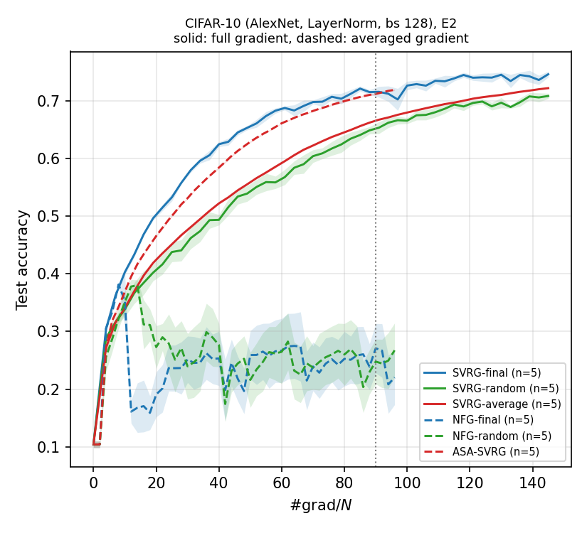
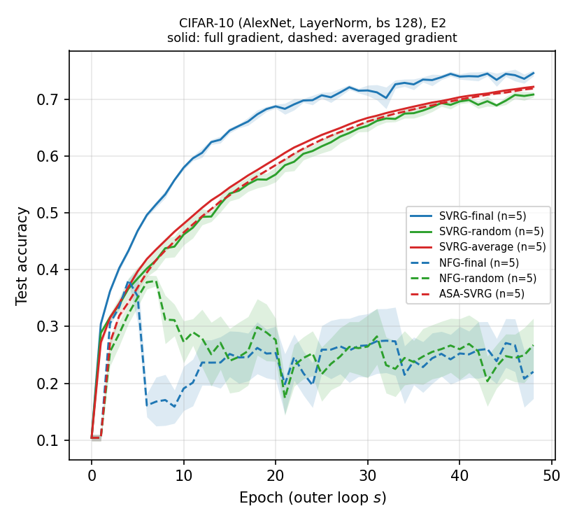

学習損失：

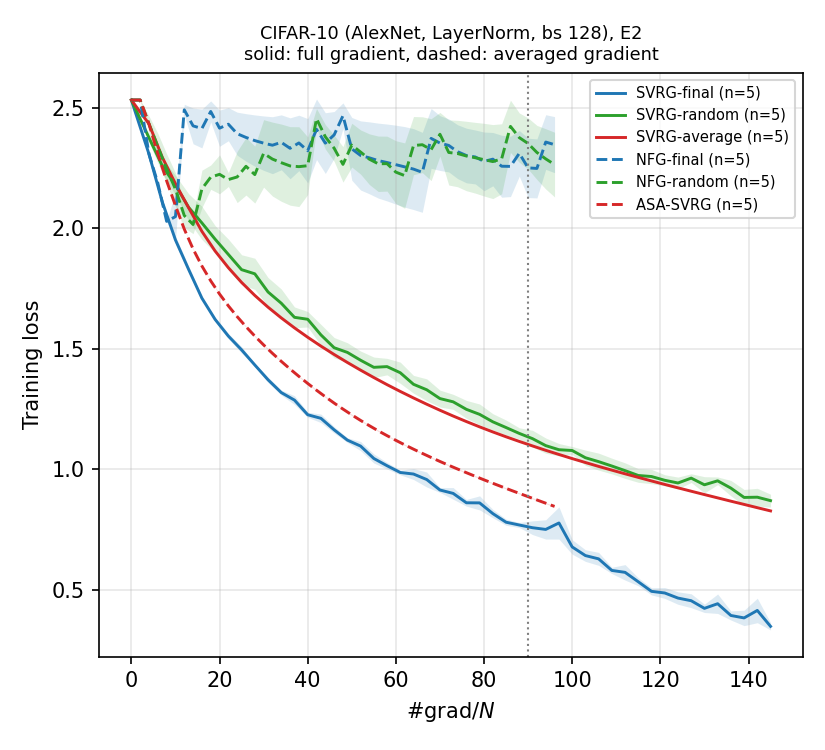
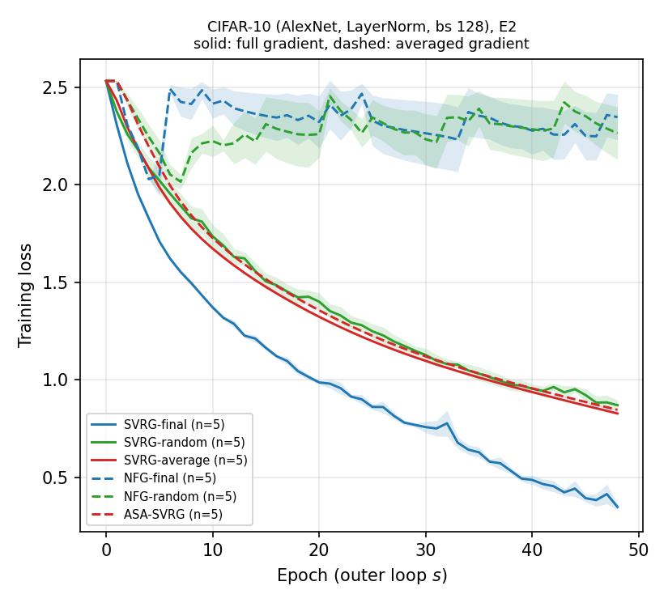

同じスナップショットでの全勾配（実線）と平均勾配（破線）の対比（横軸エポック）：

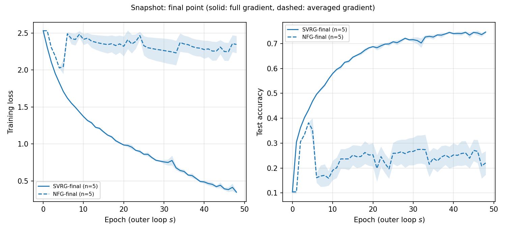
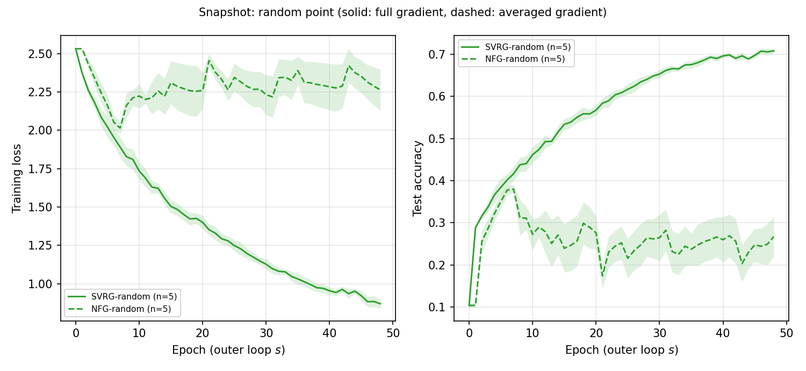
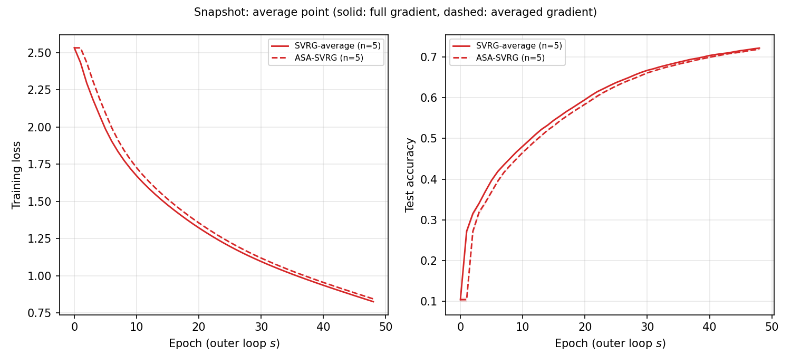

平均勾配の3手法の $ \omega({\mathbf z}_{s})/K $ と近似誤差：

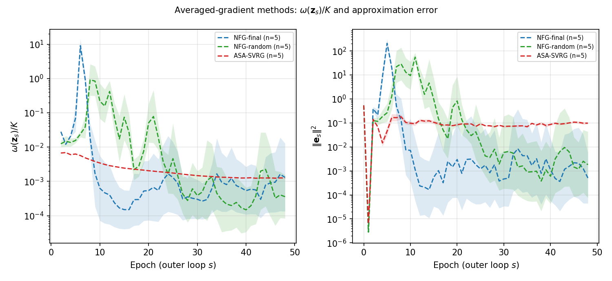

6手法の $ \omega({\mathbf z}_{s})/K $，$ \omega({\mathbf z}_{s})/\omega_{\min} $，相対近似誤差，`approx_cos`：

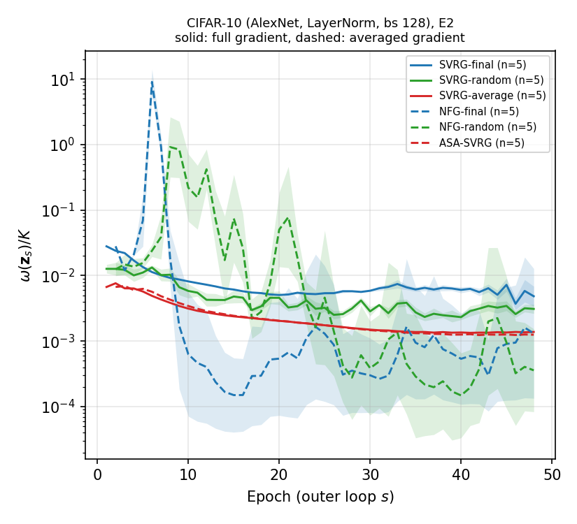
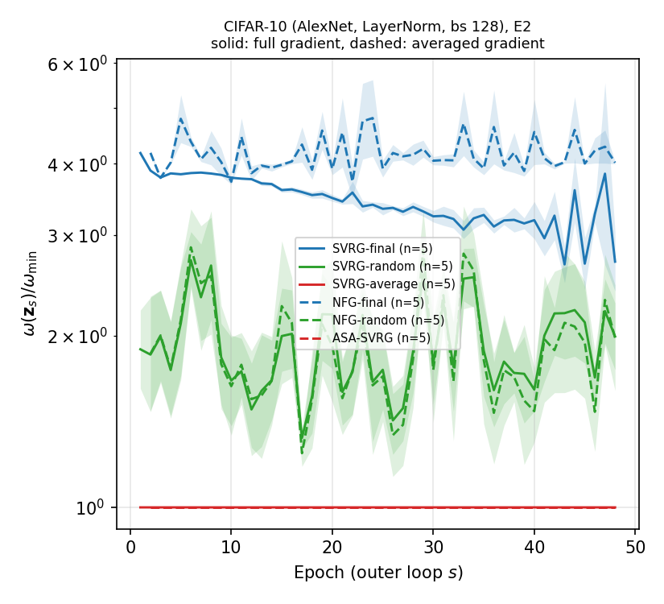
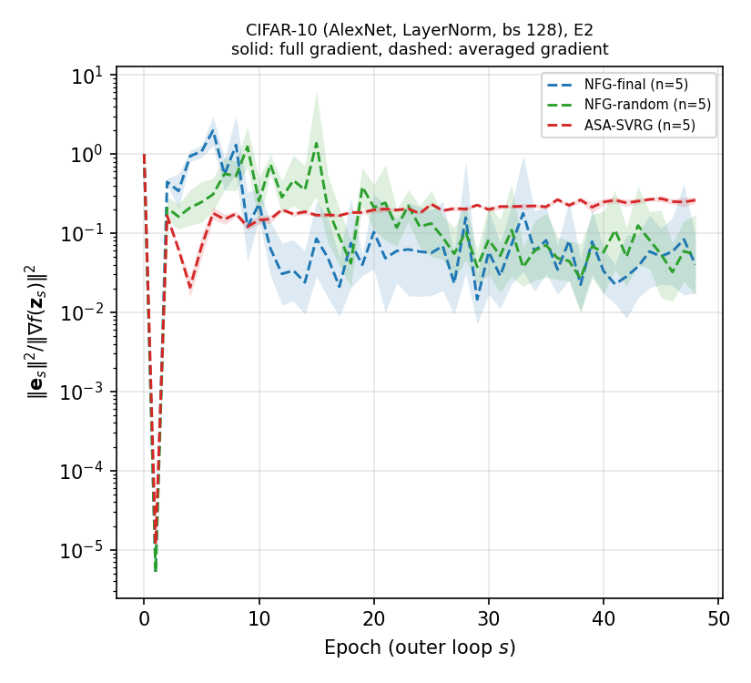
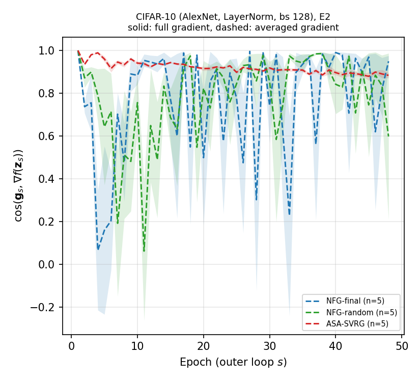

横軸が $ \#\mathrm{grad}/N $ の図（`*_grad.png`）も同じディレクトリにある．全ての図は `programs_review/visualize_result_E2.ipynb`（実行済み）でも見られる．

### 3.3 対応のある差（シードごとの差の平均 ± 標準誤差）

| 比較 | 最終精度 (a) | 最終精度 (b) | 学習損失 (a) | 学習損失 (b) | 符号が5シードで一致 |
|---|---:|---:|---:|---:|---|
| 近似誤差（最終点）：NFG-final − SVRG-final | −0.444 ± 0.041 | −0.526 ± 0.045 | +1.48 ± 0.12 | +2.00 ± 0.11 | 全て○ |
| 近似誤差（ランダム点）：NFG-random − SVRG-random | −0.401 ± 0.039 | −0.441 ± 0.049 | +1.20 ± 0.11 | +1.39 ± 0.15 | 全て○ |
| 近似誤差（平均点）：ASA-SVRG − SVRG-average | +0.0498 ± 0.0021 | −0.0030 ± 0.0005 | −0.229 ± 0.002 | +0.0187 ± 0.0005 | 全て○ |
| スナップショット（全勾配）：SVRG-average − SVRG-random | +0.0134 ± 0.0063 | +0.0136 ± 0.0046 | −0.033 ± 0.024 | −0.043 ± 0.028 | 精度 (a) は4/5，(b) は5/5．損失は3/5，4/5 |
| スナップショット（全勾配）：SVRG-final − SVRG-random | +0.0664 ± 0.0063 | +0.0377 ± 0.0074 | −0.380 ± 0.021 | −0.522 ± 0.036 | 全て○ |
| スナップショット（平均勾配）：ASA-SVRG − NFG-random | +0.464 ± 0.040 | +0.451 ± 0.048 | −1.47 ± 0.11 | −1.42 ± 0.14 | 全て○ |

### 3.4 $ \omega({\mathbf z}_{s})/\omega_{\min} $

- **最終点：** 学習後半の中央値は，SVRG-final で約3.19，NFG-final で約4.02 であった．
- **ランダム点：** SVRG-random で約1.84，NFG-random で約1.74 であった．
  - 参考：ランダム点の比の期待値は，$ \omega({\mathbf w}^{j}) = \omega_{\min} + K\|{\mathbf w}^{j} - \bar{\mathbf w}\|^{2} $ を $ j $ について平均すると $ 2 $ になる．観測値はこれに近い．
- **平均点：** SVRG-average と ASA-SVRG では，全シード・全エポック（2エポック目以降）で比は1であった．1からのずれの最大値は次の通りで，全シードで $ 10^{-6} $ をわずかに超えた．
  - SVRG-average：$ 1.16\times10^{-6} $
  - ASA-SVRG：$ 1.39\times10^{-6} $
  - これは数値誤差である．スナップショットは float32 の逐次平均（`running_avg_params`，$ K = 391 $ 回の更新）であり，$ \omega_{\min} $ は float64 の厳密な平均 $ {\mathbf S}_{1}/K $ で計算している．
  - 比のずれは $ K\|{\mathbf z}_{s} - {\mathbf S}_{1}/K\|^{2}/\omega_{\min} $ に等しい．float32 の相対丸め誤差（$ \sim 6\times10^{-8} $）が391回累積すると，この大きさになる．
  - 定理3（平均点が $ \omega $ を最小化する）と矛盾する結果ではない．

## 4. 実験計画4.6節の3つの論点への回答

### 論点1：スナップショットを固定したとき，近似誤差の有無は精度と安定性にどの程度影響するか

**事実．**

- 最終点とランダム点では，$ {\mathbf g}_{s} $ を全勾配から平均勾配に替えると，精度・学習損失・安定性のいずれも大きく悪化した．
  - 最終精度 (b)：NFG-final − SVRG-final $ = -0.526 \pm 0.045 $，NFG-random − SVRG-random $ = -0.441 \pm 0.049 $ であった．(a) でもほぼ同じである．5シード全てで同じ符号であった．
  - 精度の変化量は約2倍になった（0.013→0.023，0.010→0.023）．
- 経過：
  - NFG の2手法は，5〜10エポック目（$ \#\mathrm{grad}/N \approx 10\sim20 $）までは全勾配の手法とほぼ同じに精度が上がった（最大0.38〜0.48）．
  - その後，近似誤差 $ \|{\mathbf e}_{s}\|^{2} $ が $ 10\sim10^{2} $ まで急増した時期に，精度が0.1〜0.3に下がった．
  - その後は0.1〜0.4の間を上下した．
- 崩壊：
  - NFG の10試行のうち4試行（NFG-final のシード0，4，NFG-random のシード1，4）では，学習損失が約2.53で止まり，全勾配のノルムの2乗が約 $ 2.5\times10^{-4} $ の点に留まった．
  - テスト精度は0.12〜0.21 であった．NFG-final のシード1も48エポック目に同じ状態に落ちた．
- **NFG-random の精度低下は SVRG-random では生じなかった．** SVRG-random は5シード全てで単調に近い形で0.70〜0.72 まで上がった．
  - 2つの手法の違いは $ {\mathbf g}_{s} $ の推定方法のみであり，同じシード・同じ初期値・同じミニバッチの順序で比べている．
  - これは，NFG-SVRG の精度低下の原因が近似誤差（全勾配を平均勾配で近似すること）であることの介入的な根拠である．
- 平均点では，近似誤差の影響はほとんどなかった．
  - 48エポック目 (b) で，ASA-SVRG − SVRG-average $ = -0.0030 \pm 0.0005 $（全シードで負）であった．
  - 予算をそろえた (a) では $ +0.0498 \pm 0.0021 $（全シードで正）であった．
  - 精度の変化量は両者とも約0.004 で同程度であった．
  - ASA-SVRG の近似誤差（後半の中央値0.082，相対近似誤差0.23，`approx_cos` 0.90）は0ではない．しかし，精度への影響は (b) で0.003 に留まった．

**推測．**

- 平均点のスナップショットでは，内側ループの軌跡の平均を用いる．このため $ \omega $ が最小になり，近似誤差 $ {\mathbf e}_{s} $ の大きさが学習の全期間で安定に抑えられる．その結果，平均勾配の偏りが学習を崩すほど大きくならないと考える．
- 最終点とランダム点では，ある時点で近似誤差が急増すると，誤った $ {\mathbf g}_{s} $ によりパラメータが大きく動く．それが次のエポックの近似誤差をさらに大きくする正のフィードバックが起きたと考える．
- この因果の連鎖は本実験では直接検証していない．

### 論点2：全勾配を固定したとき，スナップショットの選択方法はどの程度影響するか

**事実．**

- **SVRG-average は SVRG-random より良かったが，差は小さい．**
  - 最終精度の差は (a) $ +0.0134 \pm 0.0063 $（4/5シードで正），(b) $ +0.0136 \pm 0.0046 $（5/5シードで正）であった．
  - 学習損失の差は (b) $ -0.043 \pm 0.028 $ であった．
  - 安定性の差は大きい．精度の変化量は SVRG-random の0.0100 に対して SVRG-average は0.0038（約1/3）であった．report_044 の定義では0.013 に対して0.002（約1/6）である．
- **全勾配では最終点（SVRG-final）が最も良かった．**
  - SVRG-final − SVRG-random は，最終精度 (a) $ +0.066 \pm 0.006 $，(b) $ +0.038 \pm 0.007 $，学習損失 (b) $ -0.52 \pm 0.04 $ であった．
  - SVRG-final は SVRG-average よりも，最終精度 (b) で約0.024 高く，学習損失 (b) は約0.48 低い．
  - 一方，精度の変化量は SVRG-final が0.0128 で，平均点の約3倍であった．
- 平均点の2手法を比べる．
  - 予算 (a) では ASA-SVRG（0.712）が SVRG-average（0.662）を上回った．
  - 同じエポック数 (b) では，ほぼ同じであった（0.719 と 0.722）．

**本文4.2節の仮説（パラメータ平均化によるノイズ低減が近似誤差のバイアスを補う）への含意．**

- **事実：** 全勾配の下でも平均点はランダム点より安定であり（変化量約1/3），精度もわずかに高い．計画4.6節の判定基準（「SVRG-average が SVRG-random より良ければ，ASA-SVRG の利点の一部は平均化そのものに由来する」）に従えば，利点の一部は平均化そのものに由来する．
- **事実：** 平均化の精度への効果（全勾配の下で +0.014）は，平均勾配の下での効果（ASA-SVRG − NFG-random で +0.45）に比べてはるかに小さい．
- **推測：** ASA-SVRG の NFG-SVRG に対する利点のほとんどは，平均化が近似誤差の悪影響（論点1の崩壊）を防ぐことに由来する．平均化による一般的なノイズ低減の寄与は小さいと考える．
  - これは仮説の「平均化が近似誤差のバイアスを補う」という部分と整合する．
  - 一方で，「ノイズの低減」による説明（全勾配でも効くはずの効果）だけでは差の大きさを説明できない．
- **仮説に合わない結果：** 全勾配の下では，平均点ではなく最終点が最終精度・学習損失で最良であった．平均点の利点は「精度」ではなく「エポック間の安定性」に表れた．
  - 本文で「平均化が精度を上げる」と書いている箇所があれば，「安定性を上げる」に修正するか，全勾配では最終点が勝ることを併記する必要がある．
  - 推測：最終点の優位は，最終点が軌跡の中で最も学習の進んだ点であるため（平均点とランダム点は軌跡の途中の点の情報を含み，約半エポック遅れる）と考える．

### 論点3：平均勾配の3手法で，$ \omega $ の大小と近似誤差の大小の順序は一致するか

**事実．**

- **シード平均の順序は一致した．** 学習後半の中央値のシード平均は，次の通りであった．
  - $ \omega({\mathbf z}_{s})/K $：ASA-SVRG（$ 1.31\times10^{-3} $）< NFG-random（$ 4.2\times10^{-3} $）< NFG-final（$ 1.6\times10^{-2} $）
  - 近似誤差：ASA-SVRG（0.082）< NFG-random（0.64）< NFG-final（1.95）
- **シードごとの順序は5シード中2シード（シード1，2）でのみ一致した．** 相対近似誤差では1/5である．
- 不一致の主因は，NFG の崩壊した試行である．
  - 該当するのは NFG-final のシード0，4と，NFG-random のシード1，4である．
  - これらの試行では，学習後半の近似誤差の中央値が $ \sim 2\times10^{-6} $，$ \omega/K $ が $ \sim 10^{-5} $ であった．ASA-SVRG（0.08，$ 1.3\times10^{-3} $）より両方とも小さい．
  - 両量がそろって小さいため，その試行の中では $ \omega $ と近似誤差は同じ向きに動いている．しかし，3手法の順序には「崩壊したか否か」が強く効く．
- **エポックごとの相関．** シードごとに，エポック2〜48の $ \log_{10}(\omega/K) $ と $ \log_{10}\|{\mathbf e}_{s}\|^{2} $ の相関係数を求めた．
  - NFG-final は $ 0.72 \pm 0.13 $，NFG-random は $ 0.76 \pm 0.09 $ で，強い正の相関があった．
  - ASA-SVRG は $ -0.01 \pm 0.07 $ で，相関はなかった．
  - ASA-SVRG では $ \omega/K $ が単調に減る一方，近似誤差は8エポック目以降 $ \sim 0.1 $ でほぼ一定であり，両者の変動が小さい．
  - NFG の2手法では，$ \omega $ の急増（5〜20エポック目）と近似誤差の急増が同時に起きた（図 `e2_omega_vs_approx_error_epoch.png`）．

**推測．**

- 手法の間で $ \omega $ の小さいスナップショットほど近似誤差が小さい傾向は，シード平均とエポックごとの相関では支持される．
- ただし，学習後半の値で手法を並べる比較は，崩壊（勾配がほぼ0の平坦な点に留まること）により交絡する．崩壊した試行では $ \omega $ も近似誤差も小さいが，学習は失敗している．
- 本文で「$ \omega $ が小さいほど近似誤差が小さい」と書く場合は，「崩壊していない区間」または「同じ手法の中のエポック間」の関係として述べるのが正確である．

## 5. 統合時の注意

### 5.1 `document.md` への転記内容

`programs_review/programs/ex007_e2_cifar10_snapshot_gradient_factorial/README.md` の5節に，転記する文面をまとめた．項目は次の通りである．

- 「現在実装している実験」への E2 の追加
- ディレクトリ構成
- 依存関係の mermaid 図
- 実行方法
- ログの新しい項目（`omega_snapshot`，`omega_average`，`snapshot_gradient`，`record_omega`）

### 5.2 `common/` に取り込むべき変更の提案

1. `svrg_average.py` の `SVRGAverage` を `common/optimizers/` に移す．`common/optimizers/__init__.py` に登録する．
2. 全勾配を用いる手法の判定を，手法名の比較から `FULL_GRADIENT_METHODS` の集合による判定に替える．あわせて，$ \omega $ の記録（`OmegaAccumulator`）を `common/vr_image_training.py` に入れる．
   - `e2_training.py` は `vr_image_training.py` の6関数のコピーに，この2点を加えたものである．
   - 取り込めば `e2_training.py` は不要になる．
   - 既存の手法では，記録の有無で学習がビット単位で変わらないことを確認済みである（1.3節）．
3. `e2_runner.py` の `_Worker`・`run_main` は，`common/e0_runner.py` に学習関数を引数で渡せるようにすれば不要になる．
4. （任意）`set_seed` などで `torch.backends.cudnn.allow_tf32` を明示的に設定する．
   - 現状は PyTorch の既定（TF32 あり）に依存しており，GPU が異なると相対 $ 10^{-4} $ の差が出る（1.2節）．
   - 既存の結果との互換のため，既定値（True）を明示するだけに留めるのがよい．
5. `check_consistency.py` の `precision` サブコマンド（TF32/FP32/FP64 の比較）は，GPU 間の比較の診断として `compare_with_existing_logs.py` に統合してもよい．

### 5.3 zip に含めなかったもの

- `programs_review/outputs/ex007_.../*/*/*/best_model.pth`（30個，各約28 MB）
- `programs_review/outputs/_verify/`：一致の確認の出力である．`ex007`，`ex007_e0code`，`ex007_omega_on`，`ex007_omega_off` を含む．`consistency_*.md` に結果を要約済みである．
- `programs_review/datasets/`，`.venv_pytorch/`，`__pycache__/`

なお `ex002_e0_.../train.py` 等の既存のファイルは変更していない．一致の確認で E0 の既存のコードを実行したが，出力は `outputs/_verify/ex007_e0code/` にのみ書いた．

### 5.4 その他

- `.ai/ai-dev-kit` サブモジュールが未初期化であったため，`git submodule update --init` で初期化した（ファイルの変更はない）．
- `tokens.json` がリポジトリに存在しない．
- git の commit・push は行っていない．

## 6. 再現方法

`programs_review/programs/ex007_e2_cifar10_snapshot_gradient_factorial/README.md` の3節のコマンドによる．本実行は次の通りである．

```bash
cd programs_review/programs
python ex007_e2_cifar10_snapshot_gradient_factorial/train.py --workers 6 > ../outputs/_run_logs/ex007.log 2>&1
python analysis_e2.py
cd .. && jupyter nbconvert --to notebook --execute --inplace visualize_result_E2.ipynb
python -m pytest -q tests
```

## 7. 未解決の論点・次の作業の候補

1. **NFG の崩壊点の正体．** 学習損失約2.53，勾配のノルムの2乗約 $ 2.5\times10^{-4} $ の点が何か（出力の一様化，LayerNorm 以降の活性の消失など）は調べていない．最終層の出力や活性の統計を記録すれば確認できる．
2. **全勾配では最終点が最良である点の扱い．** 本文の主張（平均化の利点）を「安定性」の観点に絞るか，最終点の優位を併記するかは著者の判断が必要である．
3. **学習率への依存．** 本実験は $ \eta = 10^{-3} $ のみである．SVRG-final と SVRG-average の順序や，NFG の崩壊の頻度が学習率で変わるかは未確認である．
4. **論点3の指標．** 学習後半の中央値による順序は崩壊に交絡する．崩壊していない区間に限った比較や，同じ手法の中の相関を本文の根拠とするのがよい．
5. **TF32．** GPU 間でビット単位の再現を求める場合は TF32 を無効にする必要がある．既存の全結果との互換性を失うため，今回は既定のままとした．
6. **実時間（E3）．** 本実行の `elapsed_time` は6並列の競合下の値であり使えない．E3 は1並列で別に計測する必要がある．

## 8. 成果物（`E2_results.zip`）

リポジトリのルートで `実験指示E2.md` 6節のコマンドを実行して作成した．`unzip -l E2_results.zip` の結果は次の通りである．

```text
Archive:  E2_results.zip
  Length      Date    Time    Name
---------  ---------- -----   ----
     4019  2026-11-19 07:56   .orders/order_060.md
    53290  2026-11-20 09:24   .reports/report_060.md
        0  2026-11-19 08:08   programs_review/programs/ex007_e2_cifar10_snapshot_gradient_factorial/
     4697  2026-11-19 07:57   programs_review/programs/ex007_e2_cifar10_snapshot_gradient_factorial/data.py
    16808  2026-11-19 08:20   programs_review/programs/ex007_e2_cifar10_snapshot_gradient_factorial/check_consistency.py
    24065  2026-11-19 07:57   programs_review/programs/ex007_e2_cifar10_snapshot_gradient_factorial/model.py
    20179  2026-11-19 07:59   programs_review/programs/ex007_e2_cifar10_snapshot_gradient_factorial/e2_training.py
     6997  2026-11-19 07:58   programs_review/programs/ex007_e2_cifar10_snapshot_gradient_factorial/svrg_average.py
     9401  2026-11-19 08:08   programs_review/programs/ex007_e2_cifar10_snapshot_gradient_factorial/README.md
     7150  2026-11-19 08:00   programs_review/programs/ex007_e2_cifar10_snapshot_gradient_factorial/e2_runner.py
     3297  2026-11-19 08:00   programs_review/programs/ex007_e2_cifar10_snapshot_gradient_factorial/train.py
    30171  2026-11-19 08:20   programs_review/programs/analysis_e2.py
    19984  2026-11-19 08:02   programs_review/tests/test_e2_programs.py
  3480741  2026-11-20 09:20   programs_review/visualize_result_E2.ipynb
        0  2026-11-20 04:43   programs_review/outputs/ex007_e2_cifar10_snapshot_gradient_factorial/
        0  2026-11-19 08:28   programs_review/outputs/ex007_e2_cifar10_snapshot_gradient_factorial/NFG_SVRG/
        0  2026-11-19 15:51   programs_review/outputs/ex007_e2_cifar10_snapshot_gradient_factorial/NFG_SVRG/inner_snapshot_lr0.001_bs128_lambda0.0005_epochs48/
        0  2026-11-19 15:51   programs_review/outputs/ex007_e2_cifar10_snapshot_gradient_factorial/NFG_SVRG/inner_snapshot_lr0.001_bs128_lambda0.0005_epochs48/3/
    13512  2026-11-19 15:51   programs_review/outputs/ex007_e2_cifar10_snapshot_gradient_factorial/NFG_SVRG/inner_snapshot_lr0.001_bs128_lambda0.0005_epochs48/3/log.json
      742  2026-11-19 15:51   programs_review/outputs/ex007_e2_cifar10_snapshot_gradient_factorial/NFG_SVRG/inner_snapshot_lr0.001_bs128_lambda0.0005_epochs48/3/config.json
        0  2026-11-19 13:50   programs_review/outputs/ex007_e2_cifar10_snapshot_gradient_factorial/NFG_SVRG/inner_snapshot_lr0.001_bs128_lambda0.0005_epochs48/2/
    13368  2026-11-19 13:50   programs_review/outputs/ex007_e2_cifar10_snapshot_gradient_factorial/NFG_SVRG/inner_snapshot_lr0.001_bs128_lambda0.0005_epochs48/2/log.json
      742  2026-11-19 13:50   programs_review/outputs/ex007_e2_cifar10_snapshot_gradient_factorial/NFG_SVRG/inner_snapshot_lr0.001_bs128_lambda0.0005_epochs48/2/config.json
        0  2026-11-19 10:14   programs_review/outputs/ex007_e2_cifar10_snapshot_gradient_factorial/NFG_SVRG/inner_snapshot_lr0.001_bs128_lambda0.0005_epochs48/0/
    13463  2026-11-19 10:14   programs_review/outputs/ex007_e2_cifar10_snapshot_gradient_factorial/NFG_SVRG/inner_snapshot_lr0.001_bs128_lambda0.0005_epochs48/0/log.json
      742  2026-11-19 10:14   programs_review/outputs/ex007_e2_cifar10_snapshot_gradient_factorial/NFG_SVRG/inner_snapshot_lr0.001_bs128_lambda0.0005_epochs48/0/config.json
        0  2026-11-20 06:25   programs_review/outputs/ex007_e2_cifar10_snapshot_gradient_factorial/NFG_SVRG/inner_snapshot_lr0.001_bs128_lambda0.0005_epochs48/4/
    13629  2026-11-20 06:25   programs_review/outputs/ex007_e2_cifar10_snapshot_gradient_factorial/NFG_SVRG/inner_snapshot_lr0.001_bs128_lambda0.0005_epochs48/4/log.json
      742  2026-11-20 06:25   programs_review/outputs/ex007_e2_cifar10_snapshot_gradient_factorial/NFG_SVRG/inner_snapshot_lr0.001_bs128_lambda0.0005_epochs48/4/config.json
        0  2026-11-19 12:00   programs_review/outputs/ex007_e2_cifar10_snapshot_gradient_factorial/NFG_SVRG/inner_snapshot_lr0.001_bs128_lambda0.0005_epochs48/1/
    13702  2026-11-19 12:00   programs_review/outputs/ex007_e2_cifar10_snapshot_gradient_factorial/NFG_SVRG/inner_snapshot_lr0.001_bs128_lambda0.0005_epochs48/1/log.json
      742  2026-11-19 12:00   programs_review/outputs/ex007_e2_cifar10_snapshot_gradient_factorial/NFG_SVRG/inner_snapshot_lr0.001_bs128_lambda0.0005_epochs48/1/config.json
        0  2026-11-19 08:28   programs_review/outputs/ex007_e2_cifar10_snapshot_gradient_factorial/ASAI_SVRG/
        0  2026-11-19 16:18   programs_review/outputs/ex007_e2_cifar10_snapshot_gradient_factorial/ASAI_SVRG/inner_snapshot_lr0.001_bs128_lambda0.0005_epochs48/
        0  2026-11-19 16:17   programs_review/outputs/ex007_e2_cifar10_snapshot_gradient_factorial/ASAI_SVRG/inner_snapshot_lr0.001_bs128_lambda0.0005_epochs48/3/
    13484  2026-11-19 16:16   programs_review/outputs/ex007_e2_cifar10_snapshot_gradient_factorial/ASAI_SVRG/inner_snapshot_lr0.001_bs128_lambda0.0005_epochs48/3/log.json
      743  2026-11-19 16:17   programs_review/outputs/ex007_e2_cifar10_snapshot_gradient_factorial/ASAI_SVRG/inner_snapshot_lr0.001_bs128_lambda0.0005_epochs48/3/config.json
        0  2026-11-19 14:06   programs_review/outputs/ex007_e2_cifar10_snapshot_gradient_factorial/ASAI_SVRG/inner_snapshot_lr0.001_bs128_lambda0.0005_epochs48/2/
    13458  2026-11-19 14:06   programs_review/outputs/ex007_e2_cifar10_snapshot_gradient_factorial/ASAI_SVRG/inner_snapshot_lr0.001_bs128_lambda0.0005_epochs48/2/log.json
      743  2026-11-19 14:06   programs_review/outputs/ex007_e2_cifar10_snapshot_gradient_factorial/ASAI_SVRG/inner_snapshot_lr0.001_bs128_lambda0.0005_epochs48/2/config.json
        0  2026-11-19 10:19   programs_review/outputs/ex007_e2_cifar10_snapshot_gradient_factorial/ASAI_SVRG/inner_snapshot_lr0.001_bs128_lambda0.0005_epochs48/0/
    13475  2026-11-19 10:19   programs_review/outputs/ex007_e2_cifar10_snapshot_gradient_factorial/ASAI_SVRG/inner_snapshot_lr0.001_bs128_lambda0.0005_epochs48/0/log.json
      743  2026-11-19 10:19   programs_review/outputs/ex007_e2_cifar10_snapshot_gradient_factorial/ASAI_SVRG/inner_snapshot_lr0.001_bs128_lambda0.0005_epochs48/0/config.json
        0  2026-11-20 06:26   programs_review/outputs/ex007_e2_cifar10_snapshot_gradient_factorial/ASAI_SVRG/inner_snapshot_lr0.001_bs128_lambda0.0005_epochs48/4/
    13474  2026-11-20 06:26   programs_review/outputs/ex007_e2_cifar10_snapshot_gradient_factorial/ASAI_SVRG/inner_snapshot_lr0.001_bs128_lambda0.0005_epochs48/4/log.json
      743  2026-11-20 06:26   programs_review/outputs/ex007_e2_cifar10_snapshot_gradient_factorial/ASAI_SVRG/inner_snapshot_lr0.001_bs128_lambda0.0005_epochs48/4/config.json
        0  2026-11-19 12:09   programs_review/outputs/ex007_e2_cifar10_snapshot_gradient_factorial/ASAI_SVRG/inner_snapshot_lr0.001_bs128_lambda0.0005_epochs48/1/
    13473  2026-11-19 12:09   programs_review/outputs/ex007_e2_cifar10_snapshot_gradient_factorial/ASAI_SVRG/inner_snapshot_lr0.001_bs128_lambda0.0005_epochs48/1/log.json
      743  2026-11-19 12:09   programs_review/outputs/ex007_e2_cifar10_snapshot_gradient_factorial/ASAI_SVRG/inner_snapshot_lr0.001_bs128_lambda0.0005_epochs48/1/config.json
        0  2026-11-19 08:28   programs_review/outputs/ex007_e2_cifar10_snapshot_gradient_factorial/SVRG_final/
        0  2026-11-19 15:27   programs_review/outputs/ex007_e2_cifar10_snapshot_gradient_factorial/SVRG_final/inner_snapshot_lr0.001_bs128_lambda0.0005_epochs48/
        0  2026-11-19 15:27   programs_review/outputs/ex007_e2_cifar10_snapshot_gradient_factorial/SVRG_final/inner_snapshot_lr0.001_bs128_lambda0.0005_epochs48/3/
    12312  2026-11-19 15:27   programs_review/outputs/ex007_e2_cifar10_snapshot_gradient_factorial/SVRG_final/inner_snapshot_lr0.001_bs128_lambda0.0005_epochs48/3/log.json
      740  2026-11-19 15:27   programs_review/outputs/ex007_e2_cifar10_snapshot_gradient_factorial/SVRG_final/inner_snapshot_lr0.001_bs128_lambda0.0005_epochs48/3/config.json
        0  2026-11-19 13:30   programs_review/outputs/ex007_e2_cifar10_snapshot_gradient_factorial/SVRG_final/inner_snapshot_lr0.001_bs128_lambda0.0005_epochs48/2/
    12253  2026-11-19 13:30   programs_review/outputs/ex007_e2_cifar10_snapshot_gradient_factorial/SVRG_final/inner_snapshot_lr0.001_bs128_lambda0.0005_epochs48/2/log.json
      740  2026-11-19 13:30   programs_review/outputs/ex007_e2_cifar10_snapshot_gradient_factorial/SVRG_final/inner_snapshot_lr0.001_bs128_lambda0.0005_epochs48/2/config.json
        0  2026-11-19 10:08   programs_review/outputs/ex007_e2_cifar10_snapshot_gradient_factorial/SVRG_final/inner_snapshot_lr0.001_bs128_lambda0.0005_epochs48/0/
    12274  2026-11-19 10:08   programs_review/outputs/ex007_e2_cifar10_snapshot_gradient_factorial/SVRG_final/inner_snapshot_lr0.001_bs128_lambda0.0005_epochs48/0/log.json
      740  2026-11-19 10:08   programs_review/outputs/ex007_e2_cifar10_snapshot_gradient_factorial/SVRG_final/inner_snapshot_lr0.001_bs128_lambda0.0005_epochs48/0/config.json
        0  2026-11-20 06:22   programs_review/outputs/ex007_e2_cifar10_snapshot_gradient_factorial/SVRG_final/inner_snapshot_lr0.001_bs128_lambda0.0005_epochs48/4/
    12217  2026-11-20 06:22   programs_review/outputs/ex007_e2_cifar10_snapshot_gradient_factorial/SVRG_final/inner_snapshot_lr0.001_bs128_lambda0.0005_epochs48/4/log.json
      740  2026-11-20 06:22   programs_review/outputs/ex007_e2_cifar10_snapshot_gradient_factorial/SVRG_final/inner_snapshot_lr0.001_bs128_lambda0.0005_epochs48/4/config.json
        0  2026-11-19 11:48   programs_review/outputs/ex007_e2_cifar10_snapshot_gradient_factorial/SVRG_final/inner_snapshot_lr0.001_bs128_lambda0.0005_epochs48/1/
    12270  2026-11-19 11:48   programs_review/outputs/ex007_e2_cifar10_snapshot_gradient_factorial/SVRG_final/inner_snapshot_lr0.001_bs128_lambda0.0005_epochs48/1/log.json
      740  2026-11-19 11:48   programs_review/outputs/ex007_e2_cifar10_snapshot_gradient_factorial/SVRG_final/inner_snapshot_lr0.001_bs128_lambda0.0005_epochs48/1/config.json
        0  2026-11-19 08:28   programs_review/outputs/ex007_e2_cifar10_snapshot_gradient_factorial/SVRG/
        0  2026-11-19 15:27   programs_review/outputs/ex007_e2_cifar10_snapshot_gradient_factorial/SVRG/inner_snapshot_lr0.001_bs128_lambda0.0005_epochs48/
        0  2026-11-19 15:27   programs_review/outputs/ex007_e2_cifar10_snapshot_gradient_factorial/SVRG/inner_snapshot_lr0.001_bs128_lambda0.0005_epochs48/3/
    12223  2026-11-19 15:27   programs_review/outputs/ex007_e2_cifar10_snapshot_gradient_factorial/SVRG/inner_snapshot_lr0.001_bs128_lambda0.0005_epochs48/3/log.json
      734  2026-11-19 15:27   programs_review/outputs/ex007_e2_cifar10_snapshot_gradient_factorial/SVRG/inner_snapshot_lr0.001_bs128_lambda0.0005_epochs48/3/config.json
        0  2026-11-19 13:30   programs_review/outputs/ex007_e2_cifar10_snapshot_gradient_factorial/SVRG/inner_snapshot_lr0.001_bs128_lambda0.0005_epochs48/2/
    12338  2026-11-19 13:30   programs_review/outputs/ex007_e2_cifar10_snapshot_gradient_factorial/SVRG/inner_snapshot_lr0.001_bs128_lambda0.0005_epochs48/2/log.json
      734  2026-11-19 13:30   programs_review/outputs/ex007_e2_cifar10_snapshot_gradient_factorial/SVRG/inner_snapshot_lr0.001_bs128_lambda0.0005_epochs48/2/config.json
        0  2026-11-19 10:08   programs_review/outputs/ex007_e2_cifar10_snapshot_gradient_factorial/SVRG/inner_snapshot_lr0.001_bs128_lambda0.0005_epochs48/0/
    12377  2026-11-19 10:08   programs_review/outputs/ex007_e2_cifar10_snapshot_gradient_factorial/SVRG/inner_snapshot_lr0.001_bs128_lambda0.0005_epochs48/0/log.json
      734  2026-11-19 10:08   programs_review/outputs/ex007_e2_cifar10_snapshot_gradient_factorial/SVRG/inner_snapshot_lr0.001_bs128_lambda0.0005_epochs48/0/config.json
        0  2026-11-20 06:22   programs_review/outputs/ex007_e2_cifar10_snapshot_gradient_factorial/SVRG/inner_snapshot_lr0.001_bs128_lambda0.0005_epochs48/4/
    12302  2026-11-20 06:22   programs_review/outputs/ex007_e2_cifar10_snapshot_gradient_factorial/SVRG/inner_snapshot_lr0.001_bs128_lambda0.0005_epochs48/4/log.json
      734  2026-11-20 06:22   programs_review/outputs/ex007_e2_cifar10_snapshot_gradient_factorial/SVRG/inner_snapshot_lr0.001_bs128_lambda0.0005_epochs48/4/config.json
        0  2026-11-19 11:48   programs_review/outputs/ex007_e2_cifar10_snapshot_gradient_factorial/SVRG/inner_snapshot_lr0.001_bs128_lambda0.0005_epochs48/1/
    12181  2026-11-19 11:48   programs_review/outputs/ex007_e2_cifar10_snapshot_gradient_factorial/SVRG/inner_snapshot_lr0.001_bs128_lambda0.0005_epochs48/1/log.json
      734  2026-11-19 11:48   programs_review/outputs/ex007_e2_cifar10_snapshot_gradient_factorial/SVRG/inner_snapshot_lr0.001_bs128_lambda0.0005_epochs48/1/config.json
        0  2026-11-20 04:43   programs_review/outputs/ex007_e2_cifar10_snapshot_gradient_factorial/figures/
   127705  2026-11-20 09:20   programs_review/outputs/ex007_e2_cifar10_snapshot_gradient_factorial/figures/e2_pair_final_epoch.png
   125434  2026-11-20 09:20   programs_review/outputs/ex007_e2_cifar10_snapshot_gradient_factorial/figures/e2_approx_error_epoch.png
   143261  2026-11-20 09:20   programs_review/outputs/ex007_e2_cifar10_snapshot_gradient_factorial/figures/e2_accuracy_grad.png
   131016  2026-11-20 09:20   programs_review/outputs/ex007_e2_cifar10_snapshot_gradient_factorial/figures/e2_approx_error_grad.png
   136295  2026-11-20 09:20   programs_review/outputs/ex007_e2_cifar10_snapshot_gradient_factorial/figures/e2_loss_grad.png
   120590  2026-11-20 09:20   programs_review/outputs/ex007_e2_cifar10_snapshot_gradient_factorial/figures/e2_rel_approx_error_epoch.png
   141652  2026-11-20 09:20   programs_review/outputs/ex007_e2_cifar10_snapshot_gradient_factorial/figures/e2_omega_per_K_grad.png
   142919  2026-11-20 09:20   programs_review/outputs/ex007_e2_cifar10_snapshot_gradient_factorial/figures/e2_omega_per_K_epoch.png
   174796  2026-11-20 09:20   programs_review/outputs/ex007_e2_cifar10_snapshot_gradient_factorial/figures/e2_approx_cos_grad.png
   170268  2026-11-20 09:20   programs_review/outputs/ex007_e2_cifar10_snapshot_gradient_factorial/figures/e2_approx_cos_epoch.png
   190276  2026-11-20 09:20   programs_review/outputs/ex007_e2_cifar10_snapshot_gradient_factorial/figures/e2_omega_vs_approx_error_epoch.png
   137458  2026-11-20 09:20   programs_review/outputs/ex007_e2_cifar10_snapshot_gradient_factorial/figures/e2_loss_epoch.png
   147466  2026-11-20 09:20   programs_review/outputs/ex007_e2_cifar10_snapshot_gradient_factorial/figures/e2_pair_random_epoch.png
   168945  2026-11-20 09:20   programs_review/outputs/ex007_e2_cifar10_snapshot_gradient_factorial/figures/e2_omega_ratio_grad.png
   145177  2026-11-20 09:20   programs_review/outputs/ex007_e2_cifar10_snapshot_gradient_factorial/figures/e2_accuracy_epoch.png
   125448  2026-11-20 09:20   programs_review/outputs/ex007_e2_cifar10_snapshot_gradient_factorial/figures/e2_rel_approx_error_grad.png
   102475  2026-11-20 09:20   programs_review/outputs/ex007_e2_cifar10_snapshot_gradient_factorial/figures/e2_pair_average_epoch.png
   161051  2026-11-20 09:20   programs_review/outputs/ex007_e2_cifar10_snapshot_gradient_factorial/figures/e2_omega_ratio_epoch.png
        0  2026-11-19 08:28   programs_review/outputs/ex007_e2_cifar10_snapshot_gradient_factorial/NFG_SVRG_final/
        0  2026-11-19 15:51   programs_review/outputs/ex007_e2_cifar10_snapshot_gradient_factorial/NFG_SVRG_final/inner_snapshot_lr0.001_bs128_lambda0.0005_epochs48/
        0  2026-11-19 15:51   programs_review/outputs/ex007_e2_cifar10_snapshot_gradient_factorial/NFG_SVRG_final/inner_snapshot_lr0.001_bs128_lambda0.0005_epochs48/3/
    13678  2026-11-19 15:51   programs_review/outputs/ex007_e2_cifar10_snapshot_gradient_factorial/NFG_SVRG_final/inner_snapshot_lr0.001_bs128_lambda0.0005_epochs48/3/log.json
      748  2026-11-19 15:51   programs_review/outputs/ex007_e2_cifar10_snapshot_gradient_factorial/NFG_SVRG_final/inner_snapshot_lr0.001_bs128_lambda0.0005_epochs48/3/config.json
        0  2026-11-19 13:50   programs_review/outputs/ex007_e2_cifar10_snapshot_gradient_factorial/NFG_SVRG_final/inner_snapshot_lr0.001_bs128_lambda0.0005_epochs48/2/
    13441  2026-11-19 13:50   programs_review/outputs/ex007_e2_cifar10_snapshot_gradient_factorial/NFG_SVRG_final/inner_snapshot_lr0.001_bs128_lambda0.0005_epochs48/2/log.json
      748  2026-11-19 13:50   programs_review/outputs/ex007_e2_cifar10_snapshot_gradient_factorial/NFG_SVRG_final/inner_snapshot_lr0.001_bs128_lambda0.0005_epochs48/2/config.json
        0  2026-11-19 10:14   programs_review/outputs/ex007_e2_cifar10_snapshot_gradient_factorial/NFG_SVRG_final/inner_snapshot_lr0.001_bs128_lambda0.0005_epochs48/0/
    13888  2026-11-19 10:14   programs_review/outputs/ex007_e2_cifar10_snapshot_gradient_factorial/NFG_SVRG_final/inner_snapshot_lr0.001_bs128_lambda0.0005_epochs48/0/log.json
      748  2026-11-19 10:14   programs_review/outputs/ex007_e2_cifar10_snapshot_gradient_factorial/NFG_SVRG_final/inner_snapshot_lr0.001_bs128_lambda0.0005_epochs48/0/config.json
        0  2026-11-20 06:25   programs_review/outputs/ex007_e2_cifar10_snapshot_gradient_factorial/NFG_SVRG_final/inner_snapshot_lr0.001_bs128_lambda0.0005_epochs48/4/
    13846  2026-11-20 06:25   programs_review/outputs/ex007_e2_cifar10_snapshot_gradient_factorial/NFG_SVRG_final/inner_snapshot_lr0.001_bs128_lambda0.0005_epochs48/4/log.json
      748  2026-11-20 06:25   programs_review/outputs/ex007_e2_cifar10_snapshot_gradient_factorial/NFG_SVRG_final/inner_snapshot_lr0.001_bs128_lambda0.0005_epochs48/4/config.json
        0  2026-11-19 11:59   programs_review/outputs/ex007_e2_cifar10_snapshot_gradient_factorial/NFG_SVRG_final/inner_snapshot_lr0.001_bs128_lambda0.0005_epochs48/1/
    13366  2026-11-19 11:59   programs_review/outputs/ex007_e2_cifar10_snapshot_gradient_factorial/NFG_SVRG_final/inner_snapshot_lr0.001_bs128_lambda0.0005_epochs48/1/log.json
      748  2026-11-19 11:59   programs_review/outputs/ex007_e2_cifar10_snapshot_gradient_factorial/NFG_SVRG_final/inner_snapshot_lr0.001_bs128_lambda0.0005_epochs48/1/config.json
        0  2026-11-19 08:28   programs_review/outputs/ex007_e2_cifar10_snapshot_gradient_factorial/SVRG_average/
        0  2026-11-19 15:51   programs_review/outputs/ex007_e2_cifar10_snapshot_gradient_factorial/SVRG_average/inner_snapshot_lr0.001_bs128_lambda0.0005_epochs48/
        0  2026-11-19 15:51   programs_review/outputs/ex007_e2_cifar10_snapshot_gradient_factorial/SVRG_average/inner_snapshot_lr0.001_bs128_lambda0.0005_epochs48/3/
    12340  2026-11-19 15:51   programs_review/outputs/ex007_e2_cifar10_snapshot_gradient_factorial/SVRG_average/inner_snapshot_lr0.001_bs128_lambda0.0005_epochs48/3/log.json
      742  2026-11-19 15:51   programs_review/outputs/ex007_e2_cifar10_snapshot_gradient_factorial/SVRG_average/inner_snapshot_lr0.001_bs128_lambda0.0005_epochs48/3/config.json
        0  2026-11-19 13:51   programs_review/outputs/ex007_e2_cifar10_snapshot_gradient_factorial/SVRG_average/inner_snapshot_lr0.001_bs128_lambda0.0005_epochs48/2/
    12287  2026-11-19 13:51   programs_review/outputs/ex007_e2_cifar10_snapshot_gradient_factorial/SVRG_average/inner_snapshot_lr0.001_bs128_lambda0.0005_epochs48/2/log.json
      742  2026-11-19 13:51   programs_review/outputs/ex007_e2_cifar10_snapshot_gradient_factorial/SVRG_average/inner_snapshot_lr0.001_bs128_lambda0.0005_epochs48/2/config.json
        0  2026-11-19 10:14   programs_review/outputs/ex007_e2_cifar10_snapshot_gradient_factorial/SVRG_average/inner_snapshot_lr0.001_bs128_lambda0.0005_epochs48/0/
    12400  2026-11-19 10:14   programs_review/outputs/ex007_e2_cifar10_snapshot_gradient_factorial/SVRG_average/inner_snapshot_lr0.001_bs128_lambda0.0005_epochs48/0/log.json
      742  2026-11-19 10:14   programs_review/outputs/ex007_e2_cifar10_snapshot_gradient_factorial/SVRG_average/inner_snapshot_lr0.001_bs128_lambda0.0005_epochs48/0/config.json
        0  2026-11-20 06:25   programs_review/outputs/ex007_e2_cifar10_snapshot_gradient_factorial/SVRG_average/inner_snapshot_lr0.001_bs128_lambda0.0005_epochs48/4/
    12434  2026-11-20 06:25   programs_review/outputs/ex007_e2_cifar10_snapshot_gradient_factorial/SVRG_average/inner_snapshot_lr0.001_bs128_lambda0.0005_epochs48/4/log.json
      742  2026-11-20 06:25   programs_review/outputs/ex007_e2_cifar10_snapshot_gradient_factorial/SVRG_average/inner_snapshot_lr0.001_bs128_lambda0.0005_epochs48/4/config.json
        0  2026-11-19 11:59   programs_review/outputs/ex007_e2_cifar10_snapshot_gradient_factorial/SVRG_average/inner_snapshot_lr0.001_bs128_lambda0.0005_epochs48/1/
    12422  2026-11-19 11:59   programs_review/outputs/ex007_e2_cifar10_snapshot_gradient_factorial/SVRG_average/inner_snapshot_lr0.001_bs128_lambda0.0005_epochs48/1/log.json
      742  2026-11-19 11:59   programs_review/outputs/ex007_e2_cifar10_snapshot_gradient_factorial/SVRG_average/inner_snapshot_lr0.001_bs128_lambda0.0005_epochs48/1/config.json
     1765  2026-11-19 08:22   programs_review/outputs/ex007_e2_cifar10_snapshot_gradient_factorial/consistency_omega.md
      780  2026-11-19 08:28   programs_review/outputs/ex007_e2_cifar10_snapshot_gradient_factorial/consistency_precision.md
    12935  2026-11-19 08:28   programs_review/outputs/ex007_e2_cifar10_snapshot_gradient_factorial/consistency_with_e0.md
    12214  2026-11-20 09:20   programs_review/outputs/e2_summary.md
 53716090  2026-11-19 17:01   programs_review/outputs/_run_logs/ex007.log
 10518448  2026-11-20 06:26   programs_review/outputs/_run_logs/ex007_resume.log
   118652  2026-11-19 08:12   programs_review/outputs/_run_logs/ex007_verify_e0.log
   115961  2026-11-19 08:19   programs_review/outputs/_run_logs/ex007_verify_e0code.log
    54608  2026-11-19 08:22   programs_review/outputs/_run_logs/ex007_verify_omega.log
---------                     -------
 71234616                     145 files
```
