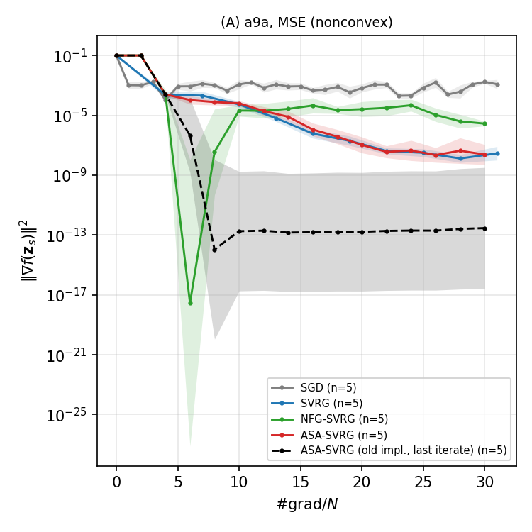
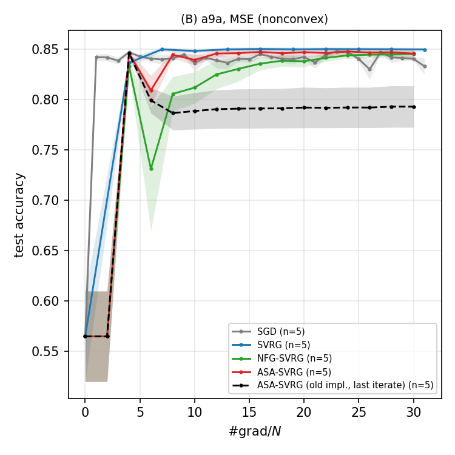
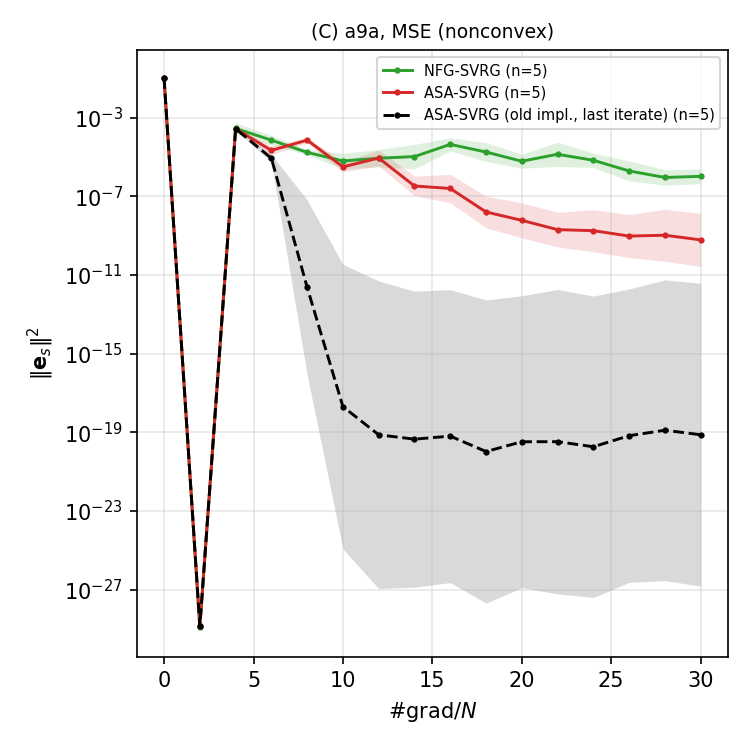
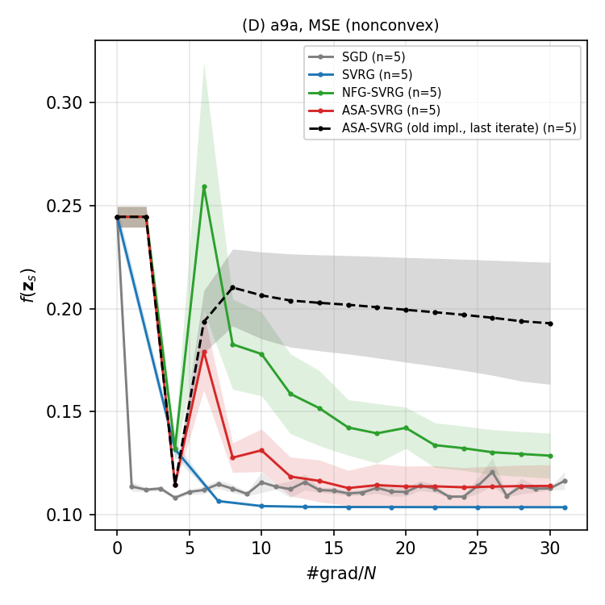
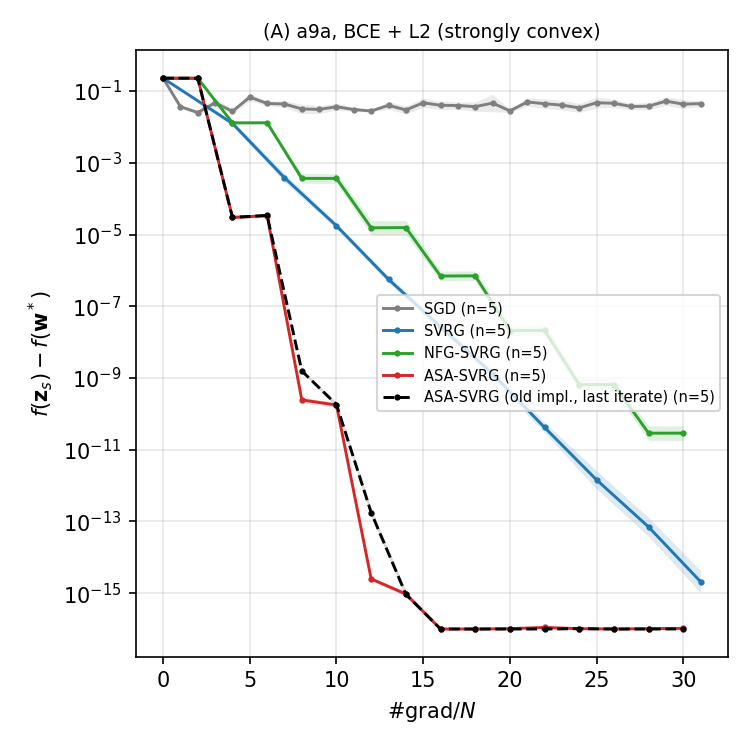
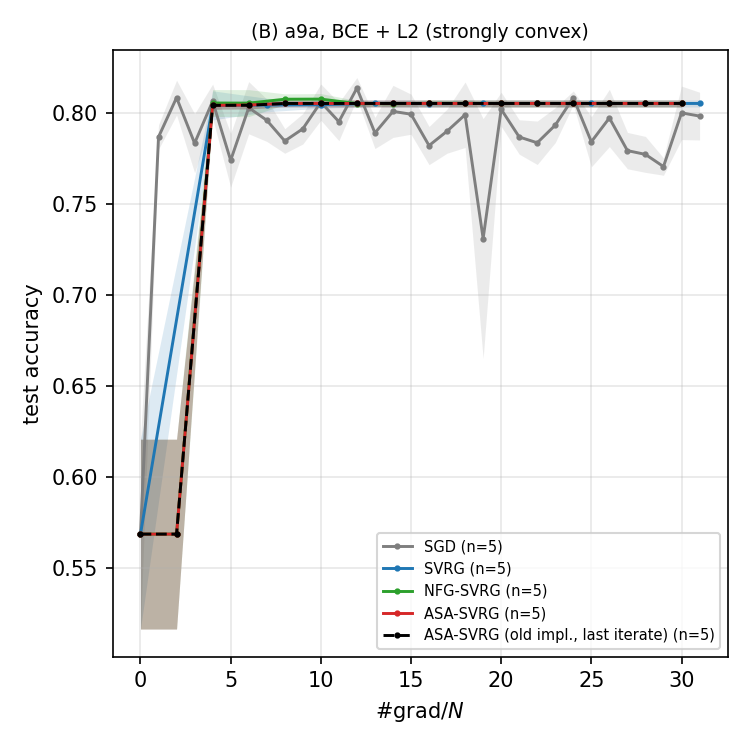
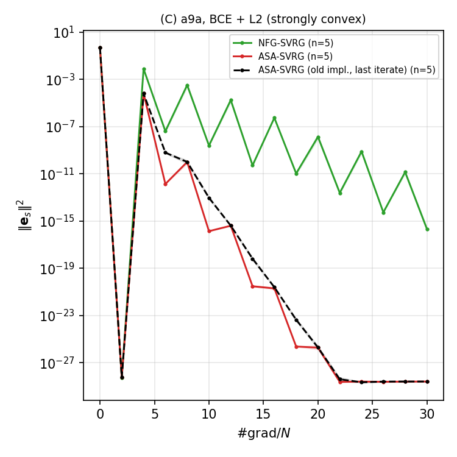

# report_070：E4（付録B.1，a9a の MSE・BCE の再実施）

対応するorder：`.orders/order_070.md`．対応する指示：`実験指示E4.md`．対応する実験計画：`実験計画.md` 6章（2026-11-19改訂版）．

## 0. 要点

- **実施内容．** a9a の2つの実験（MSE：`ex000_a9a_least_squares` の再実施，BCE：`ex0001_a9a_logistic` の再実施）を，内側ループの開始点を
  `inner_start="snapshot"`（$ {\mathbf w}_{s}^{0} \leftarrow {\mathbf z}_{s} $，Algorithm 通り）として，4手法（SGD，SVRG，NFG-SVRG，ASA-SVRG）× 5シード，
  合計40試行，新しいプログラム（`programs_review/programs/ex008_e4_a9a/`）で実行した．40試行全てが100外側ループを完了し，打ち切りは0件であった．
- **既存の実装との一致．** シード0の8試行で，整数の量と精度は全て完全一致した．実数の量は56系列中36系列がビット単位で一致し，残りの差は計算環境
  （CPU・BLAS・torch のビルド）による丸め誤差とその増幅であった．**本PCで旧コードを実行すると新しいコードとビット単位で一致した**ため，実装の差ではない．
  ただし MSE の NFG-SVRG は非凸の軌道が丸め誤差を増幅し，既存のログとの差が相対 $ 7\times10^{-9} $（$ f $），$ 2\times10^{-6} $（$ \|\nabla f\|^{2} $）に達した（1.2節）．
- **BCE（強凸）．** ASA-SVRG が最も速く収束した（$ \hat{r} $：ASA-SVRG 0.0053，SVRG 0.0395，NFG-SVRG 0.1996）．ASA-SVRG の近似誤差は学習の前半から
  NFG-SVRG より2〜14桁小さい．旧実装との差はほぼ無い（$ \hat{r} $ も，目的関数誤差が $ 10^{-12} $ に達する $ \#\mathrm{grad}/N $（=12）も同じ）．付録B.1の BCE の記述は維持できる．
- **MSE（非凸）．** 旧実装から大きく変わった．旧実装の ASA-SVRG は5シード中2シードが「全てを負例と予測する点」（$ f = 0.240820 $ = 学習データの正例の割合，
  テスト精度 0.7593）に留まり，シグモイド関数の飽和で勾配が消えたため $ \|\nabla f\|^{2} $ と近似誤差が見かけ上非常に小さかった．新しい ASA-SVRG は
  4シードが参照値 $ f \approx 0.1033 $ に達し（1シードは $ f = 0.147 $），テスト精度は 0.8131 → 0.8470 に上がった．一方，**学習の前半（$ \#\mathrm{grad}/N \lesssim 10 $）に
  ASA-SVRG の近似誤差が NFG-SVRG より数桁小さいという付録B.1の記述は，新しい結果では成り立たない**（$ \#\mathrm{grad}/N = 8 $ では ASA-SVRG の方が4倍大きい．
  $ \ge 16 $ で2〜3桁小さい）．「両手法とも丸め誤差の水準まで減少する」も $ \#\mathrm{grad}/N \le 31 $ では成り立たない．本文の修正が必要である（4節）．

## 1. 実行環境・一致の確認

### 1.1 実行環境

| 項目 | 内容 |
|---|---|
| OS | Linux 6.18.58.1-microsoft-standard-WSL2（WSL2） |
| CPU | Intel Core Ultra 9 285K（24論理コア），メモリ 62GB |
| Python・主要パッケージ | Python 3.12.15（`.venv_pytorch`），torch 2.11.0+cu128（GPU 版をインストール．計算は CPU のみ），numpy 2.4.6，scipy 1.18.1，scikit-learn 1.5.2，matplotlib 3.9.2 |
| 並列数 | 20（1試行1プロセス，`torch.set_num_threads(1)`）．並列数1での最大常駐メモリは約0.85GB，1外側ループ（BCE の SVRG）は約6.3秒．論理コア数（24）が律速のため E1 と同じ20とした |
| 実行時間 | 本実行40試行：約27分（2026-11-20 04:46〜05:13）．1試行の `elapsed_time`（並列実行中）：MSE 約5〜10分，BCE 約7〜15分 |
| データ | `programs_review/datasets/a9a/raw/a9a`（既存と同じ URL から取得．32561行，MD5 `fb3596510d780aaf76a06dc721d49662`） |

このクローンでは `.ai/` のサブモジュールが未初期化であったため，`git submodule update --init .ai/ai-dev-kit` で規約を取得した（`.ai/ai-agent` 等は未初期化のまま）．
`tokens.json` は存在しない（本タスクでは不要）．

### 1.2 既存の実装との一致の確認（`実験指示E4.md` 3節）

シード0について，SGD（`inner_none`），SVRG・NFG-SVRG（`inner_snapshot`），ASA-SVRG（`inner_last_iterate`）を新しいプログラムで実行し，
`ex008_e4_a9a/compare_e4.py` で既存のログ（リポジトリのルートの `outputs/ex000_a9a_least_squares/`，`outputs/ex0001_a9a_logistic/`）の全てのキー
（`elapsed_time` を除く）と `config.json` の定数を比べた．全ての結果は
[`consistency_with_existing.md`](../programs_review/outputs/ex008_e4_a9a/consistency_with_existing.md) にある．
判定の規則は，整数の量と精度は完全一致，実数の量は既存の値が $ 10^{-12} $ 以上の点で相対誤差 $ \le 10^{-12} $，それ未満の点で絶対誤差 $ \le 10^{-15} $ とした．

| 損失 | 手法 | 整数の量・精度（101点） | 目的関数（MSE：`objective_value`，BCE：`objective_gap`） | `grad_norm_sq` | `approx_error` |
|---|---|---|---|---|---|
| MSE | SGD | 完全一致 | 最大相対 $ 5.0\times10^{-16} $（合格） | 最大相対 $ 1.8\times10^{-14} $（合格） | NaN（一致） |
| MSE | SVRG | 完全一致 | 最大相対 $ 8.1\times10^{-16} $（合格） | 最大絶対 $ 1.6\times10^{-17} $，相対 $ 4.9\times10^{-9} $ | 0（完全一致） |
| MSE | NFG-SVRG | 完全一致 | **最大絶対 $ 8.1\times10^{-10} $，相対 $ 7.4\times10^{-9} $** | **相対 $ 1.7\times10^{-6} $** | **相対 $ 2.2\times10^{-6} $** |
| MSE | ASA-SVRG（`last_iterate`） | 完全一致 | 最大相対 $ 2.2\times10^{-16} $（合格） | 合格 | 合格 |
| BCE | SGD | 完全一致 | 最大相対 $ 1.4\times10^{-14} $（合格） | 最大相対 $ 1.2\times10^{-15} $（合格） | NaN（一致） |
| BCE | SVRG | 完全一致 | 最大絶対 $ 1.1\times10^{-16} $ | 最大絶対 $ 3.5\times10^{-18} $ | 0（完全一致） |
| BCE | NFG-SVRG | 完全一致 | 最大絶対 $ 2.2\times10^{-16} $ | 最大絶対 $ 1.0\times10^{-17} $ | 最大絶対 $ 6.9\times10^{-18} $ |
| BCE | ASA-SVRG（`last_iterate`） | 完全一致 | 最大絶対 $ 1.7\times10^{-16} $ | 最大絶対 $ 6.8\times10^{-19} $ | 最大絶対 $ 1.4\times10^{-19} $ |

| 定数 | 新しい値 | 既存の値 | 相対誤差 |
|---|---:|---:|---:|
| MSE：$ L $（`L_individual`） | 2.1568199747494745 | 2.1568199747494745 | 0 |
| MSE：$ \eta $ | 0.15300303403316318 | 0.15300303403316318 | 0 |
| MSE：`f_star_reference`（シード0，参照のみ） | 0.10329856535152805 | 0.10329856539159467 | $ 3.9\times10^{-10} $ |
| BCE：$ L $，$ \lambda $ | 3.8625，0.11249999999999999 | 3.8625，0.11249999999999999 | 0 |
| BCE：$ \eta $，$ \rho $ | 0.08543689320388351，297.3550382338325 | 同左 | 0 |
| BCE：$ f({\mathbf w}^{*}) $（シード0） | 0.4740115090431358 | 0.4740115090431359 | 1 ulp |

**事実．**
- 差は外側ループ0〜2で0または1 ulp であり，外側ループが進むにつれて相対誤差が増える．BCE の差は絶対誤差では全て $ 2.2\times10^{-16} $ 以下（$ f \approx 0.47 $ の1〜2 ulp）であり，
  相対誤差が大きいのは目的関数誤差などが丸め誤差の水準に近づいたためである．
- MSE の NFG-SVRG だけは，絶対誤差でも丸め誤差の水準を超える差（$ f $ で $ 8\times10^{-10} $）になった．ただし精度は101点全てで一致した．
- **原因の確認．** 既存のプログラム（`programs/ex000_*/train.py`，`programs/ex0001_*/train.py`）の `run_variance_reduced` を，ファイルを変更せずに本PCで12外側ループ実行し，
  新しいプログラムの結果と比べた（6組：MSE・BCE × SVRG，NFG-SVRG，ASA-SVRG（`last_iterate`））．全ての組で全てのキーが**ビット単位で一致した**．
  MSE の NFG-SVRG は既存のログとの相対誤差が外側ループ10で既に $ 5\times10^{-9} $ であり，この区間で新旧のコードが同一の計算をしていることを確認できる．

**判断．** 既存のログとの差は実装の違いではなく，計算環境の違いによる丸め誤差と，その非凸の軌道での増幅である．`実験指示E4.md` 3節の「CPU や BLAS の違いによる
丸め誤差の範囲の差は，その大きさを報告して先へ進んでよい」に当たると判断し，本実行に進んだ．ただし MSE の NFG-SVRG の差は「相対 $ 10^{-12} $ 程度以下」を超えている．
この判断が不適切な場合は，元のPCで MSE の NFG-SVRG のみを再実行して比べることを推奨する（6節）．

## 2. 実験条件

| 項目 | MSE | BCE |
|---|---|---|
| データ | a9a，$ N = 32561 $，$ d = 123 $（0/1，標準化なし），シードで 9:1 に層化分割（$ N_{\mathrm{train}} = 29304 $，$ N_{\mathrm{test}} = 3257 $） | 同左 |
| 目的関数 | $ \frac{1}{N}\sum_{n}(y_{n} - \sigma({\mathbf w}^{\top}{\mathbf x}_{n}))^{2} $，切片・正則化なし（非凸） | BCE $ + \frac{\lambda}{2}(\|{\mathbf w}\|^{2} + b^{2}) $（強凸） |
| 定数・学習率 | $ L = 2.1568199747494745 $，$ \eta = 0.99/(3L) = 0.15300303403316318 $ | $ L = 3.8625 $，$ \lambda = \mu = 0.1125 $，$ \eta = 0.99/(3L) = 0.08543689320388351 $（$ \rho = 297.36 $） |
| 手法 | SGD，SVRG（`SVRGFinalPoint`），NFG-SVRG（`NFGSVRGFinalPoint`），ASA-SVRG（`ASAISVRG`） | 同左 |
| 内側ループ | $ K = N_{\mathrm{train}} $，ミニバッチサイズ1，random reshuffling（`rng.permutation`），開始点 `snapshot`（SGD は `inner_none`） | 同左 |
| 外側ループ数・シード | 100，0〜4 | 同左 |
| 保存先 | `programs_review/outputs/ex008_e4_a9a/mse/{手法}/inner_{start}_eta1.530030e-01_K29304_epochs100/{seed}/` | `.../bce/{手法}/inner_{start}_eta8.543689e-02_lambda1.125000e-01_K29304_epochs100/{seed}/` |

横軸は $ \#\mathrm{grad}/N = $ `oracle_calls`$ /N_{\mathrm{train}} $ である．1外側ループあたり SGD は1，NFG-SVRG・ASA-SVRG は2，SVRG は3（初期の全勾配として別途1）増える．
そのため「≤31」の最後の評価点は SGD・SVRG が31，NFG-SVRG・ASA-SVRG が30である．

**補足（既存の実装の性質）．** NFG-SVRG・ASA-SVRG は $ {\mathbf g}_{0} = {\mathbf 0} $，$ {\mathbf z}_{0} = {\mathbf w}_{0} $ で始まるため，最初の内側ループでは
$ {\mathbf v} = \nabla f_{i}({\mathbf w}_{0}) - \nabla f_{i}({\mathbf z}_{0}) + {\mathbf 0} = {\mathbf 0} $ となりパラメータが動かない．最初の外側ループは $ {\mathbf g}_{1} \approx \nabla f({\mathbf w}_{0}) $ を
蓄積するだけであり，$ \#\mathrm{grad}/N = 2 $ の近似誤差が $ 10^{-29} $ 程度（丸め誤差）になる．これは旧実装のログでも同じである．

## 3. 結果

全ての表は [`e4_summary.md`](../programs_review/outputs/e4_summary.md)，全ての図は `programs_review/outputs/ex008_e4_a9a/figures/`（28枚）にある．
値は5シードの平均 ± 標準誤差．「旧実装」は既存のログの ASA-SVRG（`last_iterate`）である．

### 3.1 MSE（非凸）

| 手法 | $ \|\nabla f({\mathbf z}_{s})\|^{2} $（≤31，幾何平均） | $ \|\nabla f({\mathbf z}_{s})\|^{2} $（100，幾何平均） | $ f({\mathbf z}_{s}) $（≤31） | $ f({\mathbf z}_{s}) $（100） | テスト精度（≤31） | テスト精度（100） | 精度の試行間の標準偏差（≤31の平均） |
|---|---:|---:|---:|---:|---:|---:|---:|
| SGD | $ 1.2\times10^{-3} $ | $ 6.3\times10^{-4} $ | 0.1163 ± 0.0043 | 0.1174 ± 0.0063 | 0.8333 ± 0.0079 | 0.8367 ± 0.0056 | 0.0086 |
| SVRG | $ 2.9\times10^{-8} $ | $ 7.5\times10^{-12} $ | 0.1035 ± 0.0001 | 0.1034 ± 0.0001 | 0.8499 ± 0.0018 | 0.8497 ± 0.0021 | 0.0048 |
| NFG-SVRG | $ 2.8\times10^{-6} $ | $ 3.9\times10^{-10} $ | 0.1285 ± 0.0110 | 0.1175 ± 0.0087 | 0.8454 ± 0.0035 | 0.8466 ± 0.0015 | 0.0305 |
| ASA-SVRG | $ 2.4\times10^{-8} $ | $ 5.0\times10^{-11} $ | 0.1138 ± 0.0103 | 0.1122 ± 0.0087 | 0.8459 ± 0.0046 | 0.8470 ± 0.0031 | 0.0158 |
| 旧実装 | $ 2.9\times10^{-13} $ | $ 1.1\times10^{-15} $ | 0.1928 ± 0.0296 | 0.1650 ± 0.0316 | 0.7931 ± 0.0206 | 0.8131 ± 0.0220 | 0.0437 |

初期値の $ \|\nabla f({\mathbf z}_{0})\|^{2} $ は 0.112（シード0）である．シードごとの100外側ループ終了時の $ f({\mathbf z}_{s}) $（括弧内はテスト精度）：

| 手法 | シード0 | シード1 | シード2 | シード3 | シード4 |
|---|---:|---:|---:|---:|---:|
| SVRG | 0.103302（0.8508） | 0.103268（0.8462） | 0.103585（0.8477） | 0.103278（0.8465） | 0.103744（0.8575） |
| NFG-SVRG | 0.103305（0.8505） | 0.103268（0.8462） | 0.103598（0.8474） | **0.141039**（0.8413） | **0.136231**（0.8477） |
| ASA-SVRG | **0.147047**（0.8379） | 0.103271（0.8456） | 0.103589（0.8477） | 0.103281（0.8462） | 0.103749（0.8575） |
| 旧実装 | **0.240820**（0.7593） | 0.103270（0.8459） | **0.136779**（0.8551） | 0.103279（0.8462） | **0.240820**（0.7593） |
| 参照値 `f_star_reference` | 0.103299 | 0.103266 | 0.103582 | 0.103275 | 0.103741 |

学習の前半の近似誤差（5シードの幾何平均）：

| 手法 | $ \#\mathrm{grad}/N = 4 $ | 8 | 16 | 30 |
|---|---:|---:|---:|---:|
| NFG-SVRG | $ 2.8\times10^{-4} $ | $ 1.7\times10^{-5} $ | $ 4.3\times10^{-5} $ | $ 1.0\times10^{-6} $ |
| ASA-SVRG | $ 2.7\times10^{-4} $ | $ 7.2\times10^{-5} $ | $ 2.5\times10^{-7} $ | $ 6.0\times10^{-10} $ |
| 旧実装 | $ 2.7\times10^{-4} $ | $ 2.3\times10^{-12} $ | $ 6.3\times10^{-20} $ | $ 7.5\times10^{-20} $ |
| 比 NFG-SVRG / ASA-SVRG | 1.0 | 0.24 | $ 1.7\times10^{2} $ | $ 1.7\times10^{3} $ |

| (A) $ \|\nabla f({\mathbf z}_{s})\|^{2} $ | (B) テスト精度 |
|---|---|
|  |  |
| **(C) 近似誤差** | **(D) $ f({\mathbf z}_{s}) $（補足）** |
|  |  |

実線が新しい結果（`snapshot`），黒の破線が旧実装の ASA-SVRG（`last_iterate`）である．対数軸の量は5シードの幾何平均 ± 標準誤差（E1 と同じ描き方）．
論文用の破線なしの図は `e4_mse_{A,B,C}_*_budget31.png`，全区間の図は `*_full*.png` である．

### 3.2 BCE（強凸）

| 手法 | 目的関数誤差（≤31） | 目的関数誤差（100） | 近似誤差（≤31） | テスト精度（100） | 精度の試行間の標準偏差（≤31の平均） | $ \hat{r} $ | 目的関数誤差が $ 10^{-12} $ に達する $ \#\mathrm{grad}/N $ |
|---|---:|---:|---:|---:|---:|---:|---:|
| SGD | $ 4.73\times10^{-2} $ | $ 6.01\times10^{-2} $ | — | 0.7910 ± 0.0142 | 0.0282 | — | — |
| SVRG | $ 4.5\times10^{-15} $ | $ 3.3\times10^{-17} $ | 0 | 0.8053 ± 0.0019 | 0.0061 | 0.0395 ± 0.0029 | 25〜28 |
| NFG-SVRG | $ 4.6\times10^{-11} $ | $ 2.2\times10^{-17} $ | $ 4.0\times10^{-16} $ | 0.8053 ± 0.0019 | 0.0136 | 0.1996 ± 0.0050 | 32〜36 |
| ASA-SVRG | $ 6.7\times10^{-17} $ | $ 4.4\times10^{-17} $ | $ 2.8\times10^{-29} $ | 0.8053 ± 0.0019 | 0.0118 | 0.0053 ± 0.0002 | 12 |
| 旧実装 | $ -1.1\times10^{-17} $ | $ 0 $ | $ 2.8\times10^{-29} $ | 0.8053 ± 0.0019 | 0.0118 | 0.0053 ± 0.0001 | 12 |

学習の前半の近似誤差（5シードの幾何平均）：$ \#\mathrm{grad}/N = 4, 8, 16, 30 $ で NFG-SVRG が $ 7.8\times10^{-3}, 3.2\times10^{-4}, 5.5\times10^{-7}, 2.1\times10^{-16} $，
ASA-SVRG が $ 6.4\times10^{-5}, 1.0\times10^{-10}, 2.0\times10^{-21}, 2.6\times10^{-29} $（比 $ 1.2\times10^{2}, 3.2\times10^{6}, 2.8\times10^{14}, 8.1\times10^{12} $）．
旧実装はどの点でも新しい ASA-SVRG とほぼ同じ値である．

| (A) 目的関数誤差 | (B) テスト精度 | (C) 近似誤差 |
|---|---|---|
|  |  |  |

`visualize_result_E4.ipynb` は `jupyter nbconvert --execute` で実行済みにした（表と14枚の図を埋め込み）．

## 4. `実験計画.md` 6.6節の5つの論点への回答

現在の論文（`main.pdf`）の付録B.1の記述を併記する．

### 論点1：MSE で，SVRG・NFG-SVRG・ASA-SVRG が $ \|\nabla f({\mathbf z}_{s})\|^{2} $ を大きく減少させ，NFG-SVRG の論文の結果と整合するか

論文：「SVRG, NFG-SVRG, and ASA-SVRG all reduce $ \|\nabla f({\mathbf z}_{s})\|^{2} $ substantially. This trend is broadly consistent with that reported in the NFG-SVRG paper.」

**事実．** 3手法とも初期値 0.112 から，$ \#\mathrm{grad}/N \le 31 $ で幾何平均 $ 2.4\times10^{-8} $（ASA-SVRG），$ 2.9\times10^{-8} $（SVRG），$ 2.8\times10^{-6} $（NFG-SVRG）まで，
5〜7桁減少した．SGD は $ 10^{-3} $ 付近で停滞した．この記述は維持できる．
ただし，$ \|\nabla f\|^{2} $ が小さいことは良い停留点に達したことを意味しない．NFG-SVRG の2シード（$ f = 0.141, 0.136 $），ASA-SVRG の1シード（$ f = 0.147 $）は，
参照値 $ f \approx 0.1033 $ より大きい $ f $ のまま勾配が小さくなった．SVRG は5シード全てが参照値に達した．

**推測．** 勾配が小さいまま $ f $ が大きい点は，シグモイド関数が飽和して勾配が消える領域（またはその近くの停留点）と考えられる．NFG-SVRG と ASA-SVRG は
$ \#\mathrm{grad}/N = 6 $ で $ f $ が一度大きく増える（図D）ため，その際に飽和した領域に入ると推測するが，検証していない．

### 論点2：MSE・BCE の両方で，学習の前半に ASA-SVRG の近似誤差が NFG-SVRG より数桁小さいか

論文（MSE）：「In the first half of training, the approximation error of ASA-SVRG is consistently lower than that of NFG-SVRG, with a difference of several orders of magnitude.
As training proceeds, both methods decrease to the level of rounding error and approach the approximation error of SVRG (identically 0).」

**事実（BCE）．** 成り立つ．$ \#\mathrm{grad}/N = 4 $ で約120倍，8 で $ 3\times10^{6} $ 倍，16 以降は $ 10^{12} $ 倍以上小さい．SVRG の近似誤差は0である．付録B.1の BCE の記述は維持できる．

**事実（MSE）．** **成り立たない．** $ \#\mathrm{grad}/N = 4 $ では両者は同程度，8 では ASA-SVRG の方が約4倍大きい．$ \#\mathrm{grad}/N \ge 12 $ 程度から ASA-SVRG が小さくなり，
16 で約170倍，30 で約1700倍（2〜3桁）小さい．また，$ \#\mathrm{grad}/N \le 31 $ で両手法とも丸め誤差の水準には達しない（30 で NFG-SVRG $ 1.0\times10^{-6} $，ASA-SVRG $ 6.0\times10^{-10} $）．
旧実装では $ \#\mathrm{grad}/N = 8 $ で既に $ 2.3\times10^{-12} $ と小さかったが，これは2シードが勾配の消える点に留まり，近似誤差も自明に小さくなったことを含む値である．

**論文への影響（推測を含む）．** MSE の (C) の記述は，例えば「学習の後半（$ \#\mathrm{grad}/N \gtrsim 12 $）に ASA-SVRG の近似誤差が NFG-SVRG より2〜3桁小さい」のように
改める必要がある．「both methods decrease to the level of rounding error」は削除するか，100外側ループでの値（NFG-SVRG $ 2.8\times10^{-8} $，ASA-SVRG $ 8.6\times10^{-14} $，算術平均）に合わせて改める必要がある．

### 論点3：BCE で，4.1節の図1と同様に ASA-SVRG が最も速く収束するか

**事実．** 成り立つ．実測の縮小率 $ \hat{r} $（外側ループあたり，E1 と同じ定義）は ASA-SVRG 0.0053 ± 0.0002，SVRG 0.0395 ± 0.0029，NFG-SVRG 0.1996 ± 0.0050 である．
1外側ループあたりの勾配計算は SVRG の方が多い（3 対 2）ため，$ \#\mathrm{grad}/N $ で比べても ASA-SVRG が最も速い．目的関数誤差が $ 10^{-12} $ に達する $ \#\mathrm{grad}/N $ は
ASA-SVRG が全シードで12，SVRG が25〜28，NFG-SVRG が32〜36である．テスト精度は4手法とも最終的に同じ値（0.8053）になった（SGD を除く）．

### 論点4：MSE で，NFG-SVRG と ASA-SVRG の精度の試行間のばらつきが SVRG よりやや大きいか

論文：「At the final epoch, the accuracies of the four methods reach similar levels, while NFG-SVRG and ASA-SVRG show somewhat larger variability across trials than SVRG.」

**事実．** $ 0 < \#\mathrm{grad}/N \le 31 $ の評価点で平均した試行間の標準偏差は SVRG 0.0048，ASA-SVRG 0.0158，NFG-SVRG 0.0305 であり，NFG-SVRG・ASA-SVRG の方が大きい．
ただし差の大部分は $ \#\mathrm{grad}/N \le 10 $ の区間（図B の $ \#\mathrm{grad}/N = 6 $ の落ち込み）による．100外側ループ終了時の標準誤差は SVRG 0.0021，NFG-SVRG 0.0015，ASA-SVRG 0.0031 で，
明確な差は無い．最終の精度は SGD 0.8367，SVRG 0.8497，NFG-SVRG 0.8466，ASA-SVRG 0.8470 で同程度である．
「学習の過程での試行間のばらつきが SVRG より大きい」とすれば維持できるが，「最終のばらつき」としては支持されない．

### 論点5：旧実装と比べて，ASA-SVRG の挙動が大きく変わったか

**事実（BCE）．** ほとんど変わらない．$ \hat{r} $（0.0053 対 0.0053），目的関数誤差が $ 10^{-12} $ に達する $ \#\mathrm{grad}/N $（12 対 12），近似誤差，精度はほぼ同じであり，図の曲線もほぼ重なる．
強凸問題では2つの開始点のどちらでも同じ最適解に速く収束するためと考えられる（推測）．

**事実（MSE）．** 大きく変わった．
- 旧実装は2シード（0，4）で $ f = 0.240820 $，テスト精度 0.7593 に留まった．$ 0.240820 $ は学習データの正例の割合（7057/29304）に等しく，0.7593 はテストデータの負例の割合に等しい．
  したがって，これは全てを負例と予測する点であり，シグモイド関数の飽和で勾配が消えた（$ \|\nabla f\|^{2} $：シード0で $ 6.9\times10^{-27} $）．
- 新しい ASA-SVRG は4シードが参照値に達し，最終のテスト精度は 0.8131 → 0.8470 に上がった．$ \|\nabla f\|^{2} $ の幾何平均は旧実装（$ 2.9\times10^{-13} $，≤31）より大きい
  $ 2.4\times10^{-8} $ で SVRG と同程度である．近似誤差は旧実装より大きい（30 で $ 7\times10^{-20} $ → $ 6\times10^{-10} $）．
- 旧実装の論文の図B-1は，見かけ上 ASA-SVRG の $ \|\nabla f\|^{2} $ と近似誤差が非常に小さく見えていたが，その一部は勾配が消える点に留まった試行による．

**推測．** `last_iterate` では内側ループの最終点から次の内側ループを始めるため，飽和した領域に入った軌道がそのまま続く．`snapshot` では平均点 $ {\mathbf z}_{s} $ に戻るため
飽和した領域から離れやすいと考えられるが，検証していない．

## 5. 統合時の注意

- **`document.md` への転記．** `programs_review/programs/ex008_e4_a9a/README.md` 6節に，`programs_review/document.md` への追記内容（実験の一覧，ディレクトリ構成，依存関係の図，
  条件のディレクトリ名，実行方法，ログの項目）を書いた．
- **`common/` に取り込むべき変更の提案（`common/` は変更していない）．**
  1. `compare_with_existing_logs.py` の `COMPARED_KEYS` は固定で，`objective_value` と `full_grad_computations` を比べない．`ex008_e4_a9a/compare_e4.py` のように
     「既存のログの全てのキー（`elapsed_time` を除く）」を比べ，丸め誤差の水準の点を絶対誤差で判定する機能を共通化することを提案する．
  2. 条件名から `inner_{start}_` を除く処理（`strip_inner_prefix`）は `compare_e4.py` と `analysis_e4.py` に重複している．共通化してよい．
  3. 平滑性定数・最適値・縮小率の関数（`compute_smoothness_constant(s)`，`compute_optimal_solution`，`compute_contraction_rate`）は E1 と E4 で重複している．
- **テスト．** E4 と E0 のテスト39件は成功した．E1 のテスト16件のうち10件は，本PCに Mushroom のデータが無く，UCI（`archive.ics.uci.edu`）の SSL 証明書が
  期限切れ（2026-11-20時点）でダウンロードできないため失敗した（E1 のコードの問題ではない）．元のPCで `python -m pytest -q tests` を実行して確認すること．
  `test_e4_programs.py` は他のテストと同じ名前のモジュール（`data`，`model`，`train`）を持つため，`sys.modules` を一時的に退避して読み込む．
- **zip に含めなかったもの．** `programs_review/outputs/_verify/ex008/`（一致の確認の8試行），`programs_review/datasets/a9a/`，`.venv_pytorch/`．
  旧コードとのビット単位の比較に用いた一時スクリプトは `programs_review/` の外を import するため，`programs_review/` に置かず，本レポート1.2節に手順のみを記した．
- **番号．** `ex008`，`order_070`，`report_070` を用いた（`実験計画.md` 6.3節の `ex007` は E2 に割り当て済み）．統合時に `実験計画.md` 6.3〜6.5節のディレクトリ名を `ex008_e4_a9a` に改めること．

## 6. 再現方法

```bash
cd programs_review/programs
python ex008_e4_a9a/train.py --loss mse bce --workers 20 > ../outputs/_run_logs/ex008.log 2>&1
python analysis_e4.py --existing mse=../../outputs/ex000_a9a_least_squares bce=../../outputs/ex0001_a9a_logistic
cd .. && jupyter nbconvert --to notebook --execute --inplace visualize_result_E4.ipynb
python -m pytest -q tests
```

一致の確認の手順は `ex008_e4_a9a/README.md` 1節にある．

## 7. 未解決の論点・次の作業の候補

1. **付録B.1（MSE）の本文の修正．** 論点2・4の結果に合わせて (C) と (B) の記述を改める必要がある．図B-1は本実験の図（`e4_mse_{A,B,C}_*_budget31.png` 相当）に差し替える．
   $ \|\nabla f\|^{2} $ だけでは飽和した点を見分けられないため，$ f({\mathbf z}_{s}) $ の図（D）を載せるか，飽和した点に留まった試行数を本文に書くかを検討する．
2. **MSE の NFG-SVRG の既存のログとの差（相対 $ 10^{-6} $ 程度）．** 本PCでの旧コードとの一致で環境由来と判断したが，元のPCで MSE の NFG-SVRG（シード0）だけを再実行し，
   既存のログとビット単位で一致するかを確認すると確実である．
3. **MSE で勾配が消える点に留まる試行の原因．** 推測（シグモイド関数の飽和，$ \#\mathrm{grad}/N = 6 $ の $ f $ の増加）は検証していない．各外側ループの
   $ |{\mathbf w}^{\top}{\mathbf x}_{n}| $ の分布（飽和したデータの割合）を記録すれば確認できる．
4. **BCE の ASA-SVRG の $ \|\nabla f\|^{2} $ の床．** 100外側ループで ASA-SVRG は $ 1.0\times10^{-28} $，SVRG・NFG-SVRG は $ 2\times10^{-32}$–$1\times10^{-31} $ で止まった（目的関数誤差は全て $ 10^{-16} $ 程度）．
   平均点の計算の丸め誤差によると考えられるが，検証していない．論文の結論には影響しない．
5. BCE の図を4.1節に揃えて精度を除いた2枚にするかは，`実験計画.md` 6.5節の通り元のPCで判断する（BCE の精度は4手法で最終的に同じ値である）．

## 8. 成果物（`E4_results.zip`）

`実験指示E4.md` 6節のコマンドで作成した．以下は `unzip -l E4_results.zip` の全出力である．

0.1節の表以外のファイル，`__pycache__`，`.pyc`，`.pth`，`outputs/_verify/`，`datasets/` は含まれていない（`_verify` を含む名前は実行ログ `ex008_verify_*.log` のみ）．`report_070.md` 自身の大きさは，この一覧を追記する前の値である．

```text
Archive:  E4_results.zip
  Length      Date    Time    Name
---------  ---------- -----   ----
     5186  2026-11-19 20:46   .orders/order_070.md
    28256  2026-11-20 05:21   .reports/report_070.md
        0  2026-11-20 04:43   programs_review/programs/ex008_e4_a9a/
     9082  2026-11-19 20:47   programs_review/programs/ex008_e4_a9a/model.py
     4809  2026-11-19 20:47   programs_review/programs/ex008_e4_a9a/data.py
    31457  2026-11-19 20:49   programs_review/programs/ex008_e4_a9a/train.py
     9518  2026-11-20 05:15   programs_review/programs/ex008_e4_a9a/README.md
    11759  2026-11-20 04:43   programs_review/programs/ex008_e4_a9a/compare_e4.py
    28003  2026-11-20 05:14   programs_review/programs/analysis_e4.py
    19321  2026-11-19 20:51   programs_review/tests/test_e4_programs.py
  1586963  2026-11-20 05:15   programs_review/visualize_result_E4.ipynb
        0  2026-11-20 05:13   programs_review/outputs/ex008_e4_a9a/
        0  2026-11-20 05:01   programs_review/outputs/ex008_e4_a9a/bce/
        0  2026-11-20 04:58   programs_review/outputs/ex008_e4_a9a/bce/ASAI_SVRG/
        0  2026-11-20 04:58   programs_review/outputs/ex008_e4_a9a/bce/ASAI_SVRG/inner_snapshot_eta8.543689e-02_lambda1.125000e-01_K29304_epochs100/
        0  2026-11-20 05:12   programs_review/outputs/ex008_e4_a9a/bce/ASAI_SVRG/inner_snapshot_eta8.543689e-02_lambda1.125000e-01_K29304_epochs100/1/
    28095  2026-11-20 05:12   programs_review/outputs/ex008_e4_a9a/bce/ASAI_SVRG/inner_snapshot_eta8.543689e-02_lambda1.125000e-01_K29304_epochs100/1/log.json
      624  2026-11-20 05:12   programs_review/outputs/ex008_e4_a9a/bce/ASAI_SVRG/inner_snapshot_eta8.543689e-02_lambda1.125000e-01_K29304_epochs100/1/config.json
        0  2026-11-20 05:12   programs_review/outputs/ex008_e4_a9a/bce/ASAI_SVRG/inner_snapshot_eta8.543689e-02_lambda1.125000e-01_K29304_epochs100/4/
    28276  2026-11-20 05:12   programs_review/outputs/ex008_e4_a9a/bce/ASAI_SVRG/inner_snapshot_eta8.543689e-02_lambda1.125000e-01_K29304_epochs100/4/log.json
      625  2026-11-20 05:12   programs_review/outputs/ex008_e4_a9a/bce/ASAI_SVRG/inner_snapshot_eta8.543689e-02_lambda1.125000e-01_K29304_epochs100/4/config.json
        0  2026-11-20 05:12   programs_review/outputs/ex008_e4_a9a/bce/ASAI_SVRG/inner_snapshot_eta8.543689e-02_lambda1.125000e-01_K29304_epochs100/2/
    28340  2026-11-20 05:12   programs_review/outputs/ex008_e4_a9a/bce/ASAI_SVRG/inner_snapshot_eta8.543689e-02_lambda1.125000e-01_K29304_epochs100/2/log.json
      624  2026-11-20 05:12   programs_review/outputs/ex008_e4_a9a/bce/ASAI_SVRG/inner_snapshot_eta8.543689e-02_lambda1.125000e-01_K29304_epochs100/2/config.json
        0  2026-11-20 05:12   programs_review/outputs/ex008_e4_a9a/bce/ASAI_SVRG/inner_snapshot_eta8.543689e-02_lambda1.125000e-01_K29304_epochs100/0/
    28601  2026-11-20 05:12   programs_review/outputs/ex008_e4_a9a/bce/ASAI_SVRG/inner_snapshot_eta8.543689e-02_lambda1.125000e-01_K29304_epochs100/0/log.json
      624  2026-11-20 05:12   programs_review/outputs/ex008_e4_a9a/bce/ASAI_SVRG/inner_snapshot_eta8.543689e-02_lambda1.125000e-01_K29304_epochs100/0/config.json
        0  2026-11-20 05:12   programs_review/outputs/ex008_e4_a9a/bce/ASAI_SVRG/inner_snapshot_eta8.543689e-02_lambda1.125000e-01_K29304_epochs100/3/
    27340  2026-11-20 05:12   programs_review/outputs/ex008_e4_a9a/bce/ASAI_SVRG/inner_snapshot_eta8.543689e-02_lambda1.125000e-01_K29304_epochs100/3/log.json
      625  2026-11-20 05:12   programs_review/outputs/ex008_e4_a9a/bce/ASAI_SVRG/inner_snapshot_eta8.543689e-02_lambda1.125000e-01_K29304_epochs100/3/config.json
        0  2026-11-20 04:46   programs_review/outputs/ex008_e4_a9a/bce/SVRG/
        0  2026-11-20 04:46   programs_review/outputs/ex008_e4_a9a/bce/SVRG/inner_snapshot_eta8.543689e-02_lambda1.125000e-01_K29304_epochs100/
        0  2026-11-20 05:01   programs_review/outputs/ex008_e4_a9a/bce/SVRG/inner_snapshot_eta8.543689e-02_lambda1.125000e-01_K29304_epochs100/1/
    24107  2026-11-20 05:01   programs_review/outputs/ex008_e4_a9a/bce/SVRG/inner_snapshot_eta8.543689e-02_lambda1.125000e-01_K29304_epochs100/1/log.json
      619  2026-11-20 05:01   programs_review/outputs/ex008_e4_a9a/bce/SVRG/inner_snapshot_eta8.543689e-02_lambda1.125000e-01_K29304_epochs100/1/config.json
        0  2026-11-20 05:01   programs_review/outputs/ex008_e4_a9a/bce/SVRG/inner_snapshot_eta8.543689e-02_lambda1.125000e-01_K29304_epochs100/4/
    26578  2026-11-20 05:01   programs_review/outputs/ex008_e4_a9a/bce/SVRG/inner_snapshot_eta8.543689e-02_lambda1.125000e-01_K29304_epochs100/4/log.json
      620  2026-11-20 05:01   programs_review/outputs/ex008_e4_a9a/bce/SVRG/inner_snapshot_eta8.543689e-02_lambda1.125000e-01_K29304_epochs100/4/config.json
        0  2026-11-20 05:01   programs_review/outputs/ex008_e4_a9a/bce/SVRG/inner_snapshot_eta8.543689e-02_lambda1.125000e-01_K29304_epochs100/2/
    26303  2026-11-20 05:01   programs_review/outputs/ex008_e4_a9a/bce/SVRG/inner_snapshot_eta8.543689e-02_lambda1.125000e-01_K29304_epochs100/2/log.json
      619  2026-11-20 05:01   programs_review/outputs/ex008_e4_a9a/bce/SVRG/inner_snapshot_eta8.543689e-02_lambda1.125000e-01_K29304_epochs100/2/config.json
        0  2026-11-20 05:01   programs_review/outputs/ex008_e4_a9a/bce/SVRG/inner_snapshot_eta8.543689e-02_lambda1.125000e-01_K29304_epochs100/0/
    24090  2026-11-20 05:01   programs_review/outputs/ex008_e4_a9a/bce/SVRG/inner_snapshot_eta8.543689e-02_lambda1.125000e-01_K29304_epochs100/0/log.json
      619  2026-11-20 05:01   programs_review/outputs/ex008_e4_a9a/bce/SVRG/inner_snapshot_eta8.543689e-02_lambda1.125000e-01_K29304_epochs100/0/config.json
        0  2026-11-20 05:01   programs_review/outputs/ex008_e4_a9a/bce/SVRG/inner_snapshot_eta8.543689e-02_lambda1.125000e-01_K29304_epochs100/3/
    26441  2026-11-20 05:01   programs_review/outputs/ex008_e4_a9a/bce/SVRG/inner_snapshot_eta8.543689e-02_lambda1.125000e-01_K29304_epochs100/3/log.json
      620  2026-11-20 05:01   programs_review/outputs/ex008_e4_a9a/bce/SVRG/inner_snapshot_eta8.543689e-02_lambda1.125000e-01_K29304_epochs100/3/config.json
        0  2026-11-20 05:01   programs_review/outputs/ex008_e4_a9a/bce/SGD/
        0  2026-11-20 05:01   programs_review/outputs/ex008_e4_a9a/bce/SGD/inner_none_eta8.543689e-02_lambda1.125000e-01_K29304_epochs100/
        0  2026-11-20 05:09   programs_review/outputs/ex008_e4_a9a/bce/SGD/inner_none_eta8.543689e-02_lambda1.125000e-01_K29304_epochs100/1/
    24604  2026-11-20 05:09   programs_review/outputs/ex008_e4_a9a/bce/SGD/inner_none_eta8.543689e-02_lambda1.125000e-01_K29304_epochs100/1/log.json
      617  2026-11-20 05:09   programs_review/outputs/ex008_e4_a9a/bce/SGD/inner_none_eta8.543689e-02_lambda1.125000e-01_K29304_epochs100/1/config.json
        0  2026-11-20 05:09   programs_review/outputs/ex008_e4_a9a/bce/SGD/inner_none_eta8.543689e-02_lambda1.125000e-01_K29304_epochs100/4/
    24631  2026-11-20 05:09   programs_review/outputs/ex008_e4_a9a/bce/SGD/inner_none_eta8.543689e-02_lambda1.125000e-01_K29304_epochs100/4/log.json
      618  2026-11-20 05:09   programs_review/outputs/ex008_e4_a9a/bce/SGD/inner_none_eta8.543689e-02_lambda1.125000e-01_K29304_epochs100/4/config.json
        0  2026-11-20 05:09   programs_review/outputs/ex008_e4_a9a/bce/SGD/inner_none_eta8.543689e-02_lambda1.125000e-01_K29304_epochs100/2/
    24596  2026-11-20 05:09   programs_review/outputs/ex008_e4_a9a/bce/SGD/inner_none_eta8.543689e-02_lambda1.125000e-01_K29304_epochs100/2/log.json
      617  2026-11-20 05:09   programs_review/outputs/ex008_e4_a9a/bce/SGD/inner_none_eta8.543689e-02_lambda1.125000e-01_K29304_epochs100/2/config.json
        0  2026-11-20 05:09   programs_review/outputs/ex008_e4_a9a/bce/SGD/inner_none_eta8.543689e-02_lambda1.125000e-01_K29304_epochs100/0/
    24600  2026-11-20 05:09   programs_review/outputs/ex008_e4_a9a/bce/SGD/inner_none_eta8.543689e-02_lambda1.125000e-01_K29304_epochs100/0/log.json
      617  2026-11-20 05:09   programs_review/outputs/ex008_e4_a9a/bce/SGD/inner_none_eta8.543689e-02_lambda1.125000e-01_K29304_epochs100/0/config.json
        0  2026-11-20 05:09   programs_review/outputs/ex008_e4_a9a/bce/SGD/inner_none_eta8.543689e-02_lambda1.125000e-01_K29304_epochs100/3/
    24645  2026-11-20 05:09   programs_review/outputs/ex008_e4_a9a/bce/SGD/inner_none_eta8.543689e-02_lambda1.125000e-01_K29304_epochs100/3/log.json
      618  2026-11-20 05:09   programs_review/outputs/ex008_e4_a9a/bce/SGD/inner_none_eta8.543689e-02_lambda1.125000e-01_K29304_epochs100/3/config.json
        0  2026-11-20 04:57   programs_review/outputs/ex008_e4_a9a/bce/NFG_SVRG/
        0  2026-11-20 04:58   programs_review/outputs/ex008_e4_a9a/bce/NFG_SVRG/inner_snapshot_eta8.543689e-02_lambda1.125000e-01_K29304_epochs100/
        0  2026-11-20 05:12   programs_review/outputs/ex008_e4_a9a/bce/NFG_SVRG/inner_snapshot_eta8.543689e-02_lambda1.125000e-01_K29304_epochs100/1/
    27558  2026-11-20 05:12   programs_review/outputs/ex008_e4_a9a/bce/NFG_SVRG/inner_snapshot_eta8.543689e-02_lambda1.125000e-01_K29304_epochs100/1/log.json
      623  2026-11-20 05:12   programs_review/outputs/ex008_e4_a9a/bce/NFG_SVRG/inner_snapshot_eta8.543689e-02_lambda1.125000e-01_K29304_epochs100/1/config.json
        0  2026-11-20 05:12   programs_review/outputs/ex008_e4_a9a/bce/NFG_SVRG/inner_snapshot_eta8.543689e-02_lambda1.125000e-01_K29304_epochs100/4/
    28522  2026-11-20 05:12   programs_review/outputs/ex008_e4_a9a/bce/NFG_SVRG/inner_snapshot_eta8.543689e-02_lambda1.125000e-01_K29304_epochs100/4/log.json
      624  2026-11-20 05:12   programs_review/outputs/ex008_e4_a9a/bce/NFG_SVRG/inner_snapshot_eta8.543689e-02_lambda1.125000e-01_K29304_epochs100/4/config.json
        0  2026-11-20 05:12   programs_review/outputs/ex008_e4_a9a/bce/NFG_SVRG/inner_snapshot_eta8.543689e-02_lambda1.125000e-01_K29304_epochs100/2/
    28559  2026-11-20 05:12   programs_review/outputs/ex008_e4_a9a/bce/NFG_SVRG/inner_snapshot_eta8.543689e-02_lambda1.125000e-01_K29304_epochs100/2/log.json
      623  2026-11-20 05:12   programs_review/outputs/ex008_e4_a9a/bce/NFG_SVRG/inner_snapshot_eta8.543689e-02_lambda1.125000e-01_K29304_epochs100/2/config.json
        0  2026-11-20 05:12   programs_review/outputs/ex008_e4_a9a/bce/NFG_SVRG/inner_snapshot_eta8.543689e-02_lambda1.125000e-01_K29304_epochs100/0/
    27894  2026-11-20 05:12   programs_review/outputs/ex008_e4_a9a/bce/NFG_SVRG/inner_snapshot_eta8.543689e-02_lambda1.125000e-01_K29304_epochs100/0/log.json
      623  2026-11-20 05:12   programs_review/outputs/ex008_e4_a9a/bce/NFG_SVRG/inner_snapshot_eta8.543689e-02_lambda1.125000e-01_K29304_epochs100/0/config.json
        0  2026-11-20 05:12   programs_review/outputs/ex008_e4_a9a/bce/NFG_SVRG/inner_snapshot_eta8.543689e-02_lambda1.125000e-01_K29304_epochs100/3/
    27741  2026-11-20 05:12   programs_review/outputs/ex008_e4_a9a/bce/NFG_SVRG/inner_snapshot_eta8.543689e-02_lambda1.125000e-01_K29304_epochs100/3/log.json
      624  2026-11-20 05:12   programs_review/outputs/ex008_e4_a9a/bce/NFG_SVRG/inner_snapshot_eta8.543689e-02_lambda1.125000e-01_K29304_epochs100/3/config.json
    17830  2026-11-20 04:46   programs_review/outputs/ex008_e4_a9a/consistency_with_existing.md
        0  2026-11-20 04:58   programs_review/outputs/ex008_e4_a9a/mse/
        0  2026-11-20 04:46   programs_review/outputs/ex008_e4_a9a/mse/ASAI_SVRG/
        0  2026-11-20 04:46   programs_review/outputs/ex008_e4_a9a/mse/ASAI_SVRG/inner_snapshot_eta1.530030e-01_K29304_epochs100/
        0  2026-11-20 04:58   programs_review/outputs/ex008_e4_a9a/mse/ASAI_SVRG/inner_snapshot_eta1.530030e-01_K29304_epochs100/1/
    28370  2026-11-20 04:58   programs_review/outputs/ex008_e4_a9a/mse/ASAI_SVRG/inner_snapshot_eta1.530030e-01_K29304_epochs100/1/log.json
      621  2026-11-20 04:58   programs_review/outputs/ex008_e4_a9a/mse/ASAI_SVRG/inner_snapshot_eta1.530030e-01_K29304_epochs100/1/config.json
        0  2026-11-20 04:58   programs_review/outputs/ex008_e4_a9a/mse/ASAI_SVRG/inner_snapshot_eta1.530030e-01_K29304_epochs100/4/
    28386  2026-11-20 04:58   programs_review/outputs/ex008_e4_a9a/mse/ASAI_SVRG/inner_snapshot_eta1.530030e-01_K29304_epochs100/4/log.json
      621  2026-11-20 04:58   programs_review/outputs/ex008_e4_a9a/mse/ASAI_SVRG/inner_snapshot_eta1.530030e-01_K29304_epochs100/4/config.json
        0  2026-11-20 04:58   programs_review/outputs/ex008_e4_a9a/mse/ASAI_SVRG/inner_snapshot_eta1.530030e-01_K29304_epochs100/2/
    28388  2026-11-20 04:58   programs_review/outputs/ex008_e4_a9a/mse/ASAI_SVRG/inner_snapshot_eta1.530030e-01_K29304_epochs100/2/log.json
      621  2026-11-20 04:58   programs_review/outputs/ex008_e4_a9a/mse/ASAI_SVRG/inner_snapshot_eta1.530030e-01_K29304_epochs100/2/config.json
        0  2026-11-20 04:58   programs_review/outputs/ex008_e4_a9a/mse/ASAI_SVRG/inner_snapshot_eta1.530030e-01_K29304_epochs100/0/
    28441  2026-11-20 04:58   programs_review/outputs/ex008_e4_a9a/mse/ASAI_SVRG/inner_snapshot_eta1.530030e-01_K29304_epochs100/0/log.json
      621  2026-11-20 04:58   programs_review/outputs/ex008_e4_a9a/mse/ASAI_SVRG/inner_snapshot_eta1.530030e-01_K29304_epochs100/0/config.json
        0  2026-11-20 04:58   programs_review/outputs/ex008_e4_a9a/mse/ASAI_SVRG/inner_snapshot_eta1.530030e-01_K29304_epochs100/3/
    28403  2026-11-20 04:58   programs_review/outputs/ex008_e4_a9a/mse/ASAI_SVRG/inner_snapshot_eta1.530030e-01_K29304_epochs100/3/log.json
      621  2026-11-20 04:58   programs_review/outputs/ex008_e4_a9a/mse/ASAI_SVRG/inner_snapshot_eta1.530030e-01_K29304_epochs100/3/config.json
        0  2026-11-20 04:46   programs_review/outputs/ex008_e4_a9a/mse/SVRG/
        0  2026-11-20 04:46   programs_review/outputs/ex008_e4_a9a/mse/SVRG/inner_snapshot_eta1.530030e-01_K29304_epochs100/
        0  2026-11-20 04:58   programs_review/outputs/ex008_e4_a9a/mse/SVRG/inner_snapshot_eta1.530030e-01_K29304_epochs100/1/
    25944  2026-11-20 04:58   programs_review/outputs/ex008_e4_a9a/mse/SVRG/inner_snapshot_eta1.530030e-01_K29304_epochs100/1/log.json
      616  2026-11-20 04:58   programs_review/outputs/ex008_e4_a9a/mse/SVRG/inner_snapshot_eta1.530030e-01_K29304_epochs100/1/config.json
        0  2026-11-20 04:58   programs_review/outputs/ex008_e4_a9a/mse/SVRG/inner_snapshot_eta1.530030e-01_K29304_epochs100/4/
    25824  2026-11-20 04:58   programs_review/outputs/ex008_e4_a9a/mse/SVRG/inner_snapshot_eta1.530030e-01_K29304_epochs100/4/log.json
      616  2026-11-20 04:58   programs_review/outputs/ex008_e4_a9a/mse/SVRG/inner_snapshot_eta1.530030e-01_K29304_epochs100/4/config.json
        0  2026-11-20 04:57   programs_review/outputs/ex008_e4_a9a/mse/SVRG/inner_snapshot_eta1.530030e-01_K29304_epochs100/2/
    25849  2026-11-20 04:57   programs_review/outputs/ex008_e4_a9a/mse/SVRG/inner_snapshot_eta1.530030e-01_K29304_epochs100/2/log.json
      616  2026-11-20 04:57   programs_review/outputs/ex008_e4_a9a/mse/SVRG/inner_snapshot_eta1.530030e-01_K29304_epochs100/2/config.json
        0  2026-11-20 04:58   programs_review/outputs/ex008_e4_a9a/mse/SVRG/inner_snapshot_eta1.530030e-01_K29304_epochs100/0/
    25854  2026-11-20 04:58   programs_review/outputs/ex008_e4_a9a/mse/SVRG/inner_snapshot_eta1.530030e-01_K29304_epochs100/0/log.json
      616  2026-11-20 04:58   programs_review/outputs/ex008_e4_a9a/mse/SVRG/inner_snapshot_eta1.530030e-01_K29304_epochs100/0/config.json
        0  2026-11-20 04:58   programs_review/outputs/ex008_e4_a9a/mse/SVRG/inner_snapshot_eta1.530030e-01_K29304_epochs100/3/
    25885  2026-11-20 04:58   programs_review/outputs/ex008_e4_a9a/mse/SVRG/inner_snapshot_eta1.530030e-01_K29304_epochs100/3/log.json
      616  2026-11-20 04:58   programs_review/outputs/ex008_e4_a9a/mse/SVRG/inner_snapshot_eta1.530030e-01_K29304_epochs100/3/config.json
        0  2026-11-20 04:58   programs_review/outputs/ex008_e4_a9a/mse/SGD/
        0  2026-11-20 04:58   programs_review/outputs/ex008_e4_a9a/mse/SGD/inner_none_eta1.530030e-01_K29304_epochs100/
        0  2026-11-20 05:04   programs_review/outputs/ex008_e4_a9a/mse/SGD/inner_none_eta1.530030e-01_K29304_epochs100/1/
    24903  2026-11-20 05:04   programs_review/outputs/ex008_e4_a9a/mse/SGD/inner_none_eta1.530030e-01_K29304_epochs100/1/log.json
      614  2026-11-20 05:04   programs_review/outputs/ex008_e4_a9a/mse/SGD/inner_none_eta1.530030e-01_K29304_epochs100/1/config.json
        0  2026-11-20 05:04   programs_review/outputs/ex008_e4_a9a/mse/SGD/inner_none_eta1.530030e-01_K29304_epochs100/4/
    24900  2026-11-20 05:04   programs_review/outputs/ex008_e4_a9a/mse/SGD/inner_none_eta1.530030e-01_K29304_epochs100/4/log.json
      614  2026-11-20 05:04   programs_review/outputs/ex008_e4_a9a/mse/SGD/inner_none_eta1.530030e-01_K29304_epochs100/4/config.json
        0  2026-11-20 05:04   programs_review/outputs/ex008_e4_a9a/mse/SGD/inner_none_eta1.530030e-01_K29304_epochs100/2/
    24915  2026-11-20 05:04   programs_review/outputs/ex008_e4_a9a/mse/SGD/inner_none_eta1.530030e-01_K29304_epochs100/2/log.json
      614  2026-11-20 05:04   programs_review/outputs/ex008_e4_a9a/mse/SGD/inner_none_eta1.530030e-01_K29304_epochs100/2/config.json
        0  2026-11-20 05:04   programs_review/outputs/ex008_e4_a9a/mse/SGD/inner_none_eta1.530030e-01_K29304_epochs100/0/
    24890  2026-11-20 05:04   programs_review/outputs/ex008_e4_a9a/mse/SGD/inner_none_eta1.530030e-01_K29304_epochs100/0/log.json
      614  2026-11-20 05:04   programs_review/outputs/ex008_e4_a9a/mse/SGD/inner_none_eta1.530030e-01_K29304_epochs100/0/config.json
        0  2026-11-20 05:04   programs_review/outputs/ex008_e4_a9a/mse/SGD/inner_none_eta1.530030e-01_K29304_epochs100/3/
    24933  2026-11-20 05:04   programs_review/outputs/ex008_e4_a9a/mse/SGD/inner_none_eta1.530030e-01_K29304_epochs100/3/log.json
      614  2026-11-20 05:04   programs_review/outputs/ex008_e4_a9a/mse/SGD/inner_none_eta1.530030e-01_K29304_epochs100/3/config.json
        0  2026-11-20 04:46   programs_review/outputs/ex008_e4_a9a/mse/NFG_SVRG/
        0  2026-11-20 04:46   programs_review/outputs/ex008_e4_a9a/mse/NFG_SVRG/inner_snapshot_eta1.530030e-01_K29304_epochs100/
        0  2026-11-20 04:58   programs_review/outputs/ex008_e4_a9a/mse/NFG_SVRG/inner_snapshot_eta1.530030e-01_K29304_epochs100/1/
    28400  2026-11-20 04:58   programs_review/outputs/ex008_e4_a9a/mse/NFG_SVRG/inner_snapshot_eta1.530030e-01_K29304_epochs100/1/log.json
      620  2026-11-20 04:58   programs_review/outputs/ex008_e4_a9a/mse/NFG_SVRG/inner_snapshot_eta1.530030e-01_K29304_epochs100/1/config.json
        0  2026-11-20 04:58   programs_review/outputs/ex008_e4_a9a/mse/NFG_SVRG/inner_snapshot_eta1.530030e-01_K29304_epochs100/4/
    28393  2026-11-20 04:58   programs_review/outputs/ex008_e4_a9a/mse/NFG_SVRG/inner_snapshot_eta1.530030e-01_K29304_epochs100/4/log.json
      620  2026-11-20 04:58   programs_review/outputs/ex008_e4_a9a/mse/NFG_SVRG/inner_snapshot_eta1.530030e-01_K29304_epochs100/4/config.json
        0  2026-11-20 04:57   programs_review/outputs/ex008_e4_a9a/mse/NFG_SVRG/inner_snapshot_eta1.530030e-01_K29304_epochs100/2/
    28409  2026-11-20 04:57   programs_review/outputs/ex008_e4_a9a/mse/NFG_SVRG/inner_snapshot_eta1.530030e-01_K29304_epochs100/2/log.json
      620  2026-11-20 04:57   programs_review/outputs/ex008_e4_a9a/mse/NFG_SVRG/inner_snapshot_eta1.530030e-01_K29304_epochs100/2/config.json
        0  2026-11-20 04:58   programs_review/outputs/ex008_e4_a9a/mse/NFG_SVRG/inner_snapshot_eta1.530030e-01_K29304_epochs100/0/
    28447  2026-11-20 04:58   programs_review/outputs/ex008_e4_a9a/mse/NFG_SVRG/inner_snapshot_eta1.530030e-01_K29304_epochs100/0/log.json
      620  2026-11-20 04:58   programs_review/outputs/ex008_e4_a9a/mse/NFG_SVRG/inner_snapshot_eta1.530030e-01_K29304_epochs100/0/config.json
        0  2026-11-20 04:58   programs_review/outputs/ex008_e4_a9a/mse/NFG_SVRG/inner_snapshot_eta1.530030e-01_K29304_epochs100/3/
    28359  2026-11-20 04:58   programs_review/outputs/ex008_e4_a9a/mse/NFG_SVRG/inner_snapshot_eta1.530030e-01_K29304_epochs100/3/log.json
      620  2026-11-20 04:58   programs_review/outputs/ex008_e4_a9a/mse/NFG_SVRG/inner_snapshot_eta1.530030e-01_K29304_epochs100/3/config.json
        0  2026-11-20 05:14   programs_review/outputs/ex008_e4_a9a/figures/
   103173  2026-11-20 05:15   programs_review/outputs/ex008_e4_a9a/figures/e4_mse_C_approx_error_full_with_old.png
    90372  2026-11-20 05:15   programs_review/outputs/ex008_e4_a9a/figures/e4_mse_A_primary_budget31_with_old.png
    56360  2026-11-20 05:15   programs_review/outputs/ex008_e4_a9a/figures/e4_mse_D_objective_value_full.png
    69861  2026-11-20 05:15   programs_review/outputs/ex008_e4_a9a/figures/e4_mse_A_primary_full.png
    73169  2026-11-20 05:15   programs_review/outputs/ex008_e4_a9a/figures/e4_mse_C_approx_error_full.png
    83578  2026-11-20 05:15   programs_review/outputs/ex008_e4_a9a/figures/e4_bce_A_primary_budget31.png
    69755  2026-11-20 05:15   programs_review/outputs/ex008_e4_a9a/figures/e4_mse_D_objective_value_full_with_old.png
    84197  2026-11-20 05:15   programs_review/outputs/ex008_e4_a9a/figures/e4_mse_D_objective_value_budget31.png
    58309  2026-11-20 05:15   programs_review/outputs/ex008_e4_a9a/figures/e4_bce_A_primary_full.png
    75472  2026-11-20 05:15   programs_review/outputs/ex008_e4_a9a/figures/e4_mse_A_primary_budget31.png
    65116  2026-11-20 05:15   programs_review/outputs/ex008_e4_a9a/figures/e4_bce_B_accuracy_full_with_old.png
    59809  2026-11-20 05:15   programs_review/outputs/ex008_e4_a9a/figures/e4_mse_C_approx_error_budget31.png
    77425  2026-11-20 05:15   programs_review/outputs/ex008_e4_a9a/figures/e4_bce_C_approx_error_full_with_old.png
   100639  2026-11-20 05:15   programs_review/outputs/ex008_e4_a9a/figures/e4_mse_D_objective_value_budget31_with_old.png
    66387  2026-11-20 05:15   programs_review/outputs/ex008_e4_a9a/figures/e4_bce_A_primary_full_with_old.png
    96336  2026-11-20 05:15   programs_review/outputs/ex008_e4_a9a/figures/e4_mse_B_accuracy_budget31_with_old.png
    87702  2026-11-20 05:15   programs_review/outputs/ex008_e4_a9a/figures/e4_bce_B_accuracy_budget31_with_old.png
    58240  2026-11-20 05:15   programs_review/outputs/ex008_e4_a9a/figures/e4_bce_B_accuracy_full.png
    79828  2026-11-20 05:15   programs_review/outputs/ex008_e4_a9a/figures/e4_bce_B_accuracy_budget31.png
    83845  2026-11-20 05:15   programs_review/outputs/ex008_e4_a9a/figures/e4_mse_B_accuracy_budget31.png
    83116  2026-11-20 05:15   programs_review/outputs/ex008_e4_a9a/figures/e4_mse_A_primary_full_with_old.png
    66922  2026-11-20 05:15   programs_review/outputs/ex008_e4_a9a/figures/e4_mse_B_accuracy_full_with_old.png
    80143  2026-11-20 05:15   programs_review/outputs/ex008_e4_a9a/figures/e4_mse_C_approx_error_budget31_with_old.png
    92370  2026-11-20 05:15   programs_review/outputs/ex008_e4_a9a/figures/e4_bce_A_primary_budget31_with_old.png
    89832  2026-11-20 05:15   programs_review/outputs/ex008_e4_a9a/figures/e4_bce_C_approx_error_budget31_with_old.png
    71782  2026-11-20 05:15   programs_review/outputs/ex008_e4_a9a/figures/e4_bce_C_approx_error_budget31.png
    65132  2026-11-20 05:15   programs_review/outputs/ex008_e4_a9a/figures/e4_bce_C_approx_error_full.png
    56253  2026-11-20 05:15   programs_review/outputs/ex008_e4_a9a/figures/e4_mse_B_accuracy_full.png
     8041  2026-11-20 05:15   programs_review/outputs/e4_summary.md
   353949  2026-11-20 05:12   programs_review/outputs/_run_logs/ex008.log
     6369  2026-11-20 05:13   programs_review/outputs/_run_logs/ex008_recheck.log
    19818  2026-11-19 21:06   programs_review/outputs/_run_logs/ex008_verify_last_iterate.log
    52212  2026-11-19 21:05   programs_review/outputs/_run_logs/ex008_verify_snapshot.log
---------                     -------
  5431888                     185 files
```
