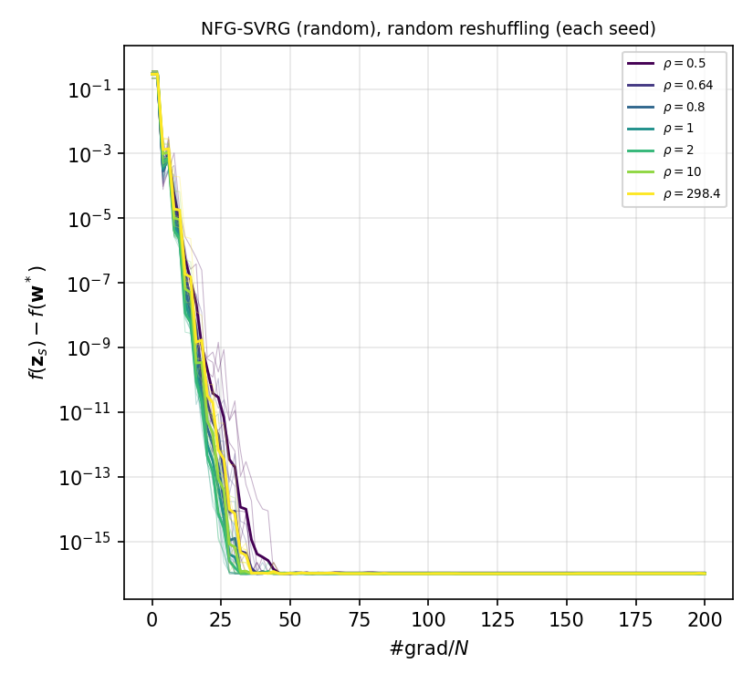
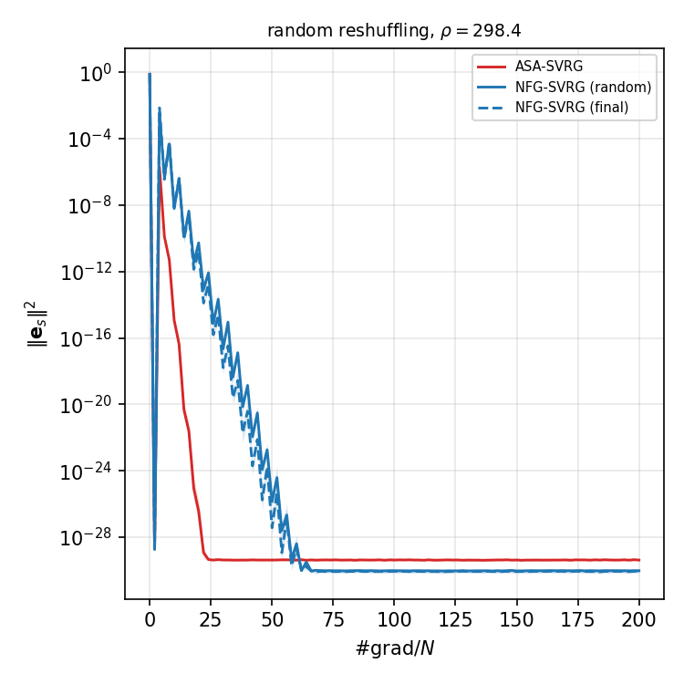

# report_071：実験計画の改訂と E1 の SVRG・NFG-SVRG のランダム点での再実施（実験計画 3.4節）

## 0. 要点

- `実験計画.md` を `実験計画 copy.md`（2026-11-20改訂）の内容で置き換えた．
  - E4 のディレクトリ名（3か所）だけは `ex007_e4_a9a` を `ex008_e4_a9a` に戻した．実在するディレクトリは `ex008_e4_a9a` である（report_070 5節，report_052 4節）．
- E1 に，ランダム点の SVRG（`SVRG_random`）と NFG-SVRG（`NFG_SVRG_random`）を追加し，100試行（2手法 × 10条件 × 5シード）を実行した．全試行が正常に終了し，打ち切りは無かった．
  - スナップショットの選択用の乱数生成器を分けた．そのため，添字の列は既存の最終点・ASA-SVRG の試行と同一である．
- 計画 3.4節の4つの論点の結果は次の通りである．
  1. **収束：** random reshuffling では，ランダム点の SVRG・NFG-SVRG とも全ての $ \rho $ で丸め誤差（$ 10^{-16} $）まで収束した．$ \hat{r} < \rho $ は全35組（7 $ \rho $ × 5シード）で成り立った．
     - SVRG の $ \hat{r} $ は最終点と差が無い（対応のある差は標準誤差以内）．
     - NFG-SVRG の $ \hat{r} $ は最終点よりやや大きい傾向がある（差は0.000〜0.027，いずれも標準誤差の2倍未満）．シード間の散らばりも大きい．
  2. **誤差床：** 独立一様サンプリングの近似誤差の床は，ランダム点の NFG-SVRG でも $ \sigma^{2}/K $（$ 4.099\times10^{-4} $，report_083）の0.984〜0.999倍であり，最終点と同様に一致した．
  3. **ASA-SVRG との比較：** random reshuffling では，ASA-SVRG の近似誤差はランダム点の NFG-SVRG より $ \#\mathrm{grad}/N \le 31 $ で中央値8〜12桁小さい．$ \hat{r} $ も ASA-SVRG が10〜60倍小さい．独立一様サンプリングでは，両者の床は同じ値（$ \sigma^{2}/K $）である．
  4. **最終点の扱い：** 傾向は最終点と同じである．4.1節では「最終点でも同じ傾向である」という一文にとどめられる結果である（判断は論文側）．
- 既存の手法（最終点，ASA-SVRG）の結果は，コードの変更で変わらないことを確認した．
  - 変更前のコードと本PCで完全に一致する．
  - 別のPCで実行した既存のログとは，$ f^{*} $ の1〜2 ulp（$ \le 2.2\times10^{-16} $）の丸め誤差の差がある（2.2節）．
- テストは全118件が通過した．

## 1. 実装

### 1.1 `ex006_e1_mushroom_rho_sampling/train.py`

| 変更 | 内容 |
|---|---|
| 手法の追加 | `_VARIANCE_REDUCED_OPTIMIZER_CLASSES` に `"SVRG_random": SVRG`，`"NFG_SVRG_random": NFGSVRG` を加えた．既存の `"SVRG"`（`SVRGFinalPoint`），`"NFG_SVRG"`（`NFGSVRGFinalPoint`）は変えていない |
| 全勾配の手法の判定 | `method == "SVRG"` を `method in FULL_GRADIENT_METHODS`（`("SVRG", "SVRG_random")`）に改めた．初期の全勾配，各エポックの全勾配，`oracle_calls`（$ 3N $／エポック）に用いる |
| 乱数生成器の分離 | `snapshot_rng = np.random.default_rng([seed, 1])` を作り，`optimizer.begin_epoch(snapshot_rng)` とした．添字の列は従来通り `rng = default_rng(seed)` から生成する |
| `config.json` | ランダム点の手法のみ `snapshot_rule: "uniform_random"`，`snapshot_rng_seed: [seed, 1]` を加えた |
| `--methods` | 既定を6手法とした（完了済みの試行はスキップされる） |

最終点の手法と ASA-SVRG は `begin_epoch` で乱数を消費しない．そのため，`begin_epoch` に渡す生成器を変えても既存の手法の計算は変わらない．

### 1.2 テスト（`tests/test_e1_programs.py` に追加）

| テスト | 内容 |
|---|---|
| `test_random_point_methods_keep_index_sequence` | ランダム点の手法と，最終点の手法・ASA-SVRG で，各エポックの添字の列が一致する（2つのサンプリング方式 × 3組） |
| `test_random_point_snapshot_rng_is_separate_and_seeded` | 選択の添字が `default_rng([seed, 1]).integers(0, K)` と一致する |
| `test_random_point_oracle_calls` | `SVRG_random` は初期 $ N $ と $ 3N $／エポック，`NFG_SVRG_random` は $ 2N $／エポック |
| `test_existing_methods_unchanged_against_existing_logs` | `SVRG`・`NFG_SVRG`・`ASAI_SVRG`（シード0，$ \rho = 298.4 $，2エポック）の結果を2つの基準と比べる（下記） |
| `test_random_point_config_records_snapshot_rule` | `config.json` の追加項目と保存先 |

`test_existing_methods_unchanged_against_existing_logs` の2つの基準は次の通りである．
- **変更前のコードの本PCでの出力（`outputs/_verify/ex006_head_check`）：** 全項目が完全に一致することを求める．
- **既存のログ：** 整数の項目と精度は完全一致，実数の項目は相対 $ 10^{-12} $ または絶対 $ 10^{-15} $ 以下を求める．既存のログに完全一致を求めない理由は2.2節に示す．

### 1.3 集計（`programs/analysis_e1.py`）

- 既存の表と図に，ランダム点の2手法を加えた．最終点の表はそのまま残した．
- `outputs/e1_summary.md` に「ランダム点の SVRG・NFG-SVRG（実験計画 3.4節）」の節を加えた．
  - $ \hat{r} $ の比較．
  - 誤差床の比較．
  - ランダム点と最終点の対応のある差．
  - ASA-SVRG とランダム点の NFG-SVRG の近似誤差の比．
- 図を追加した．
  - `e1_{loss,approx_error}_{sampling}_{SVRG_random,NFG_SVRG_random}_{budget31,full}.png`：既存と同じ形式．
  - `e1_seeds_*`：各シードの曲線を薄く重ねた確認用の図．
  - `e1_approx_error_compare_{sampling}_rho{ρ}.png`：ASA-SVRG，ランダム点と最終点の NFG-SVRG の近似誤差．
- `--this-pc-root` を指定すると，PC 間の差を `consistency_final_this_pc.md` にまとめる．
- `visualize_result_E1.ipynb` を実行した．

### 1.4 実行

- 本実行：`train.py --methods SVRG_random NFG_SVRG_random --workers 32`（ログは `outputs/_run_logs/ex006_random.log`）．
  - 1プロセスの DRAM は約0.9 GB であった．
  - 1試行は約10分（負荷時に約6.5 s／エポック）で，全体で約45分であった．
- 確認用に，最終点の SVRG・NFG-SVRG の100試行を本PCで再実行した（`--output-root ../outputs/_verify/ex006_final_this_pc --workers 16`，2.2節）．

## 2. 一致の確認

### 2.1 添字の列とコードの変更

- 添字の列の一致と，既存の手法の計算が変わらないことは，1.2節のテストで確認した．
- 本PCでは，変更前のコード（HEAD）と変更後のコードの出力がビット単位で一致した（`SVRG`・`NFG_SVRG`・`ASAI_SVRG`，2エポック）．

### 2.2 既存のログとの PC 間の差

既存の E1 のログは別のPCで実行したものである．本PCで同じコードを実行すると，$ f^{*} $（L-BFGS-B の結果）が1〜2 ulp 異なる．最終点の SVRG・NFG-SVRG の全100試行を本PCで再実行し，既存のログと比べた結果は次の通りである（`outputs/ex006_e1_mushroom_rho_sampling/consistency_final_this_pc.md`）．

| 項目 | 結果 |
|---|---|
| 整数の項目（`epoch`，`oracle_calls`，`test_correct`，`terminated`）と精度 | 100/100試行で完全一致 |
| $ f^{*} $ の差 | 最大 $ 2.2\times10^{-16} $ |
| 目的関数誤差の差 | 最大の絶対差 $ 4.4\times10^{-16} $ |
| $ \hat{r} $ の差 | 最大 $ 1.1\times10^{-6} $ |
| 独立一様サンプリングの誤差床（NFG-SVRG） | 差は0.000（log10） |

- 差は全て丸め誤差の大きさであり，E4 の MSE で見た現象（report_052 3.2節）と同じく計算環境によるものである．
- ランダム点の試行と，本PCで再実行した最終点の試行で対応のある差を計算し直しても，$ \hat{r} $ の差と誤差床の比は小数第4位まで同じであった．
- 変わったのは，丸め誤差の床（$ 10^{-16} $）にある最終の目的関数誤差の比のみ（log10 で 0.1 以下）である．
- 以下の結果は，既存のログ（最終点）と本PCのランダム点の試行の比較であり，結論はこの差の影響を受けない．

## 3. 結果

値は5シードの平均 ± 標準誤差である．全表は `programs_review/outputs/e1_summary.md` にある．

### 3.1 random reshuffling の実測の縮小率 $ \hat{r} $

| $ \rho $ | SVRG（ランダム点） | SVRG（最終点） | NFG-SVRG（ランダム点） | NFG-SVRG（最終点） | ASA-SVRG | $ \hat{r} < \rho $（ランダム点 SVRG／NFG） |
|---:|---|---|---|---|---|---|
| 0.5 | 0.0022 ± 0.0006 | 0.0009 ± 0.0003 | 0.1423 ± 0.0187 | 0.1154 ± 0.0010 | 0.0135 ± 0.0002 | 5/5 ／ 5/5 |
| 0.64 | 0.0017 ± 0.0007 | 0.0018 ± 0.0006 | 0.1024 ± 0.0164 | 0.0772 ± 0.0008 | 0.0065 ± 0.0002 | 5/5 ／ 5/5 |
| 0.8 | 0.0021 ± 0.0010 | 0.0024 ± 0.0011 | 0.0841 ± 0.0116 | 0.0617 ± 0.0005 | 0.0041 ± 0.0001 | 5/5 ／ 5/5 |
| 1 | 0.0026 ± 0.0011 | 0.0033 ± 0.0017 | 0.0648 ± 0.0078 | 0.0546 ± 0.0022 | 0.0030 ± 0.0001 | 5/5 ／ 5/5 |
| 2 | 0.0036 ± 0.0008 | 0.0043 ± 0.0020 | 0.0581 ± 0.0037 | 0.0555 ± 0.0048 | 0.0018 ± 0.0000 | 5/5 ／ 5/5 |
| 10 | 0.0089 ± 0.0016 | 0.0082 ± 0.0035 | 0.0761 ± 0.0057 | 0.0761 ± 0.0072 | 0.0016 ± 0.0002 | 5/5 ／ 5/5 |
| 298.4 | 0.0118 ± 0.0020 | 0.0091 ± 0.0025 | 0.1023 ± 0.0059 | 0.0860 ± 0.0079 | 0.0016 ± 0.0003 | 5/5 ／ 5/5 |

- ランダム点の SVRG・NFG-SVRG は全ての $ \rho $・全シードで $ 10^{-16} $ に到達し，以後は丸め誤差の床にとどまる（図）．
  - 最終の目的関数誤差は全て $ |\Delta| \le 1.1\times10^{-16} $ である．
  - 負の値（例：$ -6.7\times10^{-17} $）は，L-BFGS-B の $ f^{*} $ が真の最小値より丸め誤差の分だけ大きいためである．
- ランダム点の評価点は選ばれた $ {\mathbf z}_{s} $ のため，曲線は最終点より揺らぐ．丸め誤差の手前（$ \Delta_{s} > 10^{-12} $）にとどまる最後の外側ループ $ s_{\mathrm{end}} $ は，NFG-SVRG でランダム点が9.4〜13.2エポック，最終点が9.0〜12.0エポックであり，ランダム点が0.4〜1.2エポック長い．
- **SVRG：** $ s_{\mathrm{end}} $ が3〜5エポックと短く，$ \hat{r} $ は少数の点からの推定値である．ランダム点と最終点の対応のある差は，全ての $ \rho $ で標準誤差以内（$ -0.0007 $〜$ +0.0027 $）である．
- **NFG-SVRG：** ランダム点の $ \hat{r} $ は最終点より0.000〜0.027大きい．差が大きいのは $ \rho \le 0.8 $（差 0.023〜0.027，標準誤差 0.012〜0.019）であるが，いずれも標準誤差の2倍未満であり，5シードでは有意な差とはいえない．
  - シード間の標準誤差は最終点の2〜20倍である．スナップショットの位置がランダムなため，$ \Delta_{1} $ と $ \Delta_{s_{\mathrm{end}}} $ が揺らぐことによる．
- **ASA-SVRG との比較：** $ \hat{r} $ は ASA-SVRG がランダム点の NFG-SVRG より10〜60倍小さい．論文 4.1節の主張（ASA-SVRG は NFG-SVRG より速く収束する）は，ランダム点でも変わらない．

### 3.2 独立一様サンプリングの誤差床（最後の20外側ループの中央値）

| $ \rho $ | 指標 | SVRG（ランダム点） | SVRG（最終点） | NFG-SVRG（ランダム点） | NFG-SVRG（最終点） | ASA-SVRG |
|---:|---|---|---|---|---|---|
| 0.5 | 目的関数誤差 | $ -2.2\times10^{-17} $ | $ 6.7\times10^{-17} $ | $ 1.474\times10^{-4} $ | $ 1.726\times10^{-4} $ | $ 1.377\times10^{-4} $ |
| 0.5 | 近似誤差 | （0） | （0） | $ 4.094\times10^{-4} $ | $ 4.154\times10^{-4} $ | $ 4.040\times10^{-4} $ |
| 1 | 目的関数誤差 | $ 2.2\times10^{-17} $ | $ 6.7\times10^{-17} $ | $ 1.576\times10^{-4} $ | $ 1.724\times10^{-4} $ | $ 1.540\times10^{-4} $ |
| 1 | 近似誤差 | （0） | （0） | $ 4.033\times10^{-4} $ | $ 4.121\times10^{-4} $ | $ 4.043\times10^{-4} $ |
| 298.4 | 目的関数誤差 | $ 4.4\times10^{-17} $ | $ 8.9\times10^{-17} $ | $ 1.692\times10^{-4} $ | $ 1.746\times10^{-4} $ | $ 1.637\times10^{-4} $ |
| 298.4 | 近似誤差 | （0） | （0） | $ 4.061\times10^{-4} $ | $ 4.163\times10^{-4} $ | $ 4.044\times10^{-4} $ |

（標準誤差は `e1_summary.md` にある．近似誤差の標準誤差は約 $ 1\times10^{-5} $，NFG-SVRG の目的関数誤差の標準誤差は $ 3\times10^{-6} $〜$ 6.5\times10^{-6} $ である．）

- **SVRG：** 全勾配を用いるため，独立一様サンプリングでもランダム点・最終点とも丸め誤差まで収束する．
- **NFG-SVRG の近似誤差の床：** ランダム点で $ 4.03\times10^{-4} $〜$ 4.09\times10^{-4} $ であり，$ \sigma^{2}/K = 4.099\times10^{-4} $（report_083 2.1節，5シードの平均）の0.984〜0.999倍である．最終点（1.005倍）と同様に $ \sigma^{2}/K $ と一致する．ランダム点と最終点の対応のある差は log10 で $ -0.011 $〜$ -0.006 $（標準誤差 0.008〜0.012）であり，差は無い．
- **NFG-SVRG の目的関数誤差の床：** ランダム点の方が最終点よりやや小さい．差は log10 で $ \rho = 0.5 $ のとき $ -0.070 \pm 0.019 $（約15%），$ \rho = 1 $ のとき $ -0.040 \pm 0.016 $，$ \rho = 298.4 $ のとき $ -0.013 \pm 0.012 $ である．最終点は内側ループの最後の確率的な更新を受けた点であり，ランダム点はその平均的な位置に近いためと考えられるが，この解釈は検証していない．
- ASA-SVRG の床（目的関数誤差，近似誤差）は，ランダム点の NFG-SVRG とほぼ同じ値である（近似誤差の床の log10 の比は $ -0.006 $〜$ +0.001 $）．

### 3.3 ASA-SVRG とランダム点の NFG-SVRG の近似誤差（同じシード）

| sampling | $ \rho $ | log10(ASA/NFG(ランダム点)) の中央値（$ \#\mathrm{grad}/N \le 31 $） | ASA が小さい外側ループの割合 |
|---|---:|---|---|
| random reshuffling | 0.5 | $ -8.31 \pm 0.42 $ | 0.96 |
| random reshuffling | 1 | $ -10.36 \pm 0.43 $ | 0.96 |
| random reshuffling | 298.4 | $ -12.47 \pm 0.45 $ | 0.96 |
| 独立一様 | 0.5 | $ -0.027 \pm 0.012 $ | 0.73 |
| 独立一様 | 1 | $ -0.005 \pm 0.005 $ | 0.60 |
| 独立一様 | 298.4 | $ -0.012 \pm 0.004 $ | 0.69 |

- **random reshuffling：** ASA-SVRG の近似誤差は，$ \#\mathrm{grad}/N \le 31 $ でランダム点の NFG-SVRG より中央値で8〜12桁小さい．全7 $ \rho $ で同じであり，桁数は $ \rho $ が大きいほど大きい．
  - 割合が1でなく0.96なのは，1エポック目を含むためである．1エポック目は $ {\mathbf g}_{0} = {\mathbf 0} $ により内側ループが動かず，NFG-SVRG の近似誤差が丸め誤差（$ 10^{-29} $ 程度）になる（図の $ \#\mathrm{grad}/N = 2 $ の落ち込み）．
  - ランダム点と最終点の NFG-SVRG の近似誤差の曲線はほぼ重なる（図の実線と破線）．
  - 最後の20外側ループでは両者とも丸め誤差（ASA-SVRG $ 4\times10^{-30} $，NFG-SVRG $ 1\times10^{-30} $）にある．この床の比（log10 で $ +0.64 $〜$ +0.72 $）は丸め誤差の大きさの違いであり，手法の比較には用いない．
- **独立一様サンプリング：** 両者とも $ \sigma^{2}/K $ の床にあり，ASA-SVRG の方がわずかに小さい（log10 で $ -0.03 $〜$ -0.005 $）．Theorem 3 の形の比較としては「床は同じ」が結論である．

## 4. 考察

- 論文の収束解析と Algorithm 1・2 に合わせたランダム点でも，4.1節の3つの観察は変わらない．
  - random reshuffling で全ての $ \rho $ で収束し，$ \hat{r} < \rho $ が成り立つ．
  - 独立一様サンプリングの誤差床が $ \sigma^{2}/K $ と一致する．
  - ASA-SVRG の近似誤差が NFG-SVRG より桁違いに小さい．
- 最終点との違いは2点である．どちらも結論を変えない．
  - NFG-SVRG の $ \hat{r} $ がやや大きく，シード間の散らばりが大きいこと．
  - NFG-SVRG の目的関数誤差の床がやや小さいこと．
- このため，論文の図1・表III をランダム点の結果に差し替え，最終点については4.1節で「最終点でも同じ傾向である」と一文で述べる構成で足りると考える（計画 3.4節の論点4）．最終判断は論文側で行う．

## 5. 変更したファイル

| ファイル | 変更 |
|---|---|
| `実験計画.md` | `実験計画 copy.md` の内容で置き換え，E4 のディレクトリ名を `ex008_e4_a9a` に戻した |
| `programs_review/programs/ex006_e1_mushroom_rho_sampling/train.py` | 1.1節 |
| `programs_review/programs/ex006_e1_mushroom_rho_sampling/README.md` | ランダム点の手法，実行方法，PC 間の差，図の一覧を追記 |
| `programs_review/programs/analysis_e1.py` | 1.3節 |
| `programs_review/tests/test_e1_programs.py` | 1.2節 |
| `programs_review/document.md` | E1 の手法，`config.json` の追加項目，実行方法を追記 |
| `programs_review/outputs/ex006_e1_mushroom_rho_sampling/{SVRG_random,NFG_SVRG_random}/` | 100試行の結果（各試行の `config.json` と `log.json`） |
| `programs_review/outputs/ex006_e1_mushroom_rho_sampling/figures/`，`consistency_final_this_pc.md`，`outputs/e1_summary.md` | 集計結果 |
| `programs_review/visualize_result_E1.ipynb` | 実行済み |
| `programs_review/outputs/_run_logs/ex006_random.log`，`verify_ex006_final_this_pc.log` | 実行ログ |

`outputs/_verify/ex006_final_this_pc`，`ex006_head_check` は確認用であり，Git の管理外である．

## 6. 未解決の論点・次の作業の候補

1. **論文側の図と表の作り直し（未実施）：** 計画 3.4節の出力にある `make_e1_paper_assets.py`，`make_report083_figures.py`，`analyze_e1_gradient_variance.py` は論文のリポジトリ（`ASAI_SVRG_Paper/programs/`）にある．いずれも手法名 `SVRG`・`NFG_SVRG` を直接参照しているため，`SVRG_random`・`NFG_SVRG_random` に切り替えて図1・表III と本文の数値を作り直す必要がある．論文のリポジトリには未コミットの変更と `order_077.md` があったため，本作業では変更していない．
2. **E3 の NFG-SVRG の restart での再計測（計画 5.6節，未実施）：** 計画8章では E1 の再実施より先に行う順序であるが，今回の指示は E1 のみであった．E3 の計測は他の実験と同時に実行しない．E1 は既に終了しているため，いつでも実行できる．
3. **最終点の結果の扱い（計画 3.4節の論点4）：** 4節の通り，一文にとどめる構成を提案する．
4. **NFG-SVRG の目的関数誤差の床がランダム点で小さい理由**（3.2節）は検証していない．論文で述べる場合は，評価点の分布（内側ループ内の位置）との関係の確認が必要である．
5. `実験計画 copy.md` は Git 管理外のまま残っている．内容は `実験計画.md` に反映済みのため，削除してよい．
