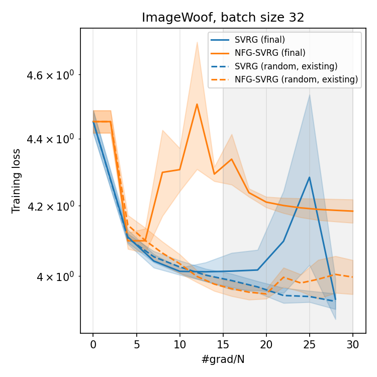
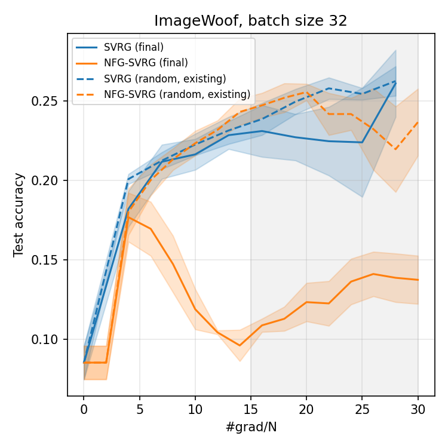
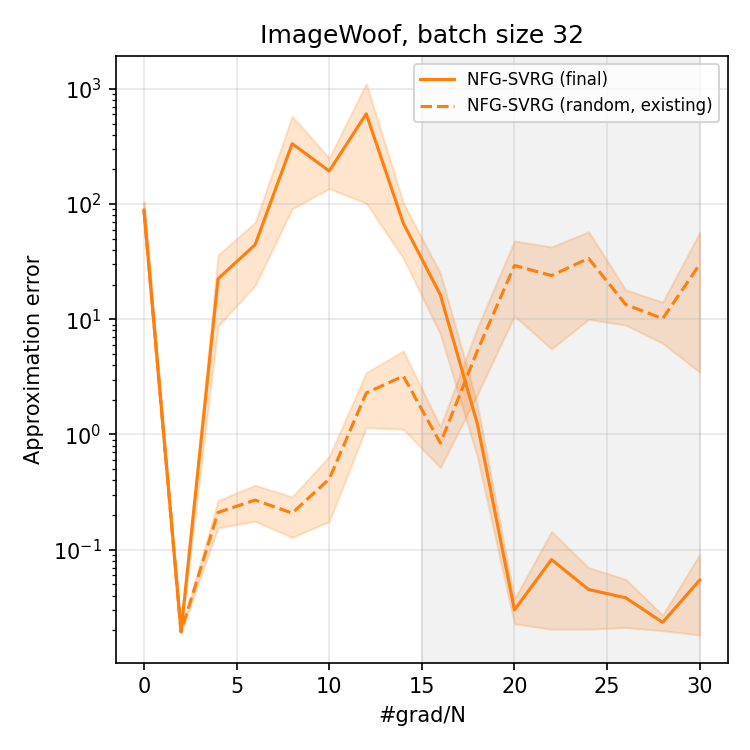
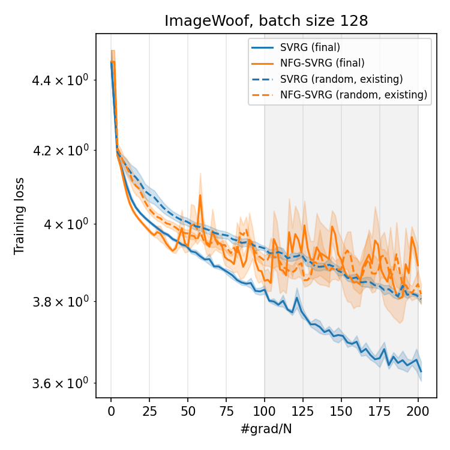
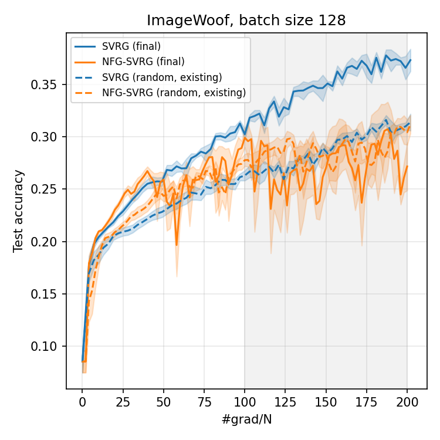
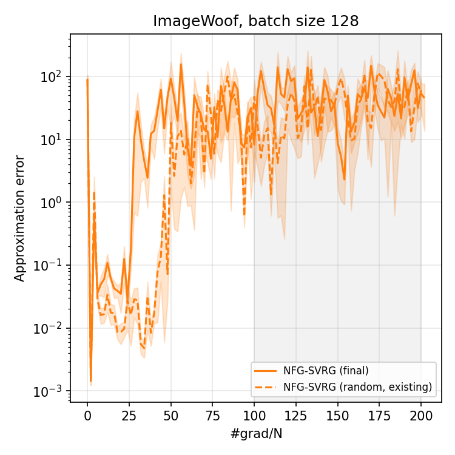
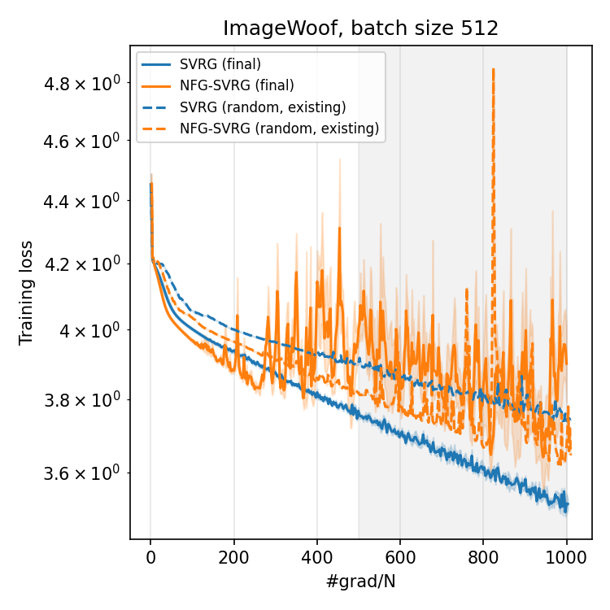
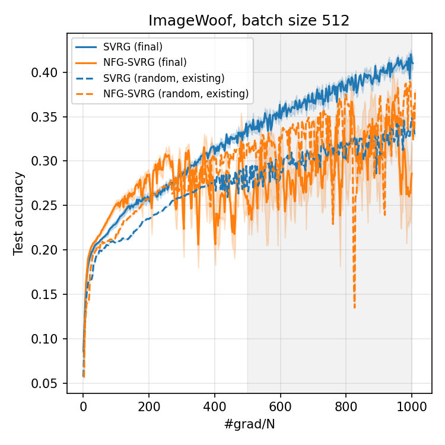
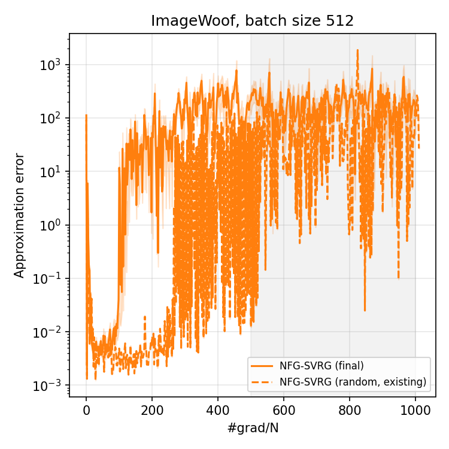

# report_075：E7 最終点のスナップショットの SVRG・NFG-SVRG（ImageWoof，バッチサイズ32・128・512）と1エポックの時間の計測

指示書：`実験指示E7.md`，改訂版 `実験指示E7 (1).md`（以下，指示書は改訂版を指す）．指示：`.orders/order_075.md`．番号は指示書0.3節のとおり（`order_075`，`report_075`，`ex012`，`ex013`）であり，既存の番号との衝突は無かった．

## 0. 要点

- A（`ex012_e7_imagewoof_final`，30試行）と B（`ex013_e7_epoch_time`，72試行）は全て完了した．失敗した試行も打ち切られた試行も無く，再実行は行っていない．
- 確認（指示書2.3節・3.4節）は全て合格した．
  - A：本実験の `train.py` による既存の SVRG（ランダム点）は，バッチサイズ32・128・512で既存の結果と4系列全てが完全に一致した．最終点の2手法の `oracle_calls` と `config.json` は規則どおりであった．
  - B：4手法の実行の順序と `oracle_calls` の増分は規則どおりであった．
- 「時間計測を優先」の指示に従い，B を A より先に実行した（指示書0.5節の推奨の順序「A → B」とは異なる）．B の実行中は他の GPU のジョブを止めた．
- 結果（6節）：
  - **NFG-SVRG（最終点）は，発散（NaN・打ち切り）はしないが，テスト精度の急落を繰り返し，予算でのテスト精度は全てのバッチサイズで既存の NFG-SVRG（ランダム点）より低い**（13.75 対 23.68%，27.16 対 30.41%，28.59 対 35.28%）．急落はバッチサイズ128では $ \#\mathrm{grad}/N \approx 46$〜$58 $，512では $ 306$〜$544 $ から始まる．バッチサイズ32では $ \#\mathrm{grad}/N = 4$〜$8 $ で最大（約20%）となった後，10〜14%に下がる．
  - **SVRG（最終点）は，バッチサイズ128・512で既存の SVRG（ランダム点）より予算でのテスト精度が高い**（36.56 対 30.98%，41.14 対 34.84%）．バッチサイズ32では平均は同じ（26.12 対 26.27%）だが，揺らぎが大きい．
  - **1エポックの時間の比 ASA-SVRG ÷ SVRG（最終点）は 0.59〜0.74 であり，ImageWoof（0.59〜0.66）より CIFAR-10（0.68〜0.74）で大きく，同じデータセットではバッチサイズが小さいほど大きい．** ASA-SVRG ÷ NFG-SVRG（最終点）は 1.00〜1.04 である．
  - **3周の揺らぎ（(最大−最小)/平均）は，24条件中20条件で 3.7% 以下であり，ASA-SVRG と SVRG の差（26〜41%）より十分に小さい．** 一方，ASA-SVRG と NFG-SVRG の差（0〜4%）とは同じ程度であり，この2手法の実時間の差は本計測では区別できない．

## 1. 実行環境と並列数

| 項目 | 内容 |
|---|---|
| OS | Windows 上の WSL2（Linux 6.18.33.2-microsoft-standard-WSL2） |
| CPU | Intel Xeon w7-3565X（64論理コア），メモリ 125 GB |
| GPU | NVIDIA RTX PRO 6000 Blackwell Max-Q Workstation Edition（97,887 MiB），ドライバ 582.08 |
| CUDA・cuDNN | CUDA 12.8（torch の付属），cuDNN 9.19.0（`torch.backends.cudnn.version()` = 91900） |
| Python・主要パッケージ | Python 3.12.15（`.venv_pytorch`），torch 2.11.0+cu128，numpy 2.4.6，scipy 1.18.1 |

本PCは E3（`ex009`）を計測した PC である．

**A の並列数：4．** 根拠（`programs_review/outputs/ex012_e7_imagewoof_final/consistency.md` 3節）：並列数1で1試行を実行し，GPU のメモリ使用量（`nvidia-smi` の `memory.used` の差．WSL2 ではプロセスごとの値が表示されない）を測った．バッチサイズ512で約22.3 GB，128で約6.5 GB，32で約2.5 GB であった（待機時 0.7 GB，総量 97.9 GB）．DRAM の使用量は全体で 5〜6 GB であった（総量 125 GB）．
タスクはエポック数の多い順（バッチサイズ512から）に実行するため，バッチサイズ512の4試行を同時に置ける4並列（約90 GB）とした．`report_073` の E5 のバッチサイズ512 と同じである．
なお，並列数1でも GPU の使用率は約95%であり，4並列では1エポックが約68〜70秒（並列数1では約18秒）であった．したがって並列化による短縮はほぼ無い．A は実時間を計測しないため，結果には影響しない．

**B の並列数：1．** 指示書3節のとおり，1試行ずつ実行し，実行中は他の GPU のジョブを止めた．

## 2. 作成したファイル

| ファイル | 内容 |
|---|---|
| `programs_review/programs/ex012_e7_imagewoof_final/`（`train.py`，`data.py`，`model.py`，`README.md`） | A．学習ループは `common/vr_image_training.py`，タスクの実行は `common/e0_runner.py` をそのまま用いる．`data.py`・`model.py` は既存の ImageWoof の実験からコピーした |
| `programs_review/programs/ex013_e7_epoch_time/`（`train.py`，`timed_training.py`，`data.py`，`data_cifar10.py`，`model.py`，`model_cifar10.py`，`README.md`） | B．`timed_training.py` は `common/vr_image_training.py` の関数を用いて1エポックを区間ごとに計測する |
| `programs_review/programs/analysis_e7.py` | 集計表と確認用の図．既存の結果のパスは `--reference-root-bs{32,128,512}` で受け取る |
| `programs_review/tests/test_e7_programs.py` | テスト25件（5節） |
| `programs_review/outputs/ex012_e7_imagewoof_final/` | A の30試行の結果，`figures/`（9枚），`consistency.md` |
| `programs_review/outputs/ex013_e7_epoch_time/` | B の72試行の結果，`consistency.md` |
| `programs_review/outputs/e7_summary.md` | 集計表 |
| `programs_review/outputs/_run_logs/ex012.log`，`ex012_verify.log`，`ex013.log`，`ex013_verify.log` | 実行ログ |
| `.orders/order_075.md`，`.reports/report_075.md` | 指示と本レポート |

## 3. 実行の経緯と順序

1. 当初の指示書（`実験指示E7.md`）では，部は A（精度），B（バッチサイズ128の実時間の本計測），C（1エポックの時間の短い計測）の3つであった．
2. 当初の B の前の速度の確認で，ex009 の SVRG のシード0に対して1エポックの時間が +4.3〜4.8% となり，基準（3%以内）を2回超えた．学習の値はビット単位で一致し，環境も同じであった．ユーザーと相談し，指示書を `実験指示E7 (1).md` に改めた（A と，1エポックの時間の短い計測 B の2部）．経緯は `order_075.md` 3節にある．
3. 旧 B・C のために作ったものは，プログラムのディレクトリを `ex013_e7_epoch_time` に作り替え，結果とログは `programs_review/outputs/_verify/ex013_old/`，`ex013_speed/`，`ex013_speed_retry/`（Git 管理外，zip に含めない）に移した．
4. 実行の順序は，B の確認（3.4節）→ B の本計測 → A の一致の確認（2.3節）→ A の本実行 とした．「時間計測を優先」の指示に従ったためであり，指示書0.5節の推奨の順序（A → B）とは異なる．B の実行中は他の GPU のジョブを止め，テストなどの計算も行わなかった．
5. A の本実行中に，E8（`ex014_e8_a9a_supplement`，CPU のみ，15並列）を並行して実行した（2026-11-22 10:00〜10:34）．A は実時間を計測しないため，結果には影響しない．

| 部 | 期間 | 実時間 |
|---|---|---:|
| B の確認（3.4節） | 2026-11-21 23:08〜23:14 | 約6分 |
| B の本計測（72試行） | 2026-11-21 23:14:17〜2026-11-22 00:59:29 | 1時間45分 |
| A の一致の確認（2.3節） | 2026-11-22 01:00ごろ〜01:05 | 約5分 |
| A の本実行（30試行，4並列） | 2026-11-22 01:06〜2026-11-23 02:25:39 | 25時間19分 |

実行しなかった部分：無し．旧指示書の B・C は改訂により行わない（途中で止めた旧 C の結果は `_verify/ex013_old/` にある）．

## 4. 確認（指示書2.3節・3.4節）

詳細は `programs_review/outputs/ex012_e7_imagewoof_final/consistency.md` と `programs_review/outputs/ex013_e7_epoch_time/consistency.md` にある．

### 4.1 A：既存の SVRG（ランダム点）との一致（2.3節）

本実験の `train.py` で `--methods SVRG --seeds 0 --epochs 2 --batch-sizes 32 128 512` を実行し，既存の結果の先頭の3点（0〜2エポック）と比べた．

| バッチサイズ | 既存の結果 | oracle_calls | train_loss | test_accuracy | approx_error |
|---:|---|---|---|---|---|
| 32 | `ex005_appb_imagewoof_resnet18_layernorm/SVRG/…_bs32_…_epochs33/0` | 完全一致 | 完全一致 | 完全一致 | 完全一致 |
| 128 | `ex003_e0_imagewoof_resnet18_layernorm/SVRG/…_bs128_…_epochs128/0` | 完全一致 | 完全一致 | 完全一致 | 完全一致 |
| 512 | `ex005_appb_imagewoof_resnet18_layernorm/SVRG/…_bs512_…_epochs505/0` | 完全一致 | 完全一致 | 完全一致 | 完全一致 |

### 4.2 A：最終点の2手法（バッチサイズ128，シード0，2エポック）

| 手法 | `config.json` の `method` | oracle_calls | train_loss |
|---|---|---|---|
| `SVRG_final` | `SVRG_final` | 0，36100，63175（$ = 0, 4N, 7N $，$ N = 9025 $） | 4.4552，4.1851，4.1418 |
| `NFG_SVRG_final` | `NFG_SVRG_final` | 0，18050，36100（$ = 0, 2N, 4N $） | 4.4552，4.4552，4.1853 |

NFG-SVRG（最終点）の1エポック目の学習損失が初期値とほぼ等しいのは，$ {\mathbf g}_{0} = {\mathbf 0} $ のため1回目の内側ループの補正勾配が $ {\mathbf 0} $ になるからである．1エポック目までは既存の NFG-SVRG（ランダム点）とビット単位で一致し，2エポック目から異なる（4.1853 と 4.1986）．

### 4.3 B：動作の確認（3.4節）

- ImageWoof・バッチサイズ128・1周の実行で，順序は ASA-SVRG → NFG-SVRG（最終点）→ SVRG（最終点）→ SGD であった．
- `oracle_calls` の増分は，ASA-SVRG・NFG-SVRG が1エポック $ 2N $，SVRG が初期 $ N $・1エポック $ 3N $，SGD が1エポック $ N $ であり，規則に一致した．
- 参考（判定には使わない）：2〜4エポック目の1エポックの時間を ex009 と比べると，ASA-SVRG +0.82%，NFG-SVRG +2.09%，SVRG +2.45%，SGD +2.08% であった．いずれも ex009 のシード間の範囲（最小〜最大）の中か，その近くにある．

### 4.4 B：本計測の実行の順序

72試行の開始時刻（`outputs/_run_logs/ex013.log` の `[start]` 行）を `e7_summary.md` の「実行の順序」の表に抜き出した．全ての組（データセット × バッチサイズ）で，ASA-SVRG → NFG-SVRG（最終点）→ SVRG（最終点）→ SGD を3周の順に実行しており，同じ組の中で同じ手法が連続した箇所は無い．`[failed]` は0件であった．

| 開始時刻 | データセット | バッチサイズ | 周回 | 手法 |
|---|---|---:|---:|---|
| 2026-11-21T23:14:19 | ImageWoof | 32 | 0 | ASA-SVRG（continue） |
| 2026-11-21T23:16:29 | ImageWoof | 32 | 0 | NFG-SVRG（最終点） |
| 2026-11-21T23:18:33 | ImageWoof | 32 | 0 | SVRG（最終点） |
| 2026-11-21T23:20:35 | ImageWoof | 32 | 0 | SGD |
| 2026-11-21T23:21:44 | ImageWoof | 32 | 1 | ASA-SVRG（continue） |
| 2026-11-21T23:23:52 | ImageWoof | 32 | 1 | NFG-SVRG（最終点） |
| 2026-11-21T23:25:59 | ImageWoof | 32 | 1 | SVRG（最終点） |
| 2026-11-21T23:28:07 | ImageWoof | 32 | 1 | SGD |
| 2026-11-21T23:29:14 | ImageWoof | 32 | 2 | ASA-SVRG（continue） |
| 2026-11-21T23:31:22 | ImageWoof | 32 | 2 | NFG-SVRG（最終点） |
| 2026-11-21T23:33:26 | ImageWoof | 32 | 2 | SVRG（最終点） |
| 2026-11-21T23:35:31 | ImageWoof | 32 | 2 | SGD |
| 2026-11-21T23:36:40 | ImageWoof | 128 | 0 | ASA-SVRG（continue） |
| 2026-11-21T23:38:08 | ImageWoof | 128 | 0 | NFG-SVRG（最終点） |
| 2026-11-21T23:39:35 | ImageWoof | 128 | 0 | SVRG（最終点） |
| 2026-11-21T23:41:01 | ImageWoof | 128 | 0 | SGD |
| 2026-11-21T23:41:56 | ImageWoof | 128 | 1 | ASA-SVRG（continue） |
| 2026-11-21T23:43:23 | ImageWoof | 128 | 1 | NFG-SVRG（最終点） |
| 2026-11-21T23:44:53 | ImageWoof | 128 | 1 | SVRG（最終点） |
| 2026-11-21T23:46:19 | ImageWoof | 128 | 1 | SGD |
| 2026-11-21T23:47:13 | ImageWoof | 128 | 2 | ASA-SVRG（continue） |
| 2026-11-21T23:48:42 | ImageWoof | 128 | 2 | NFG-SVRG（最終点） |
| 2026-11-21T23:50:09 | ImageWoof | 128 | 2 | SVRG（最終点） |
| 2026-11-21T23:51:36 | ImageWoof | 128 | 2 | SGD |
| 2026-11-21T23:52:31 | ImageWoof | 512 | 0 | ASA-SVRG（continue） |
| 2026-11-21T23:53:58 | ImageWoof | 512 | 0 | NFG-SVRG（最終点） |
| 2026-11-21T23:55:26 | ImageWoof | 512 | 0 | SVRG（最終点） |
| 2026-11-21T23:56:54 | ImageWoof | 512 | 0 | SGD |
| 2026-11-21T23:57:51 | ImageWoof | 512 | 1 | ASA-SVRG（continue） |
| 2026-11-21T23:59:18 | ImageWoof | 512 | 1 | NFG-SVRG（最終点） |
| 2026-11-22T00:00:46 | ImageWoof | 512 | 1 | SVRG（最終点） |
| 2026-11-22T00:02:14 | ImageWoof | 512 | 1 | SGD |
| 2026-11-22T00:03:09 | ImageWoof | 512 | 2 | ASA-SVRG（continue） |
| 2026-11-22T00:04:36 | ImageWoof | 512 | 2 | NFG-SVRG（最終点） |
| 2026-11-22T00:06:04 | ImageWoof | 512 | 2 | SVRG（最終点） |
| 2026-11-22T00:07:31 | ImageWoof | 512 | 2 | SGD |
| 2026-11-22T00:08:28 | CIFAR-10 | 32 | 0 | ASA-SVRG（continue） |
| 2026-11-22T00:11:56 | CIFAR-10 | 32 | 0 | NFG-SVRG（最終点） |
| 2026-11-22T00:15:20 | CIFAR-10 | 32 | 0 | SVRG（最終点） |
| 2026-11-22T00:18:38 | CIFAR-10 | 32 | 0 | SGD |
| 2026-11-22T00:20:11 | CIFAR-10 | 32 | 1 | ASA-SVRG（continue） |
| 2026-11-22T00:23:46 | CIFAR-10 | 32 | 1 | NFG-SVRG（最終点） |
| 2026-11-22T00:27:16 | CIFAR-10 | 32 | 1 | SVRG（最終点） |
| 2026-11-22T00:30:34 | CIFAR-10 | 32 | 1 | SGD |
| 2026-11-22T00:32:08 | CIFAR-10 | 32 | 2 | ASA-SVRG（continue） |
| 2026-11-22T00:35:42 | CIFAR-10 | 32 | 2 | NFG-SVRG（最終点） |
| 2026-11-22T00:39:06 | CIFAR-10 | 32 | 2 | SVRG（最終点） |
| 2026-11-22T00:42:24 | CIFAR-10 | 32 | 2 | SGD |
| 2026-11-22T00:43:56 | CIFAR-10 | 128 | 0 | ASA-SVRG（continue） |
| 2026-11-22T00:44:54 | CIFAR-10 | 128 | 0 | NFG-SVRG（最終点） |
| 2026-11-22T00:45:52 | CIFAR-10 | 128 | 0 | SVRG（最終点） |
| 2026-11-22T00:46:49 | CIFAR-10 | 128 | 0 | SGD |
| 2026-11-22T00:47:17 | CIFAR-10 | 128 | 1 | ASA-SVRG（continue） |
| 2026-11-22T00:48:21 | CIFAR-10 | 128 | 1 | NFG-SVRG（最終点） |
| 2026-11-22T00:49:23 | CIFAR-10 | 128 | 1 | SVRG（最終点） |
| 2026-11-22T00:50:22 | CIFAR-10 | 128 | 1 | SGD |
| 2026-11-22T00:50:51 | CIFAR-10 | 128 | 2 | ASA-SVRG（continue） |
| 2026-11-22T00:51:49 | CIFAR-10 | 128 | 2 | NFG-SVRG（最終点） |
| 2026-11-22T00:52:46 | CIFAR-10 | 128 | 2 | SVRG（最終点） |
| 2026-11-22T00:53:41 | CIFAR-10 | 128 | 2 | SGD |
| 2026-11-22T00:54:09 | CIFAR-10 | 512 | 0 | ASA-SVRG（continue） |
| 2026-11-22T00:54:40 | CIFAR-10 | 512 | 0 | NFG-SVRG（最終点） |
| 2026-11-22T00:55:10 | CIFAR-10 | 512 | 0 | SVRG（最終点） |
| 2026-11-22T00:55:40 | CIFAR-10 | 512 | 0 | SGD |
| 2026-11-22T00:55:57 | CIFAR-10 | 512 | 1 | ASA-SVRG（continue） |
| 2026-11-22T00:56:28 | CIFAR-10 | 512 | 1 | NFG-SVRG（最終点） |
| 2026-11-22T00:56:58 | CIFAR-10 | 512 | 1 | SVRG（最終点） |
| 2026-11-22T00:57:29 | CIFAR-10 | 512 | 1 | SGD |
| 2026-11-22T00:57:43 | CIFAR-10 | 512 | 2 | ASA-SVRG（continue） |
| 2026-11-22T00:58:14 | CIFAR-10 | 512 | 2 | NFG-SVRG（最終点） |
| 2026-11-22T00:58:44 | CIFAR-10 | 512 | 2 | SVRG（最終点） |
| 2026-11-22T00:59:14 | CIFAR-10 | 512 | 2 | SGD |

## 5. テスト

`programs_review/tests/test_e7_programs.py`（25件．小さなモデルと乱数のデータで，CPU で約6秒）．主な内容は次のとおりである．

- A：既定のタスク（30試行，エポック数 11/67/334・16/100/500），手法・エポック数の指定，長いタスクから実行する順序，最終点のスナップショット，`oracle_calls` の規則．
- B：既定のタスクの順序（組ごとに4手法 × 3周），組の分け方，確認用の選択，試行の結果の保存，1エポックの時間の定義（2〜4エポック目の平均），予算に届くエポック数，集計，区間ごとの計測で学習の値が変わらないこと．
- 集計：予算での値，予算の後半の区間．
- コピーしたファイルが元のファイルと同一であること．

全てのテスト（`python -m pytest -q tests`）は 196件が通った（2026-11-23）．

## 6. 結果

集計表は `programs_review/outputs/e7_summary.md` にある．A の値は5シードの平均 ± 標準誤差（`ddof=1`）である．

### 6.1 A：精度の実験（ImageWoof）

予算での値は，$ \#\mathrm{grad}/N $ が予算以下の最後の評価点の値である．近似誤差の中央値と揺らぎ（隣り合う評価点の間のテスト精度の変化の平均）は，予算の1/2以上・予算以下の区間で求めた．「既存」は同じバッチサイズの既存の SVRG・NFG-SVRG（ランダム点，snapshot．32・512は `ex005`，128は `ex003`）である．既存のバッチサイズ512はシード0の1試行しかない．

| バッチサイズ（予算） | 手法 | シード数 | 予算でのテスト精度［%］ | 予算での学習損失 | 予算の後半の近似誤差の中央値 | 予算の後半の揺らぎ［%pt］ | 打ち切り |
|---|---|---:|---:|---:|---:|---:|---|
| 32（30） | SVRG（最終点） | 5 | 26.12 ± 2.11 | 3.9365 ± 0.0545 | —（全勾配） | 3.37 ± 0.54 | 0 |
| 32（30） | NFG-SVRG（最終点） | 5 | 13.75 ± 1.51 | 4.1843 ± 0.0339 | 0.0511 ± 0.0302 | 0.89 ± 0.15 | 0 |
| 32（30） | SVRG（ランダム点）（既存） | 5 | 26.27 ± 0.93 | 3.9304 ± 0.0212 | —（全勾配） | 0.90 ± 0.21 | 0 |
| 32（30） | NFG-SVRG（ランダム点）（既存） | 5 | 23.68 ± 2.10 | 3.9972 ± 0.0473 | 7.2809 ± 3.8142 | 1.97 ± 0.38 | 0 |
| 128（200） | SVRG（最終点） | 5 | 36.56 ± 1.11 | 3.6553 ± 0.0263 | —（全勾配） | 1.68 ± 0.12 | 0 |
| 128（200） | NFG-SVRG（最終点） | 5 | 27.16 ± 2.28 | 3.8912 ± 0.0485 | 21.8501 ± 9.4188 | 2.34 ± 0.24 | 0 |
| 128（200） | SVRG（ランダム点）（既存） | 5 | 30.98 ± 0.34 | 3.8152 ± 0.0050 | —（全勾配） | 0.96 ± 0.13 | 0 |
| 128（200） | NFG-SVRG（ランダム点）（既存） | 5 | 30.41 ± 1.20 | 3.8433 ± 0.0350 | 13.2377 ± 5.4130 | 1.26 ± 0.05 | 0 |
| 512（1000） | SVRG（最終点） | 5 | 41.14 ± 0.95 | 3.5182 ± 0.0260 | —（全勾配） | 1.40 ± 0.02 | 0 |
| 512（1000） | NFG-SVRG（最終点） | 5 | 28.59 ± 3.49 | 3.9006 ± 0.1093 | 85.1035 ± 21.7064 | 1.94 ± 0.23 | 0 |
| 512（1000） | SVRG（ランダム点）（既存） | 1 | 34.84 ± — | 3.7395 ± — | —（全勾配） | 0.86 ± — | 0 |
| 512（1000） | NFG-SVRG（ランダム点）（既存） | 1 | 35.28 ± — | 3.6695 ± — | 53.9088 ± — | 1.48 ± — | 0 |

#### テスト精度の急落（シードごと，予算まで）

直前の評価点から 8%pt を超えてテスト精度が下がった回数を数えた（集計用の一時的なスクリプトで求めた値であり，`e7_summary.md` には無い）．

| バッチサイズ | NFG-SVRG（最終点） | NFG-SVRG（ランダム点，既存） | SVRG（最終点） | SVRG（ランダム点，既存） |
|---:|---|---|---|---|
| 32 | 0，0，0，1，0 | 0，0，1，0，0 | 0，0，1，0，0 | 0，0，0，0，0 |
| 128 | 4，4，4，3，3 | 0，0，1，0，1 | 0，0，0，0，0 | 0，0，0，0，0 |
| 512 | 2，5，6，3，2 | 1（シード0のみ） | 0，0，0，0，0 | 0（シード0のみ） |

NFG-SVRG（最終点）の最初の急落の位置（$ \#\mathrm{grad}/N $）は，バッチサイズ128で 54，58，58，46，52，512で 306，388，362，544，458 である．

#### 図

確認用の図（`programs_review/outputs/ex012_e7_imagewoof_final/figures/`）．実線が本実験の最終点，破線が既存のランダム点であり，帯は標準誤差，灰色の区間は予算の後半である．

| バッチサイズ | 学習損失 | テスト精度 | 近似誤差 |
|---:|---|---|---|
| 32 |  |  |  |
| 128 |  |  |  |
| 512 |  |  |  |

### 6.2 B：1エポックの時間

1エポックの時間は `time_optimizer + time_svrg_full_grad` の2〜4エポック目の平均（1エポック目は準備運転として除く）であり，評価の時間と，近似誤差の評価のためだけの全勾配の時間を含めない．値は3周の平均（最小〜最大）である．予算までの推定時間は，1エポックの時間 × 予算に届く最小のエポック数であり，SVRG は初期の全勾配の時間を加えた．

| データセット | バッチサイズ | 手法 | 1エポックの時間［s］（最小〜最大） | #grad/N=1 あたり［s］ | SGD に対する比 | 予算 | 予算までの推定時間［s］ | 3周の (最大−最小)/平均 |
|---|---:|---|---:|---:|---:|---:|---:|---:|
| ImageWoof | 32 | ASA-SVRG（continue） | 17.866（17.750〜18.022） | 8.933 | 1.973 | 30 | 268.0 | 1.52% |
| ImageWoof | 32 | NFG-SVRG（最終点） | 17.321（17.086〜17.611） | 8.660 | 1.913 | 30 | 259.8 | 3.03% |
| ImageWoof | 32 | SVRG（最終点） | 27.119（26.281〜28.254） | 9.040 | 2.995 | 30 | 282.7 | 7.28% |
| ImageWoof | 32 | SGD | 9.056（9.048〜9.061） | 9.056 | 1.000 | 30 | 271.7 | 0.15% |
| ImageWoof | 128 | ASA-SVRG（continue） | 10.758（10.735〜10.788） | 5.379 | 1.786 | 200 | 1075.8 | 0.49% |
| ImageWoof | 128 | NFG-SVRG（最終点） | 10.639（10.623〜10.664） | 5.320 | 1.767 | 200 | 1063.9 | 0.39% |
| ImageWoof | 128 | SVRG（最終点） | 17.904（17.867〜17.930） | 5.968 | 2.973 | 200 | 1208.0 | 0.35% |
| ImageWoof | 128 | SGD | 6.022（6.012〜6.031） | 6.022 | 1.000 | 200 | 1204.4 | 0.32% |
| ImageWoof | 512 | ASA-SVRG（continue） | 10.624（10.603〜10.653） | 5.312 | 1.754 | 1000 | 5311.8 | 0.47% |
| ImageWoof | 512 | NFG-SVRG（最終点） | 10.641（10.624〜10.672） | 5.321 | 1.757 | 1000 | 5320.6 | 0.46% |
| ImageWoof | 512 | SVRG（最終点） | 18.009（17.980〜18.054） | 6.003 | 2.973 | 1000 | 6005.8 | 0.41% |
| ImageWoof | 512 | SGD | 6.057（6.020〜6.084） | 6.057 | 1.000 | 1000 | 6057.0 | 1.06% |
| CIFAR-10 | 32 | ASA-SVRG（continue） | 34.063（33.744〜34.575） | 17.032 | 2.378 | 20 | 340.6 | 2.44% |
| CIFAR-10 | 32 | NFG-SVRG（最終点） | 32.979（32.582〜33.331） | 16.489 | 2.302 | 20 | 329.8 | 2.27% |
| CIFAR-10 | 32 | SVRG（最終点） | 45.980（45.847〜46.246） | 15.327 | 3.210 | 20 | 338.3 | 0.87% |
| CIFAR-10 | 32 | SGD | 14.324（14.295〜14.379） | 14.324 | 1.000 | 20 | 286.5 | 0.58% |
| CIFAR-10 | 128 | ASA-SVRG（continue） | 9.023（8.851〜9.274） | 4.512 | 2.291 | 90 | 406.0 | 4.69% |
| CIFAR-10 | 128 | NFG-SVRG（最終点） | 8.683（8.334〜9.204） | 4.341 | 2.204 | 90 | 390.7 | 10.02% |
| CIFAR-10 | 128 | SVRG（最終点） | 12.600（12.185〜12.979） | 4.200 | 3.199 | 90 | 382.9 | 6.30% |
| CIFAR-10 | 128 | SGD | 3.939（3.933〜3.949） | 3.939 | 1.000 | 90 | 354.5 | 0.41% |
| CIFAR-10 | 512 | ASA-SVRG（continue） | 4.148（4.118〜4.169） | 2.074 | 2.036 | 350 | 726.0 | 1.23% |
| CIFAR-10 | 512 | NFG-SVRG（最終点） | 4.118（4.111〜4.129） | 2.059 | 2.021 | 350 | 720.6 | 0.42% |
| CIFAR-10 | 512 | SVRG（最終点） | 6.142（6.122〜6.157） | 2.047 | 3.015 | 350 | 721.3 | 0.56% |
| CIFAR-10 | 512 | SGD | 2.037（2.011〜2.086） | 2.037 | 1.000 | 350 | 713.0 | 3.69% |

| データセット | バッチサイズ | ASA-SVRG ÷ SVRG（最終点） | ASA-SVRG ÷ NFG-SVRG（最終点） | NFG-SVRG（最終点） ÷ SVRG（最終点） | SVRG の初期の全勾配［s］ |
|---|---:|---:|---:|---:|---:|
| ImageWoof | 32 | 0.659 | 1.032 | 0.639 | 11.556 |
| ImageWoof | 128 | 0.601 | 1.011 | 0.594 | 8.381 |
| ImageWoof | 512 | 0.590 | 0.998 | 0.591 | 8.638 |
| CIFAR-10 | 32 | 0.741 | 1.033 | 0.717 | 16.441 |
| CIFAR-10 | 128 | 0.716 | 1.039 | 0.689 | 4.900 |
| CIFAR-10 | 512 | 0.675 | 1.008 | 0.670 | 2.684 |

## 7. 所見

### 7.1 事実

1. **NFG-SVRG（最終点）は崩壊するか．** 30試行のいずれも NaN・打ち切りは無く，学習損失が発散した試行も無い．しかし，テスト精度の 8%pt を超える急落を繰り返す．
   - バッチサイズ128：5シード全てで3〜4回急落する（既存のランダム点は0〜1回）．最初の急落は $ \#\mathrm{grad}/N = 46$〜$58 $ である．近似誤差は $ \#\mathrm{grad}/N = 28$〜$38 $ で1を超え（既存のランダム点はシード3を除き 46〜68），その後 $ 10^{1}$〜$10^{2} $ にとどまる．
   - バッチサイズ512：5シード全てで2〜6回急落する．最初の急落は $ \#\mathrm{grad}/N = 306$〜$544 $ である．急落の後は回復し，最大のテスト精度（35.4〜43.9%）は $ \#\mathrm{grad}/N = 766$〜$984 $ で記録されるが，予算での値は 17.6〜38.3% とばらつく．
   - バッチサイズ32：テスト精度は $ \#\mathrm{grad}/N = 4$〜$8 $ で最大（18.6〜21.2%）となった後，下がり続け，予算では 10.4〜14.4% である（シード2のみ最後に最大の 19.4%）．
   - 予算の後半の近似誤差の中央値は，バッチサイズ128・512で既存のランダム点より大きい（21.9 対 13.2，85.1 対 53.9）．バッチサイズ32では逆に小さい（0.051 対 7.28）．
   - 予算でのテスト精度は全てのバッチサイズで既存のランダム点より低い（13.75 対 23.68%，27.16 対 30.41%，28.59 対 35.28%）．
2. **SVRG（最終点）と既存の SVRG（ランダム点）の差．**
   - バッチサイズ128：予算でのテスト精度は 36.56 ± 1.11% と 30.98 ± 0.34% であり，最終点が 5.6%pt 高い．学習損失も低い（3.655 と 3.815）．5シード全てで最終点が高い（32.3〜38.2% と 29.7〜31.6%）．
   - バッチサイズ512：41.14 ± 0.95% と 34.84%（既存は1試行）であり，最終点が約6%pt 高い．5シードとも 37.9% 以上である．
   - バッチサイズ32：26.12 ± 2.11% と 26.27 ± 0.93% で平均は同じである．ただし揺らぎは 3.37 と 0.90%pt で大きく，予算の直後（11エポック目，$ \#\mathrm{grad}/N = 34 $）にシード1・3・4のテスト精度が 16.0〜21.4% に下がる．
   - 1エポックの計算量は同じであり（`oracle_calls` の規則が同じ），違いはスナップショットの選び方だけである．
3. **1エポックの時間の比のデータセットとバッチサイズによる変化．**
   - ASA-SVRG ÷ SVRG（最終点）は，ImageWoof で 0.659，0.601，0.590（バッチサイズ32・128・512），CIFAR-10 で 0.741，0.716，0.675 である．勾配の計算回数の比（$ 2N/3N = 0.667 $）に対し，ImageWoof では小さく，CIFAR-10 では大きい．どちらもバッチサイズが小さいほど大きい．
   - ASA-SVRG ÷ NFG-SVRG（最終点）は 0.998〜1.039，NFG-SVRG ÷ SVRG は 0.591〜0.717 である．
   - ASA-SVRG ÷ SGD は，ImageWoof で 1.75〜1.97，CIFAR-10 で 2.04〜2.38 である（勾配の計算回数の比は2）．
   - $ \#\mathrm{grad}/N = 1 $ あたりの時間で比べると，ImageWoof のバッチサイズ128・512では ASA-SVRG（5.38，5.31 s）が SVRG（5.97，6.00 s）・SGD（6.02，6.06 s）より短い．CIFAR-10 では ASA-SVRG が最も長い（17.03 対 SVRG 15.33 s など）．その結果，予算までの推定時間は，ImageWoof では ASA-SVRG が SVRG より 5〜12% 短く，CIFAR-10 では SVRG と同じか 0.7〜6% 長い．
4. **3周の揺らぎ．** (最大−最小)/平均 は24条件中20条件で 3.7% 以下であり，ImageWoof のバッチサイズ128・512と CIFAR-10 のバッチサイズ512（SGD を除く）は 1.3% 以下である．大きいのは CIFAR-10 のバッチサイズ128（4.7%，10.0%，6.3%）と ImageWoof のバッチサイズ32の SVRG（7.3%）である．
   - ASA-SVRG ÷ SVRG（最終点）の差（26〜41%）は，全ての条件で揺らぎより十分に大きい．
   - ASA-SVRG ÷ NFG-SVRG（最終点）の差（0〜4%）は，同じ条件の揺らぎ（0.4〜10%）と同じ程度か小さい．

### 7.2 推測

1. NFG-SVRG（最終点）の急落の原因は，最終点のスナップショットが近似勾配 $ {\mathbf g} $ と合わなくなることだと考えられる．NFG-SVRG の $ {\mathbf g} $ は内側ループの途中の点での勾配から作られるため，内側ループの最後の点（最終点）では，ランダム点より近似誤差が大きくなりやすい．バッチサイズ128・512で近似誤差の中央値がランダム点より大きく，近似誤差が増える時期が早いことは，この考えと矛盾しない．ただし，近似誤差と急落の時期の対応は確かめていない．
2. バッチサイズ32の NFG-SVRG（最終点）は，近似誤差が小さい（0.051）のにテスト精度が低い．学習率が同じでステップ数が多いため，最終点が局所的な領域に閉じ込められている可能性があるが，本実験の範囲では分からない．
3. SVRG（最終点）がバッチサイズ128・512でランダム点より良いのは，最終点の方が内側ループで最も進んだ点であり，次の外側ループの開始点として有利だからと考えられる．バッチサイズ32で揺らぎが大きいのは，1エポックの内側ループのステップ数が多く，最終点の分散が大きいためかもしれない．
4. ImageWoof で ASA-SVRG ÷ SVRG が 2/3 より小さいのは，SVRG の全勾配の計算（`time_svrg_full_grad`）の効率が内側ループのミニバッチの計算より悪いためと考えられる（$ \#\mathrm{grad}/N = 1 $ あたり SVRG 6.0 s，SGD 6.0 s に対し ASA-SVRG 5.3 s）．CIFAR-10 で ASA-SVRG ÷ SGD が2を超えるのは，モデルが小さく，勾配の計算以外のベクトル演算（ASA-SVRG の補正項の更新）の割合が大きいためと考えられる．小さいバッチサイズで比が大きくなることも，ステップ数に比例する演算の割合が増えることで説明できる．
5. 実時間の比較では，ASA-SVRG と SVRG の差は本計測の揺らぎより十分に大きく，結論に使える．ASA-SVRG と NFG-SVRG の実時間の差は揺らぎと区別できないため，「同じ」と扱うのが妥当である．

## 8. 統合時の注意

- `programs_review/document.md` は変更してはいけないため，統合時に次を転記する．
  - 「現在実装している実験」に E7 を追加する．A：`ex012_e7_imagewoof_final`（ImageWoof，`SVRG_final`・`NFG_SVRG_final`，バッチサイズ32・128・512，5シード），B：`ex013_e7_epoch_time`（ImageWoof・CIFAR-10 × バッチサイズ32・128・512 × 4手法 × 3周，4エポック，1エポックの時間の計測）．
  - ディレクトリ構成に `ex012_e7_imagewoof_final/`，`ex013_e7_epoch_time/`，`analysis_e7.py`，`tests/test_e7_programs.py`，`outputs/ex012_e7_imagewoof_final/`，`outputs/ex013_e7_epoch_time/`，`outputs/e7_summary.md` を追加する．
  - 依存関係の図に `ex012 train.py` → `common/e0_runner.py`（`build_tasks`，`_Worker`）→ `common/vr_image_training.py`，`ex013 train.py` → `common/e0_runner.py`（`_init_cuda`），`ex013 timed_training.py` → `common/vr_image_training.py`・`common/optimizers`・`common/machine_learning_utils` を追加する．
  - 実行方法に `ex012_e7_imagewoof_final/README.md` 5節，`ex013_e7_epoch_time/README.md` 4節の本実行・集計のコマンドを追加する．
  - 既存の ImageWoof のバッチサイズ512の SVRG・NFG-SVRG（ランダム点，`ex005`）はシード0の1試行だけである．論文でランダム点と最終点を並べる場合は注意する．
- zip に含めなかったもの：`outputs/_verify/`（`ex012/`，`ex013/`，旧 B・C の `ex013_old/`，`ex013_speed/`，`ex013_speed_retry/`），`*.pth`，`__pycache__/`，`datasets/`，`.venv_*`，`tokens.json`．
- 図は確認用であり，論文用の図は論文のリポジトリで作る（指示書6節）．
- 1エポックの時間（B）は本PC（RTX PRO 6000 Blackwell Max-Q）の値であり，ex009 の実時間とは比べない（指示書の改訂による）．

## 9. 未解決の論点・次の作業の候補

1. **NFG-SVRG（最終点）を論文で比較手法とするか．** 全てのバッチサイズでランダム点より悪く，急落を繰り返す．比較手法としてはランダム点の方が強い．最終点で比べる場合は，急落が手法の性質であることを本文で述べる必要がある．
2. **SVRG（最終点）はバッチサイズ128・512でランダム点より 5〜6%pt 良い．** 論文の ImageWoof の比較で SVRG をランダム点だけで示すと，SVRG を弱く見せる恐れがある．どちらを主な比較とするか決める必要がある．
3. 既存のバッチサイズ512のランダム点はシード0の1試行だけである．最終点との差を統計的に述べるなら，ランダム点の SVRG・NFG-SVRG の残り4シードずつ（8試行．約500エポックであり，4並列では1試行約9〜10時間のため，合計約20時間）を取る必要がある．
4. 7.2節1の推測（近似誤差と急落の対応）を確かめるなら，急落の直前の近似誤差とコサイン類似度をシードごとに調べる．
5. 実時間の図を作る場合，CIFAR-10 では ASA-SVRG の予算までの時間が SVRG と同じか長いことに注意する（7.1節3）．ASA-SVRG の実時間の利点を主張できるのは ImageWoof に限られる．

## 10. 成果物の zip

リポジトリのルートで指示書8節のコマンドを実行し，`E7_results.zip` を作った．`unzip -l E7_results.zip` の結果は次のとおりである．

```text
Archive:  E7_results.zip
  Length      Date    Time    Name
---------  ---------- -----   ----
     4012  2026-11-21 23:14   .orders/order_075.md
    80282  2026-11-23 02:31   .reports/report_075.md
        0  2026-11-21 23:14   programs_review/programs/ex012_e7_imagewoof_final/
     8101  2026-11-21 22:39   programs_review/programs/ex012_e7_imagewoof_final/model.py
     8400  2026-11-21 22:39   programs_review/programs/ex012_e7_imagewoof_final/data.py
     3495  2026-11-21 23:14   programs_review/programs/ex012_e7_imagewoof_final/README.md
     8570  2026-11-21 22:40   programs_review/programs/ex012_e7_imagewoof_final/train.py
        0  2026-11-21 23:14   programs_review/programs/ex013_e7_epoch_time/
     8101  2026-11-21 22:39   programs_review/programs/ex013_e7_epoch_time/model.py
     8400  2026-11-21 22:39   programs_review/programs/ex013_e7_epoch_time/data.py
    14744  2026-11-21 22:39   programs_review/programs/ex013_e7_epoch_time/timed_training.py
     4697  2026-11-21 22:39   programs_review/programs/ex013_e7_epoch_time/data_cifar10.py
     3582  2026-11-21 23:14   programs_review/programs/ex013_e7_epoch_time/README.md
    13495  2026-11-21 23:05   programs_review/programs/ex013_e7_epoch_time/train.py
    24065  2026-11-21 22:39   programs_review/programs/ex013_e7_epoch_time/model_cifar10.py
    26747  2026-11-21 23:15   programs_review/programs/analysis_e7.py
    19193  2026-11-22 01:00   programs_review/tests/test_e7_programs.py
        0  2026-11-22 09:47   programs_review/outputs/ex012_e7_imagewoof_final/
        0  2026-11-23 00:48   programs_review/outputs/ex012_e7_imagewoof_final/SVRG_final/
        0  2026-11-22 20:43   programs_review/outputs/ex012_e7_imagewoof_final/SVRG_final/inner_snapshot_lr0.001_bs128_lambda0.0005_epochs67/
        0  2026-11-22 22:25   programs_review/outputs/ex012_e7_imagewoof_final/SVRG_final/inner_snapshot_lr0.001_bs128_lambda0.0005_epochs67/4/
    17981  2026-11-22 22:25   programs_review/outputs/ex012_e7_imagewoof_final/SVRG_final/inner_snapshot_lr0.001_bs128_lambda0.0005_epochs67/4/log.json
      673  2026-11-22 22:25   programs_review/outputs/ex012_e7_imagewoof_final/SVRG_final/inner_snapshot_lr0.001_bs128_lambda0.0005_epochs67/4/config.json
        0  2026-11-22 20:44   programs_review/outputs/ex012_e7_imagewoof_final/SVRG_final/inner_snapshot_lr0.001_bs128_lambda0.0005_epochs67/3/
    17929  2026-11-22 20:44   programs_review/outputs/ex012_e7_imagewoof_final/SVRG_final/inner_snapshot_lr0.001_bs128_lambda0.0005_epochs67/3/log.json
      673  2026-11-22 20:44   programs_review/outputs/ex012_e7_imagewoof_final/SVRG_final/inner_snapshot_lr0.001_bs128_lambda0.0005_epochs67/3/config.json
        0  2026-11-22 20:43   programs_review/outputs/ex012_e7_imagewoof_final/SVRG_final/inner_snapshot_lr0.001_bs128_lambda0.0005_epochs67/2/
    18126  2026-11-22 20:43   programs_review/outputs/ex012_e7_imagewoof_final/SVRG_final/inner_snapshot_lr0.001_bs128_lambda0.0005_epochs67/2/log.json
      673  2026-11-22 20:43   programs_review/outputs/ex012_e7_imagewoof_final/SVRG_final/inner_snapshot_lr0.001_bs128_lambda0.0005_epochs67/2/config.json
        0  2026-11-22 18:58   programs_review/outputs/ex012_e7_imagewoof_final/SVRG_final/inner_snapshot_lr0.001_bs128_lambda0.0005_epochs67/0/
    17987  2026-11-22 18:58   programs_review/outputs/ex012_e7_imagewoof_final/SVRG_final/inner_snapshot_lr0.001_bs128_lambda0.0005_epochs67/0/log.json
      673  2026-11-22 18:58   programs_review/outputs/ex012_e7_imagewoof_final/SVRG_final/inner_snapshot_lr0.001_bs128_lambda0.0005_epochs67/0/config.json
        0  2026-11-22 18:59   programs_review/outputs/ex012_e7_imagewoof_final/SVRG_final/inner_snapshot_lr0.001_bs128_lambda0.0005_epochs67/1/
    17970  2026-11-22 18:59   programs_review/outputs/ex012_e7_imagewoof_final/SVRG_final/inner_snapshot_lr0.001_bs128_lambda0.0005_epochs67/1/log.json
      673  2026-11-22 18:59   programs_review/outputs/ex012_e7_imagewoof_final/SVRG_final/inner_snapshot_lr0.001_bs128_lambda0.0005_epochs67/1/config.json
        0  2026-11-23 01:21   programs_review/outputs/ex012_e7_imagewoof_final/SVRG_final/inner_snapshot_lr0.001_bs32_lambda0.0005_epochs11/
        0  2026-11-23 01:46   programs_review/outputs/ex012_e7_imagewoof_final/SVRG_final/inner_snapshot_lr0.001_bs32_lambda0.0005_epochs11/4/
     3319  2026-11-23 01:46   programs_review/outputs/ex012_e7_imagewoof_final/SVRG_final/inner_snapshot_lr0.001_bs32_lambda0.0005_epochs11/4/log.json
      672  2026-11-23 01:46   programs_review/outputs/ex012_e7_imagewoof_final/SVRG_final/inner_snapshot_lr0.001_bs32_lambda0.0005_epochs11/4/config.json
        0  2026-11-23 01:45   programs_review/outputs/ex012_e7_imagewoof_final/SVRG_final/inner_snapshot_lr0.001_bs32_lambda0.0005_epochs11/3/
     3318  2026-11-23 01:45   programs_review/outputs/ex012_e7_imagewoof_final/SVRG_final/inner_snapshot_lr0.001_bs32_lambda0.0005_epochs11/3/log.json
      672  2026-11-23 01:45   programs_review/outputs/ex012_e7_imagewoof_final/SVRG_final/inner_snapshot_lr0.001_bs32_lambda0.0005_epochs11/3/config.json
        0  2026-11-23 01:44   programs_review/outputs/ex012_e7_imagewoof_final/SVRG_final/inner_snapshot_lr0.001_bs32_lambda0.0005_epochs11/2/
     3330  2026-11-23 01:44   programs_review/outputs/ex012_e7_imagewoof_final/SVRG_final/inner_snapshot_lr0.001_bs32_lambda0.0005_epochs11/2/log.json
      672  2026-11-23 01:44   programs_review/outputs/ex012_e7_imagewoof_final/SVRG_final/inner_snapshot_lr0.001_bs32_lambda0.0005_epochs11/2/config.json
        0  2026-11-23 01:20   programs_review/outputs/ex012_e7_imagewoof_final/SVRG_final/inner_snapshot_lr0.001_bs32_lambda0.0005_epochs11/0/
     3350  2026-11-23 01:20   programs_review/outputs/ex012_e7_imagewoof_final/SVRG_final/inner_snapshot_lr0.001_bs32_lambda0.0005_epochs11/0/log.json
      672  2026-11-23 01:20   programs_review/outputs/ex012_e7_imagewoof_final/SVRG_final/inner_snapshot_lr0.001_bs32_lambda0.0005_epochs11/0/config.json
        0  2026-11-23 01:21   programs_review/outputs/ex012_e7_imagewoof_final/SVRG_final/inner_snapshot_lr0.001_bs32_lambda0.0005_epochs11/1/
     3374  2026-11-23 01:21   programs_review/outputs/ex012_e7_imagewoof_final/SVRG_final/inner_snapshot_lr0.001_bs32_lambda0.0005_epochs11/1/log.json
      672  2026-11-23 01:21   programs_review/outputs/ex012_e7_imagewoof_final/SVRG_final/inner_snapshot_lr0.001_bs32_lambda0.0005_epochs11/1/config.json
        0  2026-11-22 07:31   programs_review/outputs/ex012_e7_imagewoof_final/SVRG_final/inner_snapshot_lr0.001_bs512_lambda0.0005_epochs334/
        0  2026-11-22 13:51   programs_review/outputs/ex012_e7_imagewoof_final/SVRG_final/inner_snapshot_lr0.001_bs512_lambda0.0005_epochs334/4/
    88670  2026-11-22 13:51   programs_review/outputs/ex012_e7_imagewoof_final/SVRG_final/inner_snapshot_lr0.001_bs512_lambda0.0005_epochs334/4/log.json
      675  2026-11-22 13:51   programs_review/outputs/ex012_e7_imagewoof_final/SVRG_final/inner_snapshot_lr0.001_bs512_lambda0.0005_epochs334/4/config.json
        0  2026-11-22 07:31   programs_review/outputs/ex012_e7_imagewoof_final/SVRG_final/inner_snapshot_lr0.001_bs512_lambda0.0005_epochs334/3/
    88692  2026-11-22 07:31   programs_review/outputs/ex012_e7_imagewoof_final/SVRG_final/inner_snapshot_lr0.001_bs512_lambda0.0005_epochs334/3/log.json
      675  2026-11-22 07:31   programs_review/outputs/ex012_e7_imagewoof_final/SVRG_final/inner_snapshot_lr0.001_bs512_lambda0.0005_epochs334/3/config.json
        0  2026-11-22 07:31   programs_review/outputs/ex012_e7_imagewoof_final/SVRG_final/inner_snapshot_lr0.001_bs512_lambda0.0005_epochs334/2/
    88819  2026-11-22 07:31   programs_review/outputs/ex012_e7_imagewoof_final/SVRG_final/inner_snapshot_lr0.001_bs512_lambda0.0005_epochs334/2/log.json
      675  2026-11-22 07:31   programs_review/outputs/ex012_e7_imagewoof_final/SVRG_final/inner_snapshot_lr0.001_bs512_lambda0.0005_epochs334/2/config.json
        0  2026-11-22 07:32   programs_review/outputs/ex012_e7_imagewoof_final/SVRG_final/inner_snapshot_lr0.001_bs512_lambda0.0005_epochs334/0/
    88730  2026-11-22 07:32   programs_review/outputs/ex012_e7_imagewoof_final/SVRG_final/inner_snapshot_lr0.001_bs512_lambda0.0005_epochs334/0/log.json
      675  2026-11-22 07:32   programs_review/outputs/ex012_e7_imagewoof_final/SVRG_final/inner_snapshot_lr0.001_bs512_lambda0.0005_epochs334/0/config.json
        0  2026-11-22 07:32   programs_review/outputs/ex012_e7_imagewoof_final/SVRG_final/inner_snapshot_lr0.001_bs512_lambda0.0005_epochs334/1/
    88935  2026-11-22 07:32   programs_review/outputs/ex012_e7_imagewoof_final/SVRG_final/inner_snapshot_lr0.001_bs512_lambda0.0005_epochs334/1/log.json
      675  2026-11-22 07:32   programs_review/outputs/ex012_e7_imagewoof_final/SVRG_final/inner_snapshot_lr0.001_bs512_lambda0.0005_epochs334/1/config.json
     2873  2026-11-22 01:06   programs_review/outputs/ex012_e7_imagewoof_final/consistency.md
        0  2026-11-23 01:44   programs_review/outputs/ex012_e7_imagewoof_final/NFG_SVRG_final/
        0  2026-11-23 02:15   programs_review/outputs/ex012_e7_imagewoof_final/NFG_SVRG_final/inner_snapshot_lr0.001_bs32_lambda0.0005_epochs16/
        0  2026-11-23 02:25   programs_review/outputs/ex012_e7_imagewoof_final/NFG_SVRG_final/inner_snapshot_lr0.001_bs32_lambda0.0005_epochs16/4/
     5004  2026-11-23 02:25   programs_review/outputs/ex012_e7_imagewoof_final/NFG_SVRG_final/inner_snapshot_lr0.001_bs32_lambda0.0005_epochs16/4/log.json
      676  2026-11-23 02:25   programs_review/outputs/ex012_e7_imagewoof_final/NFG_SVRG_final/inner_snapshot_lr0.001_bs32_lambda0.0005_epochs16/4/config.json
        0  2026-11-23 02:21   programs_review/outputs/ex012_e7_imagewoof_final/NFG_SVRG_final/inner_snapshot_lr0.001_bs32_lambda0.0005_epochs16/3/
     4995  2026-11-23 02:21   programs_review/outputs/ex012_e7_imagewoof_final/NFG_SVRG_final/inner_snapshot_lr0.001_bs32_lambda0.0005_epochs16/3/log.json
      676  2026-11-23 02:21   programs_review/outputs/ex012_e7_imagewoof_final/NFG_SVRG_final/inner_snapshot_lr0.001_bs32_lambda0.0005_epochs16/3/config.json
        0  2026-11-23 02:16   programs_review/outputs/ex012_e7_imagewoof_final/NFG_SVRG_final/inner_snapshot_lr0.001_bs32_lambda0.0005_epochs16/2/
     4971  2026-11-23 02:16   programs_review/outputs/ex012_e7_imagewoof_final/NFG_SVRG_final/inner_snapshot_lr0.001_bs32_lambda0.0005_epochs16/2/log.json
      676  2026-11-23 02:16   programs_review/outputs/ex012_e7_imagewoof_final/NFG_SVRG_final/inner_snapshot_lr0.001_bs32_lambda0.0005_epochs16/2/config.json
        0  2026-11-23 02:14   programs_review/outputs/ex012_e7_imagewoof_final/NFG_SVRG_final/inner_snapshot_lr0.001_bs32_lambda0.0005_epochs16/0/
     5008  2026-11-23 02:14   programs_review/outputs/ex012_e7_imagewoof_final/NFG_SVRG_final/inner_snapshot_lr0.001_bs32_lambda0.0005_epochs16/0/log.json
      676  2026-11-23 02:14   programs_review/outputs/ex012_e7_imagewoof_final/NFG_SVRG_final/inner_snapshot_lr0.001_bs32_lambda0.0005_epochs16/0/config.json
        0  2026-11-23 02:16   programs_review/outputs/ex012_e7_imagewoof_final/NFG_SVRG_final/inner_snapshot_lr0.001_bs32_lambda0.0005_epochs16/1/
     4977  2026-11-23 02:16   programs_review/outputs/ex012_e7_imagewoof_final/NFG_SVRG_final/inner_snapshot_lr0.001_bs32_lambda0.0005_epochs16/1/log.json
      676  2026-11-23 02:16   programs_review/outputs/ex012_e7_imagewoof_final/NFG_SVRG_final/inner_snapshot_lr0.001_bs32_lambda0.0005_epochs16/1/config.json
        0  2026-11-22 17:13   programs_review/outputs/ex012_e7_imagewoof_final/NFG_SVRG_final/inner_snapshot_lr0.001_bs512_lambda0.0005_epochs500/
        0  2026-11-23 00:46   programs_review/outputs/ex012_e7_imagewoof_final/NFG_SVRG_final/inner_snapshot_lr0.001_bs512_lambda0.0005_epochs500/4/
   143808  2026-11-23 00:46   programs_review/outputs/ex012_e7_imagewoof_final/NFG_SVRG_final/inner_snapshot_lr0.001_bs512_lambda0.0005_epochs500/4/log.json
      679  2026-11-23 00:46   programs_review/outputs/ex012_e7_imagewoof_final/NFG_SVRG_final/inner_snapshot_lr0.001_bs512_lambda0.0005_epochs500/4/config.json
        0  2026-11-22 22:27   programs_review/outputs/ex012_e7_imagewoof_final/NFG_SVRG_final/inner_snapshot_lr0.001_bs512_lambda0.0005_epochs500/3/
   143575  2026-11-22 22:27   programs_review/outputs/ex012_e7_imagewoof_final/NFG_SVRG_final/inner_snapshot_lr0.001_bs512_lambda0.0005_epochs500/3/log.json
      679  2026-11-22 22:27   programs_review/outputs/ex012_e7_imagewoof_final/NFG_SVRG_final/inner_snapshot_lr0.001_bs512_lambda0.0005_epochs500/3/config.json
        0  2026-11-22 17:15   programs_review/outputs/ex012_e7_imagewoof_final/NFG_SVRG_final/inner_snapshot_lr0.001_bs512_lambda0.0005_epochs500/2/
   143455  2026-11-22 17:15   programs_review/outputs/ex012_e7_imagewoof_final/NFG_SVRG_final/inner_snapshot_lr0.001_bs512_lambda0.0005_epochs500/2/log.json
      679  2026-11-22 17:15   programs_review/outputs/ex012_e7_imagewoof_final/NFG_SVRG_final/inner_snapshot_lr0.001_bs512_lambda0.0005_epochs500/2/config.json
        0  2026-11-22 17:13   programs_review/outputs/ex012_e7_imagewoof_final/NFG_SVRG_final/inner_snapshot_lr0.001_bs512_lambda0.0005_epochs500/0/
   143721  2026-11-22 17:13   programs_review/outputs/ex012_e7_imagewoof_final/NFG_SVRG_final/inner_snapshot_lr0.001_bs512_lambda0.0005_epochs500/0/log.json
      679  2026-11-22 17:13   programs_review/outputs/ex012_e7_imagewoof_final/NFG_SVRG_final/inner_snapshot_lr0.001_bs512_lambda0.0005_epochs500/0/config.json
        0  2026-11-22 17:14   programs_review/outputs/ex012_e7_imagewoof_final/NFG_SVRG_final/inner_snapshot_lr0.001_bs512_lambda0.0005_epochs500/1/
   143636  2026-11-22 17:14   programs_review/outputs/ex012_e7_imagewoof_final/NFG_SVRG_final/inner_snapshot_lr0.001_bs512_lambda0.0005_epochs500/1/log.json
      679  2026-11-22 17:14   programs_review/outputs/ex012_e7_imagewoof_final/NFG_SVRG_final/inner_snapshot_lr0.001_bs512_lambda0.0005_epochs500/1/config.json
        0  2026-11-23 00:46   programs_review/outputs/ex012_e7_imagewoof_final/NFG_SVRG_final/inner_snapshot_lr0.001_bs128_lambda0.0005_epochs100/
        0  2026-11-23 02:00   programs_review/outputs/ex012_e7_imagewoof_final/NFG_SVRG_final/inner_snapshot_lr0.001_bs128_lambda0.0005_epochs100/4/
    28844  2026-11-23 02:00   programs_review/outputs/ex012_e7_imagewoof_final/NFG_SVRG_final/inner_snapshot_lr0.001_bs128_lambda0.0005_epochs100/4/log.json
      679  2026-11-23 02:00   programs_review/outputs/ex012_e7_imagewoof_final/NFG_SVRG_final/inner_snapshot_lr0.001_bs128_lambda0.0005_epochs100/4/config.json
        0  2026-11-23 01:19   programs_review/outputs/ex012_e7_imagewoof_final/NFG_SVRG_final/inner_snapshot_lr0.001_bs128_lambda0.0005_epochs100/3/
    28725  2026-11-23 01:19   programs_review/outputs/ex012_e7_imagewoof_final/NFG_SVRG_final/inner_snapshot_lr0.001_bs128_lambda0.0005_epochs100/3/log.json
      679  2026-11-23 01:19   programs_review/outputs/ex012_e7_imagewoof_final/NFG_SVRG_final/inner_snapshot_lr0.001_bs128_lambda0.0005_epochs100/3/config.json
        0  2026-11-23 00:49   programs_review/outputs/ex012_e7_imagewoof_final/NFG_SVRG_final/inner_snapshot_lr0.001_bs128_lambda0.0005_epochs100/2/
    28662  2026-11-23 00:49   programs_review/outputs/ex012_e7_imagewoof_final/NFG_SVRG_final/inner_snapshot_lr0.001_bs128_lambda0.0005_epochs100/2/log.json
      679  2026-11-23 00:49   programs_review/outputs/ex012_e7_imagewoof_final/NFG_SVRG_final/inner_snapshot_lr0.001_bs128_lambda0.0005_epochs100/2/config.json
        0  2026-11-22 23:17   programs_review/outputs/ex012_e7_imagewoof_final/NFG_SVRG_final/inner_snapshot_lr0.001_bs128_lambda0.0005_epochs100/0/
    28818  2026-11-22 23:17   programs_review/outputs/ex012_e7_imagewoof_final/NFG_SVRG_final/inner_snapshot_lr0.001_bs128_lambda0.0005_epochs100/0/log.json
      679  2026-11-22 23:17   programs_review/outputs/ex012_e7_imagewoof_final/NFG_SVRG_final/inner_snapshot_lr0.001_bs128_lambda0.0005_epochs100/0/config.json
        0  2026-11-23 00:48   programs_review/outputs/ex012_e7_imagewoof_final/NFG_SVRG_final/inner_snapshot_lr0.001_bs128_lambda0.0005_epochs100/1/
    28690  2026-11-23 00:48   programs_review/outputs/ex012_e7_imagewoof_final/NFG_SVRG_final/inner_snapshot_lr0.001_bs128_lambda0.0005_epochs100/1/log.json
      679  2026-11-23 00:48   programs_review/outputs/ex012_e7_imagewoof_final/NFG_SVRG_final/inner_snapshot_lr0.001_bs128_lambda0.0005_epochs100/1/config.json
        0  2026-11-23 02:25   programs_review/outputs/ex012_e7_imagewoof_final/figures/
   151748  2026-11-23 02:28   programs_review/outputs/ex012_e7_imagewoof_final/figures/e7_bs128_approx_error.png
   162217  2026-11-23 02:28   programs_review/outputs/ex012_e7_imagewoof_final/figures/e7_bs128_test_accuracy.png
    98326  2026-11-23 02:28   programs_review/outputs/ex012_e7_imagewoof_final/figures/e7_bs32_approx_error.png
   158466  2026-11-23 02:28   programs_review/outputs/ex012_e7_imagewoof_final/figures/e7_bs512_approx_error.png
   144877  2026-11-23 02:28   programs_review/outputs/ex012_e7_imagewoof_final/figures/e7_bs128_train_loss.png
   123202  2026-11-23 02:28   programs_review/outputs/ex012_e7_imagewoof_final/figures/e7_bs32_test_accuracy.png
   152980  2026-11-23 02:28   programs_review/outputs/ex012_e7_imagewoof_final/figures/e7_bs512_train_loss.png
   119589  2026-11-23 02:28   programs_review/outputs/ex012_e7_imagewoof_final/figures/e7_bs32_train_loss.png
   176030  2026-11-23 02:28   programs_review/outputs/ex012_e7_imagewoof_final/figures/e7_bs512_test_accuracy.png
        0  2026-11-22 00:08   programs_review/outputs/ex013_e7_epoch_time/
        0  2026-11-21 23:52   programs_review/outputs/ex013_e7_epoch_time/imagewoof/
        0  2026-11-21 23:56   programs_review/outputs/ex013_e7_epoch_time/imagewoof/bs512/
        0  2026-11-22 00:07   programs_review/outputs/ex013_e7_epoch_time/imagewoof/bs512/SGD/
        0  2026-11-22 00:03   programs_review/outputs/ex013_e7_epoch_time/imagewoof/bs512/SGD/rep1/
     1461  2026-11-22 00:03   programs_review/outputs/ex013_e7_epoch_time/imagewoof/bs512/SGD/rep1/log.json
     1310  2026-11-22 00:03   programs_review/outputs/ex013_e7_epoch_time/imagewoof/bs512/SGD/rep1/config.json
        0  2026-11-22 00:08   programs_review/outputs/ex013_e7_epoch_time/imagewoof/bs512/SGD/rep2/
     1466  2026-11-22 00:08   programs_review/outputs/ex013_e7_epoch_time/imagewoof/bs512/SGD/rep2/log.json
     1310  2026-11-22 00:08   programs_review/outputs/ex013_e7_epoch_time/imagewoof/bs512/SGD/rep2/config.json
        0  2026-11-21 23:57   programs_review/outputs/ex013_e7_epoch_time/imagewoof/bs512/SGD/rep0/
     1467  2026-11-21 23:57   programs_review/outputs/ex013_e7_epoch_time/imagewoof/bs512/SGD/rep0/log.json
     1310  2026-11-21 23:57   programs_review/outputs/ex013_e7_epoch_time/imagewoof/bs512/SGD/rep0/config.json
        0  2026-11-22 00:06   programs_review/outputs/ex013_e7_epoch_time/imagewoof/bs512/SVRG_final/
        0  2026-11-22 00:02   programs_review/outputs/ex013_e7_epoch_time/imagewoof/bs512/SVRG_final/rep1/
     1545  2026-11-22 00:02   programs_review/outputs/ex013_e7_epoch_time/imagewoof/bs512/SVRG_final/rep1/log.json
     1322  2026-11-22 00:02   programs_review/outputs/ex013_e7_epoch_time/imagewoof/bs512/SVRG_final/rep1/config.json
        0  2026-11-22 00:07   programs_review/outputs/ex013_e7_epoch_time/imagewoof/bs512/SVRG_final/rep2/
     1548  2026-11-22 00:07   programs_review/outputs/ex013_e7_epoch_time/imagewoof/bs512/SVRG_final/rep2/log.json
     1322  2026-11-22 00:07   programs_review/outputs/ex013_e7_epoch_time/imagewoof/bs512/SVRG_final/rep2/config.json
        0  2026-11-21 23:56   programs_review/outputs/ex013_e7_epoch_time/imagewoof/bs512/SVRG_final/rep0/
     1544  2026-11-21 23:56   programs_review/outputs/ex013_e7_epoch_time/imagewoof/bs512/SVRG_final/rep0/log.json
     1322  2026-11-21 23:56   programs_review/outputs/ex013_e7_epoch_time/imagewoof/bs512/SVRG_final/rep0/config.json
        0  2026-11-22 00:03   programs_review/outputs/ex013_e7_epoch_time/imagewoof/bs512/ASAI_SVRG/
        0  2026-11-21 23:59   programs_review/outputs/ex013_e7_epoch_time/imagewoof/bs512/ASAI_SVRG/rep1/
     1623  2026-11-21 23:59   programs_review/outputs/ex013_e7_epoch_time/imagewoof/bs512/ASAI_SVRG/rep1/log.json
     1325  2026-11-21 23:59   programs_review/outputs/ex013_e7_epoch_time/imagewoof/bs512/ASAI_SVRG/rep1/config.json
        0  2026-11-22 00:04   programs_review/outputs/ex013_e7_epoch_time/imagewoof/bs512/ASAI_SVRG/rep2/
     1625  2026-11-22 00:04   programs_review/outputs/ex013_e7_epoch_time/imagewoof/bs512/ASAI_SVRG/rep2/log.json
     1325  2026-11-22 00:04   programs_review/outputs/ex013_e7_epoch_time/imagewoof/bs512/ASAI_SVRG/rep2/config.json
        0  2026-11-21 23:53   programs_review/outputs/ex013_e7_epoch_time/imagewoof/bs512/ASAI_SVRG/rep0/
     1624  2026-11-21 23:53   programs_review/outputs/ex013_e7_epoch_time/imagewoof/bs512/ASAI_SVRG/rep0/log.json
     1325  2026-11-21 23:53   programs_review/outputs/ex013_e7_epoch_time/imagewoof/bs512/ASAI_SVRG/rep0/config.json
        0  2026-11-22 00:04   programs_review/outputs/ex013_e7_epoch_time/imagewoof/bs512/NFG_SVRG_final/
        0  2026-11-22 00:00   programs_review/outputs/ex013_e7_epoch_time/imagewoof/bs512/NFG_SVRG_final/rep1/
     1616  2026-11-22 00:00   programs_review/outputs/ex013_e7_epoch_time/imagewoof/bs512/NFG_SVRG_final/rep1/log.json
     1326  2026-11-22 00:00   programs_review/outputs/ex013_e7_epoch_time/imagewoof/bs512/NFG_SVRG_final/rep1/config.json
        0  2026-11-22 00:06   programs_review/outputs/ex013_e7_epoch_time/imagewoof/bs512/NFG_SVRG_final/rep2/
     1617  2026-11-22 00:06   programs_review/outputs/ex013_e7_epoch_time/imagewoof/bs512/NFG_SVRG_final/rep2/log.json
     1326  2026-11-22 00:06   programs_review/outputs/ex013_e7_epoch_time/imagewoof/bs512/NFG_SVRG_final/rep2/config.json
        0  2026-11-21 23:55   programs_review/outputs/ex013_e7_epoch_time/imagewoof/bs512/NFG_SVRG_final/rep0/
     1618  2026-11-21 23:55   programs_review/outputs/ex013_e7_epoch_time/imagewoof/bs512/NFG_SVRG_final/rep0/log.json
     1326  2026-11-21 23:55   programs_review/outputs/ex013_e7_epoch_time/imagewoof/bs512/NFG_SVRG_final/rep0/config.json
        0  2026-11-21 23:41   programs_review/outputs/ex013_e7_epoch_time/imagewoof/bs128/
        0  2026-11-21 23:51   programs_review/outputs/ex013_e7_epoch_time/imagewoof/bs128/SGD/
        0  2026-11-21 23:47   programs_review/outputs/ex013_e7_epoch_time/imagewoof/bs128/SGD/rep1/
     1469  2026-11-21 23:47   programs_review/outputs/ex013_e7_epoch_time/imagewoof/bs128/SGD/rep1/log.json
     1310  2026-11-21 23:47   programs_review/outputs/ex013_e7_epoch_time/imagewoof/bs128/SGD/rep1/config.json
        0  2026-11-21 23:52   programs_review/outputs/ex013_e7_epoch_time/imagewoof/bs128/SGD/rep2/
     1469  2026-11-21 23:52   programs_review/outputs/ex013_e7_epoch_time/imagewoof/bs128/SGD/rep2/log.json
     1310  2026-11-21 23:52   programs_review/outputs/ex013_e7_epoch_time/imagewoof/bs128/SGD/rep2/config.json
        0  2026-11-21 23:41   programs_review/outputs/ex013_e7_epoch_time/imagewoof/bs128/SGD/rep0/
     1469  2026-11-21 23:41   programs_review/outputs/ex013_e7_epoch_time/imagewoof/bs128/SGD/rep0/log.json
     1310  2026-11-21 23:41   programs_review/outputs/ex013_e7_epoch_time/imagewoof/bs128/SGD/rep0/config.json
        0  2026-11-21 23:50   programs_review/outputs/ex013_e7_epoch_time/imagewoof/bs128/SVRG_final/
        0  2026-11-21 23:46   programs_review/outputs/ex013_e7_epoch_time/imagewoof/bs128/SVRG_final/rep1/
     1552  2026-11-21 23:46   programs_review/outputs/ex013_e7_epoch_time/imagewoof/bs128/SVRG_final/rep1/log.json
     1322  2026-11-21 23:46   programs_review/outputs/ex013_e7_epoch_time/imagewoof/bs128/SVRG_final/rep1/config.json
        0  2026-11-21 23:51   programs_review/outputs/ex013_e7_epoch_time/imagewoof/bs128/SVRG_final/rep2/
     1549  2026-11-21 23:51   programs_review/outputs/ex013_e7_epoch_time/imagewoof/bs128/SVRG_final/rep2/log.json
     1322  2026-11-21 23:51   programs_review/outputs/ex013_e7_epoch_time/imagewoof/bs128/SVRG_final/rep2/config.json
        0  2026-11-21 23:40   programs_review/outputs/ex013_e7_epoch_time/imagewoof/bs128/SVRG_final/rep0/
     1552  2026-11-21 23:40   programs_review/outputs/ex013_e7_epoch_time/imagewoof/bs128/SVRG_final/rep0/log.json
     1322  2026-11-21 23:40   programs_review/outputs/ex013_e7_epoch_time/imagewoof/bs128/SVRG_final/rep0/config.json
        0  2026-11-21 23:47   programs_review/outputs/ex013_e7_epoch_time/imagewoof/bs128/ASAI_SVRG/
        0  2026-11-21 23:43   programs_review/outputs/ex013_e7_epoch_time/imagewoof/bs128/ASAI_SVRG/rep1/
     1618  2026-11-21 23:43   programs_review/outputs/ex013_e7_epoch_time/imagewoof/bs128/ASAI_SVRG/rep1/log.json
     1325  2026-11-21 23:43   programs_review/outputs/ex013_e7_epoch_time/imagewoof/bs128/ASAI_SVRG/rep1/config.json
        0  2026-11-21 23:48   programs_review/outputs/ex013_e7_epoch_time/imagewoof/bs128/ASAI_SVRG/rep2/
     1619  2026-11-21 23:48   programs_review/outputs/ex013_e7_epoch_time/imagewoof/bs128/ASAI_SVRG/rep2/log.json
     1325  2026-11-21 23:48   programs_review/outputs/ex013_e7_epoch_time/imagewoof/bs128/ASAI_SVRG/rep2/config.json
        0  2026-11-21 23:38   programs_review/outputs/ex013_e7_epoch_time/imagewoof/bs128/ASAI_SVRG/rep0/
     1620  2026-11-21 23:38   programs_review/outputs/ex013_e7_epoch_time/imagewoof/bs128/ASAI_SVRG/rep0/log.json
     1325  2026-11-21 23:38   programs_review/outputs/ex013_e7_epoch_time/imagewoof/bs128/ASAI_SVRG/rep0/config.json
        0  2026-11-21 23:48   programs_review/outputs/ex013_e7_epoch_time/imagewoof/bs128/NFG_SVRG_final/
        0  2026-11-21 23:44   programs_review/outputs/ex013_e7_epoch_time/imagewoof/bs128/NFG_SVRG_final/rep1/
     1617  2026-11-21 23:44   programs_review/outputs/ex013_e7_epoch_time/imagewoof/bs128/NFG_SVRG_final/rep1/log.json
     1326  2026-11-21 23:44   programs_review/outputs/ex013_e7_epoch_time/imagewoof/bs128/NFG_SVRG_final/rep1/config.json
        0  2026-11-21 23:50   programs_review/outputs/ex013_e7_epoch_time/imagewoof/bs128/NFG_SVRG_final/rep2/
     1620  2026-11-21 23:50   programs_review/outputs/ex013_e7_epoch_time/imagewoof/bs128/NFG_SVRG_final/rep2/log.json
     1326  2026-11-21 23:50   programs_review/outputs/ex013_e7_epoch_time/imagewoof/bs128/NFG_SVRG_final/rep2/config.json
        0  2026-11-21 23:39   programs_review/outputs/ex013_e7_epoch_time/imagewoof/bs128/NFG_SVRG_final/rep0/
     1618  2026-11-21 23:39   programs_review/outputs/ex013_e7_epoch_time/imagewoof/bs128/NFG_SVRG_final/rep0/log.json
     1326  2026-11-21 23:39   programs_review/outputs/ex013_e7_epoch_time/imagewoof/bs128/NFG_SVRG_final/rep0/config.json
        0  2026-11-21 23:20   programs_review/outputs/ex013_e7_epoch_time/imagewoof/bs32/
        0  2026-11-21 23:35   programs_review/outputs/ex013_e7_epoch_time/imagewoof/bs32/SGD/
        0  2026-11-21 23:29   programs_review/outputs/ex013_e7_epoch_time/imagewoof/bs32/SGD/rep1/
     1468  2026-11-21 23:29   programs_review/outputs/ex013_e7_epoch_time/imagewoof/bs32/SGD/rep1/log.json
     1309  2026-11-21 23:29   programs_review/outputs/ex013_e7_epoch_time/imagewoof/bs32/SGD/rep1/config.json
        0  2026-11-21 23:36   programs_review/outputs/ex013_e7_epoch_time/imagewoof/bs32/SGD/rep2/
     1460  2026-11-21 23:36   programs_review/outputs/ex013_e7_epoch_time/imagewoof/bs32/SGD/rep2/log.json
     1309  2026-11-21 23:36   programs_review/outputs/ex013_e7_epoch_time/imagewoof/bs32/SGD/rep2/config.json
        0  2026-11-21 23:21   programs_review/outputs/ex013_e7_epoch_time/imagewoof/bs32/SGD/rep0/
     1465  2026-11-21 23:21   programs_review/outputs/ex013_e7_epoch_time/imagewoof/bs32/SGD/rep0/log.json
     1309  2026-11-21 23:21   programs_review/outputs/ex013_e7_epoch_time/imagewoof/bs32/SGD/rep0/config.json
        0  2026-11-21 23:33   programs_review/outputs/ex013_e7_epoch_time/imagewoof/bs32/SVRG_final/
        0  2026-11-21 23:28   programs_review/outputs/ex013_e7_epoch_time/imagewoof/bs32/SVRG_final/rep1/
     1550  2026-11-21 23:28   programs_review/outputs/ex013_e7_epoch_time/imagewoof/bs32/SVRG_final/rep1/log.json
     1321  2026-11-21 23:28   programs_review/outputs/ex013_e7_epoch_time/imagewoof/bs32/SVRG_final/rep1/config.json
        0  2026-11-21 23:35   programs_review/outputs/ex013_e7_epoch_time/imagewoof/bs32/SVRG_final/rep2/
     1550  2026-11-21 23:35   programs_review/outputs/ex013_e7_epoch_time/imagewoof/bs32/SVRG_final/rep2/log.json
     1321  2026-11-21 23:35   programs_review/outputs/ex013_e7_epoch_time/imagewoof/bs32/SVRG_final/rep2/config.json
        0  2026-11-21 23:20   programs_review/outputs/ex013_e7_epoch_time/imagewoof/bs32/SVRG_final/rep0/
     1549  2026-11-21 23:20   programs_review/outputs/ex013_e7_epoch_time/imagewoof/bs32/SVRG_final/rep0/log.json
     1321  2026-11-21 23:20   programs_review/outputs/ex013_e7_epoch_time/imagewoof/bs32/SVRG_final/rep0/config.json
        0  2026-11-21 23:29   programs_review/outputs/ex013_e7_epoch_time/imagewoof/bs32/ASAI_SVRG/
        0  2026-11-21 23:23   programs_review/outputs/ex013_e7_epoch_time/imagewoof/bs32/ASAI_SVRG/rep1/
     1618  2026-11-21 23:23   programs_review/outputs/ex013_e7_epoch_time/imagewoof/bs32/ASAI_SVRG/rep1/log.json
     1324  2026-11-21 23:23   programs_review/outputs/ex013_e7_epoch_time/imagewoof/bs32/ASAI_SVRG/rep1/config.json
        0  2026-11-21 23:31   programs_review/outputs/ex013_e7_epoch_time/imagewoof/bs32/ASAI_SVRG/rep2/
     1617  2026-11-21 23:31   programs_review/outputs/ex013_e7_epoch_time/imagewoof/bs32/ASAI_SVRG/rep2/log.json
     1324  2026-11-21 23:31   programs_review/outputs/ex013_e7_epoch_time/imagewoof/bs32/ASAI_SVRG/rep2/config.json
        0  2026-11-21 23:16   programs_review/outputs/ex013_e7_epoch_time/imagewoof/bs32/ASAI_SVRG/rep0/
     1615  2026-11-21 23:16   programs_review/outputs/ex013_e7_epoch_time/imagewoof/bs32/ASAI_SVRG/rep0/log.json
     1324  2026-11-21 23:16   programs_review/outputs/ex013_e7_epoch_time/imagewoof/bs32/ASAI_SVRG/rep0/config.json
        0  2026-11-21 23:31   programs_review/outputs/ex013_e7_epoch_time/imagewoof/bs32/NFG_SVRG_final/
        0  2026-11-21 23:25   programs_review/outputs/ex013_e7_epoch_time/imagewoof/bs32/NFG_SVRG_final/rep1/
     1614  2026-11-21 23:25   programs_review/outputs/ex013_e7_epoch_time/imagewoof/bs32/NFG_SVRG_final/rep1/log.json
     1325  2026-11-21 23:25   programs_review/outputs/ex013_e7_epoch_time/imagewoof/bs32/NFG_SVRG_final/rep1/config.json
        0  2026-11-21 23:33   programs_review/outputs/ex013_e7_epoch_time/imagewoof/bs32/NFG_SVRG_final/rep2/
     1614  2026-11-21 23:33   programs_review/outputs/ex013_e7_epoch_time/imagewoof/bs32/NFG_SVRG_final/rep2/log.json
     1325  2026-11-21 23:33   programs_review/outputs/ex013_e7_epoch_time/imagewoof/bs32/NFG_SVRG_final/rep2/config.json
        0  2026-11-21 23:18   programs_review/outputs/ex013_e7_epoch_time/imagewoof/bs32/NFG_SVRG_final/rep0/
     1610  2026-11-21 23:18   programs_review/outputs/ex013_e7_epoch_time/imagewoof/bs32/NFG_SVRG_final/rep0/log.json
     1325  2026-11-21 23:18   programs_review/outputs/ex013_e7_epoch_time/imagewoof/bs32/NFG_SVRG_final/rep0/config.json
     2173  2026-11-21 23:14   programs_review/outputs/ex013_e7_epoch_time/consistency.md
        0  2026-11-22 00:54   programs_review/outputs/ex013_e7_epoch_time/cifar10/
        0  2026-11-22 00:55   programs_review/outputs/ex013_e7_epoch_time/cifar10/bs512/
        0  2026-11-22 00:59   programs_review/outputs/ex013_e7_epoch_time/cifar10/bs512/SGD/
        0  2026-11-22 00:57   programs_review/outputs/ex013_e7_epoch_time/cifar10/bs512/SGD/rep1/
     1471  2026-11-22 00:57   programs_review/outputs/ex013_e7_epoch_time/cifar10/bs512/SGD/rep1/log.json
     1319  2026-11-22 00:57   programs_review/outputs/ex013_e7_epoch_time/cifar10/bs512/SGD/rep1/config.json
        0  2026-11-22 00:59   programs_review/outputs/ex013_e7_epoch_time/cifar10/bs512/SGD/rep2/
     1468  2026-11-22 00:59   programs_review/outputs/ex013_e7_epoch_time/cifar10/bs512/SGD/rep2/log.json
     1319  2026-11-22 00:59   programs_review/outputs/ex013_e7_epoch_time/cifar10/bs512/SGD/rep2/config.json
        0  2026-11-22 00:55   programs_review/outputs/ex013_e7_epoch_time/cifar10/bs512/SGD/rep0/
     1469  2026-11-22 00:55   programs_review/outputs/ex013_e7_epoch_time/cifar10/bs512/SGD/rep0/log.json
     1319  2026-11-22 00:55   programs_review/outputs/ex013_e7_epoch_time/cifar10/bs512/SGD/rep0/config.json
        0  2026-11-22 00:58   programs_review/outputs/ex013_e7_epoch_time/cifar10/bs512/SVRG_final/
        0  2026-11-22 00:57   programs_review/outputs/ex013_e7_epoch_time/cifar10/bs512/SVRG_final/rep1/
     1561  2026-11-22 00:57   programs_review/outputs/ex013_e7_epoch_time/cifar10/bs512/SVRG_final/rep1/log.json
     1331  2026-11-22 00:57   programs_review/outputs/ex013_e7_epoch_time/cifar10/bs512/SVRG_final/rep1/config.json
        0  2026-11-22 00:59   programs_review/outputs/ex013_e7_epoch_time/cifar10/bs512/SVRG_final/rep2/
     1561  2026-11-22 00:59   programs_review/outputs/ex013_e7_epoch_time/cifar10/bs512/SVRG_final/rep2/log.json
     1331  2026-11-22 00:59   programs_review/outputs/ex013_e7_epoch_time/cifar10/bs512/SVRG_final/rep2/config.json
        0  2026-11-22 00:55   programs_review/outputs/ex013_e7_epoch_time/cifar10/bs512/SVRG_final/rep0/
     1558  2026-11-22 00:55   programs_review/outputs/ex013_e7_epoch_time/cifar10/bs512/SVRG_final/rep0/log.json
     1331  2026-11-22 00:55   programs_review/outputs/ex013_e7_epoch_time/cifar10/bs512/SVRG_final/rep0/config.json
        0  2026-11-22 00:57   programs_review/outputs/ex013_e7_epoch_time/cifar10/bs512/ASAI_SVRG/
        0  2026-11-22 00:56   programs_review/outputs/ex013_e7_epoch_time/cifar10/bs512/ASAI_SVRG/rep1/
     1637  2026-11-22 00:56   programs_review/outputs/ex013_e7_epoch_time/cifar10/bs512/ASAI_SVRG/rep1/log.json
     1334  2026-11-22 00:56   programs_review/outputs/ex013_e7_epoch_time/cifar10/bs512/ASAI_SVRG/rep1/config.json
        0  2026-11-22 00:58   programs_review/outputs/ex013_e7_epoch_time/cifar10/bs512/ASAI_SVRG/rep2/
     1637  2026-11-22 00:58   programs_review/outputs/ex013_e7_epoch_time/cifar10/bs512/ASAI_SVRG/rep2/log.json
     1334  2026-11-22 00:58   programs_review/outputs/ex013_e7_epoch_time/cifar10/bs512/ASAI_SVRG/rep2/config.json
        0  2026-11-22 00:54   programs_review/outputs/ex013_e7_epoch_time/cifar10/bs512/ASAI_SVRG/rep0/
     1632  2026-11-22 00:54   programs_review/outputs/ex013_e7_epoch_time/cifar10/bs512/ASAI_SVRG/rep0/log.json
     1334  2026-11-22 00:54   programs_review/outputs/ex013_e7_epoch_time/cifar10/bs512/ASAI_SVRG/rep0/config.json
        0  2026-11-22 00:58   programs_review/outputs/ex013_e7_epoch_time/cifar10/bs512/NFG_SVRG_final/
        0  2026-11-22 00:56   programs_review/outputs/ex013_e7_epoch_time/cifar10/bs512/NFG_SVRG_final/rep1/
     1636  2026-11-22 00:56   programs_review/outputs/ex013_e7_epoch_time/cifar10/bs512/NFG_SVRG_final/rep1/log.json
     1335  2026-11-22 00:56   programs_review/outputs/ex013_e7_epoch_time/cifar10/bs512/NFG_SVRG_final/rep1/config.json
        0  2026-11-22 00:58   programs_review/outputs/ex013_e7_epoch_time/cifar10/bs512/NFG_SVRG_final/rep2/
     1638  2026-11-22 00:58   programs_review/outputs/ex013_e7_epoch_time/cifar10/bs512/NFG_SVRG_final/rep2/log.json
     1335  2026-11-22 00:58   programs_review/outputs/ex013_e7_epoch_time/cifar10/bs512/NFG_SVRG_final/rep2/config.json
        0  2026-11-22 00:55   programs_review/outputs/ex013_e7_epoch_time/cifar10/bs512/NFG_SVRG_final/rep0/
     1641  2026-11-22 00:55   programs_review/outputs/ex013_e7_epoch_time/cifar10/bs512/NFG_SVRG_final/rep0/log.json
     1335  2026-11-22 00:55   programs_review/outputs/ex013_e7_epoch_time/cifar10/bs512/NFG_SVRG_final/rep0/config.json
        0  2026-11-22 00:46   programs_review/outputs/ex013_e7_epoch_time/cifar10/bs128/
        0  2026-11-22 00:53   programs_review/outputs/ex013_e7_epoch_time/cifar10/bs128/SGD/
        0  2026-11-22 00:50   programs_review/outputs/ex013_e7_epoch_time/cifar10/bs128/SGD/rep1/
     1411  2026-11-22 00:50   programs_review/outputs/ex013_e7_epoch_time/cifar10/bs128/SGD/rep1/log.json
     1319  2026-11-22 00:50   programs_review/outputs/ex013_e7_epoch_time/cifar10/bs128/SGD/rep1/config.json
        0  2026-11-22 00:54   programs_review/outputs/ex013_e7_epoch_time/cifar10/bs128/SGD/rep2/
     1410  2026-11-22 00:54   programs_review/outputs/ex013_e7_epoch_time/cifar10/bs128/SGD/rep2/log.json
     1319  2026-11-22 00:54   programs_review/outputs/ex013_e7_epoch_time/cifar10/bs128/SGD/rep2/config.json
        0  2026-11-22 00:47   programs_review/outputs/ex013_e7_epoch_time/cifar10/bs128/SGD/rep0/
     1412  2026-11-22 00:47   programs_review/outputs/ex013_e7_epoch_time/cifar10/bs128/SGD/rep0/log.json
     1319  2026-11-22 00:47   programs_review/outputs/ex013_e7_epoch_time/cifar10/bs128/SGD/rep0/config.json
        0  2026-11-22 00:52   programs_review/outputs/ex013_e7_epoch_time/cifar10/bs128/SVRG_final/
        0  2026-11-22 00:50   programs_review/outputs/ex013_e7_epoch_time/cifar10/bs128/SVRG_final/rep1/
     1496  2026-11-22 00:50   programs_review/outputs/ex013_e7_epoch_time/cifar10/bs128/SVRG_final/rep1/log.json
     1331  2026-11-22 00:50   programs_review/outputs/ex013_e7_epoch_time/cifar10/bs128/SVRG_final/rep1/config.json
        0  2026-11-22 00:53   programs_review/outputs/ex013_e7_epoch_time/cifar10/bs128/SVRG_final/rep2/
     1500  2026-11-22 00:53   programs_review/outputs/ex013_e7_epoch_time/cifar10/bs128/SVRG_final/rep2/log.json
     1331  2026-11-22 00:53   programs_review/outputs/ex013_e7_epoch_time/cifar10/bs128/SVRG_final/rep2/config.json
        0  2026-11-22 00:46   programs_review/outputs/ex013_e7_epoch_time/cifar10/bs128/SVRG_final/rep0/
     1499  2026-11-22 00:46   programs_review/outputs/ex013_e7_epoch_time/cifar10/bs128/SVRG_final/rep0/log.json
     1331  2026-11-22 00:46   programs_review/outputs/ex013_e7_epoch_time/cifar10/bs128/SVRG_final/rep0/config.json
        0  2026-11-22 00:50   programs_review/outputs/ex013_e7_epoch_time/cifar10/bs128/ASAI_SVRG/
        0  2026-11-22 00:48   programs_review/outputs/ex013_e7_epoch_time/cifar10/bs128/ASAI_SVRG/rep1/
     1573  2026-11-22 00:48   programs_review/outputs/ex013_e7_epoch_time/cifar10/bs128/ASAI_SVRG/rep1/log.json
     1334  2026-11-22 00:48   programs_review/outputs/ex013_e7_epoch_time/cifar10/bs128/ASAI_SVRG/rep1/config.json
        0  2026-11-22 00:51   programs_review/outputs/ex013_e7_epoch_time/cifar10/bs128/ASAI_SVRG/rep2/
     1569  2026-11-22 00:51   programs_review/outputs/ex013_e7_epoch_time/cifar10/bs128/ASAI_SVRG/rep2/log.json
     1334  2026-11-22 00:51   programs_review/outputs/ex013_e7_epoch_time/cifar10/bs128/ASAI_SVRG/rep2/config.json
        0  2026-11-22 00:44   programs_review/outputs/ex013_e7_epoch_time/cifar10/bs128/ASAI_SVRG/rep0/
     1570  2026-11-22 00:44   programs_review/outputs/ex013_e7_epoch_time/cifar10/bs128/ASAI_SVRG/rep0/log.json
     1334  2026-11-22 00:44   programs_review/outputs/ex013_e7_epoch_time/cifar10/bs128/ASAI_SVRG/rep0/config.json
        0  2026-11-22 00:51   programs_review/outputs/ex013_e7_epoch_time/cifar10/bs128/NFG_SVRG_final/
        0  2026-11-22 00:49   programs_review/outputs/ex013_e7_epoch_time/cifar10/bs128/NFG_SVRG_final/rep1/
     1569  2026-11-22 00:49   programs_review/outputs/ex013_e7_epoch_time/cifar10/bs128/NFG_SVRG_final/rep1/log.json
     1335  2026-11-22 00:49   programs_review/outputs/ex013_e7_epoch_time/cifar10/bs128/NFG_SVRG_final/rep1/config.json
        0  2026-11-22 00:52   programs_review/outputs/ex013_e7_epoch_time/cifar10/bs128/NFG_SVRG_final/rep2/
     1566  2026-11-22 00:52   programs_review/outputs/ex013_e7_epoch_time/cifar10/bs128/NFG_SVRG_final/rep2/log.json
     1335  2026-11-22 00:52   programs_review/outputs/ex013_e7_epoch_time/cifar10/bs128/NFG_SVRG_final/rep2/config.json
        0  2026-11-22 00:45   programs_review/outputs/ex013_e7_epoch_time/cifar10/bs128/NFG_SVRG_final/rep0/
     1569  2026-11-22 00:45   programs_review/outputs/ex013_e7_epoch_time/cifar10/bs128/NFG_SVRG_final/rep0/log.json
     1335  2026-11-22 00:45   programs_review/outputs/ex013_e7_epoch_time/cifar10/bs128/NFG_SVRG_final/rep0/config.json
        0  2026-11-22 00:18   programs_review/outputs/ex013_e7_epoch_time/cifar10/bs32/
        0  2026-11-22 00:42   programs_review/outputs/ex013_e7_epoch_time/cifar10/bs32/SGD/
        0  2026-11-22 00:32   programs_review/outputs/ex013_e7_epoch_time/cifar10/bs32/SGD/rep1/
     1412  2026-11-22 00:32   programs_review/outputs/ex013_e7_epoch_time/cifar10/bs32/SGD/rep1/log.json
     1318  2026-11-22 00:32   programs_review/outputs/ex013_e7_epoch_time/cifar10/bs32/SGD/rep1/config.json
        0  2026-11-22 00:43   programs_review/outputs/ex013_e7_epoch_time/cifar10/bs32/SGD/rep2/
     1410  2026-11-22 00:43   programs_review/outputs/ex013_e7_epoch_time/cifar10/bs32/SGD/rep2/log.json
     1318  2026-11-22 00:43   programs_review/outputs/ex013_e7_epoch_time/cifar10/bs32/SGD/rep2/config.json
        0  2026-11-22 00:20   programs_review/outputs/ex013_e7_epoch_time/cifar10/bs32/SGD/rep0/
     1410  2026-11-22 00:20   programs_review/outputs/ex013_e7_epoch_time/cifar10/bs32/SGD/rep0/log.json
     1318  2026-11-22 00:20   programs_review/outputs/ex013_e7_epoch_time/cifar10/bs32/SGD/rep0/config.json
        0  2026-11-22 00:39   programs_review/outputs/ex013_e7_epoch_time/cifar10/bs32/SVRG_final/
        0  2026-11-22 00:30   programs_review/outputs/ex013_e7_epoch_time/cifar10/bs32/SVRG_final/rep1/
     1501  2026-11-22 00:30   programs_review/outputs/ex013_e7_epoch_time/cifar10/bs32/SVRG_final/rep1/log.json
     1330  2026-11-22 00:30   programs_review/outputs/ex013_e7_epoch_time/cifar10/bs32/SVRG_final/rep1/config.json
        0  2026-11-22 00:42   programs_review/outputs/ex013_e7_epoch_time/cifar10/bs32/SVRG_final/rep2/
     1501  2026-11-22 00:42   programs_review/outputs/ex013_e7_epoch_time/cifar10/bs32/SVRG_final/rep2/log.json
     1330  2026-11-22 00:42   programs_review/outputs/ex013_e7_epoch_time/cifar10/bs32/SVRG_final/rep2/config.json
        0  2026-11-22 00:18   programs_review/outputs/ex013_e7_epoch_time/cifar10/bs32/SVRG_final/rep0/
     1500  2026-11-22 00:18   programs_review/outputs/ex013_e7_epoch_time/cifar10/bs32/SVRG_final/rep0/log.json
     1330  2026-11-22 00:18   programs_review/outputs/ex013_e7_epoch_time/cifar10/bs32/SVRG_final/rep0/config.json
        0  2026-11-22 00:32   programs_review/outputs/ex013_e7_epoch_time/cifar10/bs32/ASAI_SVRG/
        0  2026-11-22 00:23   programs_review/outputs/ex013_e7_epoch_time/cifar10/bs32/ASAI_SVRG/rep1/
     1556  2026-11-22 00:23   programs_review/outputs/ex013_e7_epoch_time/cifar10/bs32/ASAI_SVRG/rep1/log.json
     1333  2026-11-22 00:23   programs_review/outputs/ex013_e7_epoch_time/cifar10/bs32/ASAI_SVRG/rep1/config.json
        0  2026-11-22 00:35   programs_review/outputs/ex013_e7_epoch_time/cifar10/bs32/ASAI_SVRG/rep2/
     1558  2026-11-22 00:35   programs_review/outputs/ex013_e7_epoch_time/cifar10/bs32/ASAI_SVRG/rep2/log.json
     1333  2026-11-22 00:35   programs_review/outputs/ex013_e7_epoch_time/cifar10/bs32/ASAI_SVRG/rep2/config.json
        0  2026-11-22 00:11   programs_review/outputs/ex013_e7_epoch_time/cifar10/bs32/ASAI_SVRG/rep0/
     1555  2026-11-22 00:11   programs_review/outputs/ex013_e7_epoch_time/cifar10/bs32/ASAI_SVRG/rep0/log.json
     1333  2026-11-22 00:11   programs_review/outputs/ex013_e7_epoch_time/cifar10/bs32/ASAI_SVRG/rep0/config.json
        0  2026-11-22 00:35   programs_review/outputs/ex013_e7_epoch_time/cifar10/bs32/NFG_SVRG_final/
        0  2026-11-22 00:27   programs_review/outputs/ex013_e7_epoch_time/cifar10/bs32/NFG_SVRG_final/rep1/
     1556  2026-11-22 00:27   programs_review/outputs/ex013_e7_epoch_time/cifar10/bs32/NFG_SVRG_final/rep1/log.json
     1334  2026-11-22 00:27   programs_review/outputs/ex013_e7_epoch_time/cifar10/bs32/NFG_SVRG_final/rep1/config.json
        0  2026-11-22 00:39   programs_review/outputs/ex013_e7_epoch_time/cifar10/bs32/NFG_SVRG_final/rep2/
     1554  2026-11-22 00:39   programs_review/outputs/ex013_e7_epoch_time/cifar10/bs32/NFG_SVRG_final/rep2/log.json
     1334  2026-11-22 00:39   programs_review/outputs/ex013_e7_epoch_time/cifar10/bs32/NFG_SVRG_final/rep2/config.json
        0  2026-11-22 00:15   programs_review/outputs/ex013_e7_epoch_time/cifar10/bs32/NFG_SVRG_final/rep0/
     1552  2026-11-22 00:15   programs_review/outputs/ex013_e7_epoch_time/cifar10/bs32/NFG_SVRG_final/rep0/log.json
     1334  2026-11-22 00:15   programs_review/outputs/ex013_e7_epoch_time/cifar10/bs32/NFG_SVRG_final/rep0/config.json
    12132  2026-11-23 02:26   programs_review/outputs/e7_summary.md
 18704670  2026-11-23 02:25   programs_review/outputs/_run_logs/ex012.log
    72915  2026-11-22 01:05   programs_review/outputs/_run_logs/ex012_verify.log
  2413850  2026-11-22 00:59   programs_review/outputs/_run_logs/ex013.log
    92966  2026-11-21 23:13   programs_review/outputs/_run_logs/ex013_verify.log
---------                     -------
 24489355                     382 files
```
