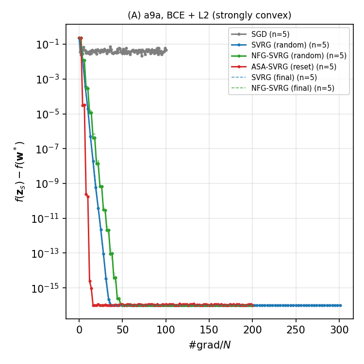
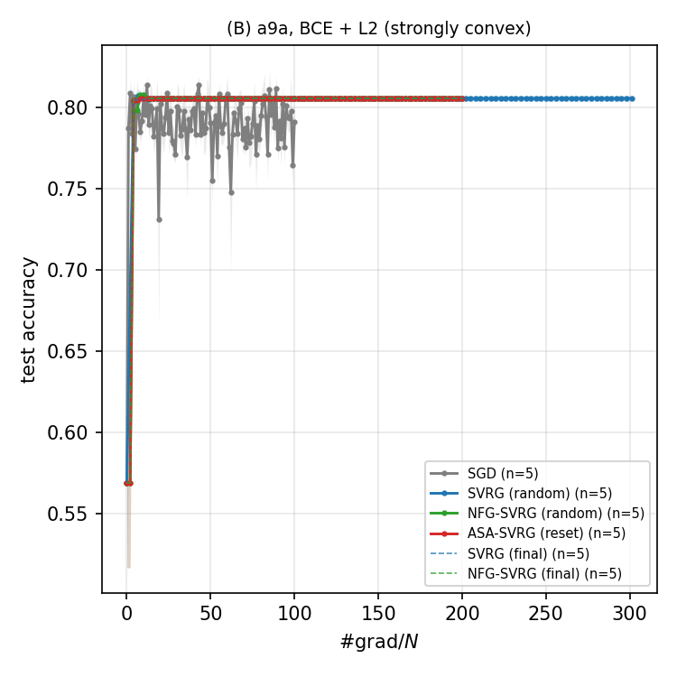
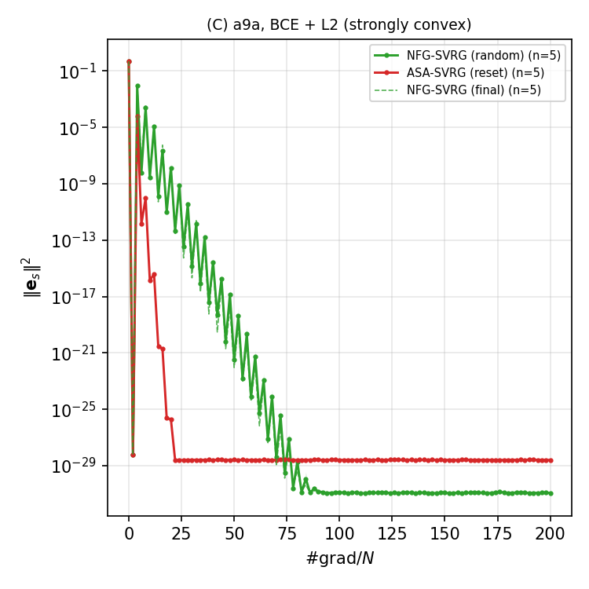
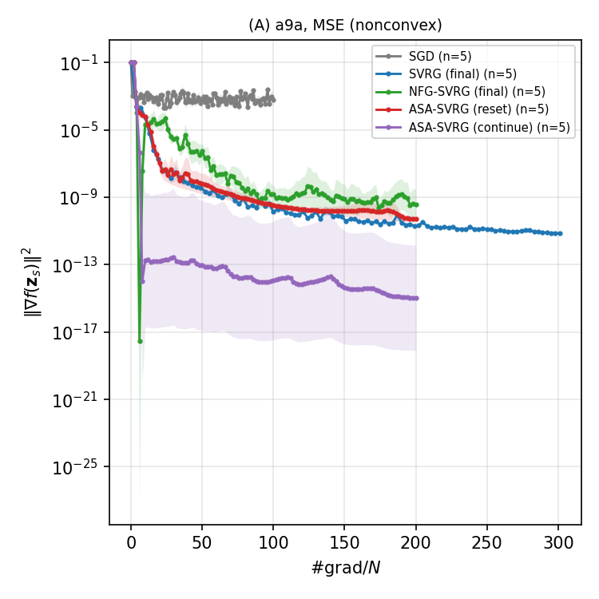
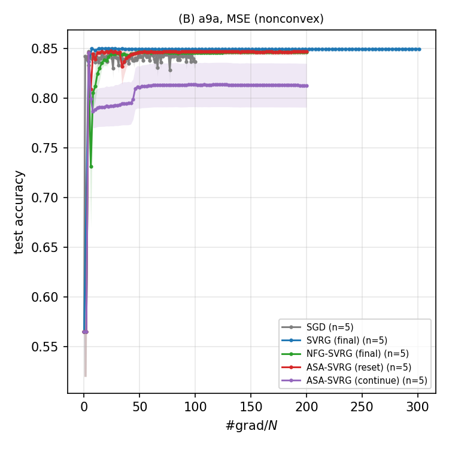
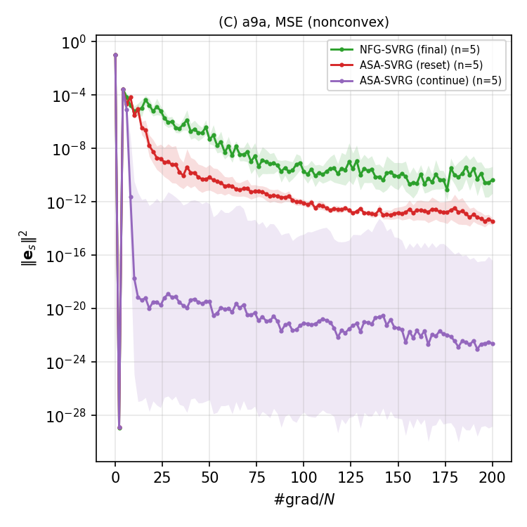

# report_076：E8 付録B.1（a9a）の追加実験（BCE のランダム点の SVRG・NFG-SVRG，MSE の ASA-SVRG（continue））

指示書：`実験指示E8.md`．指示：`.orders/order_076.md`．番号は指示書0.3節のとおり（`order_076`，`report_076`，`ex014`）であり，既存の番号との衝突は無かった．

## 0. 要点

- 15試行（A：BCE の `SVRG_random`・`NFG_SVRG_random`（reset）10試行，B：MSE の `ASAI_SVRG`（continue）5試行）が全て完了した．本PCで E7 の A（GPU）と並行して CPU で実行し，実時間は34分であった．
- 3節の確認は全て合格した．
  - 3.1：本PCで E4 のプログラム（無変更）を実行した結果と，既存の4手法 × 2損失の全てのキーがビット単位で一致した．E4 の本実行の結果（別のPC）とは，整数の量が完全一致，実数の量が相対 $ 10^{-11} $ 以下で一致した．
  - 3.2：ランダム点の2手法の `config.json`，`oracle_calls` の増分，近似誤差（SVRG は0），0外側ループ目の一致が規則どおりであった．
  - 3.3：MSE の ASA-SVRG（continue）は旧実装（`outputs/ex000_a9a_least_squares`）と，シード0だけでなく本実行の5シード全てで，全てのキーがビット単位で一致した．
- 結果（3節）：
  - **BCE：ランダム点と最終点の SVRG・NFG-SVRG は，収束の速さ・誤差の床・近似誤差のいずれもほぼ同じである．** 目的関数の誤差が $ 10^{-10} $ 以下になる $ \#\mathrm{grad}/N $ は，SVRG がランダム点 22.6 と最終点 22.0，NFG-SVRG が 28.8 と 28.8 である．100外側ループ目には全て倍精度の床（$ 10^{-16} $）に達する．
  - **BCE：ASA-SVRG の近似誤差は NFG-SVRG（ランダム点）より桁違いに小さく，実験1（Mushroom）と同じ傾向である．** 例えば4外側ループ目で $ 1.0\times10^{-10} $ と $ 2.6\times10^{-4} $（幾何平均）．ASA-SVRG は $ \#\mathrm{grad}/N = 12 $ で目的関数の誤差が $ 10^{-14} $ 以下になり，SVRG（31.6）・NFG-SVRG（41.6）より速い．
  - **MSE：ASA-SVRG の continue は，5シードのうち2つ（シード0・4）がシグモイドの飽和点（全てを負例と予測する点，$ f = 0.24082 $，テスト精度 0.7593）に停滞した．** reset では停滞は無い（$ f $ は 0.1033〜0.1471）．このため，continue の最終の $ f $ は 0.165 ± 0.032 と reset の 0.112 ± 0.009 より大きく，テスト精度も 0.813 ± 0.022 と 0.847 ± 0.003 で低い．旧実装も同じ値であり，実装の問題ではない．

## 1. 実行環境と並列数

| 項目 | 内容 |
|---|---|
| OS | Windows 上の WSL2（Linux 6.18.33.2-microsoft-standard-WSL2） |
| CPU | Intel Xeon w7-3565X（64論理コア），メモリ 125 GB |
| Python・主要パッケージ | Python 3.12.15（`.venv_pytorch`），torch 2.11.0+cu128（計算は CPU のみ），numpy 2.4.6，scipy 1.18.1 |
| 実行の設定 | 1試行1プロセス，`torch.set_num_threads(1)`（E4 と同じ） |
| 並列数 | 15（15試行を全て同時に実行） |

並列数の根拠：ai-dev-kit の規約に従い，3.3節の確認（MSE の ASA-SVRG（continue），シード0，100外側ループ）を並列数1で `/usr/bin/time -v` で計測した．最大常駐メモリは 0.90 GB，実時間は21分20秒であった．
15並列ではメモリは約13.4 GB（空き約115 GB）であり，論理コア64のうち15を使う．同時に E7 の A（`ex012_e7_imagewoof_final`，GPU 4並列）が約4コアを使っていたが，合わせても余裕がある．
E7 の A は精度の実験であり実時間を計測しないため，並行して実行しても E7 の結果に影響しない（E7 の時間計測は終了済み）．

所要時間：本実行は 2026-11-22 10:00:12〜10:34:18（34分）．15並列では1外側ループが約19秒であり，並列数1（約11.6秒）より遅かった．

## 2. 作成したファイル

| ファイル | 内容 |
|---|---|
| `programs_review/programs/ex014_e8_a9a_supplement/train.py` | `ex008_e4_a9a/train.py` をコピーし，指示書2節の変更（`SVRG_random`・`NFG_SVRG_random`，`snapshot_rng`，`--part`）を加えた |
| 同 `data.py`，`model.py`，`compare_e4.py` | `ex008_e4_a9a/` から変更せずにコピーした（テストで同一であることを確認） |
| 同 `README.md` | 目的，E4 との違い，実行方法，出力，コピー元 |
| `programs_review/programs/analysis_e8.py` | 集計表と確認用の図．読み込み・統計量・曲線の描画は `analysis_e4.py` の関数を用いる．E4・E8 の結果のパスは `--e4-root`・`--e8-root` で受け取る |
| `programs_review/tests/test_e8_programs.py` | テスト24件（5節） |
| `programs_review/outputs/ex014_e8_a9a_supplement/` | 15試行の結果，`figures/`（6枚），`consistency.md`，`consistency_continue_with_ex000.md` |
| `programs_review/outputs/e8_summary.md` | 集計表 |
| `programs_review/outputs/_run_logs/ex014.log`，`ex014_verify_{e4,random,continue}.log` | 実行ログ |
| `.orders/order_076.md`，`.reports/report_076.md` | 指示と本レポート |

`train.py` の主な変更：

- `ALL_METHODS` に `SVRG_random`（`SVRG`）・`NFG_SVRG_random`（`NFGSVRG`）を加えた．`SVRG`・`NFG_SVRG` は E4 と同じ最終点のままである．
- 全勾配を使う手法の判定を `method == "SVRG"` から `method in FULL_GRADIENT_METHODS`（`SVRG`，`SVRG_random`）に変えた．
- `begin_epoch` に，添字の列の生成器 `rng` とは別の `snapshot_rng = default_rng([seed, 1])` を全ての手法で渡す（`ex006` と同じ）．ランダム点の手法の `config.json` に `snapshot_rule`・`snapshot_rng_seed` を加える．
- `--part A|B|all` を加えた．`--loss`・`--methods`・`--inner-starts` のいずれかを明示した場合は `--part` を使わない（3.1節の確認用）．

## 3. 確認（指示書3節）

詳細は `programs_review/outputs/ex014_e8_a9a_supplement/consistency.md` にある．

### 3.1 E4 の結果の再現

- E4 の本実行の結果（`outputs/ex008_e4_a9a`，シード0の最初の3外側ループ）と比べると，整数の量（`epoch`，`oracle_calls`，`full_grad_computations`，`accuracy`）は8条件全てで完全に一致した．
  - 実数の量はビット単位では一致せず，最大相対誤差は $ 1.2\times10^{-16} $〜$ 8.1\times10^{-12} $ であった．
- E4 の本実行は別のPC（Intel Core Ultra 9 285K，`report_070.md`）で行われたため，指示書の「同じ PC ならビット単位で一致すべき」には当たらない．
- そこで，`ex008_e4_a9a/train.py`（無変更）を同じ引数で本PCで実行し，本実験の結果と比べた．**8条件全てで，`elapsed_time` を除く全てのキーがビット単位で一致した．** コピーと変更で既存の手法の計算は変わっていない．

### 3.2 ランダム点の手法の動作

| 項目 | `SVRG_random` | `NFG_SVRG_random` |
|---|---|---|
| `config.json` | `snapshot_rule: "uniform_random"`，`snapshot_rng_seed: [0, 1]`，`inner_start: "snapshot"` | 同左 |
| `oracle_calls` | 0，$ 4N $，$ 7N $，$ 10N $（初期 $ N $・1外側ループ $ 3N $） | 0，$ 2N $，$ 4N $，$ 6N $ |
| 近似誤差 | 全て0 | — |
| 0外側ループ目 | 本PCの E4 の `SVRG` と全キーが一致 | 本PCの E4 の `NFG_SVRG` と全キーが一致 |
| 1外側ループ目以降 | 1外側ループ目から異なる | 1外側ループ目は一致し，2外側ループ目から異なる |

NFG-SVRG の1外側ループ目が一致するのは想定どおりである．$ {\mathbf g}_{0} = {\mathbf 0} $，$ {\mathbf w}_{0}^{0} = {\mathbf z}_{0} $ のため，1回目の内側ループの補正勾配は $ \nabla f_{i}({\mathbf z}_{0}) - \nabla f_{i}({\mathbf z}_{0}) = {\mathbf 0} $ となり，内側ループの点は全て $ {\mathbf z}_{0} $ に等しい．
どの点を選んでも $ {\mathbf z}_{1} = {\mathbf z}_{0} $ となる（目的関数の誤差が0外側ループ目とビット単位で一致することで確認した）．

### 3.3 MSE の ASA-SVRG（continue）と旧実装

旧実装（`outputs/ex000_a9a_least_squares/ASAI_SVRG/eta1.530030e-01_K29304_epochs100/0/`）と `compare_e4.py` で比べ，7系列（各101点）が全て完全一致し，`config.json` の定数も一致した（`consistency_continue_with_ex000.md`）．
さらに本実行の5シード全てを旧実装の同じシードと比べ，全てのキーがビット単位で一致した．旧実装のログは本PCで作られたものである（`outputs/ex008_e4_a9a/consistency_with_existing_this_pc.md`）．

## 4. 結果

値は5シードの平均 ± 標準誤差（ddof=1）である．全文は `programs_review/outputs/e8_summary.md` にある．

### 4.1 BCE（強凸）

| 手法 | 結果 | $ f({\mathbf z}_{s})-f({\mathbf w}^{*}) $（100外側ループ目） | 同（幾何平均） | テスト精度 | $ \|{\mathbf e}_{s}\|^{2} $ の中央値（51〜100） |
|---|---|---:|---:|---:|---:|
| SGD | E4 | 6.011e-02 ± 2.3e-02 | 4.70e-02 | 0.7910 ± 0.0142 | — |
| SVRG（ランダム点，reset） | E8 | 0.000e+00 ± 2.5e-17 | 1.00e-16 | 0.8053 ± 0.0019 | 0 |
| NFG-SVRG（ランダム点，reset） | E8 | −2.220e-17 ± 2.2e-17 | 1.00e-16 | 0.8053 ± 0.0019 | 1.237e-31 ± 1.2e-32 |
| ASA-SVRG（reset） | E4 | 4.441e-17 ± 2.1e-17 | 1.02e-16 | 0.8053 ± 0.0019 | 2.776e-29 ± 5.1e-30 |
| 参考：SVRG（最終点） | E4 | 3.331e-17 ± 1.4e-17 | 1.00e-16 | 0.8053 ± 0.0019 | 0 |
| 参考：NFG-SVRG（最終点） | E4 | 2.220e-17 ± 2.2e-17 | 1.00e-16 | 0.8053 ± 0.0019 | 1.241e-31 ± 1.3e-32 |

100外側ループ目では SGD 以外が倍精度の床に達するため，収束の速さを次の表で比べた（本レポートのために追加で集計した．`e8_summary.md` には無い）．

| 手法 | 誤差 $ \le 10^{-6} $ となる $ \#\mathrm{grad}/N $ | $ \le 10^{-10} $ | $ \le 10^{-14} $ |
|---|---:|---:|---:|
| SVRG（ランダム点） | 14.2 ± 0.7 | 22.6 ± 0.6 | 31.6 ± 0.6 |
| NFG-SVRG（ランダム点） | 16.8 ± 0.8 | 28.8 ± 0.8 | 41.6 ± 1.0 |
| ASA-SVRG（reset） | 8.0 ± 0.0 | 12.0 ± 0.0 | 12.0 ± 0.0 |
| 参考：SVRG（最終点） | 13.0 ± 0.0 | 22.0 ± 0.0 | 31.0 ± 0.9 |
| 参考：NFG-SVRG（最終点） | 17.6 ± 1.0 | 28.8 ± 0.8 | 40.8 ± 0.8 |

近似誤差 $ \|{\mathbf e}_{s}\|^{2} $ の幾何平均（外側ループ $ s $）：

| 手法 | $ s=2 $ | $ s=4 $ | $ s=8 $ | $ s=16 $ | $ s=30 $ |
|---|---:|---:|---:|---:|---:|
| NFG-SVRG（ランダム点） | 8.9e-03 | 2.6e-04 | 2.3e-07 | 1.4e-12 | 5.6e-22 |
| ASA-SVRG（reset） | 6.4e-05 | 1.0e-10 | 2.0e-21 | 2.6e-29 | 2.6e-29 |
| 参考：NFG-SVRG（最終点） | 7.7e-03 | 3.2e-04 | 5.5e-07 | 2.4e-12 | 1.2e-22 |





### 4.2 MSE（非凸）

| 手法 | 結果 | $ \|\nabla f({\mathbf z}_{s})\|^{2} $（100外側ループ目） | 同（幾何平均） | $ f({\mathbf z}_{s}) $ | テスト精度 | $ \|{\mathbf e}_{s}\|^{2} $ の中央値（51〜100） |
|---|---|---:|---:|---:|---:|---:|
| SGD | E4 | 2.172e-03 ± 1.2e-03 | 6.34e-04 | 0.11745 ± 0.00630 | 0.8367 ± 0.0056 | — |
| SVRG（最終点） | E4 | 7.627e-12 ± 7.5e-13 | 7.46e-12 | 0.10344 ± 0.00010 | 0.8497 ± 0.0021 | 0 |
| NFG-SVRG（最終点） | E4 | 1.102e-07 ± 1.1e-07 | 3.91e-10 | 0.11749 ± 0.00867 | 0.8466 ± 0.0015 | 3.536e-09 ± 3.5e-09 |
| ASA-SVRG（reset） | E4 | 7.882e-11 ± 4.5e-11 | 5.00e-11 | 0.11219 ± 0.00872 | 0.8470 ± 0.0031 | 1.336e-12 ± 1.3e-12 |
| ASA-SVRG（continue） | E8 | 6.544e-11 ± 5.8e-11 | 1.06e-15 | 0.16499 ± 0.03155 | 0.8131 ± 0.0220 | 1.085e-12 ± 6.2e-13 |

シードごとの最終の $ f({\mathbf z}_{s}) $（シード0〜4）：

| 手法 | シード0 | 1 | 2 | 3 | 4 |
|---|---:|---:|---:|---:|---:|
| ASA-SVRG（reset） | 0.14705 | 0.10327 | 0.10359 | 0.10328 | 0.10375 |
| ASA-SVRG（continue） | **0.24082** | 0.10327 | 0.13678 | 0.10328 | **0.24082** |
| SVRG（最終点） | 0.10330 | 0.10327 | 0.10358 | 0.10328 | 0.10374 |
| NFG-SVRG（最終点） | 0.10331 | 0.10327 | 0.10360 | 0.14104 | 0.13623 |

continue のシード0・4の $ f = 0.24082 $ は学習データの正例の割合（約0.2408）に等しく，テスト精度 0.7593 はテストデータの負例の割合に等しい．全てを負例と予測するシグモイドの飽和点であり，勾配はほぼ0（$ \|\nabla f\|^{2} = 6.9\times10^{-27} $，$ 3.2\times10^{-18} $）である．





## 5. テスト

`programs_review/tests/test_e8_programs.py`（24件）を作成した．全てのテスト（`python -m pytest -q tests`）196件が成功した（2分44秒．E7 のテストを含む）．

| 確認すること（指示書5節） | テスト |
|---|---|
| 1. タスク数（A：10，B：5，all：15）と保存先の形式．引数を明示した場合に `--part` を使わないこと | `test_part_task_counts_and_paths`，`test_explicit_selection_ignores_part` |
| 2. ランダム点のスナップショットが内側ループの点の1つと一致し，添字が `default_rng([seed, 1])` で選ばれること．reset で次の内側ループがスナップショットから始まること．添字の列が最終点の手法と同じこと | `test_random_snapshot_is_inner_point_selected_by_separate_rng`（MSE・BCE × 2手法），`test_random_point_keeps_index_sequence` |
| 3. 最終点の手法と ASA-SVRG が E4 の `run_variance_reduced` とビット単位で一致すること | `test_existing_methods_match_e4`（4条件 × 2損失） |
| 4. `oracle_calls` の増分 | `test_random_point_oracle_calls` |
| その他：`config.json` の記録，コピーしたファイルの同一性 | `test_config_records_snapshot_rule`，`test_copied_files_unchanged` |

## 6. 所見

### 6.1 事実

1. BCE で，ランダム点と最終点の SVRG・NFG-SVRG の差は小さい．
   - 目的関数の誤差が $ 10^{-6} $・$ 10^{-10} $・$ 10^{-14} $ 以下になる $ \#\mathrm{grad}/N $ の差は，SVRG で 1.2・0.6・0.6，NFG-SVRG で 0.8・0.0・0.8 であり，いずれも1外側ループ（SVRG は $ 3 $，NFG-SVRG は $ 2 $）以下である．
   - 100外側ループ目の目的関数の誤差は全て倍精度の床（幾何平均 $ 1.00\times10^{-16} $）に達し，テスト精度は 0.8053 ± 0.0019 で4手法と参考の2手法が同じである．
   - NFG-SVRG の近似誤差は，ランダム点と最終点で同程度に減少する（$ s=16 $ で $ 1.4\times10^{-12} $ と $ 2.4\times10^{-12} $）．
2. BCE で，ASA-SVRG の近似誤差は NFG-SVRG（ランダム点）より小さい．
   - $ s = 2, 4, 8, 16 $ で，それぞれ約 $ 10^{2} $，$ 10^{6} $，$ 10^{14} $，$ 10^{17} $ 倍小さい．
   - ASA-SVRG の近似誤差は $ s = 11 $（$ \#\mathrm{grad}/N = 22 $）で床（$ 2.6\times10^{-29} $）に達する．NFG-SVRG は $ s \approx 44 $（$ \#\mathrm{grad}/N \approx 88 $）でそれより低い床（$ 1.2\times10^{-31} $）に達する．
   - 51〜100外側ループの中央値は ASA-SVRG（$ 2.8\times10^{-29} $）の方が NFG-SVRG（$ 1.2\times10^{-31} $）より大きい．これは両者とも丸め誤差の水準である．
3. BCE で，ASA-SVRG は目的関数の誤差が $ 10^{-14} $ 以下になるまでの $ \#\mathrm{grad}/N $ が 12 であり，SVRG（ランダム点）の 31.6，NFG-SVRG（ランダム点）の 41.6 より少ない．
4. MSE で，ASA-SVRG の continue は5シードのうち2つが飽和点（$ f = 0.24082 $）に停滞した．reset ではシード0の $ f = 0.14705 $ がやや大きいが，飽和点には停滞しなかった．
   - continue の残り3シードの $ f $（0.10327，0.13678，0.10328）は，reset の同じシード（0.10327，0.10359，0.10328）と同程度か大きい．
   - continue の $ \|\nabla f\|^{2} $ の幾何平均（$ 1.1\times10^{-15} $）は reset（$ 5.0\times10^{-11} $）より小さい．ただしこれは，飽和点に停滞した2シードの勾配がほぼ0であることによる．
5. MSE の ASA-SVRG（continue）は，旧実装と5シード全てでビット単位で一致した．

### 6.2 推測

1. BCE でランダム点と最終点の差が小さいのは，強凸かつ $ \rho = 297 $ の条件で内側ループ（$ K = N $）の点がすでに十分に収束しており，内側ループのどの点をスナップショットにしても大差がないためと考えられる．
   - 付録B.1の BCE の構成を実験1にそろえても（ランダム点に変えても），結論は E4 の最終点のときと変わらないと考えられる．
2. ASA-SVRG の近似誤差が小さいのは，$ {\mathbf g}_{s} $ を内側ループの平均点 $ {\mathbf z}_{s} $ の近くで集めた確率的勾配から作るためであり，実験1と同じ傾向である．
3. MSE の continue で飽和点への停滞が起きるのは，前の内側ループの最終点から続けるため，飽和の領域に入った点がスナップショットに戻されないことによる可能性がある．
   - 5シードでは，停滞が continue に固有の性質か，シードによる偶然かは判断できない（2/5 と 0/5）．
   - 旧版の論文（v42）の MSE の ASA-SVRG の結果は，この2シードを含む平均であったと考えられる．

## 7. 統合時の注意

- `programs_review/document.md` は変更してはいけないため，統合時に次を転記する．
  - 「現在実装している実験」に E8（`ex014_e8_a9a_supplement`，付録B.1 の a9a．A：BCE の `SVRG_random`・`NFG_SVRG_random`（reset），B：MSE の `ASAI_SVRG`（continue））を追加する．
  - ディレクトリ構成に `ex014_e8_a9a_supplement/`（`data.py`，`model.py`，`train.py`，`compare_e4.py`，`README.md`），`analysis_e8.py`，`tests/test_e8_programs.py`，`outputs/ex014_e8_a9a_supplement/`，`outputs/e8_summary.md` を追加する．
  - 依存関係の図に `ex014 train.py` → `common/optimizers`（`SVRG`，`NFGSVRG` を追加で使う），`common/machine_learning_utils`，`ex014 data.py`，`ex014 model.py` と，`analysis_e8.py` → `analysis_e4.py`，`outputs/` を追加する．
  - 実行方法に `ex014_e8_a9a_supplement/README.md` 3節の本実行・集計のコマンドを追加する．
  - E4 の結果と合わせて使う場合，BCE の付録B.1の表は「SGD（E4），SVRG（ランダム点，E8），NFG-SVRG（ランダム点，E8），ASA-SVRG（reset，E4）」，MSE は「SGD・SVRG（最終点）・NFG-SVRG（最終点）・ASA-SVRG（reset）（E4），ASA-SVRG（continue，E8）」である．
- zip に含めなかったもの：`outputs/_verify/`（3節の確認の結果．`ex014_e4`，`ex014_random`，`ex014_continue`，`ex014_e4_ref_ex008_this_pc` とそのログ），`datasets/`，`.venv_*`，`tokens.json`．
- 図は確認用であり，論文用の図は論文のリポジトリで作る（指示書6節）．

## 8. 未解決の論点・次の作業の候補

1. **MSE の ASA-SVRG（continue）を論文に載せる場合の扱い．** 2/5 シードが飽和点に停滞するため，平均 ± 標準誤差では continue が reset より悪く見える．載せるならシードごとの値か，停滞したシードの数を併記することを推奨する．
2. **停滞が continue に固有かの確認．** 必要なら MSE の continue・reset のシードを増やして（例えば10〜20シード），飽和点に停滞する割合を比べる．1試行は並列数1で約21分である．
3. BCE の図で，ランダム点と最終点はほぼ重なる．論文で両方を示す必要はなく，実験1と同じ構成（ランダム点）だけでよいと考えられる．
4. E4 の本実行（別のPC）と本実験（本PC）の結果を同じ表に並べている．BCE は全て床に達するため影響はないが，厳密に同じ環境にそろえるなら E4 の4手法を本PCで取り直す必要がある（約30分）．

## 9. 成果物の zip

リポジトリのルートで指示書7.2節のコマンドを実行して `E8_results.zip` を作成した．0.3節以外のファイルは含まれていない（`outputs/_verify/`，`datasets/`，`.venv_*`，`*.pth`，`tokens.json` は含めていない）．

```text
$ unzip -l E8_results.zip
Archive:  E8_results.zip
  Length      Date    Time    Name
---------  ---------- -----   ----
     1884  2026-11-22 09:37   .orders/order_076.md
    31806  2026-11-22 10:36   .reports/report_076.md
        0  2026-11-22 09:44   programs_review/programs/ex014_e8_a9a_supplement/
     9082  2026-11-22 09:37   programs_review/programs/ex014_e8_a9a_supplement/model.py
     4809  2026-11-22 09:37   programs_review/programs/ex014_e8_a9a_supplement/data.py
     4935  2026-11-22 09:44   programs_review/programs/ex014_e8_a9a_supplement/README.md
    36327  2026-11-22 09:38   programs_review/programs/ex014_e8_a9a_supplement/train.py
    11759  2026-11-22 09:37   programs_review/programs/ex014_e8_a9a_supplement/compare_e4.py
    13920  2026-11-22 09:40   programs_review/programs/analysis_e8.py
    12678  2026-11-22 09:39   programs_review/tests/test_e8_programs.py
        0  2026-11-22 10:34   programs_review/outputs/ex014_e8_a9a_supplement/
     6703  2026-11-22 10:34   programs_review/outputs/ex014_e8_a9a_supplement/consistency.md
        0  2026-11-22 10:34   programs_review/outputs/ex014_e8_a9a_supplement/figures/
    66842  2026-11-22 10:34   programs_review/outputs/ex014_e8_a9a_supplement/figures/e8_mse_B_accuracy.png
    71081  2026-11-22 10:34   programs_review/outputs/ex014_e8_a9a_supplement/figures/e8_bce_A_primary.png
   100743  2026-11-22 10:34   programs_review/outputs/ex014_e8_a9a_supplement/figures/e8_mse_C_approx_error.png
    71176  2026-11-22 10:34   programs_review/outputs/ex014_e8_a9a_supplement/figures/e8_bce_B_accuracy.png
    83586  2026-11-22 10:34   programs_review/outputs/ex014_e8_a9a_supplement/figures/e8_mse_A_primary.png
    77223  2026-11-22 10:34   programs_review/outputs/ex014_e8_a9a_supplement/figures/e8_bce_C_approx_error.png
        0  2026-11-22 10:00   programs_review/outputs/ex014_e8_a9a_supplement/mse/
        0  2026-11-22 10:00   programs_review/outputs/ex014_e8_a9a_supplement/mse/ASAI_SVRG/
        0  2026-11-22 10:00   programs_review/outputs/ex014_e8_a9a_supplement/mse/ASAI_SVRG/inner_last_iterate_eta1.530030e-01_K29304_epochs100/
        0  2026-11-22 10:21   programs_review/outputs/ex014_e8_a9a_supplement/mse/ASAI_SVRG/inner_last_iterate_eta1.530030e-01_K29304_epochs100/4/
    28308  2026-11-22 10:21   programs_review/outputs/ex014_e8_a9a_supplement/mse/ASAI_SVRG/inner_last_iterate_eta1.530030e-01_K29304_epochs100/4/log.json
      636  2026-11-22 10:21   programs_review/outputs/ex014_e8_a9a_supplement/mse/ASAI_SVRG/inner_last_iterate_eta1.530030e-01_K29304_epochs100/4/config.json
        0  2026-11-22 10:21   programs_review/outputs/ex014_e8_a9a_supplement/mse/ASAI_SVRG/inner_last_iterate_eta1.530030e-01_K29304_epochs100/3/
    28398  2026-11-22 10:21   programs_review/outputs/ex014_e8_a9a_supplement/mse/ASAI_SVRG/inner_last_iterate_eta1.530030e-01_K29304_epochs100/3/log.json
      636  2026-11-22 10:21   programs_review/outputs/ex014_e8_a9a_supplement/mse/ASAI_SVRG/inner_last_iterate_eta1.530030e-01_K29304_epochs100/3/config.json
        0  2026-11-22 10:22   programs_review/outputs/ex014_e8_a9a_supplement/mse/ASAI_SVRG/inner_last_iterate_eta1.530030e-01_K29304_epochs100/2/
    28352  2026-11-22 10:22   programs_review/outputs/ex014_e8_a9a_supplement/mse/ASAI_SVRG/inner_last_iterate_eta1.530030e-01_K29304_epochs100/2/log.json
      636  2026-11-22 10:22   programs_review/outputs/ex014_e8_a9a_supplement/mse/ASAI_SVRG/inner_last_iterate_eta1.530030e-01_K29304_epochs100/2/config.json
        0  2026-11-22 10:22   programs_review/outputs/ex014_e8_a9a_supplement/mse/ASAI_SVRG/inner_last_iterate_eta1.530030e-01_K29304_epochs100/0/
    27553  2026-11-22 10:22   programs_review/outputs/ex014_e8_a9a_supplement/mse/ASAI_SVRG/inner_last_iterate_eta1.530030e-01_K29304_epochs100/0/log.json
      636  2026-11-22 10:22   programs_review/outputs/ex014_e8_a9a_supplement/mse/ASAI_SVRG/inner_last_iterate_eta1.530030e-01_K29304_epochs100/0/config.json
        0  2026-11-22 10:21   programs_review/outputs/ex014_e8_a9a_supplement/mse/ASAI_SVRG/inner_last_iterate_eta1.530030e-01_K29304_epochs100/1/
    28413  2026-11-22 10:21   programs_review/outputs/ex014_e8_a9a_supplement/mse/ASAI_SVRG/inner_last_iterate_eta1.530030e-01_K29304_epochs100/1/log.json
      636  2026-11-22 10:21   programs_review/outputs/ex014_e8_a9a_supplement/mse/ASAI_SVRG/inner_last_iterate_eta1.530030e-01_K29304_epochs100/1/config.json
        0  2026-11-22 10:00   programs_review/outputs/ex014_e8_a9a_supplement/bce/
        0  2026-11-22 10:00   programs_review/outputs/ex014_e8_a9a_supplement/bce/NFG_SVRG_random/
        0  2026-11-22 10:00   programs_review/outputs/ex014_e8_a9a_supplement/bce/NFG_SVRG_random/inner_snapshot_eta8.543689e-02_lambda1.125000e-01_K29304_epochs100/
        0  2026-11-22 10:32   programs_review/outputs/ex014_e8_a9a_supplement/bce/NFG_SVRG_random/inner_snapshot_eta8.543689e-02_lambda1.125000e-01_K29304_epochs100/4/
    28591  2026-11-22 10:32   programs_review/outputs/ex014_e8_a9a_supplement/bce/NFG_SVRG_random/inner_snapshot_eta8.543689e-02_lambda1.125000e-01_K29304_epochs100/4/log.json
      735  2026-11-22 10:32   programs_review/outputs/ex014_e8_a9a_supplement/bce/NFG_SVRG_random/inner_snapshot_eta8.543689e-02_lambda1.125000e-01_K29304_epochs100/4/config.json
        0  2026-11-22 10:32   programs_review/outputs/ex014_e8_a9a_supplement/bce/NFG_SVRG_random/inner_snapshot_eta8.543689e-02_lambda1.125000e-01_K29304_epochs100/3/
    27802  2026-11-22 10:32   programs_review/outputs/ex014_e8_a9a_supplement/bce/NFG_SVRG_random/inner_snapshot_eta8.543689e-02_lambda1.125000e-01_K29304_epochs100/3/log.json
      736  2026-11-22 10:32   programs_review/outputs/ex014_e8_a9a_supplement/bce/NFG_SVRG_random/inner_snapshot_eta8.543689e-02_lambda1.125000e-01_K29304_epochs100/3/config.json
        0  2026-11-22 10:32   programs_review/outputs/ex014_e8_a9a_supplement/bce/NFG_SVRG_random/inner_snapshot_eta8.543689e-02_lambda1.125000e-01_K29304_epochs100/2/
    28662  2026-11-22 10:32   programs_review/outputs/ex014_e8_a9a_supplement/bce/NFG_SVRG_random/inner_snapshot_eta8.543689e-02_lambda1.125000e-01_K29304_epochs100/2/log.json
      735  2026-11-22 10:32   programs_review/outputs/ex014_e8_a9a_supplement/bce/NFG_SVRG_random/inner_snapshot_eta8.543689e-02_lambda1.125000e-01_K29304_epochs100/2/config.json
        0  2026-11-22 10:34   programs_review/outputs/ex014_e8_a9a_supplement/bce/NFG_SVRG_random/inner_snapshot_eta8.543689e-02_lambda1.125000e-01_K29304_epochs100/0/
    28616  2026-11-22 10:34   programs_review/outputs/ex014_e8_a9a_supplement/bce/NFG_SVRG_random/inner_snapshot_eta8.543689e-02_lambda1.125000e-01_K29304_epochs100/0/log.json
      735  2026-11-22 10:34   programs_review/outputs/ex014_e8_a9a_supplement/bce/NFG_SVRG_random/inner_snapshot_eta8.543689e-02_lambda1.125000e-01_K29304_epochs100/0/config.json
        0  2026-11-22 10:32   programs_review/outputs/ex014_e8_a9a_supplement/bce/NFG_SVRG_random/inner_snapshot_eta8.543689e-02_lambda1.125000e-01_K29304_epochs100/1/
    28422  2026-11-22 10:32   programs_review/outputs/ex014_e8_a9a_supplement/bce/NFG_SVRG_random/inner_snapshot_eta8.543689e-02_lambda1.125000e-01_K29304_epochs100/1/log.json
      736  2026-11-22 10:32   programs_review/outputs/ex014_e8_a9a_supplement/bce/NFG_SVRG_random/inner_snapshot_eta8.543689e-02_lambda1.125000e-01_K29304_epochs100/1/config.json
        0  2026-11-22 10:00   programs_review/outputs/ex014_e8_a9a_supplement/bce/SVRG_random/
        0  2026-11-22 10:00   programs_review/outputs/ex014_e8_a9a_supplement/bce/SVRG_random/inner_snapshot_eta8.543689e-02_lambda1.125000e-01_K29304_epochs100/
        0  2026-11-22 10:31   programs_review/outputs/ex014_e8_a9a_supplement/bce/SVRG_random/inner_snapshot_eta8.543689e-02_lambda1.125000e-01_K29304_epochs100/4/
    26593  2026-11-22 10:31   programs_review/outputs/ex014_e8_a9a_supplement/bce/SVRG_random/inner_snapshot_eta8.543689e-02_lambda1.125000e-01_K29304_epochs100/4/log.json
      731  2026-11-22 10:31   programs_review/outputs/ex014_e8_a9a_supplement/bce/SVRG_random/inner_snapshot_eta8.543689e-02_lambda1.125000e-01_K29304_epochs100/4/config.json
        0  2026-11-22 10:31   programs_review/outputs/ex014_e8_a9a_supplement/bce/SVRG_random/inner_snapshot_eta8.543689e-02_lambda1.125000e-01_K29304_epochs100/3/
    26653  2026-11-22 10:31   programs_review/outputs/ex014_e8_a9a_supplement/bce/SVRG_random/inner_snapshot_eta8.543689e-02_lambda1.125000e-01_K29304_epochs100/3/log.json
      732  2026-11-22 10:31   programs_review/outputs/ex014_e8_a9a_supplement/bce/SVRG_random/inner_snapshot_eta8.543689e-02_lambda1.125000e-01_K29304_epochs100/3/config.json
        0  2026-11-22 10:31   programs_review/outputs/ex014_e8_a9a_supplement/bce/SVRG_random/inner_snapshot_eta8.543689e-02_lambda1.125000e-01_K29304_epochs100/2/
    25637  2026-11-22 10:31   programs_review/outputs/ex014_e8_a9a_supplement/bce/SVRG_random/inner_snapshot_eta8.543689e-02_lambda1.125000e-01_K29304_epochs100/2/log.json
      731  2026-11-22 10:31   programs_review/outputs/ex014_e8_a9a_supplement/bce/SVRG_random/inner_snapshot_eta8.543689e-02_lambda1.125000e-01_K29304_epochs100/2/config.json
        0  2026-11-22 10:31   programs_review/outputs/ex014_e8_a9a_supplement/bce/SVRG_random/inner_snapshot_eta8.543689e-02_lambda1.125000e-01_K29304_epochs100/0/
    25573  2026-11-22 10:31   programs_review/outputs/ex014_e8_a9a_supplement/bce/SVRG_random/inner_snapshot_eta8.543689e-02_lambda1.125000e-01_K29304_epochs100/0/log.json
      731  2026-11-22 10:31   programs_review/outputs/ex014_e8_a9a_supplement/bce/SVRG_random/inner_snapshot_eta8.543689e-02_lambda1.125000e-01_K29304_epochs100/0/config.json
        0  2026-11-22 10:31   programs_review/outputs/ex014_e8_a9a_supplement/bce/SVRG_random/inner_snapshot_eta8.543689e-02_lambda1.125000e-01_K29304_epochs100/1/
    25336  2026-11-22 10:31   programs_review/outputs/ex014_e8_a9a_supplement/bce/SVRG_random/inner_snapshot_eta8.543689e-02_lambda1.125000e-01_K29304_epochs100/1/log.json
      732  2026-11-22 10:31   programs_review/outputs/ex014_e8_a9a_supplement/bce/SVRG_random/inner_snapshot_eta8.543689e-02_lambda1.125000e-01_K29304_epochs100/1/config.json
     2621  2026-11-22 10:00   programs_review/outputs/ex014_e8_a9a_supplement/consistency_continue_with_ex000.md
     3113  2026-11-22 10:34   programs_review/outputs/e8_summary.md
   147359  2026-11-22 10:34   programs_review/outputs/_run_logs/ex014.log
    10830  2026-11-22 10:00   programs_review/outputs/_run_logs/ex014_verify_continue.log
     4621  2026-11-22 09:40   programs_review/outputs/_run_logs/ex014_verify_e4.log
     1391  2026-11-22 09:41   programs_review/outputs/_run_logs/ex014_verify_random.log
---------                     -------
  1197912                     78 files
```
