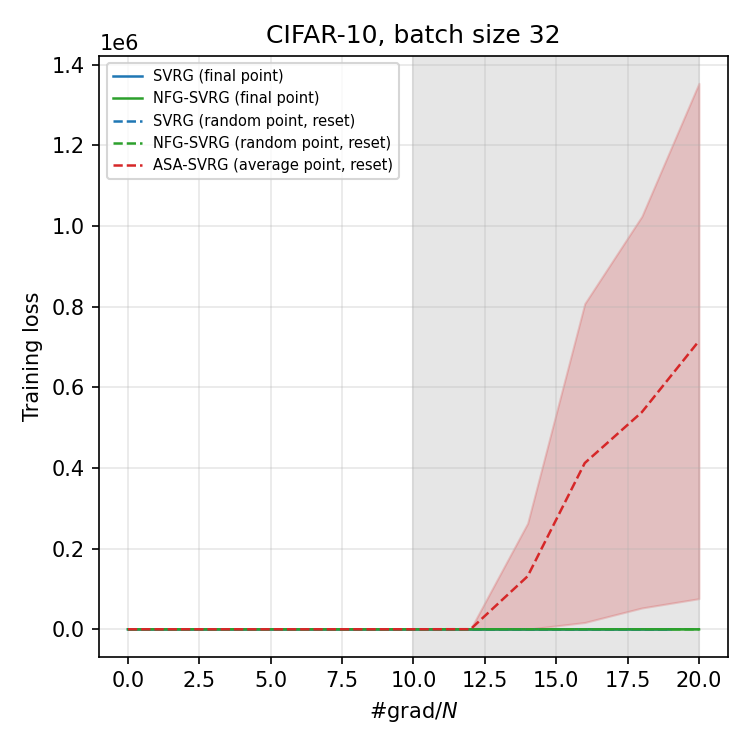
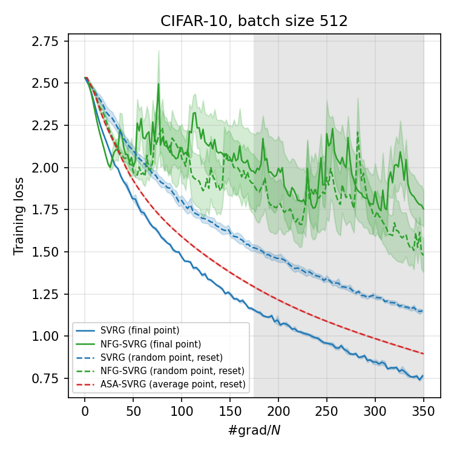
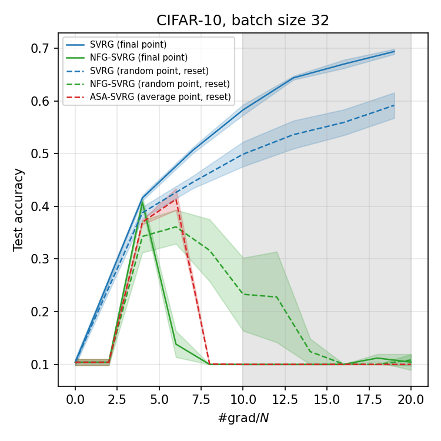
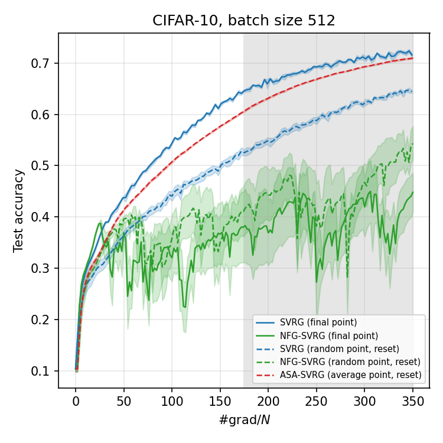
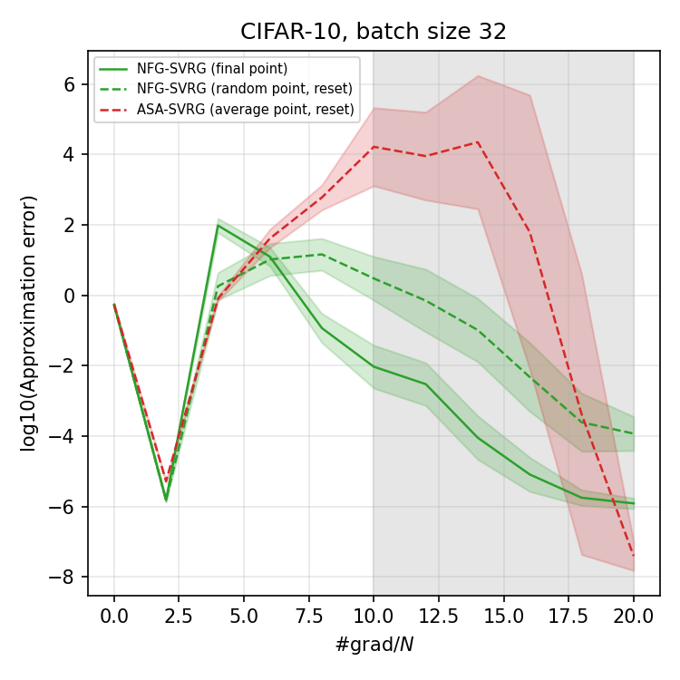
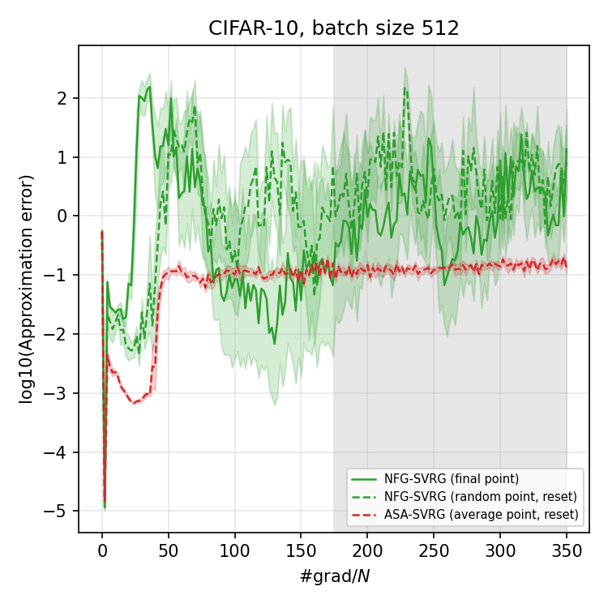

# report_080：E6（最終点のスナップショットの SVRG・NFG-SVRG，CIFAR-10，バッチサイズ32・512）

- 対応する指示：`.orders/order_080.md`（指示書 `実験指示E6.md`）．番号 080 は未使用であったため，そのまま用いた．
- 実施期間：2026-11-21 20:19 〜 2026-11-22 15:30（JST）．

## 1. 概要

論文の付録の CIFAR-10 の図（バッチサイズ32・512）に必要な，SVRG（最終点，`SVRG_final`）と NFG-SVRG（最終点，`NFG_SVRG_final`）の結果を得るため，2手法 × バッチサイズ2種 × 5シード $ = 20 $ 試行を実行した．
作成済みのプログラム（`programs_review/programs/ex011_e6_cifar10_final_bs32_512/`，`analysis_e6.py`，`tests/test_e6_programs.py`）は変更していない．

- 20試行の全てが完了した．学習損失が非有限になって打ち切られた試行はない．
- 一致の確認では，`oracle_calls` が全て完全に一致し，0エポック目の差は相対 $ 4\times10^{-8} $ 以下であった．1エポック目以降の差は，比較先と GPU が異なることによる大きさであった．
- SVRG（最終点）は，両バッチサイズで付録B の SVRG（ランダム点，reset）と ASA-SVRG（平均点，reset）を上回った．
- NFG-SVRG（最終点）は，バッチサイズ32では全シードで2エポック目の直後に崩壊し，以後は回復しなかった．バッチサイズ512では崩壊と回復を繰り返した．

## 2. 実行環境

| 項目 | 値 |
|---|---|
| OS | Ubuntu 22.04.5 LTS（WSL2，カーネル 6.18.58.1-microsoft-standard-WSL2） |
| CPU | Intel Core Ultra 9 285K（24コア） |
| メモリ | 64GB（WSL2 から見える量） |
| GPU | NVIDIA GeForce RTX 4090（24GB） |
| ドライバ | 610.88（KMD），CUDA UMD 13.3 |
| Python | 3.12.15（`.venv_pytorch`，`programs_review/requirements_pytorch_gpu.txt` で構築） |
| torch | 2.11.0+cu128（CUDA 12.8，cuDNN 9.19.0） |
| torchvision | 0.26.0+cu128 |

- `.venv_pytorch` が存在しなかったため，`uv venv .venv_pytorch --python 3.12` で作成し，`programs_review/requirements_pytorch_gpu.txt` をインストールした．
- CIFAR-10 は `prepare_cache()` が初回にダウンロードした（回線が遅く約23分かかった）．
- `tokens.json` は存在しない（本実験では使わない）．
- 処理の無い状態でも GPU の `memory.used` が約700MiB，使用率が30〜50% であった．他のプロセス（デスクトップの描画等）が GPU を使っていたと考えられる（推測）．

### 2.1 並列数とその根拠

3節の一致の確認を並列数1で実行し，`nvidia-smi --query-gpu=memory.used,utilization.gpu` と `free -m` を3〜5秒ごとに記録した（WSL2 ではプロセスごとの GPU メモリが `[N/A]` のため，実行前との差を用いた）．

| 条件（並列数1） | VRAM（実行前との差） | GPU 使用率 | DRAM（実行前との差） |
|---|---:|---:|---:|
| バッチサイズ32（SVRG） | 約1.8GB | 約70% | 約1.2GB |
| バッチサイズ128（`SVRG_final`，`NFG_SVRG_final`） | 約2.1GB | — | 約1.4GB |
| バッチサイズ512（SVRG） | 約3.8GB | 約98% | 約1.2GB |

- 最も大きいバッチサイズ512で4並列にした場合の VRAM は約 $ 4\times3.8+0.7 \approx 16 $ GB で，24GB に余裕がある．DRAM も約5GB で十分に余裕がある．このため並列数を4とした．
- 本実行中の実測の最大は，VRAM 15.8GB，DRAM 8.0GB（全体の使用量）であった．
- **並列化の効率は低かった．** 4並列で実行中の GPU は使用率100%，消費電力は約170W（上限450W）であった．1試行あたりの `elapsed_time`（評価を含まない）は次のとおりである．

  | 条件 | 並列数1での確認の値から外挿した時間 | 本実行（4並列）の `elapsed_time` |
  |---|---:|---:|
  | `SVRG` / `SVRG_final`，バッチサイズ32，12エポック | 約5分（2エポックで48.6秒） | 22分（seed 0〜3），40分（seed 4） |
  | `SVRG` / `SVRG_final`，バッチサイズ512，192エポック | 約28分（2エポックで17.5秒） | 409〜463分（seed 0〜3），234分（seed 4） |

  - 4並列にすると，1試行あたりの時間は4倍を大きく超えて長くなった．特にバッチサイズ512では約15倍であった．
  - 外挿の値は手法の違い（ランダム点と最終点）とエポック数の外挿を含み，評価の時間も含まない．そのため比は目安である．
  - WSL2 上で複数のプロセスが GPU を時分割で使うと，切り替えの負担が大きいと考えられる（推測であり，原因は確かめていない）．
  - 本PCで同種の実験を行う場合は，並列数1または2で実時間を比べてから並列数を決めるべきである．

## 3. テストの結果

| テスト | 結果 |
|---|---|
| `tests/test_e6_programs.py`（環境構築の直後） | 14件成功 |
| `tests` の全て（環境構築の直後） | 137件成功，9件スキップ |
| `tests` の全て（本実行の終了後） | 137件成功，9件スキップ |

スキップの9件は全て `test_e4_programs.py` で，理由は「a9a のデータ（`datasets/a9a/raw/a9a`）が無い」である．E6 とは関係しない．

## 4. 一致の確認

詳細は `programs_review/outputs/ex011_e6_cifar10_final_bs32_512/consistency.md`（`consistency_bs128.md`，`consistency_bs32_512.md` を含む）にある．

| 確認 | 比較先（GPU） | `oracle_calls` | 0エポック目 | 1エポック目以降 | 判定 |
|---|---|---|---|---|---|
| 3.1節：`SVRG_final`，`NFG_SVRG_final`，バッチサイズ128，3エポック | `ex007`（RTX 3090） | 完全一致 | `train_loss` の相対差 $ 5.9\times10^{-9} $，`test_accuracy` は一致 | `train_loss` の相対差は最大 $ 1.1\times10^{-4} $，`test_accuracy` の絶対差は最大 0.0016 | 合格 |
| 3.2節：`SVRG`，バッチサイズ32・512，2エポック | `ex004`（RTX PRO 6000 Blackwell Max-Q） | 完全一致 | `train_loss` の相対差は最大 $ 4.0\times10^{-8} $，`test_accuracy` は一致 | `train_loss` の相対差は最大 $ 1.5\times10^{-3} $（バッチサイズ32），$ 5.0\times10^{-6} $（512） | 合格 |

- 本PC の GPU（RTX 4090）はどちらの比較先とも異なるため，ビット単位の一致はどちらの確認でも得られなかった．これは指示書の3.4節の予想（RTX 3090 なら3.1節が一致）とは異なるが，GPU が異なる場合として想定されていた結果である．
- `oracle_calls` の完全一致と0エポック目の一致は3.3節の基準を満たす．1エポック目以降の差は，1エポックあたりのステップ数が多いバッチサイズ32で大きく，512で小さい．丸め誤差の蓄積と整合する（推測）．
- `NFG_SVRG_final` の `approx_error` は3エポック目に相対差 0.14 であった．近似誤差は2つの勾配の差の大きさであり，パラメータの小さな差に敏感な量であることによると考えられる（推測）．

## 5. 本実行

```bash
cd programs_review/programs
nohup ../../.venv_pytorch/bin/python ex011_e6_cifar10_final_bs32_512/train.py --workers 4 \
    > ../outputs/_run_logs/ex011.log 2>&1 &
```

- 開始 2026-11-21 20:47:48，終了 2026-11-22 15:03:11（実時間 約18時間15分）．
- ログに `[failed]`，再実行，「完了しなかったタスク」はなく，「全ての学習が終了しました．」で終了した．
- 20試行の `config.json`，`log.json`，`best_model.pth` が `programs_review/outputs/ex011_e6_cifar10_final_bs32_512/{手法}/{条件}/{seed}/` にある．
- $ \#\mathrm{grad}/N $ の最終値は，バッチサイズ32で SVRG 37，NFG-SVRG 24，512で SVRG 577，NFG-SVRG 384 であり，全試行で2.4節の値と一致した．

## 6. 集計の結果

`programs_review/programs/analysis_e6.py` を既定の引数で実行した．出力は `programs_review/outputs/e6_summary.md` と `programs_review/outputs/ex011_e6_cifar10_final_bs32_512/figures/` である．
値は5シードの平均 ± 標準誤差（`ddof=1`）である．予算はバッチサイズ32で $ \#\mathrm{grad}/N \le 20 $，512で $ \#\mathrm{grad}/N \le 350 $ である．

### 6.1 E6 の結果

| 手法 | バッチサイズ | 予算での学習損失 | 予算でのテスト精度 | 最終エポックの学習損失 | 最終エポックのテスト精度 | 近似誤差（予算の後半の中央値） | 打ち切り |
|---|---:|---:|---:|---:|---:|---:|---|
| SVRG（最終点） | 32 | 0.9583 ± 0.0113 | 0.6937 ± 0.0048 | 0.5969 ± 0.0204 | 0.7265 ± 0.0064 | 0（全勾配） | 0 |
| SVRG（最終点） | 512 | 0.7633 ± 0.0120 | 0.7157 ± 0.0038 | 0.3227 ± 0.0118 | 0.7493 ± 0.0038 | 0（全勾配） | 0 |
| NFG-SVRG（最終点） | 32 | 2.5990 ± 0.0252 | 0.1043 ± 0.0150 | 2.5981 ± 0.0251 | 0.1095 ± 0.0058 | $ 6.0\times10^{-5} \pm 4.7\times10^{-5} $ | 0 |
| NFG-SVRG（最終点） | 512 | 1.7548 ± 0.1059 | 0.4480 ± 0.0382 | 1.5610 ± 0.1205 | 0.5148 ± 0.0471 | $ 8.8 \pm 4.2 $ | 0 |

### 6.2 参考：付録B（`ex004`，ランダム点または平均点，reset）

| 手法 | バッチサイズ | 予算での学習損失 | 予算でのテスト精度 | 最終エポックの学習損失 | 最終エポックのテスト精度 | 近似誤差（予算の後半の中央値） | 打ち切り |
|---|---:|---:|---:|---:|---:|---:|---|
| SVRG（ランダム点，reset） | 32 | 1.3280 ± 0.0799 | 0.5916 ± 0.0240 | 0.9871 ± 0.0459 | 0.6838 ± 0.0135 | 0（全勾配） | 0 |
| SVRG（ランダム点，reset） | 512 | 1.1499 ± 0.0065 | 0.6445 ± 0.0026 | 0.8560 ± 0.0112 | 0.7094 ± 0.0042 | 0（全勾配） | 0 |
| NFG-SVRG（ランダム点，reset） | 32 | 2.5554 ± 0.0081 | 0.1083 ± 0.0108 | 2.5545 ± 0.0079 | 0.1367 ± 0.0230 | 0.26 ± 0.18 | 0 |
| NFG-SVRG（ランダム点，reset） | 512 | 1.4788 ± 0.0998 | 0.5434 ± 0.0334 | 1.4080 ± 0.0856 | 0.5653 ± 0.0299 | 9.5 ± 3.9 | 0 |
| ASA-SVRG（平均点，reset） | 32 | 431034 ± 390867 | 0.1000 ± 0.0000 | 430367 ± 390260 | 0.1000 ± 0.0000 | $ 3.6\times10^{6} \pm 3.6\times10^{6} $ | 2（seed 0：9，seed 1：10） |
| ASA-SVRG（平均点，reset） | 512 | 0.8955 ± 0.0021 | 0.7098 ± 0.0015 | 0.8379 ± 0.0021 | 0.7200 ± 0.0013 | 0.136 ± 0.005 | 0 |

- 試行数は全ての行で5，打ち切りは E6 の4行で0である．$ \#\mathrm{grad}/N $ の最大値は5節のとおり2.4節と矛盾しない．

### 6.3 図

確認用の図である（実線が E6，破線が付録B，灰色の領域が予算の後半）．

| | バッチサイズ32 | バッチサイズ512 |
|---|---|---|
| 学習損失 |  |  |
| テスト精度 |  |  |
| 近似誤差 |  |  |

- バッチサイズ32の学習損失の図は，付録B の ASA-SVRG（平均点，reset）の発散（seed 0，1 が9・10エポック目に打ち切り，損失は $ 10^{6} $ 程度）で縦軸が決まるため，他の手法の推移が読み取れない．確認用の図であり，論文用の図では縦軸の範囲を制限する必要がある．

## 7. 所見

### 7.1 事実

**NFG-SVRG（最終点）の崩壊**

- バッチサイズ32：全5シードで同じ経過をたどった．
  - 1エポック目は内側ループが動かない（$ {\mathbf g}_{0} = {\mathbf 0} $ のため補正勾配が $ {\mathbf 0} $．E2 と同じ）．
  - 2エポック目に学習損失は 1.85〜1.98，テスト精度は 0.37〜0.42 に達した．これが各シードの最良値である．
  - 3エポック目に崩壊した．学習損失は 2.39〜2.71 に上がり，テスト精度は 0.10〜0.23 に下がった．4エポック目以降は全シードで学習損失 2.55〜2.70，テスト精度 0.10 前後のまま，12エポック目まで回復しなかった．
  - 学習損失の値は非有限にはならず，打ち切りは起きなかった．
- バッチサイズ512：崩壊と回復を繰り返した．
  - 例：seed 0 は128エポック目に学習損失が 1.56 から 2.18 に上がり，その後 1.33（192エポック目）まで下がった．seed 3 は32，80，128エポック目付近で学習損失が 2.4〜2.5 に上がった．
  - seed 4 は32エポック目付近で崩壊し（学習損失 2.63），192エポック目でも 2.00（テスト精度 0.34）であった．
  - 最終エポックのテスト精度は 0.34〜0.60 で，シードによるばらつきが大きい（標準誤差 0.047）．
- バッチサイズ128（E2，`ex007`）の NFG-SVRG（最終点）は，全シードで4〜5エポック目にテスト精度が約0.38〜0.41 に達した後，崩壊した．seed 0，3，4 はその後の学習損失が約2.5 にとどまった（seed 3 は36エポック目以降に 2.1 程度まで緩やかに下がった）．seed 1，2 は回復と崩壊を繰り返した（seed 2 の最良は32エポック目の 0.43）．

**SVRG（最終点）と付録B の SVRG（ランダム点，reset）の差**

| バッチサイズ | 指標 | SVRG（最終点） | SVRG（ランダム点，reset） | 差（最終点 − ランダム点） |
|---:|---|---:|---:|---:|
| 32 | 予算での学習損失 | 0.958 | 1.328 | −0.370 |
| 32 | 予算でのテスト精度 | 0.694 | 0.592 | +0.102 |
| 512 | 予算での学習損失 | 0.763 | 1.150 | −0.387 |
| 512 | 予算でのテスト精度 | 0.716 | 0.645 | +0.071 |

- 両バッチサイズで，予算でも最終エポックでも，SVRG（最終点）の学習損失は低く，テスト精度は高かった．差は標準誤差（0.01 程度）より十分に大きい．
- SVRG（最終点）は，バッチサイズ512で ASA-SVRG（平均点，reset）より予算での学習損失が 0.13 低く，テスト精度が 0.006 高かった．テスト精度の差は2つの標準誤差の和程度である．
- SVRG（最終点）の打ち切りは0件で，テスト精度の推移も滑らかであった（図）．

### 7.2 推測

- NFG-SVRG（最終点）の崩壊の時期は，エポック数ではなく内側ループの長さ $ K $ に関係していると考えられる．$ K $ が大きいバッチサイズ32（$ K = 1563 $）では，最初に内側ループが動いた直後の外側ループ（3エポック目）で崩壊した．$ K $ が小さい512（$ K = 98 $）では，崩壊しても回復した．$ K $ が大きいほど $ {\mathbf g}_{s} $（直前の内側ループの確率的勾配の平均）と $ {\mathbf z}_{s} $ での全勾配の差が大きくなることと整合するが，本実験では近似誤差の崩壊の時点での値を確かめていない．
  - バッチサイズ32の近似誤差（予算の後半の中央値）が $ 6\times10^{-5} $ と非常に小さいのは，崩壊後にパラメータがほとんど動かず，確率的勾配の平均と全勾配の差が小さくなったためと考えられる．この値は「近似が正確である」ことを意味しない．
- SVRG（最終点）がランダム点より良いのは，最終点が内側ループで最も進んだ点であり，次の内側ループをそこから始められるためと考えられる（ランダム点では内側ループの途中の点に戻る）．
- 付録の図では，SVRG（最終点）が5手法の中で最も良い手法の1つになる可能性が高い．平均点の手法の利点を主張する場合は，この結果との関係を本文で説明する必要がある．

## 8. 所要時間（実時間）

| 作業 | 実時間 |
|---|---:|
| 環境構築（venv の作成とインストール） | 約3分 |
| テスト | 約1分 |
| 3.1節の確認（CIFAR-10 のダウンロード約23分を含む） | 24.5分 |
| 3.2節の確認 | 1.4分 |
| 本実行（20試行，4並列） | 18時間15分 |
| 集計，レポート，zip | 約30分 |

## 9. 作成済みのプログラムの修正

なし．`ex011_e6_cifar10_final_bs32_512/`，`analysis_e6.py`，`tests/test_e6_programs.py` は変更していない．

## 10. 統合時の注意

- `programs_review/document.md` への転記（本PC では変更していない）：
  - 実験の一覧に `ex011_e6_cifar10_final_bs32_512`（E6，2手法 × バッチサイズ32・512 × 5シード，結果の場所，集計 `analysis_e6.py`，`outputs/e6_summary.md`）を加える．
  - 実行ログ `outputs/_run_logs/ex011.log`，`ex011_verify_bs128.log`，`ex011_verify_bs32_512.log` と一致の確認 `outputs/ex011_e6_cifar10_final_bs32_512/consistency.md` を加える．
  - 本実験の結果は RTX 4090 で得たものであり，付録B（`ex004`，RTX PRO 6000）や E2（`ex007`，RTX 3090）と GPU が異なることを記す．
- zip に含めなかったもの：`best_model.pth`（20個），`programs_review/outputs/_verify/`（一致の確認の学習結果），`programs_review/datasets/`，`.venv_pytorch/`．
- 実行ログ `ex011.log` は tqdm の出力を含み約21MB である．
- ルートの `document.md`，`visualize_result.ipynb` は，指示書で変更してよいファイルに含まれないため変更していない．確認用の可視化は `analysis_e6.py` の図で代えた．

## 11. 未解決の論点と次の作業の候補

- 論文用の図（5手法）の作成：ASA-SVRG（平均点，continue）と SGD は旧実装 `outputs/ex0024_cifar10_alexnet_layernorm_longrun` から取る．バッチサイズ32では ASA-SVRG（平均点，reset）の発散が縦軸を支配するため，縦軸の範囲の指定か対数軸が必要である．
- NFG-SVRG（最終点）の崩壊の時点での近似誤差の推移の確認（7.2節の推測の検証）．`log.json` の `approx_error` と `omega_snapshot` をエポックごとに見ればよく，追加の学習は不要である．
- SVRG（最終点）が平均点の手法より良いことの扱い：論文の主張との関係を整理する必要がある（ユーザーの判断事項）．
- 本PC での並列化の効率：4並列では1試行あたりの時間が大きく延びた．本PC で追加の実験を行う場合は，並列数1・2・4の実時間（評価を含む）を短い実行で比べてから並列数を決める．
- 統合：E6_results.zip の内容を元のPCに統合し，プログラムが元のPCのファイルと同一であることを確かめる．

## 12. E6_results.zip の内容

（`unzip -l E6_results.zip` の結果．`report_080.md` のサイズはこの節を書き加える前の値である．）

```text
Archive:  E6_results.zip
  Length      Date    Time    Name
---------  ---------- -----   ----
     1519  2026-11-21 20:20   .orders/order_080.md
    19246  2026-11-22 15:05   .reports/report_080.md
        0  2026-11-21 20:20   programs_review/programs/ex011_e6_cifar10_final_bs32_512/
    24065  2026-11-21 20:18   programs_review/programs/ex011_e6_cifar10_final_bs32_512/model.py
     4697  2026-11-21 20:18   programs_review/programs/ex011_e6_cifar10_final_bs32_512/data.py
     3499  2026-11-21 20:18   programs_review/programs/ex011_e6_cifar10_final_bs32_512/train.py
    20528  2026-11-21 20:18   programs_review/programs/ex011_e6_cifar10_final_bs32_512/e2_training.py
     5266  2026-11-21 20:18   programs_review/programs/ex011_e6_cifar10_final_bs32_512/README.md
     6997  2026-11-21 20:18   programs_review/programs/ex011_e6_cifar10_final_bs32_512/svrg_average.py
     8212  2026-11-21 20:18   programs_review/programs/ex011_e6_cifar10_final_bs32_512/e2_runner.py
    13651  2026-11-21 20:18   programs_review/programs/analysis_e6.py
    12929  2026-11-21 20:18   programs_review/tests/test_e6_programs.py
        0  2026-11-22 15:03   programs_review/outputs/ex011_e6_cifar10_final_bs32_512/
        0  2026-11-21 21:35   programs_review/outputs/ex011_e6_cifar10_final_bs32_512/NFG_SVRG_final/
        0  2026-11-21 21:33   programs_review/outputs/ex011_e6_cifar10_final_bs32_512/NFG_SVRG_final/inner_snapshot_lr0.001_bs32_lambda0.0005_epochs12/
        0  2026-11-21 21:11   programs_review/outputs/ex011_e6_cifar10_final_bs32_512/NFG_SVRG_final/inner_snapshot_lr0.001_bs32_lambda0.0005_epochs12/1/
     3793  2026-11-21 21:11   programs_review/outputs/ex011_e6_cifar10_final_bs32_512/NFG_SVRG_final/inner_snapshot_lr0.001_bs32_lambda0.0005_epochs12/1/log.json
      734  2026-11-21 21:11   programs_review/outputs/ex011_e6_cifar10_final_bs32_512/NFG_SVRG_final/inner_snapshot_lr0.001_bs32_lambda0.0005_epochs12/1/config.json
        0  2026-11-21 22:19   programs_review/outputs/ex011_e6_cifar10_final_bs32_512/NFG_SVRG_final/inner_snapshot_lr0.001_bs32_lambda0.0005_epochs12/4/
     3785  2026-11-21 22:19   programs_review/outputs/ex011_e6_cifar10_final_bs32_512/NFG_SVRG_final/inner_snapshot_lr0.001_bs32_lambda0.0005_epochs12/4/log.json
      734  2026-11-21 22:19   programs_review/outputs/ex011_e6_cifar10_final_bs32_512/NFG_SVRG_final/inner_snapshot_lr0.001_bs32_lambda0.0005_epochs12/4/config.json
        0  2026-11-21 21:33   programs_review/outputs/ex011_e6_cifar10_final_bs32_512/NFG_SVRG_final/inner_snapshot_lr0.001_bs32_lambda0.0005_epochs12/2/
     3791  2026-11-21 21:33   programs_review/outputs/ex011_e6_cifar10_final_bs32_512/NFG_SVRG_final/inner_snapshot_lr0.001_bs32_lambda0.0005_epochs12/2/log.json
      734  2026-11-21 21:33   programs_review/outputs/ex011_e6_cifar10_final_bs32_512/NFG_SVRG_final/inner_snapshot_lr0.001_bs32_lambda0.0005_epochs12/2/config.json
        0  2026-11-21 21:11   programs_review/outputs/ex011_e6_cifar10_final_bs32_512/NFG_SVRG_final/inner_snapshot_lr0.001_bs32_lambda0.0005_epochs12/0/
     3775  2026-11-21 21:11   programs_review/outputs/ex011_e6_cifar10_final_bs32_512/NFG_SVRG_final/inner_snapshot_lr0.001_bs32_lambda0.0005_epochs12/0/log.json
      734  2026-11-21 21:11   programs_review/outputs/ex011_e6_cifar10_final_bs32_512/NFG_SVRG_final/inner_snapshot_lr0.001_bs32_lambda0.0005_epochs12/0/config.json
        0  2026-11-21 21:35   programs_review/outputs/ex011_e6_cifar10_final_bs32_512/NFG_SVRG_final/inner_snapshot_lr0.001_bs32_lambda0.0005_epochs12/3/
     3767  2026-11-21 21:35   programs_review/outputs/ex011_e6_cifar10_final_bs32_512/NFG_SVRG_final/inner_snapshot_lr0.001_bs32_lambda0.0005_epochs12/3/log.json
      734  2026-11-21 21:35   programs_review/outputs/ex011_e6_cifar10_final_bs32_512/NFG_SVRG_final/inner_snapshot_lr0.001_bs32_lambda0.0005_epochs12/3/config.json
        0  2026-11-22 11:38   programs_review/outputs/ex011_e6_cifar10_final_bs32_512/NFG_SVRG_final/inner_snapshot_lr0.001_bs512_lambda0.0005_epochs192/
        0  2026-11-22 04:38   programs_review/outputs/ex011_e6_cifar10_final_bs32_512/NFG_SVRG_final/inner_snapshot_lr0.001_bs512_lambda0.0005_epochs192/1/
    54642  2026-11-22 04:38   programs_review/outputs/ex011_e6_cifar10_final_bs32_512/NFG_SVRG_final/inner_snapshot_lr0.001_bs512_lambda0.0005_epochs192/1/log.json
      737  2026-11-22 04:38   programs_review/outputs/ex011_e6_cifar10_final_bs32_512/NFG_SVRG_final/inner_snapshot_lr0.001_bs512_lambda0.0005_epochs192/1/config.json
        0  2026-11-22 15:03   programs_review/outputs/ex011_e6_cifar10_final_bs32_512/NFG_SVRG_final/inner_snapshot_lr0.001_bs512_lambda0.0005_epochs192/4/
    55554  2026-11-22 15:03   programs_review/outputs/ex011_e6_cifar10_final_bs32_512/NFG_SVRG_final/inner_snapshot_lr0.001_bs512_lambda0.0005_epochs192/4/log.json
      737  2026-11-22 15:03   programs_review/outputs/ex011_e6_cifar10_final_bs32_512/NFG_SVRG_final/inner_snapshot_lr0.001_bs512_lambda0.0005_epochs192/4/config.json
        0  2026-11-22 11:38   programs_review/outputs/ex011_e6_cifar10_final_bs32_512/NFG_SVRG_final/inner_snapshot_lr0.001_bs512_lambda0.0005_epochs192/2/
    55246  2026-11-22 11:38   programs_review/outputs/ex011_e6_cifar10_final_bs32_512/NFG_SVRG_final/inner_snapshot_lr0.001_bs512_lambda0.0005_epochs192/2/log.json
      737  2026-11-22 11:38   programs_review/outputs/ex011_e6_cifar10_final_bs32_512/NFG_SVRG_final/inner_snapshot_lr0.001_bs512_lambda0.0005_epochs192/2/config.json
        0  2026-11-22 04:11   programs_review/outputs/ex011_e6_cifar10_final_bs32_512/NFG_SVRG_final/inner_snapshot_lr0.001_bs512_lambda0.0005_epochs192/0/
    54667  2026-11-22 04:11   programs_review/outputs/ex011_e6_cifar10_final_bs32_512/NFG_SVRG_final/inner_snapshot_lr0.001_bs512_lambda0.0005_epochs192/0/log.json
      737  2026-11-22 04:11   programs_review/outputs/ex011_e6_cifar10_final_bs32_512/NFG_SVRG_final/inner_snapshot_lr0.001_bs512_lambda0.0005_epochs192/0/config.json
        0  2026-11-22 12:26   programs_review/outputs/ex011_e6_cifar10_final_bs32_512/NFG_SVRG_final/inner_snapshot_lr0.001_bs512_lambda0.0005_epochs192/3/
    55125  2026-11-22 12:26   programs_review/outputs/ex011_e6_cifar10_final_bs32_512/NFG_SVRG_final/inner_snapshot_lr0.001_bs512_lambda0.0005_epochs192/3/log.json
      737  2026-11-22 12:26   programs_review/outputs/ex011_e6_cifar10_final_bs32_512/NFG_SVRG_final/inner_snapshot_lr0.001_bs512_lambda0.0005_epochs192/3/config.json
      688  2026-11-21 20:47   programs_review/outputs/ex011_e6_cifar10_final_bs32_512/consistency_bs32_512.md
        0  2026-11-21 21:33   programs_review/outputs/ex011_e6_cifar10_final_bs32_512/SVRG_final/
        0  2026-11-21 21:32   programs_review/outputs/ex011_e6_cifar10_final_bs32_512/SVRG_final/inner_snapshot_lr0.001_bs32_lambda0.0005_epochs12/
        0  2026-11-21 21:10   programs_review/outputs/ex011_e6_cifar10_final_bs32_512/SVRG_final/inner_snapshot_lr0.001_bs32_lambda0.0005_epochs12/1/
     3434  2026-11-21 21:10   programs_review/outputs/ex011_e6_cifar10_final_bs32_512/SVRG_final/inner_snapshot_lr0.001_bs32_lambda0.0005_epochs12/1/log.json
      726  2026-11-21 21:10   programs_review/outputs/ex011_e6_cifar10_final_bs32_512/SVRG_final/inner_snapshot_lr0.001_bs32_lambda0.0005_epochs12/1/config.json
        0  2026-11-21 22:12   programs_review/outputs/ex011_e6_cifar10_final_bs32_512/SVRG_final/inner_snapshot_lr0.001_bs32_lambda0.0005_epochs12/4/
     3452  2026-11-21 22:12   programs_review/outputs/ex011_e6_cifar10_final_bs32_512/SVRG_final/inner_snapshot_lr0.001_bs32_lambda0.0005_epochs12/4/log.json
      726  2026-11-21 22:12   programs_review/outputs/ex011_e6_cifar10_final_bs32_512/SVRG_final/inner_snapshot_lr0.001_bs32_lambda0.0005_epochs12/4/config.json
        0  2026-11-21 21:32   programs_review/outputs/ex011_e6_cifar10_final_bs32_512/SVRG_final/inner_snapshot_lr0.001_bs32_lambda0.0005_epochs12/2/
     3457  2026-11-21 21:32   programs_review/outputs/ex011_e6_cifar10_final_bs32_512/SVRG_final/inner_snapshot_lr0.001_bs32_lambda0.0005_epochs12/2/log.json
      726  2026-11-21 21:32   programs_review/outputs/ex011_e6_cifar10_final_bs32_512/SVRG_final/inner_snapshot_lr0.001_bs32_lambda0.0005_epochs12/2/config.json
        0  2026-11-21 21:10   programs_review/outputs/ex011_e6_cifar10_final_bs32_512/SVRG_final/inner_snapshot_lr0.001_bs32_lambda0.0005_epochs12/0/
     3417  2026-11-21 21:10   programs_review/outputs/ex011_e6_cifar10_final_bs32_512/SVRG_final/inner_snapshot_lr0.001_bs32_lambda0.0005_epochs12/0/log.json
      726  2026-11-21 21:10   programs_review/outputs/ex011_e6_cifar10_final_bs32_512/SVRG_final/inner_snapshot_lr0.001_bs32_lambda0.0005_epochs12/0/config.json
        0  2026-11-21 21:33   programs_review/outputs/ex011_e6_cifar10_final_bs32_512/SVRG_final/inner_snapshot_lr0.001_bs32_lambda0.0005_epochs12/3/
     3418  2026-11-21 21:33   programs_review/outputs/ex011_e6_cifar10_final_bs32_512/SVRG_final/inner_snapshot_lr0.001_bs32_lambda0.0005_epochs12/3/log.json
      726  2026-11-21 21:33   programs_review/outputs/ex011_e6_cifar10_final_bs32_512/SVRG_final/inner_snapshot_lr0.001_bs32_lambda0.0005_epochs12/3/config.json
        0  2026-11-22 11:03   programs_review/outputs/ex011_e6_cifar10_final_bs32_512/SVRG_final/inner_snapshot_lr0.001_bs512_lambda0.0005_epochs192/
        0  2026-11-22 05:16   programs_review/outputs/ex011_e6_cifar10_final_bs32_512/SVRG_final/inner_snapshot_lr0.001_bs512_lambda0.0005_epochs192/1/
    50763  2026-11-22 05:16   programs_review/outputs/ex011_e6_cifar10_final_bs32_512/SVRG_final/inner_snapshot_lr0.001_bs512_lambda0.0005_epochs192/1/log.json
      729  2026-11-22 05:16   programs_review/outputs/ex011_e6_cifar10_final_bs32_512/SVRG_final/inner_snapshot_lr0.001_bs512_lambda0.0005_epochs192/1/config.json
        0  2026-11-22 14:59   programs_review/outputs/ex011_e6_cifar10_final_bs32_512/SVRG_final/inner_snapshot_lr0.001_bs512_lambda0.0005_epochs192/4/
    50618  2026-11-22 14:59   programs_review/outputs/ex011_e6_cifar10_final_bs32_512/SVRG_final/inner_snapshot_lr0.001_bs512_lambda0.0005_epochs192/4/log.json
      729  2026-11-22 14:59   programs_review/outputs/ex011_e6_cifar10_final_bs32_512/SVRG_final/inner_snapshot_lr0.001_bs512_lambda0.0005_epochs192/4/config.json
        0  2026-11-22 11:03   programs_review/outputs/ex011_e6_cifar10_final_bs32_512/SVRG_final/inner_snapshot_lr0.001_bs512_lambda0.0005_epochs192/2/
    50700  2026-11-22 11:03   programs_review/outputs/ex011_e6_cifar10_final_bs32_512/SVRG_final/inner_snapshot_lr0.001_bs512_lambda0.0005_epochs192/2/log.json
      729  2026-11-22 11:03   programs_review/outputs/ex011_e6_cifar10_final_bs32_512/SVRG_final/inner_snapshot_lr0.001_bs512_lambda0.0005_epochs192/2/config.json
        0  2026-11-22 04:37   programs_review/outputs/ex011_e6_cifar10_final_bs32_512/SVRG_final/inner_snapshot_lr0.001_bs512_lambda0.0005_epochs192/0/
    50506  2026-11-22 04:37   programs_review/outputs/ex011_e6_cifar10_final_bs32_512/SVRG_final/inner_snapshot_lr0.001_bs512_lambda0.0005_epochs192/0/log.json
      729  2026-11-22 04:37   programs_review/outputs/ex011_e6_cifar10_final_bs32_512/SVRG_final/inner_snapshot_lr0.001_bs512_lambda0.0005_epochs192/0/config.json
        0  2026-11-22 12:25   programs_review/outputs/ex011_e6_cifar10_final_bs32_512/SVRG_final/inner_snapshot_lr0.001_bs512_lambda0.0005_epochs192/3/
    50744  2026-11-22 12:25   programs_review/outputs/ex011_e6_cifar10_final_bs32_512/SVRG_final/inner_snapshot_lr0.001_bs512_lambda0.0005_epochs192/3/log.json
      729  2026-11-22 12:25   programs_review/outputs/ex011_e6_cifar10_final_bs32_512/SVRG_final/inner_snapshot_lr0.001_bs512_lambda0.0005_epochs192/3/config.json
        0  2026-11-22 15:03   programs_review/outputs/ex011_e6_cifar10_final_bs32_512/figures/
   193772  2026-11-22 15:03   programs_review/outputs/ex011_e6_cifar10_final_bs32_512/figures/e6_bs512_test_accuracy.png
   189183  2026-11-22 15:03   programs_review/outputs/ex011_e6_cifar10_final_bs32_512/figures/e6_bs512_train_loss.png
   122673  2026-11-22 15:03   programs_review/outputs/ex011_e6_cifar10_final_bs32_512/figures/e6_bs32_approx_error.png
   129421  2026-11-22 15:03   programs_review/outputs/ex011_e6_cifar10_final_bs32_512/figures/e6_bs32_test_accuracy.png
    61771  2026-11-22 15:03   programs_review/outputs/ex011_e6_cifar10_final_bs32_512/figures/e6_bs32_train_loss.png
   201667  2026-11-22 15:03   programs_review/outputs/ex011_e6_cifar10_final_bs32_512/figures/e6_bs512_approx_error.png
     4992  2026-11-21 20:48   programs_review/outputs/ex011_e6_cifar10_final_bs32_512/consistency.md
      751  2026-11-21 20:45   programs_review/outputs/ex011_e6_cifar10_final_bs32_512/consistency_bs128.md
     3202  2026-11-22 15:03   programs_review/outputs/e6_summary.md
 28191119  2026-11-22 15:03   programs_review/outputs/_run_logs/ex011.log
   355953  2026-11-21 20:45   programs_review/outputs/_run_logs/ex011_verify_bs128.log
    40766  2026-11-21 20:47   programs_review/outputs/_run_logs/ex011_verify_bs32_512.log
---------                     -------
 30195851                     93 files
```
