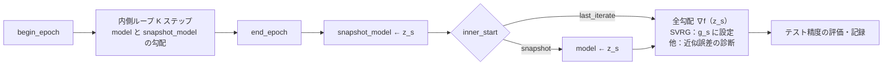

# programs_review：査読対応の追加実験

NOLTA投稿論文（Manuscript ID: 2027NPP0002，ASA-SVRG）の条件付き採録に対する追加実験のプログラムである．
実験の内容は親リポジトリの `実験計画.md` に定められている．本ディレクトリは独立したリポジトリとして
切り出すことを想定しており，本ディレクトリの外のファイルを import・参照しない（既存の結果との比較に
用いる `programs/compare_with_existing_logs.py` は，既存の結果のパスをコマンドライン引数で受け取る）．

現在実装している実験は次の7つである（E2は2つの実験からなる）．

- E0（内側ループの開始点の影響確認）．
- 付録B（バッチサイズ32・512）の再実施．
  - 著者の判断により，以降の実験は内側ループの開始点を論文のAlgorithm通りとする．
    すなわち `inner_start="snapshot"`（$ {\mathbf w}_{s}^{0} \leftarrow {\mathbf z}_{s} $）である（`.reports/report_044.md`）．
  - 付録Bは `snapshot` で再実施する．`last_iterate` とSGDの結果には既存のログを用いる．
- E1（Mushroomにおける $ \rho $ の異なる学習率での収束挙動とサンプリング方式の影響，`snapshot`，SGDを含む4手法と，ランダム点の SVRG・NFG-SVRG（`SVRG_random`，`NFG_SVRG_random`，実験計画 3.4節））．
- E2（CIFAR-10における，平均勾配を用いる手法のスナップショットと初期値のアブレーション）．E0の6条件に，NFG-final（`NFGSVRGFinalPoint`）とSVRG-average（`SVRGAverage`，`last_iterate`）を加える．
- E2（旧版の `実験指示E2.md`，別のPCで実施）：スナップショットの選択方法（最終点，ランダム点，平均点）と $ {\mathbf g}_{s} $ の推定方法（全勾配，平均勾配）の2×3の要因配置の6手法．全て `snapshot`（`ex007_e2_cifar10_snapshot_gradient_factorial`，`.reports/report_060.md`）．最終点の手法と SVRG-average（`snapshot`）は，上の E2 のアブレーションの集計（`analysis_e2.py`）にも用いる．
- E4（付録B.1，a9a の MSE・BCE の再実施．`snapshot`，SGD を含む4手法．CPUのみ．別のPCで実施，`.reports/report_070.md`）．
- E3（ImageWoofにおける実時間の比較．SGD，SVRG，NFG-SVRG，ASA-SVRG．SVRG・ASA-SVRG は `last_iterate`，NFG-SVRG は E2 の選択規則で最良であった `snapshot`（restart，`実験計画.md` 5.6節．当初の `last_iterate` の計測は確認用に残す）．全試行を逐次に実行し，4区間の時間を計測する）．

2026-11-19の実験計画の改訂により，内側ループの初期値は実験ごとに定める（`実験計画.md` 0.1節）．実験1（E1）と付録B.1（E4）は `snapshot`，実験3（E3）は SVRG・ASA-SVRG が `last_iterate`，NFG-SVRG が `snapshot`（2026-11-20改訂），付録B.2・B.3は `last_iterate`，実験2（E2）は両方を要因とする．付録Bの `snapshot` での再実施（`ex004`，`ex005`）は論文には用いない（`ex005` のバッチサイズ512は途中で中止した）．

## 1. ディレクトリ構成

```text
programs_review/
├── programs/
│   ├── common/                          # 全実験で共通のモジュール
│   │   ├── machine_learning_utils.py    # set_seed，ResultLogger（ai-dev-kit からのコピー）
│   │   ├── optimizers/                  # SGD，SVRG，NFG-SVRG，ASA-SVRG 等（既存の実装のコピー）と SVRGAverage（E2で追加）
│   │   ├── cached_loader.py             # 前処理済みテンソルからミニバッチを読み出すローダー
│   │   ├── vr_image_training.py         # 画像分類のSVRG系手法の学習ループ（inner_start，ω の記録，E2の手法を追加）
│   │   └── e0_runner.py                 # 画像分類のタスク構築と並列実行（E0，付録B）
│   ├── ex001_e0_mushroom_logistic/      # E0 (i) Mushroom（data.py，model.py，train.py）
│   ├── ex002_e0_cifar10_alexnet_layernorm/   # E0 (ii) CIFAR-10（data.py，model.py，train.py）
│   ├── ex003_e0_imagewoof_resnet18_layernorm/ # E0 (iii) ImageWoof（data.py，model.py，train.py）
│   ├── ex004_appb_cifar10_alexnet_layernorm/  # 付録B.2 CIFAR-10 バッチサイズ32・512（snapshot）
│   ├── ex005_appb_imagewoof_resnet18_layernorm/ # 付録B.3 ImageWoof バッチサイズ32・512（snapshot）
│   ├── ex006_e1_mushroom_rho_sampling/  # E1 Mushroom（data.py，model.py，train.py，README.md）
│   ├── ex007_e2_cifar10_ablation/       # E2 CIFAR-10 のアブレーションの新規条件（data.py，model.py，train.py）
│   ├── ex007_e2_cifar10_snapshot_gradient_factorial/  # E2（旧版，6手法の要因配置．data.py，model.py，svrg_average.py，e2_training.py，e2_runner.py，train.py，check_consistency.py，README.md）
│   ├── ex008_e4_a9a/                    # E4 a9a の MSE・BCE（data.py，model.py，train.py，compare_e4.py，README.md）
│   ├── ex009_e3_imagewoof_walltime/     # E3 ImageWoof の実時間の計測（data.py，model.py，timed_training.py，train.py）
│   ├── compare_with_existing_logs.py    # 既存の結果との一致の確認
│   ├── analysis_e0.py                   # E0の図と表の作成
│   ├── analysis_e0_with_sgd.py          # E0の結果とSGD（既存のログ）の比較
│   ├── analysis_appb.py                 # 付録Bの図と表（既存の last_iterate・SGD と比較）
│   ├── analysis_e1.py                   # E1の図と表
│   ├── analysis_e2.py                   # E2の図と表（E0の6条件，旧版のE2の最終点の条件と合わせて集計）
│   ├── analysis_e2_factorial.py         # 旧版のE2（要因配置）の図と表
│   ├── analysis_e4.py                   # E4の図と表（既存の a9a のログとの比較を含む）
│   └── analysis_e3.py                   # E3の時間の表と，実時間を横軸とした図
├── tests/test_e0_programs.py            # pytest（E0，付録B）
├── tests/test_e1_programs.py            # pytest（E1）
├── tests/test_e2_programs.py            # pytest（E2：SVRGAverage，ω，新しい手法）
├── tests/test_e2_factorial_programs.py  # pytest（旧版のE2）
├── tests/test_e4_programs.py            # pytest（E4．a9a のデータが無い場合は一部を skip）
├── tests/test_e3_programs.py            # pytest（E3：計測が学習の演算を変えないこと，区間の割り当て，--inner-start）
├── visualize_result_E3.ipynb            # E3の可視化（analysis_e3.py を呼ぶ）
├── visualize_result.ipynb               # 可視化（analysis_e0.py を呼ぶ）
├── visualize_result_E1.ipynb            # E1の可視化（analysis_e1.py を呼ぶ）
├── visualize_result_E2.ipynb            # E2の可視化（analysis_e2.py を呼ぶ）
├── visualize_result_E2_factorial.ipynb  # 旧版のE2の可視化（analysis_e2_factorial.py を呼ぶ）
├── visualize_result_E4.ipynb            # E4の可視化（analysis_e4.py を呼ぶ）
├── datasets/                            # データ（Git管理外．a9a は datasets/a9a/raw/a9a に自動でダウンロードする）
├── outputs/                             # 結果
│   ├── ex00{1,2,3}_e0_*/{手法}/{条件}/{seed}/{config.json,log.json,best_model.pth}
│   ├── ex00{4,5}_appb_*/{手法}/{条件}/{seed}/...   # 付録Bの再実施
│   ├── ex006_e1_mushroom_rho_sampling/{手法}/{条件}/{seed}/...  # E1（figures/，consistency_with_*.md を含む）
│   ├── ex00{1,2,3}_e0_*/figures/        # 図
│   ├── ex00{1,2,3}_e0_*/consistency_with_existing.md  # 既存の結果との一致の確認
│   ├── e0_summary.md                    # 集計表（E0）
│   ├── e0_with_sgd_summary.md           # 集計表（E0とSGDの比較）
│   ├── appb_summary.md                  # 集計表（付録B）
│   ├── e1_summary.md                    # 集計表（E1）
│   ├── ex007_e2_cifar10_ablation/{手法}/{条件}/{seed}/...  # E2（figures/，consistency_with_e0.md を含む）
│   ├── e2_summary.md                    # 集計表（E2）
│   ├── ex007_e2_cifar10_snapshot_gradient_factorial/{手法}/{条件}/{seed}/...  # 旧版のE2（figures/，consistency_*.md を含む）
│   ├── e2_factorial_summary.md          # 集計表（旧版のE2）
│   ├── ex008_e4_a9a/{mse,bce}/{手法}/{条件}/{seed}/...  # E4（figures/，consistency_with_existing.md を含む）
│   ├── e4_summary.md                    # 集計表（E4）
│   ├── ex009_e3_imagewoof_walltime/{手法}/{条件}/{seed}/...  # E3（figures/，consistency_with_e0.md を含む）
│   ├── e3_summary.md                    # 集計表（E3）
│   └── _run_logs/                       # 実行時の標準出力
├── requirements_pytorch_gpu.txt
└── document.md
```

条件のディレクトリ名は `inner_{inner_start}_...` の形式で，内側ループの開始点を含む．
E4では `{loss}/{手法}/inner_{inner_start}_eta{η}[_lambda{λ}]_K29304_epochs100` とし，`config.json` に `loss` を追加している．
旧版のE2の名前は E0 と同じ形式である．同じ実験番号 `ex007` を本PCのE2と旧版のE2が用いているが，ディレクトリ名で区別する．
E1では `inner_{inner_start}_{sampling}_rho{目標のρ}_eta{η}_lambda{λ}_K{K}_epochs{エポック数}` とし，内側ループの開始点を持たないSGDは `inner_none_...` とする．E1の `config.json` には，`rho`（$ \eta $ から計算し直した実際の縮小率の上界），`target_rho`（目標とした $ \rho $），`sampling`（`random_reshuffle` または `uniform_with_replacement`），`L`，`mu` を追加している．ランダム点の手法（`SVRG_random`，`NFG_SVRG_random`）の `config.json` には，さらに `snapshot_rule`（`"uniform_random"`）と `snapshot_rng_seed`（`[seed, 1]`．スナップショットの選択用の乱数生成器のシード）を加えている．

## 2. 依存関係

```mermaid
graph TD
    subgraph common
        U[machine_learning_utils.py]
        O[optimizers/]
        C[cached_loader.py]
        V[vr_image_training.py]
        R[e0_runner.py]
    end
    T1[ex001 train.py] --> O
    T1 --> U
    T1 --> D1[ex001 data.py]
    T1 --> M1[ex001 model.py]
    T2[ex002 train.py] --> R
    T3[ex003 train.py] --> R
    R --> V
    V --> O
    V --> U
    T2 --> D2[ex002 data.py] --> C
    T3 --> D3[ex003 data.py] --> C
    T2 --> M2[ex002 model.py]
    T3 --> M3[ex003 model.py]
    T4[ex004/ex005 train.py] --> R
    T7[ex007 train.py] --> R
    T9[ex009 train.py] --> TT[ex009 timed_training.py] --> V
    E3A[analysis_e3.py] --> OUT
    E2A[analysis_e2.py] --> OUT
    E2A --> A
    AB[analysis_appb.py] --> AS
    A[analysis_e0.py] --> OUT[(outputs/)]
    NB[visualize_result.ipynb] --> A
    CMP[compare_with_existing_logs.py] --> OUT
    AS[analysis_e0_with_sgd.py] --> A
    T6[ex006 train.py] --> O
    T6 --> U
    T6 --> D6[ex006 data.py]
    T6 --> M6[ex006 model.py]
    E1A[analysis_e1.py] --> OUT
    NB1[visualize_result_E1.ipynb] --> E1A
    NB3[visualize_result_E3.ipynb] --> E3A
    NB2[visualize_result_E2.ipynb] --> E2A
    T7F[ex007 factorial train.py] --> R7F[ex007 factorial e2_runner.py]
    R7F --> R
    R7F --> V7F[ex007 factorial e2_training.py]
    V7F --> V
    V7F --> SA7[ex007 factorial svrg_average.py]
    CC7[ex007 factorial check_consistency.py] --> CMP
    E2F[analysis_e2_factorial.py] --> A
    E2F --> AS
    NB2F[visualize_result_E2_factorial.ipynb] --> E2F
    T8[ex008 train.py] --> O
    T8 --> U
    T8 --> D8[ex008 data.py]
    T8 --> M8[ex008 model.py]
    CMP8[ex008 compare_e4.py] --> OUT
    E4A[analysis_e4.py] --> OUT
    NB4[visualize_result_E4.ipynb] --> E4A
```



### 学習ループ（SVRG系手法，1つの外側ループ）



## 3. 内側ループの開始点（`inner_start`）

| 値 | 内容 |
|---|---|
| `last_iterate` | 既存の実装と同じ．次の内側ループを前の内側ループの最終点 $ {\mathbf w}_{s-1}^{K} $ から開始する |
| `snapshot` | 論文のAlgorithmと同じ．外側ループの終了時に `model` のパラメータを $ {\mathbf z}_{s} $ で上書きする |

最終点をスナップショットとする手法（`SVRGFinalPoint`，`NFGSVRGFinalPoint`）では，2つの値は同じ結果になる．

## 4. データの前処理とキャッシュ

CIFAR-10とImageWoofの前処理は既存の実験と同一（決定論的）である．前処理後のテンソルを
`datasets/*/cache/` に1回だけ保存し，`CachedTensorLoader` で読み出す．`CachedTensorLoader` は
長さ $ N $ の添字に対する `DataLoader(shuffle=True, generator=...)` で添字を生成するため，
ミニバッチの順序と乱数生成器の消費は既存の実装と一致する（`tests/test_e0_programs.py`）．
ImageWoofのキャッシュ（float32，約7.8GB）は `numpy.memmap` で読み出す．

## 5. 環境構築

```bash
uv venv .venv_pytorch --python 3.12
VIRTUAL_ENV=.venv_pytorch uv pip install -r requirements_pytorch_gpu.txt --index-strategy unsafe-best-match
```

実行に用いた環境：Python 3.12.15，torch 2.11.0+cu128，torchvision 0.26.0+cu128，cuDNN 9.19，Pillow 13.0.0，
NVIDIA RTX PRO 6000 Blackwell Max-Q（96GB）．親リポジトリでは `.venv_pytorch` を親リポジトリのルートに置いている．

## 6. 実行方法

```bash
cd programs
# E0 (i) Mushroom（既定はASA-SVRGのみ．最終点の手法の確認のため3手法とも実行した）
python ex001_e0_mushroom_logistic/train.py --methods SVRG NFG_SVRG ASAI_SVRG --workers 30
# E0 (ii) CIFAR-10，(iii) ImageWoof（3手法 × 2条件 × 5シード）
python ex002_e0_cifar10_alexnet_layernorm/train.py --workers 8
python ex003_e0_imagewoof_resnet18_layernorm/train.py --workers 8
# 既存の結果との一致の確認（短い実行の例）
python ex002_e0_cifar10_alexnet_layernorm/train.py --inner-starts last_iterate --seeds 0 --epochs 3 \
    --output-root ../outputs/_verify/ex002
python compare_with_existing_logs.py --new-root ../outputs/_verify/ex002 \
    --existing-root <既存の outputs>/ex0024_cifar10_alexnet_layernorm_longrun \
    --hp-map inner_last_iterate_lr0.001_bs128_lambda0.0005_epochs3=lr0.001_bs128_normlayernorm_lambda0.0005_epochs48
# 付録B（バッチサイズ32・512，snapshot）．ImageWoofのバッチサイズ512は1プロセスで約22GBのGPUメモリを使う
python ex004_appb_cifar10_alexnet_layernorm/train.py --workers 6
python ex005_appb_imagewoof_resnet18_layernorm/train.py --batch-sizes 32 --workers 8
python ex005_appb_imagewoof_resnet18_layernorm/train.py --batch-sizes 512 --workers 3
python analysis_appb.py --existing ex004_appb_cifar10_alexnet_layernorm=<既存の outputs>/ex0024_cifar10_alexnet_layernorm_longrun \
    ex005_appb_imagewoof_resnet18_layernorm=<既存の outputs>/ex0051_imagewoof_resnet18_bs128_longrun
# E1（Mushroom，CPUのみ．最終点・ASA-SVRG・SGD の200試行と，ランダム点の SVRG・NFG-SVRG の100試行）
python ex006_e1_mushroom_rho_sampling/train.py --methods SGD SVRG NFG_SVRG ASAI_SVRG --workers 20
python ex006_e1_mushroom_rho_sampling/train.py --methods SVRG_random NFG_SVRG_random --workers 32
python analysis_e1.py   # --this-pc-root ../outputs/_verify/ex006_final_this_pc で PC 間の差も集計する
# E2（CIFAR-10．既定は NFG_SVRG_final と SVRG_average の last_iterate，各5シード）
python ex007_e2_cifar10_ablation/train.py --workers 10
# 任意の条件の例：python ex007_e2_cifar10_ablation/train.py --methods SVRG_average --inner-starts snapshot
python analysis_e2.py
# 旧版のE2（6手法 × 5シード，snapshot．別のPCで実施）
python ex007_e2_cifar10_snapshot_gradient_factorial/train.py --workers 6
python analysis_e2_factorial.py
# E4（a9a，CPUのみ．2損失 × 4手法 × 5シード = 40試行）
python ex008_e4_a9a/train.py --loss mse bce --workers 20
python analysis_e4.py --existing mse=<既存の outputs>/ex000_a9a_least_squares bce=<既存の outputs>/ex0001_a9a_logistic
# E3（逐次に実行．各試行の前に GPU のメモリ使用量が --idle-mib 以下になるまで待つ．他の学習と同時に実行しない）
python ex009_e3_imagewoof_walltime/train.py            # 5シード × 4手法（完了済みの試行は飛ばす．既定は --inner-start last_iterate）
python ex009_e3_imagewoof_walltime/train.py --methods NFG_SVRG --inner-start snapshot   # NFG-SVRG の restart（5.6節）
python analysis_e3.py   # 論文用の条件は analysis_e3.PAPER_CONDITIONS（NFG-SVRG は inner_snapshot_...）
# 集計と図
python analysis_e0.py
# SGD（既存のログ．パスは引数で渡す）との比較
python analysis_e0_with_sgd.py --sgd ex002_e0_cifar10_alexnet_layernorm=<既存の outputs>/ex0024_.../SGD/lr0.001_bs128_normlayernorm_lambda0.0005_epochs96 ...
# テスト
cd .. && python -m pytest -q tests
```

完了済みの条件（`log.json` と `config.json` があり，全エポックの記録があるか打ち切りで終了したもの）は
自動的にスキップされる．

## 7. ログの項目（`log.json`）

既存の項目（`epoch`，`oracle_calls`，`elapsed_time`，`train_loss`／`objective_gap`，`test_accuracy`／`accuracy`，
`approx_error`，Mushroomでは `full_grad_computations`，`grad_norm_sq`）は名前と計算方法を変えていない．
追加した項目は `test_correct`（テストデータの正解数），`omega_snapshot`・`omega_average`（画像分類のみ．$ \omega({\mathbf z}_{s}) = \sum_{k}\|{\mathbf w}_{s-1}^{k} - {\mathbf z}_{s}\|^{2} $ とその最小値．`run_config["record_omega"]=False` で無効にでき，実時間の計測ではそうする），`full_grad_norm_sq`（$ \|\nabla f({\mathbf z}_{s})\|^{2} $），
`approx_cos`（$ {\mathbf g}_{s} $ と $ \nabla f({\mathbf z}_{s}) $ のコサイン類似度），`terminated`（学習損失が
非有限となり打ち切った外側ループで `true`）である．a9a の MSE（E4）では，目的関数の項目は `objective_value`（$ f({\mathbf z}_{s}) $ の値）である．評価点はスナップショット $ {\mathbf z}_{s} $ である．
`elapsed_time` は複数の試行を並列に実行した状態での計測であり，実時間の比較には用いない．E3の `log.json` は `time_optimizer`，`time_svrg_full_grad`，`time_diagnostic`，`time_evaluation`（累積［s］）を持ち，`elapsed_time` には実時間 $ t = \mathrm{time\_optimizer} + \mathrm{time\_svrg\_full\_grad} $ を記録する．

## 8. Git管理上の注意

`datasets/`，`outputs/_verify/`，`*.pth` はGit管理外とする（`.gitignore`）．
