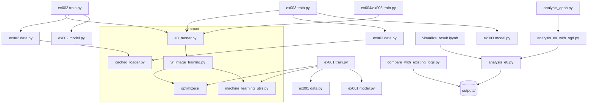
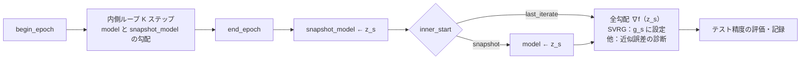

# programs_review：査読対応の追加実験

NOLTA投稿論文（Manuscript ID: 2027NPP0002，ASA-SVRG）の条件付き採録に対する追加実験のプログラムである．
実験の内容は親リポジトリの `実験計画.md` に定められている．本ディレクトリは独立したリポジトリとして
切り出すことを想定しており，本ディレクトリの外のファイルを import・参照しない（既存の結果との比較に
用いる `programs/compare_with_existing_logs.py` は，既存の結果のパスをコマンドライン引数で受け取る）．

現在実装している実験は次の2つである．

- E0（内側ループの開始点の影響確認）．
- 付録B（バッチサイズ32・512）の再実施．
  - 著者の判断により，以降の実験は内側ループの開始点を論文のAlgorithm通りとする．
    すなわち `inner_start="snapshot"`（$ {\mathbf w}_{s}^{0} \leftarrow {\mathbf z}_{s} $）である（`.reports/report_044.md`）．
  - 付録Bは `snapshot` で再実施する．`last_iterate` とSGDの結果には既存のログを用いる．

## 1. ディレクトリ構成

```text
programs_review/
├── programs/
│   ├── common/                          # 全実験で共通のモジュール
│   │   ├── machine_learning_utils.py    # set_seed，ResultLogger（ai-dev-kit からのコピー）
│   │   ├── optimizers/                  # SGD，SVRG，NFG-SVRG，ASA-SVRG 等（既存の実装のコピー，変更なし）
│   │   ├── cached_loader.py             # 前処理済みテンソルからミニバッチを読み出すローダー
│   │   ├── vr_image_training.py         # 画像分類のSVRG系手法の学習ループ（inner_start を追加）
│   │   └── e0_runner.py                 # 画像分類のタスク構築と並列実行（E0，付録B）
│   ├── ex001_e0_mushroom_logistic/      # E0 (i) Mushroom（data.py，model.py，train.py）
│   ├── ex002_e0_cifar10_alexnet_layernorm/   # E0 (ii) CIFAR-10（data.py，model.py，train.py）
│   ├── ex003_e0_imagewoof_resnet18_layernorm/ # E0 (iii) ImageWoof（data.py，model.py，train.py）
│   ├── ex004_appb_cifar10_alexnet_layernorm/  # 付録B.2 CIFAR-10 バッチサイズ32・512（snapshot）
│   ├── ex005_appb_imagewoof_resnet18_layernorm/ # 付録B.3 ImageWoof バッチサイズ32・512（snapshot）
│   ├── compare_with_existing_logs.py    # 既存の結果との一致の確認
│   ├── analysis_e0.py                   # E0の図と表の作成
│   ├── analysis_e0_with_sgd.py          # E0の結果とSGD（既存のログ）の比較
│   └── analysis_appb.py                 # 付録Bの図と表（既存の last_iterate・SGD と比較）
├── tests/test_e0_programs.py            # pytest
├── visualize_result.ipynb               # 可視化（analysis_e0.py を呼ぶ）
├── datasets/                            # データ（Git管理外）
├── outputs/                             # 結果
│   ├── ex00{1,2,3}_e0_*/{手法}/{条件}/{seed}/{config.json,log.json,best_model.pth}
│   ├── ex00{4,5}_appb_*/{手法}/{条件}/{seed}/...   # 付録Bの再実施
│   ├── ex00{1,2,3}_e0_*/figures/        # 図
│   ├── ex00{1,2,3}_e0_*/consistency_with_existing.md  # 既存の結果との一致の確認
│   ├── e0_summary.md                    # 集計表（E0）
│   ├── e0_with_sgd_summary.md           # 集計表（E0とSGDの比較）
│   ├── appb_summary.md                  # 集計表（付録B）
│   └── _run_logs/                       # 実行時の標準出力
├── requirements_pytorch_gpu.txt
└── document.md
```

条件のディレクトリ名は `inner_{inner_start}_...` の形式で，内側ループの開始点を含む．

## 2. 依存関係



### 学習ループ（SVRG系手法，1つの外側ループ）



## 3. 内側ループの開始点（`inner_start`）

| 値 | 内容 |
|---|---|
| `last_iterate` | 既存の実装と同じ．次の内側ループを前の内側ループの最終点 $ {\mathbf w}_{s-1}^{K} $ から開始する |
| `snapshot` | 論文のAlgorithmと同じ．外側ループの終了時に `model` のパラメータを $ {\mathbf z}_{s} $ で上書きする |

最終点をスナップショットとする手法（`SVRGFinalPoint`，`NFGSVRGFinalPoint`）では，2つの値は同じ結果になる．

## 4. データの前処理とキャッシュ

CIFAR-10とImageWoofの前処理は既存の実験と同一（決定論的）である．前処理後のテンソルを
`datasets/*/cache/` に1回だけ保存し，`CachedTensorLoader` で読み出す．`CachedTensorLoader` は
長さ $ N $ の添字に対する `DataLoader(shuffle=True, generator=...)` で添字を生成するため，
ミニバッチの順序と乱数生成器の消費は既存の実装と一致する（`tests/test_e0_programs.py`）．
ImageWoofのキャッシュ（float32，約7.8GB）は `numpy.memmap` で読み出す．

## 5. 環境構築

```bash
uv venv .venv_pytorch --python 3.12
VIRTUAL_ENV=.venv_pytorch uv pip install -r requirements_pytorch_gpu.txt --index-strategy unsafe-best-match
```

実行に用いた環境：Python 3.12.15，torch 2.11.0+cu128，torchvision 0.26.0+cu128，cuDNN 9.19，Pillow 13.0.0，
NVIDIA RTX PRO 6000 Blackwell Max-Q（96GB）．親リポジトリでは `.venv_pytorch` を親リポジトリのルートに置いている．

## 6. 実行方法

```bash
cd programs
# E0 (i) Mushroom（既定はASA-SVRGのみ．最終点の手法の確認のため3手法とも実行した）
python ex001_e0_mushroom_logistic/train.py --methods SVRG NFG_SVRG ASAI_SVRG --workers 30
# E0 (ii) CIFAR-10，(iii) ImageWoof（3手法 × 2条件 × 5シード）
python ex002_e0_cifar10_alexnet_layernorm/train.py --workers 8
python ex003_e0_imagewoof_resnet18_layernorm/train.py --workers 8
# 既存の結果との一致の確認（短い実行の例）
python ex002_e0_cifar10_alexnet_layernorm/train.py --inner-starts last_iterate --seeds 0 --epochs 3 \
    --output-root ../outputs/_verify/ex002
python compare_with_existing_logs.py --new-root ../outputs/_verify/ex002 \
    --existing-root <既存の outputs>/ex0024_cifar10_alexnet_layernorm_longrun \
    --hp-map inner_last_iterate_lr0.001_bs128_lambda0.0005_epochs3=lr0.001_bs128_normlayernorm_lambda0.0005_epochs48
# 付録B（バッチサイズ32・512，snapshot）．ImageWoofのバッチサイズ512は1プロセスで約22GBのGPUメモリを使う
python ex004_appb_cifar10_alexnet_layernorm/train.py --workers 6
python ex005_appb_imagewoof_resnet18_layernorm/train.py --batch-sizes 32 --workers 8
python ex005_appb_imagewoof_resnet18_layernorm/train.py --batch-sizes 512 --workers 3
python analysis_appb.py --existing ex004_appb_cifar10_alexnet_layernorm=<既存の outputs>/ex0024_cifar10_alexnet_layernorm_longrun \
    ex005_appb_imagewoof_resnet18_layernorm=<既存の outputs>/ex0051_imagewoof_resnet18_bs128_longrun
# 集計と図
python analysis_e0.py
# SGD（既存のログ．パスは引数で渡す）との比較
python analysis_e0_with_sgd.py --sgd ex002_e0_cifar10_alexnet_layernorm=<既存の outputs>/ex0024_.../SGD/lr0.001_bs128_normlayernorm_lambda0.0005_epochs96 ...
# テスト
cd .. && python -m pytest -q tests
```

完了済みの条件（`log.json` と `config.json` があり，全エポックの記録があるか打ち切りで終了したもの）は
自動的にスキップされる．

## 7. ログの項目（`log.json`）

既存の項目（`epoch`，`oracle_calls`，`elapsed_time`，`train_loss`／`objective_gap`，`test_accuracy`／`accuracy`，
`approx_error`，Mushroomでは `full_grad_computations`，`grad_norm_sq`）は名前と計算方法を変えていない．
追加した項目は `test_correct`（テストデータの正解数），`full_grad_norm_sq`（$ \|\nabla f({\mathbf z}_{s})\|^{2} $），
`approx_cos`（$ {\mathbf g}_{s} $ と $ \nabla f({\mathbf z}_{s}) $ のコサイン類似度），`terminated`（学習損失が
非有限となり打ち切った外側ループで `true`）である．評価点はスナップショット $ {\mathbf z}_{s} $ である．
`elapsed_time` は複数の試行を並列に実行した状態での計測であり，実時間の比較には用いない（E3で別途計測する）．

## 8. Git管理上の注意

`datasets/`，`outputs/_verify/`，`*.pth` はGit管理外とする（`.gitignore`）．
